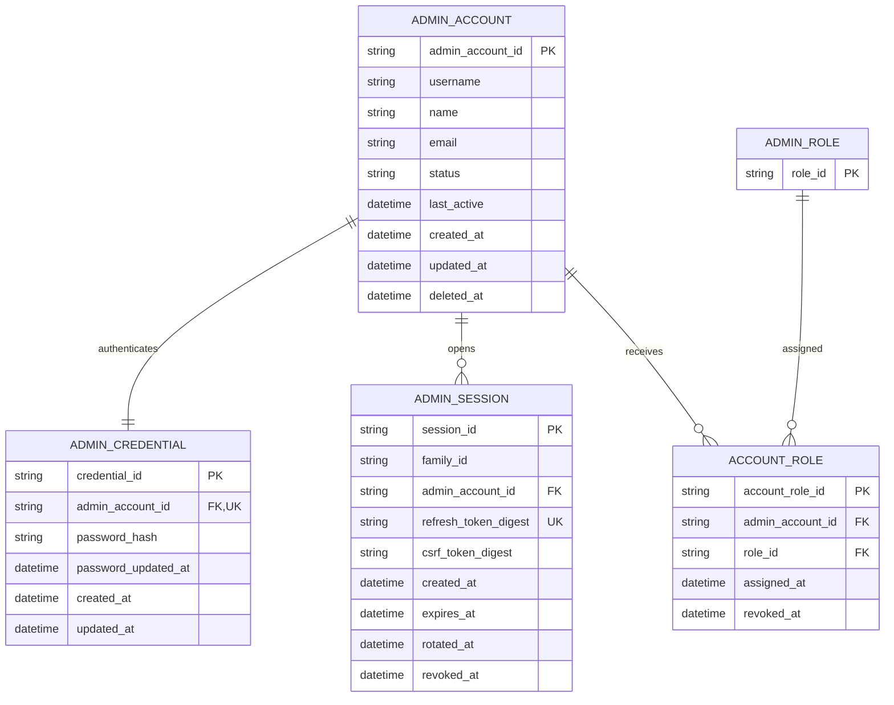

# Administrator Account ERD

> **Document Type:** ERD  
> **Status:** Baseline Sprint 1  
> **Scope:** Administrator identity, login credential, and refresh session data for Sprint 1. Account list/detail remains read-only; credential provisioning is controlled and no email-provider flow is in scope.

## ERD

## Tables

### `admin_account`

| Column             | Type                     | Null | Key / constraint              | Meaning                                                                                                                                                     |
| ------------------ | ------------------------ | ---- | ----------------------------- | ----------------------------------------------------------------------------------------------------------------------------------------------------------- |
| `admin_account_id` | String, max 64           | No   | PK                            | Immutable administrator identifier with the admin_ entity prefix.                                                                                           |
| `username`         | String, max 30           | No   | —                             | Administrator username returned by list/detail APIs.                                                                                                        |
| `name`             | String, max 150          | No   | —                             | Display name returned by list/detail APIs.                                                                                                                  |
| `email`            | String, max 254          | No   | —                             | Administrator email; no email sending is in scope.                                                                                                          |
| `status`           | Enum/string, max 20      | No   | `ACTIVE` or `INACTIVE`        | Account status used by list filters and authentication policy.                                                                                              |
| `last_active`      | Timestamp with time zone | Yes  | —                             | Activity timestamp. Updated at successful admin login; API returns `null` until the first successful login.                                                 |
| `created_at`       | Timestamp with time zone | No   | Default current UTC timestamp | Account creation time. Not currently returned by account list/detail contracts.                                                                             |
| `updated_at`       | Timestamp with time zone | No   | Default current UTC timestamp | Last account data update; exposed as `updatedAt` in list/detail responses.                                                                                  |
| `deleted_at`       | Timestamp with time zone | Yes  | Null means not soft-deleted   | Soft-delete marker. Soft-deleted accounts are excluded from login and list/detail APIs; retain 2 months then purge with associated credential/session data. |

### `account_role`

| Column             | Type                     | Null | Key / constraint                      | Meaning                                                                           |
| ------------------ | ------------------------ | ---- | ------------------------------------- | --------------------------------------------------------------------------------- |
| `account_role_id`  | String, max 64           | No   | PK; internal prefix `account_role_`   | Immutable role-assignment identifier; not returned by API.                        |
| `admin_account_id` | String, max 64           | No   | FK → `admin_account.admin_account_id` | Administrator receiving the role.                                                 |
| `role_id`          | String, max 64           | No   | FK → `admin_role.role_id`             | Assigned role. The account APIs expose its `id`, `name`, `code`, and system flag. |
| `assigned_at`      | Timestamp with time zone | No   | Default current UTC timestamp         | Assignment time.                                                                  |
| `revoked_at`       | Timestamp with time zone | Yes  | Null means assignment active          | Revocation time; retained to preserve assignment history.                         |

Only one row per administrator may have `revoked_at IS NULL`. Enforce this with a partial unique index or equivalent transaction-level constraint. Assignment history allows a role to be revoked and later reassigned without overwriting the prior row.

### `admin_credential`

| Column                | Type                     | Null | Key / constraint                                    | Meaning                                            |
| --------------------- | ------------------------ | ---- | --------------------------------------------------- | -------------------------------------------------- |
| `credential_id`       | String, max 64           | No   | PK                                                  | Credential identifier with `credential_` prefix.   |
| `admin_account_id`    | String, max 64           | No   | FK → `admin_account.admin_account_id`; unique       | One credential record per administrator.           |
| `password_hash`       | String, max 512          | No   | Encoded Argon2id hash                               | Password hash only; never exposed by account APIs. |
| `password_updated_at` | Timestamp with time zone | No   | Set during controlled credential provisioning/reset | Most recent operator-managed password hash update. |
| `created_at`          | Timestamp with time zone | No   | Default current UTC timestamp                       | Credential record creation time.                   |
| `updated_at`          | Timestamp with time zone | No   | Default current UTC timestamp                       | Most recent credential record update.              |

### `admin_session`

One document represents one refresh-token generation. Rotated generations remain until their own expiry to detect replay; all generations share a session family.

| Column                 | Type                     | Null | Key / constraint                      | Meaning                                                                |
| ---------------------- | ------------------------ | ---- | ------------------------------------- | ---------------------------------------------------------------------- |
| `session_id`           | String, max 64           | No   | PK                                    | Session generation ID with `session_` prefix.                          |
| `family_id`            | String, max 64           | No   | Indexed                               | Groups generations from one login for family-wide revocation.          |
| `admin_account_id`     | String, max 64           | No   | FK → `admin_account.admin_account_id` | Owner of the session.                                                  |
| `refresh_token_digest` | String, max 64           | No   | Unique                                | SHA-256 digest of the opaque refresh token; raw token is never stored. |
| `csrf_token_digest`    | String, max 64           | No   | —                                     | Digest of the current generation CSRF token.                           |
| `created_at`           | Timestamp with time zone | No   | Default current UTC timestamp         | Generation creation time.                                              |
| `expires_at`           | Timestamp with time zone | No   | TTL index                             | Expiration time, seven days after issuance/rotation.                   |
| `rotated_at`           | Timestamp with time zone | Yes  | Null means current generation         | Time the generation was consumed by refresh.                           |
| `revoked_at`           | Timestamp with time zone | Yes  | Null means not revoked                | Family or account revocation time.                                     |
| `revocation_reason`    | String, max 40           | Yes  | —                                     | Controlled reason such as LOGOUT, REPLAY, ACCOUNT_INACTIVE.            |

## Indexes

| Index                             | Columns                                                          | Type                                           | Purpose                                                                                              |
| --------------------------------- | ---------------------------------------------------------------- | ---------------------------------------------- | ---------------------------------------------------------------------------------------------------- |
| `uq_admin_account_username_ci`    | `username` with unique collation `{ locale: "en", strength: 2 }` | Unique                                         | Prevent case-only duplicate usernames; login query must use same collation.                          |
| `uq_admin_account_email_ci`       | `email` with unique collation `{ locale: "en", strength: 2 }`    | Unique                                         | Prevent case-only duplicate emails; login query must use same collation.                             |
| `ix_admin_account_list`           | `status`, `username`, `admin_account_id`                         | Non-unique; partial where `deleted_at IS NULL` | Support account list filters and deterministic ordering.                                             |
| `uq_admin_credential_account`     | `admin_account_id`                                               | Unique                                         | Enforce one credential document per administrator.                                                   |
| `uq_admin_session_refresh_digest` | `refresh_token_digest`                                           | Unique                                         | Resolve refresh token by digest and prevent duplicate token storage.                                 |
| `ix_admin_session_family_active`  | `family_id`, `revoked_at`, `rotated_at`                          | Non-unique                                     | Revoke/check all generations in a session family and detect replay.                                  |
| `ix_admin_session_account_active` | `admin_account_id`, `revoked_at`, `expires_at`                   | Non-unique                                     | Find active sessions for account status changes.                                                     |
| `ttl_admin_session_expiry`        | `expires_at`                                                     | TTL                                            | Remove expired generations after expiry; retain rotated generations until then for replay detection. |
| `uq_account_role_admin_active`    | `admin_account_id`                                               | Unique, partial where `revoked_at IS NULL`     | Enforce at most one active role per account.                                                         |
| `ix_account_role_role_active`     | `role_id`, `admin_account_id`                                    | Non-unique, partial where `revoked_at IS NULL` | Find active accounts assigned to a role before role changes/deletion.                                |

## Data Rules

1. Administrator account list/detail APIs remain read-only. Credential provisioning occurs through a controlled backend/database/script process, not dashboard CRUD.
2. Bootstrap creates the initial Super Admin account, its password hash credential, and the seeded `SUPER_ADMIN` role assignment.
3. Each administrator has exactly one active role assignment when provisioned; no administrator may have more than one active role.
4. Account list/detail responses return `username`, `name`, `email`, `status`, one nested `role` object, `lastActive`, and `updatedAt`. Credential/session data and password hashes are never exposed.
5. Login is allowed only for ACTIVE, non-deleted accounts with a valid Argon2id hash and one active role.
6. Account status and session family are checked on each authentication check. An INACTIVE or soft-deleted account has its active session families revoked and cannot use either access or refresh cookies.
7. Provisioning menyimpan `username` dan `email` tanpa whitespace tepi; huruf asli tetap dipertahankan. Semua proses tulis wajib memangkas whitespace tepi dan menolak username yang mengandung `@`. Login memangkas whitespace tepi dari `identifier`; nilai yang mengandung `@` dicari pada `email`, selain itu pada `username`, menggunakan collation yang sama dengan unique index `{ locale: "en", strength: 2 }`. Unique collation index mencegah duplikasi yang hanya berbeda kapitalisasi tanpa menambah field lookup.
8. Raw passwords and raw refresh tokens are never stored. ADMIN_CREDENTIAL stores only the encoded Argon2id password hash; ADMIN_SESSION stores only refresh-token and CSRF-token digests.
9. Refresh creates a new ADMIN_SESSION generation in the same family and marks the previous generation rotated atomically. Reuse of a rotated refresh token revokes the whole family.
10. Refresh tokens expire seven days after issuance/rotation. Expired generation documents are removed by TTL only after their own expiry, preserving replay detection while a token remains valid.
11. Logout revokes one session family. Session cookie lifetimes are independent of the administrator account read-only APIs.
12. Credential records are purged with the account after two months. Session families are revoked on offboarding; each session generation is removed by TTL after its own expiry to preserve replay detection during token validity.
13. Sprint 1 does not write audit events. Secret values, hashes, raw cookies, and CSRF tokens are never written to application logs.

## Decisions

- Domain IDs use `admin_`, `role_`, and `permission_`; internal credential and session generation IDs use `credential_` and `session_` and are never returned by API.
- Login identifier comparison is trim + case-insensitive. Stored username/email values have no leading or trailing whitespace; MongoDB unique collation indexes on the original fields enforce case-insensitive uniqueness.
- Rate limit login: 5 failed attempts per trimmed lowercase identifier in a rolling 15-minute window; login and refresh: 20 requests per IP in a rolling 15-minute window. `Retry-After` reports seconds until capacity is available.
- Rahasia bootstrap disediakan melalui kanal aman dan tidak dicatat pada log.
- Full audit-event storage and retention are outside this ERD; account reads must not be treated as account mutation capability.

## References

- [Role ERD](role-erd.md)
- [List administrator accounts IFA](../solutioning/dashboard/admin-accounts/get-list-admin-accounts.md)
- [Admin Login IFA](../solutioning/dashboard/auth/login.md)
- [Admin Refresh Token IFA](../solutioning/dashboard/auth/refresh-token.md)
- [Admin Logout IFA](../solutioning/dashboard/auth/logout.md)
- [Administrator account detail IFA](../solutioning/dashboard/admin-accounts/get-admin-account-detail.md)

## SLA Baseline

Operasi login, refresh, dan logout memakai SLA tulis dashboard: availability bulanan 99,9%; NFT 50 VUser / 20 request per detik; p95 ≤ 1 detik dan p99 ≤ 2 detik. List/detail admin memakai latency baca p95 ≤ 500 ms dan p99 ≤ 2 detik. Target kapasitas awal per instance 2 vCPU / 4 GiB, CPU ≤ 70%, dan memori ≤ 75% saat beban target. Angka kapasitas/beban adalah asumsi yang wajib divalidasi melalui NFT.
