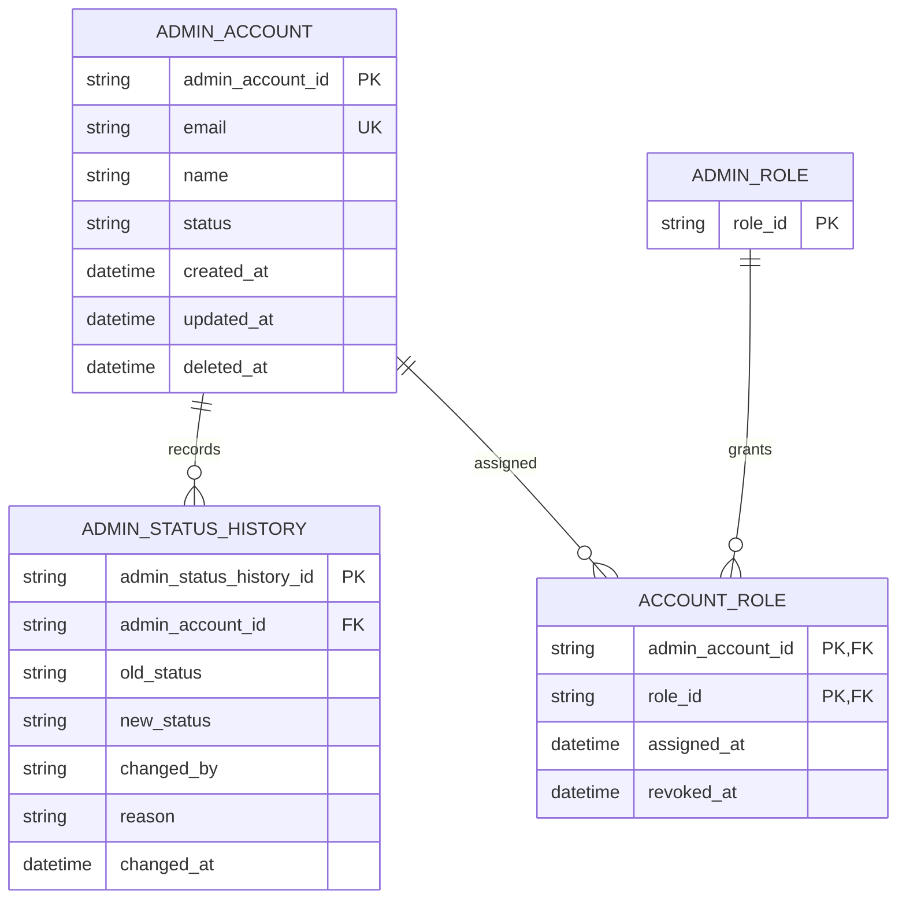

# Administrator Account ERD

> **Document Type:** ERD  
> **Status:** Draft  
> **Scope:** Administrator identity data required for Sprint 1 dashboard read-only list/detail. Super Admin bootstrap is an operational backend/database/script process; no email provider or dashboard account CRUD is in scope.

## ERD

## Tables

### `admin_account`

| Column             | Type                     | Null | Key / constraint                    | Meaning                                                                            |
| ------------------ | ------------------------ | ---- | ----------------------------------- | ---------------------------------------------------------------------------------- |
| `admin_account_id` | String, max 64           | No   | PK                                  | Immutable administrator identifier; generation strategy TBD.                       |
| `email`            | String, max 254          | No   | Unique after approved normalization | Administrator identity/contact attribute; not used for invitations in this sprint. |
| `name`             | String, max 150          | No   | —                                   | Display name.                                                                      |
| `status`           | Enum/string, max 20      | No   | `ACTIVE` / `INACTIVE` proposed      | Determines dashboard authentication eligibility.                                   |
| `created_at`       | Timestamp with time zone | No   | Default current UTC timestamp       | Creation time.                                                                     |
| `updated_at`       | Timestamp with time zone | No   | Default current UTC timestamp       | Last update time.                                                                  |
| `deleted_at`       | Timestamp with time zone | Yes  | Null means not soft-deleted         | Proposed soft-delete marker; disable-versus-delete policy TBD.                     |

### `admin_status_history`

| Column                    | Type                     | Null | Key / constraint                      | Meaning                                      |
| ------------------------- | ------------------------ | ---- | ------------------------------------- | -------------------------------------------- |
| `admin_status_history_id` | String, max 64           | No   | PK                                    | Immutable history event identifier.          |
| `admin_account_id`        | String, max 64           | No   | FK → `admin_account.admin_account_id` | Account whose status changed.                |
| `old_status`              | String, max 20           | Yes  | —                                     | Previous status; null for initial event.     |
| `new_status`              | String, max 20           | No   | —                                     | Resulting status.                            |
| `changed_by`              | String, max 64           | Yes  | Administrator actor reference         | Actor initiating the change.                 |
| `reason`                  | String, max 500          | Yes  | —                                     | Optional reason; secrets must not be stored. |
| `changed_at`              | Timestamp with time zone | No   | Default current UTC timestamp         | Event time.                                  |

Role and account-role definitions are owned by the [Role ERD](role-erd.md). Reconcile the shared `ADMIN_ACCOUNT` reference and role cardinality before implementation. This history table does not replace the platform-wide audit log.

## Data rules and open decisions

- Credentials, password hashes, invitation tokens, and provider secrets are not stored here.
- Bootstrap creates the initial Super Admin through a restricted backend/database/script procedure; dashboard API exposes read-only list/detail only.
- Bootstrap credentials/secrets must be injected securely and must never be committed to source or written to logs. Record actor/source/time in operational audit where supported.
- Email may remain an identity attribute, but no email sending, invitations, or provider integration is assumed.
- Disabling an administrator must prevent new dashboard sessions; existing-session revocation policy remains TBD.
- Decide whether status history belongs here, in the shared audit store, or both; keep status mutation and history atomic if both are written locally.

## References

- [Role ERD](role-erd.md)
- [Admin account IFAs](../solutioning/dashboard/admin-accounts/)

## SLA Baseline

Operasi baca daftar dan detail akun mengikuti SLA dashboard: availability bulanan 99,9%; NFT 50 VUser / 20 request per detik; latency baca p95 ≤ 500 ms dan p99 ≤ 2 detik. Target kapasitas awal per instance 2 vCPU / 4 GiB, CPU ≤ 70%, dan memori ≤ 75% saat beban target. Angka kapasitas/beban adalah asumsi yang wajib divalidasi melalui NFT.
