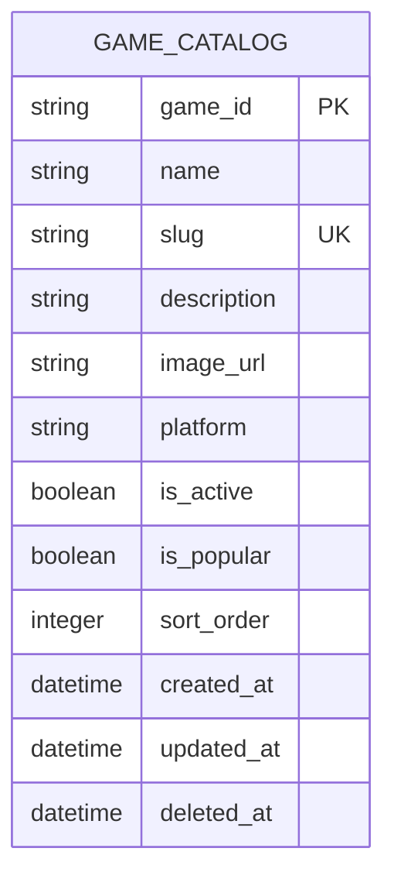

# Game ERD

> **Document Type:** ERD  
> **Status:** Draft  
> **Scope:** MongoDB game catalog documents used by Admin Dashboard game create/list/update and public game list/popular-games APIs.

## ERD

Sprint 1 does not record audit events per BRD; `created_at` and `updated_at` provide record timestamps.

## Table: `game_catalog`

| Column        | Data Type                | Null | Key / Constraint                            | Description                                                                                  |
| ------------- | ------------------------ | ---- | ------------------------------------------- | -------------------------------------------------------------------------------------------- |
| `game_id`     | String, max 64           | No   | PK                                          | Immutable ID: `game_` plus a 26-character canonical ULID in uppercase Crockford Base32.      |
| `name`        | String, max 100          | No   | Unique, case-insensitive after trim         | Display name used by Admin Dashboard and storefront.                                         |
| `slug`        | String, max 100          | No   | Unique                                      | Lowercase URL-safe identifier. Format: `^[a-z0-9]+(?:-[a-z0-9]+)*$`.                         |
| `description` | String, max 500          | Yes  | —                                           | Optional game description shown in dashboard and storefront.                                 |
| `image_url`   | String, max 2048         | No   | Required                                    | Absolute HTTPS URL for the game image. BRD permits any HTTPS host.                           |
| `platform`    | String, max 30           | Yes  | Optional enum: `MOBILE`, `PC`, or `CONSOLE` | Platform classification used by public game discovery/filtering.                             |
| `is_active`   | Boolean                  | No   | Default `false` (proposed)                  | Whether game is available in storefront.                                                     |
| `is_popular`  | Boolean                  | No   | Default `false` (proposed)                  | Whether game may appear in popular-games list. Must be false when `is_active=false`.         |
| `sort_order`  | Integer                  | No   | Unique; check `>= 0`                        | Service-managed unique display order; service allocates next available integer when omitted. |
| `created_at`  | Timestamp with time zone | No   | Default current UTC timestamp               | Record creation time. Immutable after insert.                                                |
| `updated_at`  | Timestamp with time zone | No   | Default current UTC timestamp               | Time of most recent record update.                                                           |
| `deleted_at`  | Timestamp with time zone | Yes  | Null means available                        | Soft-delete marker; no restore; permanently purge after 2 months.                            |

## Indexes

| Index                        | Columns                                                    | Type                                                 | Purpose                                                              |
| ---------------------------- | ---------------------------------------------------------- | ---------------------------------------------------- | -------------------------------------------------------------------- |
| `uq_game_catalog_slug`       | `slug`                                                     | Unique                                               | Enforce unique game route.                                           |
| `uq_game_catalog_sort_order` | `sort_order`                                               | Unique                                               | Keep game display order unique across all games.                     |
| `uq_game_catalog_name_ci`    | `name`, collation `{ locale: "en", strength: 2 }`          | Unique                                               | Prevent case-only duplicate names; application trims before storage. |
| `ix_game_catalog_admin_list` | `is_active`, `is_popular`, `sort_order`, `name`, `game_id` | Non-unique                                           | Support admin list filters and deterministic ordering.               |
| `ix_game_catalog_platform`   | `platform`, `is_active`, `sort_order`                      | Non-unique; partial where supported (proposed)       | Support public platform-filtered game discovery.                     |
| `ix_game_catalog_popular`    | `is_active`, `is_popular`, `sort_order`                    | Non-unique; partial index where supported (proposed) | Support active popular-games lookup.                                 |

## Relationships

| Parent                | Child                 | Cardinality | Rule                                                                                                            |
| --------------------- | --------------------- | ----------- | --------------------------------------------------------------------------------------------------------------- |
| None in current scope | None in current scope | —           | Game services, orders, and admin users are outside this ERD. Add foreign keys when their data model is defined. |

## Data Rules

1. `game_id` is generated by the service as `game_` plus a canonical 26-character uppercase Crockford Base32 ULID; it never changes.
2. `name` is trimmed before storage; a MongoDB unique collation index enforces case-insensitive uniqueness.
3. `slug` is trimmed, lowercased, and unique.
4. `is_popular=true` requires `is_active=true`.
5. `platform` is optional and nullable; when supplied it must be `MOBILE`, `PC`, or `CONSOLE`.
6. sort_order tidak boleh negatif dan harus unik pada seluruh record game tersimpan, termasuk yang nonaktif dan soft-deleted.
7. `created_at` is immutable; service updates `updated_at` on every successful change.
8. Delete is soft: set `deleted_at`, deactivate game, and clear popular flag. Keep data 2 months, then permanently purge; no restore is supported. Never cascade into services or order history.
9. Updating a game changes only supplied mutable attributes; `game_id` and `created_at` remain immutable.

## Decisions

- `GAME_CATALOG` is a MongoDB collection. Document fields follow the API contract; database timestamps use UTC.
- `game_id` uses `game_` plus a canonical 26-character uppercase Crockford Base32 ULID.
- `description` is the optional game description, maximum 500 characters. `image_url` is a required absolute HTTPS URL; host is unrestricted in Sprint 1.
- `name` is trimmed before storage and unique case-insensitively through MongoDB collation `{ locale: "en", strength: 2 }`; all lookup queries use the same collation.
- Default public list order and popular-game order are `sort_order ASC`. Unknown query parameters and `Accept-Language` are ignored.
- Soft-deleted documents are hidden immediately, retained for 2 months, then permanently purged. No restore API is supported.
- Create does not use an `Idempotency-Key`; uniqueness constraints reject duplicate create retries. Repeated update/delete requests do not create additional effects.
- Audit-event logging is outside Sprint 1 per BRD.

## References

- [Create game IFA](../solutioning/dashboard/games/create-game.md)
- [Dashboard game list IFA](../solutioning/dashboard/games/get-list-games.md)
- [Game detail IFA](../solutioning/dashboard/games/get-detail-game.md)
- [Update game IFA](../solutioning/dashboard/games/update-game.md)
- [Delete game IFA](../solutioning/dashboard/games/delete-game.md)
- [Public game list IFA](../solutioning/public/games/get-list-games.md)
- [Popular games IFA](../solutioning/public/games/get-popular-games.md)
