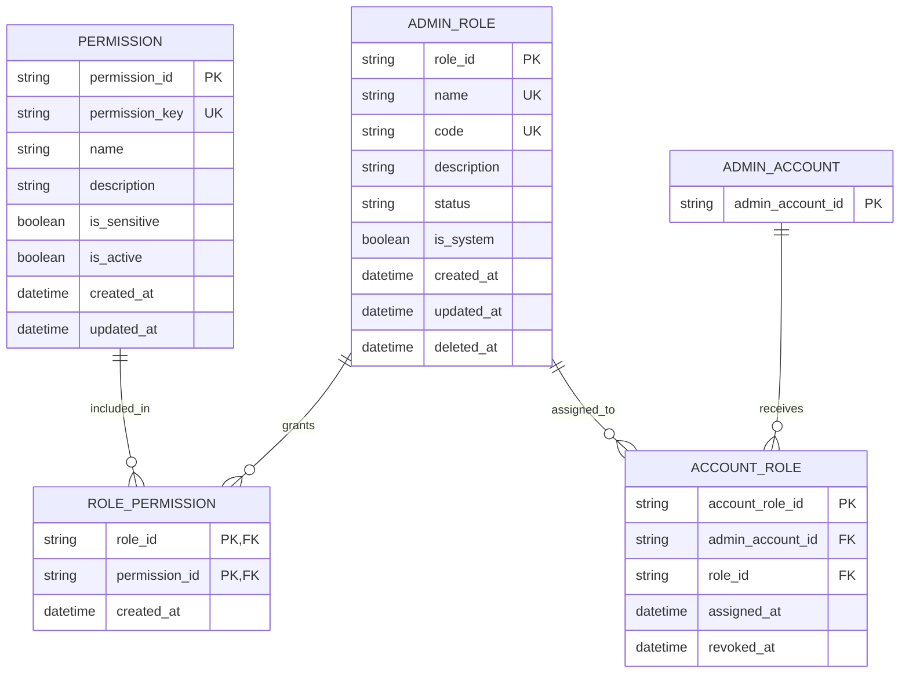

# Role ERD

> **Document Type:** ERD  
> **Status:** Baseline Sprint 1  
> **Scope:** Model role, permission catalog, permission grants, and administrator role assignments.

## ERD

Struktur ini merepresentasikan collection MongoDB. ADMIN_ACCOUNT adalah entitas referensi yang dijelaskan dalam [Administrator Account ERD](./admin-account-erd.md). Relasi assignment menyimpan riwayat penugasan; satu akun hanya boleh memiliki satu assignment aktif.

## Seed Sprint 1

Bootstrap membuat tepat satu role aktif: SUPER_ADMIN / Super Admin, is_system=true, dan deleted_at=null. Role ini memberi akses ke seluruh fungsi admin, termasuk permission yang ditambahkan kemudian, serta tidak dapat diubah, dinonaktifkan, atau dihapus melalui API. Role kustom tidak dibuat otomatis; Super Admin dapat membuatnya setelah bootstrap. Assignment awal dibuat melalui proses backend/database/script terkendali.

## Collection ADMIN_ROLE

| Field       | Type            | Null | Constraint                                               | Arti                                                       |
| ----------- | --------------- | ---- | -------------------------------------------------------- | ---------------------------------------------------------- |
| role_id     | String, max 64  | No   | PK; prefix role_                                         | ID role immutable.                                         |
| name        | String, max 100 | No   | Unik pada role non-terhapus, trim dan case-insensitive   | Nama tampilan role.                                        |
| code        | String, max 50  | No   | Unik pada role non-terhapus; uppercase ^[A-Z][A-Z0-9_]*$ | Kode role.                                                 |
| description | String, max 500 | Yes  | —                                                        | Deskripsi role.                                            |
| status      | String          | No   | ACTIVE atau INACTIVE; custom role default ACTIVE         | Role INACTIVE tidak dapat mengotorisasi request.           |
| is_system   | Boolean         | No   | Seed SUPER_ADMIN=true; custom role=false                 | Penanda role system yang immutable.                        |
| created_at  | Timestamp UTC   | No   | Default waktu insert                                     | Waktu pembuatan.                                           |
| updated_at  | Timestamp UTC   | No   | Default waktu insert                                     | Waktu perubahan terakhir.                                  |
| deleted_at  | Timestamp UTC   | Yes  | Null berarti belum dihapus                               | Soft delete; tidak ada pemulihan; purge setelah dua bulan. |

## Collection PERMISSION

| Field                  | Type            | Null | Constraint             | Arti                                                                                                                   |
| ---------------------- | --------------- | ---- | ---------------------- | ---------------------------------------------------------------------------------------------------------------------- |
| permission_id          | String, max 64  | No   | PK; prefix permission_ | ID record permission internal.                                                                                         |
| permission_key         | String, max 120 | No   | Unique                 | Key stabil yang dipakai API, sesuai [katalog permission](../solutioning/dashboard/accounts-roles/permission-model.md). |
| name                   | String, max 100 | No   | —                      | Label permission.                                                                                                      |
| description            | String, max 500 | Yes  | —                      | Penjelasan kemampuan.                                                                                                  |
| is_sensitive           | Boolean         | No   | Default false          | Klasifikasi internal; Super Admin tetap dapat memilih permission aktif apa pun.                                        |
| is_active              | Boolean         | No   | Default true           | Hanya permission aktif dapat diberikan ke role kustom.                                                                 |
| created_at, updated_at | Timestamp UTC   | No   | Default waktu insert   | Timestamp metadata.                                                                                                    |

Katalog permission dikelola sistem; CRUD role tidak membuat atau mengubah definisinya. API menerima permission_key, lalu service menyimpan relasi menggunakan permission_id.

## Collection ROLE_PERMISSION

| Field         | Type           | Constraint                         | Arti                       |
| ------------- | -------------- | ---------------------------------- | -------------------------- |
| role_id       | String, max 64 | PK, FK ke ADMIN_ROLE.role_id       | Role penerima grant.       |
| permission_id | String, max 64 | PK, FK ke PERMISSION.permission_id | Permission yang diberikan. |
| created_at    | Timestamp UTC  | Default waktu insert               | Waktu grant dibuat.        |

Pasangan (role_id, permission_id) unik. Penggantian permission dalam update role bersifat atomik; daftar kosong berarti role tidak mendapat grant.

## Collection ACCOUNT_ROLE

| Field            | Type           | Null | Constraint                          | Arti                                              |
| ---------------- | -------------- | ---- | ----------------------------------- | ------------------------------------------------- |
| account_role_id  | String, max 64 | No   | PK; internal prefix `account_role_` | ID assignment immutable; not returned by API.     |
| admin_account_id | String, max 64 | No   | Referensi ke akun admin             | Akun penerima role.                               |
| role_id          | String, max 64 | No   | FK ke ADMIN_ROLE.role_id            | Role yang ditugaskan.                             |
| assigned_at      | Timestamp UTC  | No   | Default waktu insert                | Waktu assignment.                                 |
| revoked_at       | Timestamp UTC  | Yes  | Null berarti aktif                  | Waktu assignment dicabut; riwayat tetap disimpan. |

## Indexes

| Index                        | Columns                          | Constraint                     | Tujuan                                                                |
| ---------------------------- | -------------------------------- | ------------------------------ | --------------------------------------------------------------------- |
| uq_admin_role_name_active    | name, collation case-insensitive | Unique, deleted_at IS NULL     | Mencegah nama duplikat; nama dapat dipakai ulang setelah soft delete. |
| uq_admin_role_code_active    | code                             | Unique, deleted_at IS NULL     | Mencegah kode duplikat.                                               |
| ix_admin_role_list           | status,name,role_id              | Non-unique, deleted_at IS NULL | Mendukung filter dan urutan daftar.                                   |
| uq_permission_key            | permission_key                   | Unique                         | Menjamin key permission unik.                                         |
| ix_permission_active_key     | is_active,permission_key         | Non-unique                     | Mencari permission aktif.                                             |
| uq_role_permission_pair      | role_id,permission_id            | Unique                         | Mencegah grant ganda.                                                 |
| uq_account_role_admin_active | admin_account_id                 | Unique, revoked_at IS NULL     | Membatasi satu role aktif per akun.                                   |
| ix_account_role_role_active  | role_id,admin_account_id         | Non-unique, revoked_at IS NULL | Mencari akun aktif sebelum role dinonaktifkan/dihapus.                |

## Data Rules

1. ID role dan permission immutable; prefix role role_, prefix permission record permission_. permission_key adalah nilai API yang terpisah dari ID record.
2. Nama role di-trim dan unik tanpa membedakan kapitalisasi pada record non-terhapus. Kode di-trim, uppercase, dan unik pada record non-terhapus.
3. Role kustom hanya memakai status ACTIVE atau INACTIVE, default ACTIVE. Role INACTIVE tidak dapat mengotorisasi request atau menerima assignment baru.
4. Satu akun memiliki paling banyak satu assignment aktif. Role tidak dapat dinonaktifkan atau dihapus selama masih memiliki assignment aktif.
5. SUPER_ADMIN adalah satu-satunya role yang di-seed pada Sprint 1. API tidak boleh mengubah atau menghapusnya; Super Admin melewati pemeriksaan grant dan berwenang pada seluruh fungsi admin.
6. Super Admin dapat memilih permission aktif apa pun dari katalog sistem untuk role kustom. Permission nonaktif/tidak dikenal ditolak.
7. Perubahan role dan permission berlaku pada request dashboard berikutnya. Backend membaca state otorisasi terkini; cache permission stale tidak digunakan.
8. Role soft-deleted dikecualikan dari list/detail, tidak dapat mengotorisasi, tidak dapat dipulihkan, dan dipurge setelah dua bulan. Grant role dan histori assignment terkait ikut dipurge setelah masa retensi; akun administrator dan definisi permission tidak ikut dihapus.
9. Assignment yang dicabut disimpan sebagai histori; Sprint 1 tidak mencatat audit event.
10. Timestamp disimpan dalam UTC. Constraint parsial dan transaksi MongoDB mengikuti perilaku ekuivalen yang dideskripsikan di atas.

## Decisions

- MongoDB menyimpan ADMIN_ROLE, PERMISSION, ROLE_PERMISSION, dan ACCOUNT_ROLE dengan logical references.
- Katalog dan definisi permission dimiliki sistem; role hanya menyimpan grant ke permission aktif.
- Role create/update menerima permission keys; update mengganti keseluruhan daftar bila field dikirim.
- Nama/kode dapat digunakan kembali setelah role di-soft-delete; tidak ada restore API.
- Tidak ada audit-event flow Sprint 1. Soft-deleted role, grant, dan histori assignment terkait dipurge setelah dua bulan.

## SLA Baseline

ERD ini mengikuti SLA API role dan akun administrator pada [BRD Sprint 1](../BRD.md): availability 99,9% per bulan; uji 50 VUser / 20 request per detik; baca p95 ≤ 500 ms, tulis p95 ≤ 1 detik, p99 ≤ 2 detik; kapasitas awal 2 vCPU / 4 GiB per instance dengan CPU ≤ 70% dan memori ≤ 75% saat beban target. SLA mengukur API, bukan query MongoDB secara terpisah.

## References

- [List roles IFA](../solutioning/dashboard/accounts-roles/get-list-roles.md)
- [Role detail IFA](../solutioning/dashboard/accounts-roles/get-detail-role.md)
- [Create role IFA](../solutioning/dashboard/accounts-roles/create-role.md)
- [Update role IFA](../solutioning/dashboard/accounts-roles/update-role.md)
- [Delete role IFA](../solutioning/dashboard/accounts-roles/delete-role.md)
- [Permission catalog](../solutioning/dashboard/accounts-roles/permission-model.md)
