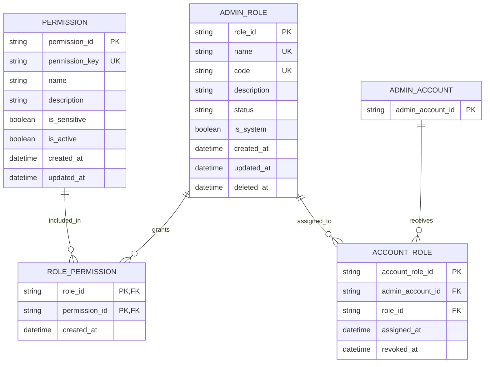

# Role ERD

> **Document Type:** ERD  
> **Status:** Draft  
> **Scope:** Role definitions, permission catalog, role-permission grants, and account-role assignments required by Admin Dashboard Account & Role Management APIs. Sprint 1 bootstrap seeds only the protected Super Admin role.

## ERD

This is the MongoDB collection model for role authorization. `ADMIN_ACCOUNT` is a reference entity owned by the administrator identity model; only its identifier is shown here. One account has at most one active role assignment, matching the administrator account list/detail contracts. Revoked assignments may remain as history. Relationship timestamps describe assignment lifecycle only; Sprint 1 does not record audit events per BRD.

## Sprint 1 Seed State

Initial deployment seeds exactly one active role: `code=SUPER_ADMIN`, `name=Super Admin`, `status=ACTIVE`, `is_system=true`, and `deleted_at=null`. It has unrestricted access to every protected admin function, including permission keys added later. Do not seed other roles in Sprint 1. Custom roles may be created explicitly later through the authorized create-role flow; they are not part of the initial state. Controlled backend/database/script bootstrap assigns this role to the Super Admin account.

## Table: `admin_role`

| Column        | Data Type                | Null | Key / Constraint                                                                | Description                                                                                                |
| ------------- | ------------------------ | ---- | ------------------------------------------------------------------------------- | ---------------------------------------------------------------------------------------------------------- |
| `role_id`     | String, max 64           | No   | PK                                                                              | Immutable role identifier generated by service with the role_ entity prefix.                               |
| `name`        | String, max 100          | No   | Unique among non-deleted roles, case-insensitive after trim (proposed)          | Display name used in Admin Dashboard.                                                                      |
| `code`        | String, max 50           | No   | Unique among non-deleted roles; uppercase format `^[A-Z][A-Z0-9_]*$` (proposed) | Stable machine-readable role code.                                                                         |
| `description` | String, max 500          | Yes  | —                                                                               | Role purpose and scope.                                                                                    |
| `status`      | String, max 20           | No   | `ACTIVE` or `INACTIVE`; custom role defaults to `ACTIVE`                        | Inactive roles cannot authorize requests. Deactivation is rejected while active account assignments exist. |
| `is_system`   | Boolean                  | No   | `true` for seeded `SUPER_ADMIN`; `false` for custom roles                       | Marks immutable built-in role. No dashboard role API may update or delete the seeded Super Admin.          |
| `created_at`  | Timestamp with time zone | No   | Default current UTC timestamp                                                   | Creation time; immutable after insert.                                                                     |
| `updated_at`  | Timestamp with time zone | No   | Default current UTC timestamp                                                   | Time of most recent change.                                                                                |
| `deleted_at`  | Timestamp with time zone | Yes  | Null means not soft-deleted                                                     | Soft-delete timestamp. No product restore; retain 2 months, then permanently purge.                        |

## Table: permission

| Column         | Data Type                | Null | Key / Constraint | Description                                                                           |
| -------------- | ------------------------ | ---- | ---------------- | ------------------------------------------------------------------------------------- |
| permission_id  | String, max 64           | No   | PK               | ID record permission berprefix permission_, misalnya permission_01JXYZ.               |
| permission_key | String, max 120          | No   | Unique           | Key permission stabil yang dipakai API, misalnya role.read atau game.create.          |
| name           | String, max 100          | No   | —                | Nama permission untuk ditampilkan.                                                    |
| description    | String, max 500          | Yes  | —                | Penjelasan kemampuan yang diberikan.                                                  |
| is_sensitive   | Boolean                  | No   | Default false    | Penanda klasifikasi keamanan; tidak membatasi Super Admin memilih permission katalog. |
| is_active      | Boolean                  | No   | Default true     | Menentukan apakah permission dapat diberikan kepada role.                             |
| created_at     | Timestamp with time zone | No   | Default UTC now  | Waktu pembuatan permission.                                                           |
| updated_at     | Timestamp with time zone | No   | Default UTC now  | Waktu perubahan metadata permission.                                                  |

Katalog permission dikelola sistem. Definisi permission tidak dibuat atau diubah melalui CRUD role. Mekanisme teknis seed dan pengelolaan katalog ditetapkan pada desain implementasi.

## Table: `role_permission`

| Column          | Data Type                | Null | Key / Constraint                    | Description                 |
| --------------- | ------------------------ | ---- | ----------------------------------- | --------------------------- |
| `role_id`       | String, max 64           | No   | PK, FK → `admin_role.role_id`       | Role receiving the grant.   |
| `permission_id` | String, max 64           | No   | PK, FK → `permission.permission_id` | Permission granted to role. |
| `created_at`    | Timestamp with time zone | No   | Default current UTC timestamp       | Time of grant.              |

Updating role permissions replaces grants transactionally under the current update-role proposal. Sprint 1 does not record audit events per BRD.

## Table: `account_role`

| Column             | Data Type                | Null | Key / Constraint              | Description                                                |
| ------------------ | ------------------------ | ---- | ----------------------------- | ---------------------------------------------------------- |
| `account_role_id`  | String, max 64           | No   | PK                            | Immutable assignment identifier.                           |
| `admin_account_id` | String, max 64           | No   | FK → admin identity account   | Administrator receiving the role.                          |
| `role_id`          | String, max 64           | No   | FK → `admin_role.role_id`     | Assigned role.                                             |
| `assigned_at`      | Timestamp with time zone | No   | Default current UTC timestamp | Time role was assigned.                                    |
| `revoked_at`       | Timestamp with time zone | Yes  | Null means assignment active  | Time assignment was revoked; preserves assignment history. |

At most one active role assignment is allowed per administrator account. Database-specific partial unique index or transactional enforcement is required. The separate assignment ID allows an account to be assigned a role again after a prior assignment is revoked.

## Indexes

| Index                           | Columns                                           | Type                                                      | Purpose                                                                                     |
| ------------------------------- | ------------------------------------------------- | --------------------------------------------------------- | ------------------------------------------------------------------------------------------- |
| `uq_admin_role_name_active`     | `name`, collation `{ locale: "en", strength: 2 }` | Unique, partial where `deleted_at IS NULL`                | Prevent case-only duplicate active names; reuse is allowed after soft delete.               |
| `uq_admin_role_code_active`     | `code`                                            | Unique, partial where `deleted_at IS NULL`                | Prevent duplicate active codes; code is trimmed and uppercase.                              |
| `ix_admin_role_list`            | `status`, `name`, `role_id`                       | Non-unique; partial where `deleted_at IS NULL` (proposed) | Support filtered and deterministic role listing.                                            |
| `uq_permission_key`             | `permission_key`                                  | Unique                                                    | Menjaga key permission tetap unik dan stabil untuk kontrak API.                             |
| `ix_permission_active_key`      | `is_active`, `permission_key`                     | Non-unique                                                | Resolve key permission aktif yang dikirim melalui kontrak API.                              |
| `ix_role_permission_permission` | `permission_id`, `role_id`                        | Non-unique                                                | Find roles granted a permission and support permission lifecycle checks.                    |
| `uq_account_role_admin_active`  | `admin_account_id`                                | Unique, partial where `revoked_at IS NULL` (proposed)     | Enforce at most one active role per administrator account, matching account read contracts. |
| `ix_account_role_role_active`   | `role_id`, `admin_account_id`                     | Non-unique, partial where `revoked_at IS NULL` (proposed) | Check assignments before role deactivation or deletion.                                     |

## Relationships

| Parent                 | Child             | Cardinality | Rule                                                                                                                                                                                                                                  |
| ---------------------- | ----------------- | ----------- | ------------------------------------------------------------------------------------------------------------------------------------------------------------------------------------------------------------------------------------- |
| `admin_role`           | `role_permission` | 1 to 0..N   | Role may grant multiple permission records. role_permission.permission_id references permission.permission_id; API resolves permission_key before storing grant. Soft-deleting role must not hard-delete grant history automatically. |
| `permission`           | `role_permission` | 1 to 0..N   | Permission may be granted to multiple roles through the internal permission_id. Permission deletion is outside role CRUD; prefer deactivation and retain referenced rows.                                                             |
| Admin identity account | `account_role`    | 1 to 0..N   | Rows may preserve assignment history; at most one assignment per account may have `revoked_at IS NULL`.                                                                                                                               |
| `admin_role`           | `account_role`    | 1 to 0..N   | Role may be assigned to multiple accounts. Role deletion/deactivation is blocked while active assignments exist unless approved migration is provided.                                                                                |

## Data Rules

1. `role_id` dan `permission_id` adalah ID record immutable yang dikelola service. ID record permission memakai prefix `permission_`; `permission_key` adalah key API terpisah dan stabil.
2. Role `name` is trimmed; uniqueness is case-insensitive among non-deleted roles (proposed).
3. Role `code` is normalized uppercase and unique among non-deleted roles (proposed); code format is `^[A-Z][A-Z0-9_]*$`.
4. `status` is exactly `ACTIVE` or `INACTIVE`; custom roles default to `ACTIVE`. Inactive roles cannot authorize or receive new assignments. Deactivation is rejected while active account assignments remain.
5. Sprint 1 bootstrap seeds only `SUPER_ADMIN` / `Super Admin`, active, `is_system=true`, and not deleted. No other role is seeded.
6. No application API or administrator workflow may change or delete the seeded Super Admin role; reject each attempt with the protected-role error and preserve its record and access policy.
7. Super Admin bypasses role-permission grant checks and is authorized for every protected admin function, including future permission keys. Authentication, active-account checks, input validation, and business rules still apply.
8. Custom roles may contain multiple permission grants; duplicate `(role_id, permission_id)` is prohibited.
9. Hanya permission aktif dari katalog sistem yang dapat diberikan ke custom role. API menerima `permission_key`, lalu service menyelesaikannya ke `permission_id` internal. Super Admin dapat memilih seluruh permission aktif di katalog.
10. Role permission replacement must be atomic: either all requested grants are stored or none are.
11. Soft delete sets `admin_role.deleted_at`; soft-deleted custom roles are excluded from list/detail, cannot receive new assignments, and cannot authorize. No restore API exists; a retention process permanently purges the document after 2 months.
12. Custom role deletion is rejected while active account assignments exist. No cascade deletion of accounts, permission records, or assignments.
13. Revoking an account-role assignment sets `revoked_at`; it does not erase historical assignment data.
14. Role metadata uses UTC timestamps. Sprint 1 does not record audit events per BRD.
15. Role and permission changes apply on the next dashboard request. Authorization reads the latest account, active role, and permission grants; do not use stale permission caches.

## Decisions

- MongoDB stores role, permission, role-permission, and account-role records as collections with logical references.
- Permission catalog is system-managed. API accepts stable `permission_key`; stored grants reference `permission_id`. Super Admin can assign every active catalog permission.
- Create and update role may set an empty permission list; this yields a role that grants no permissions.
- Unique name and code indexes apply to non-deleted roles. Because deleted roles cannot be restored, names/codes may be reused after soft delete.
- Role changes and permission grants are read from authoritative MongoDB state on every protected request; no permission cache may delay application.
- Soft-deleted role documents are purged after 2 months. No restore or audit-event flow is in Sprint 1.

## References

- [List roles IFA](../solutioning/dashboard/accounts-roles/get-list-roles.md)
- [Role detail IFA](../solutioning/dashboard/accounts-roles/get-detail-role.md)
- [Create role IFA](../solutioning/dashboard/accounts-roles/create-role.md)
- [Update role IFA](../solutioning/dashboard/accounts-roles/update-role.md)
- [Delete role IFA](../solutioning/dashboard/accounts-roles/delete-role.md)
- [Permission catalog](../solutioning/dashboard/accounts-roles/permission-model.md)
