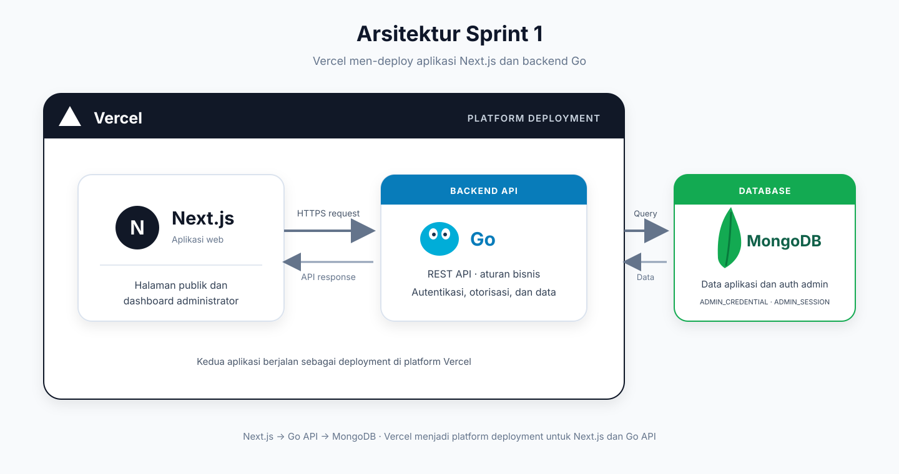
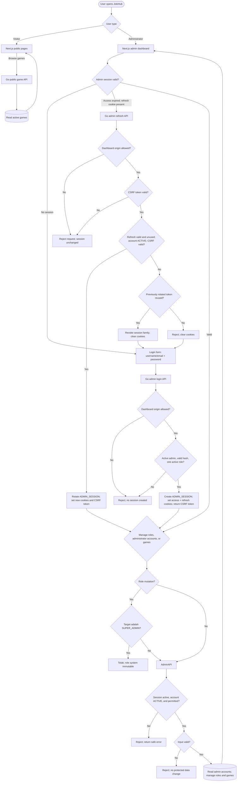

# Sprint 1 — High-Level Design

## Stack Teknologi

| Komponen            | Teknologi | Tanggung jawab                                                                                      |
| ------------------- | --------- | --------------------------------------------------------------------------------------------------- |
| Platform deployment | Vercel    | Men-deploy dan menyajikan aplikasi Next.js serta backend API Golang.                                |
| Aplikasi web        | Next.js   | Menyediakan halaman publik dan dashboard administrator, lalu memanggil Go service melalui REST API. |
| Backend API         | Golang    | Menjalankan aturan bisnis, autentikasi/otorisasi request, dan akses data aplikasi.                  |
| Database            | MongoDB   | Menyimpan data yang dibutuhkan fitur Sprint 1.                                                      |

## Arsitektur Tingkat Tinggi

## Penjelasan Arsitektur

Pengunjung atau administrator membuka aplikasi Next.js yang di-deploy melalui Vercel. Aplikasi web mengirim request HTTPS ke backend Golang yang juga di-deploy melalui Vercel. Login admin memverifikasi ADMIN_ACCOUNT dan hash Argon2id pada ADMIN_CREDENTIAL, lalu membuat access/refresh session di ADMIN_SESSION. Backend menetapkan cookie HttpOnly dan memvalidasi session, status admin, role, permission, CORS origin, serta CSRF sebelum menjalankan aturan bisnis dan mengakses MongoDB. Response dikembalikan melalui jalur yang sama ke aplikasi web.

## Flowchart Login, Session, dan Proses Request

## Penjelasan Flow

- **Login admin:** Dashboard mengirim username/email dan password ke Go. Setelah akun ACTIVE, hash Argon2id, dan role aktif lolos pemeriksaan, backend membuat session di MongoDB lalu mengirim access/refresh cookie HttpOnly dan CSRF token.
- **Refresh session:** Dashboard mengirim refresh cookie dan CSRF token. Go merotasi refresh token satu kali; replay mencabut session family dan menghapus cookie.
- **Aksi admin:** Bootstrap menyiapkan satu role aktif `SUPER_ADMIN` yang tidak dapat diubah atau dihapus melalui API. Go memeriksa session family dan status akun pada setiap request. Akun INACTIVE atau terhapus langsung ditolak dan session family dicabut pada pemeriksaan berikutnya. Go lalu mengevaluasi role, permission, dan input sebelum membaca akun administrator atau mengelola role/game. Dashboard hanya menampilkan daftar dan detail akun admin. Permintaan tanpa akses atau input tidak valid ditolak tanpa mengubah data terlindungi.
- **Game publik:** Pengunjung meminta daftar game melalui Next.js. Go mengambil game aktif dan mengembalikan hasil untuk ditampilkan.

## SLA Baseline

Target awal untuk route dashboard, login/refresh/logout admin, dan katalog publik Sprint 1: availability bulanan 99,9%; beban NFT 50 VUser / 20 request per detik; latency baca p95 ≤ 500 ms, tulis p95 ≤ 1 detik, p99 ≤ 2 detik; kapasitas awal 2 vCPU / 4 GiB per instance dengan CPU ≤ 70% dan memori ≤ 75% saat beban target. Ini asumsi awal, bukan hasil benchmark; ukur melalui NFT sebelum rilis.

Detail kontrak mengikuti [IFA login](../solutioning/dashboard/auth/login.md), [IFA refresh token](../solutioning/dashboard/auth/refresh-token.md), [IFA logout](../solutioning/dashboard/auth/logout.md), dan Admin Account ERD untuk collection credential/session. Permission assignment custom role dan publikasi game mengikuti IFA terkait. Seed state dan sifat immutable Super Admin sudah menjadi kebijakan tetap Sprint 1.
