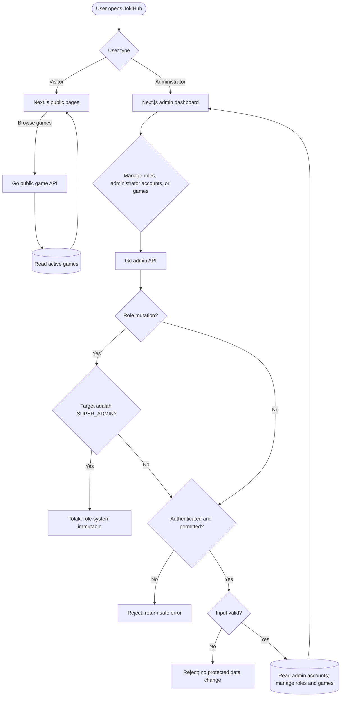

# Sprint 1 — High-Level Design

> **Scope:** Admin access verification, roles, administrator accounts, and game management/discovery. Admin authentication is a prerequisite check; it does not add a new login feature.

## Flowchart

## Penjelasan flow

- **Game publik:** Pengunjung meminta daftar game melalui Next.js. Go mengambil game aktif dan mengembalikan hasil untuk ditampilkan.
- **Aksi admin:** Bootstrap menyiapkan satu role aktif `SUPER_ADMIN` dengan akses ke seluruh fungsi admin dan menugaskannya ke akun Super Admin. Role system ini tidak dapat diubah atau dihapus melalui API. Go memeriksa sesi, permission, dan input sebelum membaca akun administrator atau mengelola role/game. Dashboard hanya menampilkan daftar dan detail akun admin. Permintaan tanpa akses atau input tidak valid ditolak tanpa mengubah data terlindungi.

## SLA Baseline

Target awal untuk route dashboard dan katalog publik Sprint 1: availability bulanan 99,9%; beban NFT 50 VUser / 20 request per detik; latency baca p95 ≤ 500 ms, tulis p95 ≤ 1 detik, p99 ≤ 2 detik; kapasitas awal 2 vCPU / 4 GiB per instance dengan CPU ≤ 70% dan memori ≤ 75% saat beban target. Ini asumsi awal, bukan hasil benchmark; ukur melalui NFT sebelum rilis.

Detail kebijakan identitas/session, permission assignment custom role, dan publikasi game mengikuti IFA terkait. Seed state dan sifat immutable Super Admin sudah menjadi kebijakan tetap Sprint 1.
