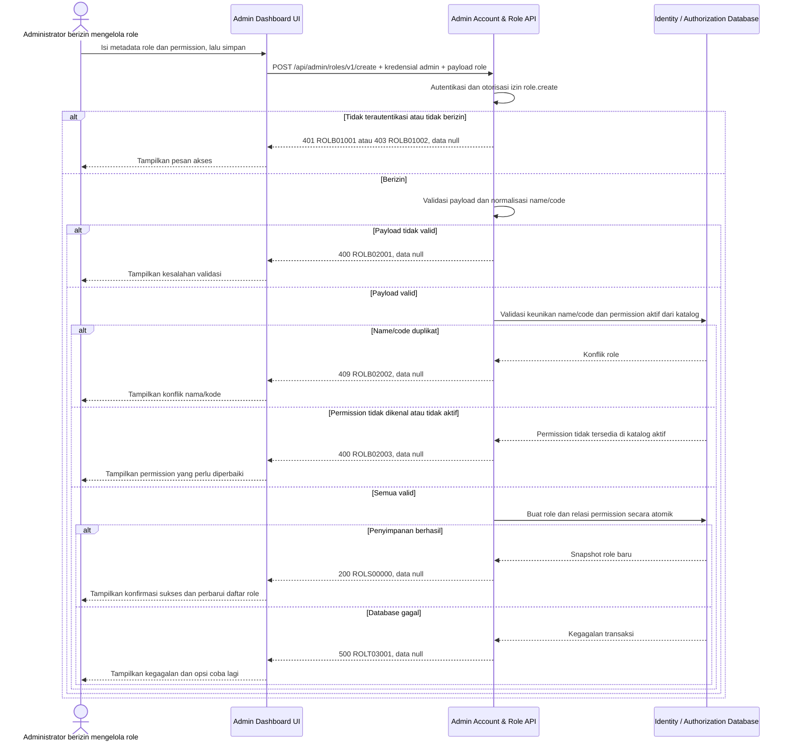

# Admin Dashboard - Create Role Interface Agreement

> **Document Type:** IFA / API Contract  
> **Status:** Draft  
> **Service / Domain:** Admin Dashboard — Account & Role Management  
> **Consumer / Partner:** JokiHub Admin Dashboard (authorized administrator)

## Design


## Sequence Diagram



## Performance / SLA Targets

| Success Rate                                                  | VUser                              | CPU / Memory                                                                | Response Time              |
| ------------------------------------------------------------- | ---------------------------------- | --------------------------------------------------------------------------- | -------------------------- |
| 99.9% monthly availability; valid-request server error ≤ 0.1% | 50 VUser / 20 request/s NFT target | Initial 2 vCPU / 4 GiB per instance; CPU ≤ 70%, memory ≤ 75% at target load | Write p95 ≤ 1 s; p99 ≤ 2 s |

## General Information

| Component          | Value                                                                                                                                                                                                                                                                                                    |
| ------------------ | -------------------------------------------------------------------------------------------------------------------------------------------------------------------------------------------------------------------------------------------------------------------------------------------------------- |
| Description        | Membuat custom role setelah bootstrap `SUPER_ADMIN`; endpoint ini tidak membuat role system atau katalog permission.                                                                                                                                                                                     |
| Resource URL       | `https://{host}/api/admin/roles/v1/create`                                                                                                                                                                                                                                                               |
| Transport Protocol | HTTPS, REST                                                                                                                                                                                                                                                                                              |
| Request Verb       | POST                                                                                                                                                                                                                                                                                                     |
| Content Type       | `application/json`                                                                                                                                                                                                                                                                                       |
| Interaction Type   | Synchronous                                                                                                                                                                                                                                                                                              |
| Security Policy    | Hanya Super Admin terautentikasi yang dapat membuat custom role. Permission target `role.create` mengacu pada [katalog permission Sprint 1](./permission-model.md); Super Admin dapat memilih permission aktif apa pun dari katalog sistem. Terapkan rate limiting. Sprint 1 tidak mencatat audit event. |

### Path / Endpoint

| Section        | Value                           |
| -------------- | ------------------------------- |
| Host / Domain  | `{host}` (environment-specific) |
| Service Name   | Admin Account & Role            |
| Version        | `v1`                            |
| Resource       | `/admin/roles/v1/create`        |
| Final Endpoint | `/api/admin/roles/v1/create`    |

### API Versioning

- **Decision:** New Endpoint
- **Previous Endpoint:** Tidak ada API create role yang teridentifikasi pada solutioning sprint ini.
- **Final Endpoint:** `POST /api/admin/roles/v1/create`
- **Backward Compatibility:** Belum ada consumer API create role yang teridentifikasi. Penambahan field response opsional bersifat kompatibel; perubahan kontrak yang mematahkan consumer memerlukan major version baru.
- **Reason:** Admin Dashboard memerlukan operasi untuk membuat definisi role baru.

## Business Rules

**Rate limit:** 1.200 request/IP/menit dan 60 request/admin/menit. Pelampauan mengembalikan HTTP 429 dengan `Retry-After`.

**Autentikasi bersama:** Setiap request dashboard wajib memakai cookie access admin dari backend, Origin yang exact-match dengan allowlist, dan X-CSRF-Token. Backend memeriksa session family aktif serta status akun ACTIVE/non-deleted pada setiap autentikasi. Jika akun INACTIVE, request ditolak pada pemeriksaan berikutnya dan session family aktif dicabut. Setiap endpoint tetap memerlukan permission sesuai metode. Lihat [IFA login](../auth/login.md), [refresh token](../auth/refresh-token.md), dan [logout](../auth/logout.md).

1. Hanya Super Admin terautentikasi dengan permission `role.create` yang dapat membuat custom role. Pada kondisi awal Sprint 1, `SUPER_ADMIN` adalah satu-satunya role hasil seed; permission target dan cakupan katalog mengacu pada [permission model](./permission-model.md).
2. `id`, `createdAt`, dan `updatedAt` dibuat oleh server; klien tidak boleh menetapkan nilai tersebut.
3. `name` setelah trim dan perbandingan case-insensitive harus unik di antara role yang belum dihapus.
4. `code` dinormalisasi uppercase dan harus unik di antara role yang belum dihapus.
5. Role kustom menerima status `ACTIVE` atau `INACTIVE`; default `ACTIVE`. `SUPER_ADMIN` tidak dapat dibuat ulang melalui API.
6. `permissions` merupakan daftar key permission awal. Semua key harus terdaftar, aktif, dan unik. Super Admin boleh memilih seluruh key aktif di katalog. Daftar kosong diizinkan untuk role tanpa akses.
7. Klien tidak dapat membuat role system/built-in, menggunakan code `SUPER_ADMIN`, atau mengatur atribut protected. Bootstrap Super Admin adalah proses backend/database/script terpisah, bukan endpoint ini.
8. Sprint 1 tidak menerima `Idempotency-Key`. Create ulang setelah timeout dengan `name` atau `code` yang sudah tersimpan menghasilkan HTTP 409 dan tidak membuat role kedua.
9. Pembuatan metadata role dan relasi permission harus atomik. Jika satu langkah gagal, tidak ada role parsial yang tersimpan.
10. ID role dibuat service dengan prefix `role_` dan suffix unik yang tidak dapat diprediksi.
11. createdAt dan updatedAt diisi server dalam UTC. Sprint 1 tidak mencatat audit event sesuai BRD.
12. Perubahan role atau permission wajib berlaku pada request dashboard berikutnya. Otorisasi membaca state terbaru dari sumber data dan tidak memakai cache permission yang stale.

## Request Headers

| Header   | E/N/T | Type   | M/O/C | Max Length | Description                                                                                                | Example                             |
| -------- | ----- | ------ | ----- | ---------: | ---------------------------------------------------------------------------------------------------------- | ----------------------------------- |
| `Cookie` | N     | String | M     |       4096 | Browser mengirim cookie access admin secara otomatis; token tidak dikirim melalui Authorization atau body. | `__Host-jokihub-admin-access={JWT}` |

| `Origin` | N | String | M | 2048 | Origin dashboard harus exact-match dengan allowlist API. | `https://dashboard.example.test` |
| `X-CSRF-Token` | N | String | M | 128 | CSRF token sinkronisasi untuk request cookie-authenticated. | `{csrf-token}` |
| `Content-Type` | N | String | M | 100 | Tipe media request. | `application/json` |
| `Accept` | N | String | O | 100 | Tipe media response yang diinginkan; default JSON. | `application/json` |
| `X-Request-Id` | N | String | O | 100 | ID korelasi request untuk tracing/support. | `req-6ef271` |

## Request Parameters

None.

## Request Query Parameters

None.

## Request Body

| Attribute     | E/N/T | Type            | M/O/C | Max Length | Description                                                       | Example                         |
| ------------- | ----- | --------------- | ----- | ---------: | ----------------------------------------------------------------- | ------------------------------- |
| `name`        | N     | String          | M     |        100 | Nama tampilan role; trim sebelum disimpan.                        | `Senior Support Agent`          |
| `code`        | N     | String          | M     |         50 | Kode role unik uppercase; format usulan `^[A-Z][A-Z0-9_]*$`.      | `SENIOR_SUPPORT_AGENT`          |
| `description` | N     | String/null     | O     |        500 | Deskripsi role; `null` atau string kosong disimpan sebagai null.  | `Menangani eskalasi pelanggan.` |
| `status`      | N     | String          | O     |         20 | Status role kustom: `ACTIVE` atau `INACTIVE`; default `ACTIVE`.   | `ACTIVE`                        |
| `permissions` | N     | Array of String | O     |  100 items | Key permission aktif dari katalog Sprint 1; default array kosong. | `["role.read", "game.read"]`    |

### Example Request Body

```json
{
  "name": "Senior Support Agent",
  "code": "SENIOR_SUPPORT_AGENT",
  "description": "Menangani eskalasi pelanggan.",
  "status": "ACTIVE",
  "permissions": ["role.read", "game.read"]
}
```

### Request Validation

1. Request harus membawa cookie access admin valid, Origin dashboard yang diizinkan, CSRF token valid, akun ACTIVE/non-deleted, session family aktif, dan permission `role.create`. Kembalikan HTTP 401 `ROLB01001` bila belum terautentikasi dan HTTP 403 `ROLB01002` bila permission tidak tersedia.
2. Body harus JSON object. Field wajib `name` dan `code`; body tidak valid atau field wajib hilang mengembalikan `ROLB02001`.
3. `name` harus string non-empty setelah trim dan maksimal 100 karakter.
4. `code` harus string non-empty, maksimal 50 karakter, dinormalisasi uppercase, dan mengikuti `^[A-Z][A-Z0-9_]*$`.
5. `description`, bila dikirim, harus string atau `null` dan maksimal 500 karakter.
6. `status`, bila dikirim, harus salah satu nilai yang disepakati. Usulan saat ini `ACTIVE` atau `INACTIVE`; nilai lainnya mengembalikan `ROLB02001`.
7. `permissions`, bila dikirim, harus berupa array maksimal 100 key permission unik dari katalog Sprint 1. Array kosong valid. Key di luar katalog atau tidak aktif mengembalikan `ROLB02003`.
8. Field tak dikenal atau immutable seperti `id`, `createdAt`, `updatedAt`, dan atribut protected ditolak dengan `ROLB02001`.
9. Nama/kode duplikat setelah normalisasi mengembalikan `ROLB02002`. Validasi unique constraint harus tetap ditegakkan saat commit untuk menangani request bersamaan.
10. Validasi payload dan permission sebelum commit. Error validasi mengembalikan HTTP 400, konflik nama/kode mengembalikan HTTP 409, dan kegagalan database mengembalikan HTTP 500; semua error memakai `data: null`.
11. Retry setelah timeout tidak memakai `Idempotency-Key`; klien dapat membaca daftar role. Jika create pertama sudah berhasil, pengulangan menghasilkan HTTP 409 karena `name`/`code` unik.

## Response Body

| Attribute | E/N/T | Type   | M/O/C | Max Length | Description                             | Example        |
| --------- | ----- | ------ | ----- | ---------: | --------------------------------------- | -------------- |
| `code`    | N     | String | M     |         20 | Service status code.                    | `ROLS00000`    |
| `message` | N     | String | O     |        200 | Pesan hasil untuk consumer.             | `Role created` |
| `data`    | N     | null   | M     |          — | Selalu `null` pada sukses maupun error. | `null`         |

### Success Example

```json
{
  "code": "ROLS00000",
  "message": "Role created",
  "data": null
}
```

### Business Error Example

```json
{
  "code": "ROLB02002",
  "message": "Role name or code already exists",
  "data": null
}
```

### Technical Error Example

```json
{
  "code": "ROLT03001",
  "message": "Role service is temporarily unavailable",
  "data": null
}
```

## HTTP Status Codes

| HTTP Status | Usage                                                                                                                          |
| ----------- | ------------------------------------------------------------------------------------------------------------------------------ |
| `200`       | Role berhasil dibuat; response memakai `data: null`. Konfirmasi apakah standar API memilih `201 Created` untuk operasi create. |
| `400`       | Payload tidak valid atau permission key tidak dikenal/tidak aktif.                                                             |
| `401`       | Admin belum terautentikasi atau session tidak valid.                                                                           |
| `403`       | Admin tidak memiliki permission `role.create`, Origin tidak diizinkan, atau CSRF tidak valid.                                  |
| `409`       | Nama/kode role sudah digunakan.                                                                                                |
| `500`       | Kegagalan service atau database identity/authorization yang tidak terduga.                                                     |
| `429`       | Rate limit terlampaui; response menyertakan header `Retry-After`.                                                              |

## Service Status Codes

Format: `[Service Prefix][Status Type][Category][Specific Error Code]`

| Code        | Type      | Category        | Meaning                                                            |
| ----------- | --------- | --------------- | ------------------------------------------------------------------ |
| `ROLS00000` | Success   | General         | Role berhasil dibuat.                                              |
| `ROLB01001` | Business  | Authentication  | Administrator belum terautentikasi.                                |
| `ROLB01002` | Business  | Authentication  | Administrator tidak memiliki permission `role.create`.             |
| `ROLB02001` | Business  | User validation | Body/field wajib, format, panjang, atau state request tidak valid. |
| `ROLB02002` | Business  | User validation | Nama atau kode role sudah digunakan role lain.                     |
| `ROLB02003` | Business  | User validation | Satu atau lebih permission tidak dikenal/tidak tersedia.           |
| `ROLT03001` | Technical | Database        | Role, relasi permission gagal disimpan/database tidak tersedia.    |

## API Exposure Classification

| Classification | Rationale                                                                                                         |
| -------------- | ----------------------------------------------------------------------------------------------------------------- |
| Public         | Route dashboard dapat diakses dari internet dan dilindungi session admin, permission, CORS allowlist, serta CSRF. |

## Testing & Documentation Scope

| Scope      | Required | Rationale / Handoff                                                                                                                                                                                                             |
| ---------- | -------- | ------------------------------------------------------------------------------------------------------------------------------------------------------------------------------------------------------------------------------- |
| NFT        | Yes      | API admin write baru. Uji create sukses, validasi, konflik unik termasuk request bersamaan, permission tidak dikenal atau tidak aktif, atomicity, dan beban 50 VUser / 20 request per detik; ukur CPU/memory terhadap baseline. |
| VA/Pentest | Yes      | API membuat kontrol akses. Uji authentication/authorization, privilege escalation, pemilihan permission dari seluruh katalog, mass assignment, injection, replay/idempotency.                                                   |

## Assumptions

- Endpoint `/api/admin/roles/v1/create`, HTTP `POST`, field request/response, envelope, prefix `ROL`, serta kode status mengikuti pola solutioning admin; API owner perlu menyetujui.
- `name`, `code`, `status`, dan `permissions` adalah field kontrak yang mengikuti Role ERD Sprint 1.
- `permissions` berisi identifier katalog permission Sprint 1 sebagaimana [permission model](./permission-model.md), dan default kosong. Super Admin dapat memberikan key permission aktif apa pun dari katalog sistem; definisi permission tetap dikelola sistem.
- Role baru default `ACTIVE`; status final dan apakah role boleh dibuat tanpa permission harus dikonfirmasi oleh product/security owner.
- Audit event tidak dicatat pada Sprint 1. SLA mengikuti baseline BRD; HTTP status memakai mapping BRD. Create tidak menerima `Idempotency-Key`; duplicate business key menghasilkan konflik. ID role memakai prefix role_; suffix unik dibuat service.
- Cakupan hanya membuat definisi role; assignment akun, CRUD permission catalog, dan aktivasi workflow approval berada di luar API ini.

## References

- `./get-list-roles.md` — field role dan usulan daftar role.
- `./get-detail-role.md` — kontrak membaca detail role dan permission visibility.
- `./update-role.md` — format metadata, permission, dan error code role.
- `./delete-role.md` — protected-role dan assignment checks yang diusulkan.
- `docs-game-service-platform/sprint_1/solutioning/TEMPLATE.md` — template kontrak API sprint.
- `src/features/AdminAccountsRoles/` — UI Admin Dashboard akun & role; tidak menyediakan backend contract.
