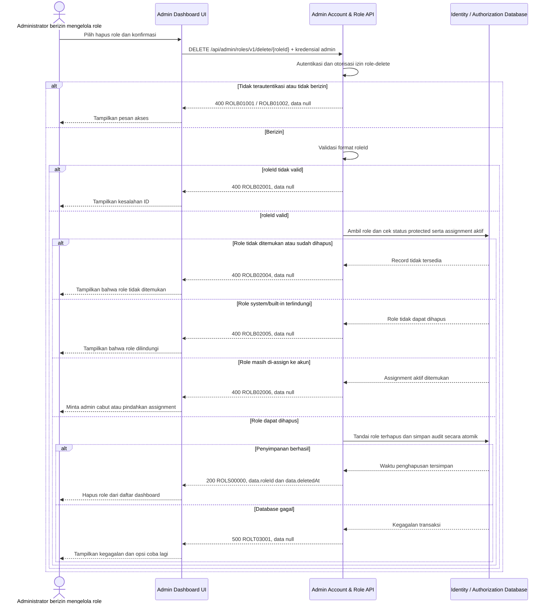

# Admin Dashboard - Delete Role Interface Agreement

> **Document Type:** IFA / API Contract  
> **Status:** Draft  
> **Service / Domain:** Admin Dashboard — Account & Role Management  
> **Consumer / Partner:** JokiHub Admin Dashboard (authorized administrator)

## Design


## Sequence Diagram



## Performance / SLA Targets

| Success Rate                                                  | VUser                              | CPU / Memory                                                                | Response Time              |
| ------------------------------------------------------------- | ---------------------------------- | --------------------------------------------------------------------------- | -------------------------- |
| 99.9% monthly availability; valid-request server error ≤ 0.1% | 50 VUser / 20 request/s NFT target | Initial 2 vCPU / 4 GiB per instance; CPU ≤ 70%, memory ≤ 75% at target load | Write p95 ≤ 1 s; p99 ≤ 2 s |

## General Information

| Component          | Value                                                                                                            |
| ------------------ | ---------------------------------------------------------------------------------------------------------------- |
| Description        | Menandai satu role sebagai terhapus setelah memastikan role tidak protected dan tidak memiliki assignment aktif. |
| Resource URL       | `https://{host}/api/admin/roles/v1/delete/{roleId}`                                                              |
| Transport Protocol | HTTPS, REST                                                                                                      |
| Request Verb       | DELETE                                                                                                           |
| Content Type       | Tidak ada request body                                                                                           |
| Interaction Type   | Synchronous                                                                                                      |

    | Security Policy    | Admin authentication dan permission `role-delete` sesuai [katalog permission Sprint 1](./permission-model.md). Identity provider TBD. Wajib audit aktor/aksi; lindungi role system dan hak akses sensitif. |

### Path / Endpoint

| Section        | Value                                 |
| -------------- | ------------------------------------- |
| Host / Domain  | `{host}` (environment-specific)       |
| Service Name   | Admin Account & Role                  |
| Version        | `v1`                                  |
| Resource       | `/admin/roles/v1/delete/{roleId}`     |
| Final Endpoint | `/api/admin/roles/v1/delete/{roleId}` |

### API Versioning

- **Decision:** New Endpoint
- **Previous Endpoint:** Tidak ada API delete role yang teridentifikasi pada solutioning sprint ini.
- **Final Endpoint:** `DELETE /api/admin/roles/v1/delete/{roleId}`
- **Backward Compatibility:** Belum ada consumer API delete role yang teridentifikasi. Penambahan field response opsional bersifat kompatibel; perubahan kontrak yang mematahkan consumer memerlukan major version baru.
- **Reason:** Admin Dashboard memerlukan penghapusan role yang terkontrol dengan pemeriksaan assignment dan protected role.

## Business Rules

1. Hanya Super Admin terautentikasi dengan permission `role-delete` yang dapat menghapus custom role. Identifier target mengacu pada [katalog permission Sprint 1](./permission-model.md); identity provider TBD.
2. Operasi yang diusulkan adalah soft delete. Service mengisi `deleted_at` dan memperbarui `updated_at` dalam satu transaksi; field `deleted_at` belum ada pada model/ERD dan harus disetujui sebelum implementasi.
3. `SUPER_ADMIN` (`Super Admin`) adalah satu-satunya role hasil seed Sprint 1, ditandai `is_system=true`, dan tidak dapat dihapus oleh endpoint ini. Setiap upaya menghapusnya ditolak dengan `ROLB02005`. Role lain yang dibuat secara eksplisit setelah bootstrap mengikuti aturan delete custom role.
4. Role dengan assignment akun aktif tidak dapat dihapus. Admin harus terlebih dahulu mencabut assignment atau memindahkan akun ke role lain melalui proses yang disetujui. Kebijakan ini mencegah hilangnya otorisasi tanpa pengganti.
5. API tidak menghapus akun, permission catalog, atau riwayat assignment. Tidak ada cascade delete.
6. `roleId` yang tidak ditemukan atau sudah dihapus mengembalikan `ROLB02004`. Pengulangan request setelah penghapusan tidak mengubah data dan menghasilkan status tidak ditemukan; retry dianggap aman tanpa efek tambahan.
7. `roleId`, identitas penghapus, dan waktu penghapusan dicatat untuk audit. Penyimpanan dan retensi audit TBD.
8. Pemeriksaan status protected, assignment aktif, dan penandaan soft delete harus dijalankan konsisten dalam satu transaksi atau memakai mekanisme concurrency yang setara.
9. Penghapusan tidak dapat dibatalkan oleh endpoint ini. Restore, bila dibutuhkan, ditetapkan sebagai API terpisah dengan audit.
10. Jika model assignment tidak dapat memeriksa akun pemegang role secara andal, endpoint tidak boleh menghapus role sampai dependency tersebut tersedia.

## Request Headers

| Header          | E/N/T | Type   | M/O/C | Max Length | Description                                                               | Example                 |
| --------------- | ----- | ------ | ----- | ---------: | ------------------------------------------------------------------------- | ----------------------- |
| `Authorization` | N     | String | M     |       4096 | Kredensial administrator; skema autentikasi bergantung identity provider. | `Bearer {access-token}` |
| `Accept`        | N     | String | O     |        100 | Tipe media response yang diinginkan; default JSON.                        | `application/json`      |
| `X-Request-Id`  | N     | String | O     |        100 | ID korelasi untuk audit/support.                                          | `req-6ef271`            |

## Request Parameters

| Parameter | E/N/T | Type   | M/O/C | Max Length | Description                          | Example       |
| --------- | ----- | ------ | ----- | ---------: | ------------------------------------ | ------------- |
| `roleId`  | N     | String | M     |         64 | ID immutable role yang akan dihapus. | `role_01JXYZ` |

## Request Query Parameters

None.

## Request Body

Tidak ada request body.

### Request Validation

1. `Authorization` harus mengidentifikasi Super Admin terautentikasi dengan permission `role-delete`. Kembalikan `ROLB01001` bila belum terautentikasi dan `ROLB01002` bila permission tidak tersedia.
2. `roleId` wajib tersedia, tidak kosong, dan maksimal 64 karakter. Format ID mengikuti strategi pembuatan ID yang TBD; nilai tidak valid mengembalikan `ROLB02001`.
3. Role harus ditemukan dan belum soft-deleted; jika tidak, kembalikan `ROLB02004`.
4. Role protected/system/built-in ditolak dengan `ROLB02005`.
5. Jika role memiliki satu atau lebih assignment akun aktif, tolak dengan `ROLB02006`. Tidak ada assignment yang dicabut otomatis.
6. Request body tidak digunakan. Parameter tambahan tidak mengubah target atau aturan penghapusan.
7. Status penghapusan dan audit harus tersimpan atomik. Kegagalan database mengembalikan HTTP 500 dan tidak mengungkap detail internal.

## Response Body

| Attribute        | E/N/T | Type               | M/O/C | Max Length | Description                         | Example                |
| ---------------- | ----- | ------------------ | ----- | ---------: | ----------------------------------- | ---------------------- |
| `status`         | N     | Object             | M     |          — | Object status response.             | `{}`                   |
| `status.code`    | N     | String             | M     |         20 | Service status code.                | `ROLS00000`            |
| `status.message` | N     | String             | O     |        200 | Pesan hasil untuk consumer.         | `Role deleted`         |
| `data`           | N     | Object/null        | M     |          — | Payload hasil; `null` ketika error. | `{}`                   |
| `data.roleId`    | N     | String             | C     |         64 | ID role yang ditandai terhapus.     | `role_01JXYZ`          |
| `data.deletedAt` | N     | String (date-time) | C     |         35 | Waktu soft delete ISO 8601 UTC.     | `2026-10-11T10:30:00Z` |

### Success Example

```json
{
  "status": {
    "code": "ROLS00000",
    "message": "Role deleted"
  },
  "data": {
    "roleId": "role_01JXYZ",
    "deletedAt": "2026-10-11T10:30:00Z"
  }
}
```

### Business Error Example

```json
{
  "status": {
    "code": "ROLB02006",
    "message": "Role is assigned to one or more accounts"
  },
  "data": null
}
```

### Technical Error Example

```json
{
  "status": {
    "code": "ROLT03001",
    "message": "Role service is temporarily unavailable"
  },
  "data": null
}
```

## HTTP Status Codes

| HTTP Status | Usage                                                                                                                                                                                                               |
| ----------- | ------------------------------------------------------------------------------------------------------------------------------------------------------------------------------------------------------------------- |
| `200`       | Role berhasil ditandai terhapus dan metadata penghapusan dikembalikan.                                                                                                                                              |
| `400`       | ID tidak valid, akses admin ditolak, role tidak ditemukan, role protected, atau role masih digunakan sesuai baseline response project. Konfirmasi apakah API standard mengharuskan `401`, `403`, `404`, atau `409`. |
| `500`       | Kegagalan service atau database identity/authorization yang tidak terduga.                                                                                                                                          |

## Service Status Codes

Format: `[Service Prefix][Status Type][Category][Specific Error Code]`

| Code        | Type      | Category        | Meaning                                                        |
| ----------- | --------- | --------------- | -------------------------------------------------------------- |
| `ROLS00000` | Success   | General         | Role berhasil ditandai terhapus.                               |
| `ROLB01001` | Business  | Authentication  | Administrator belum terautentikasi.                            |
| `ROLB01002` | Business  | Authentication  | Administrator tidak memiliki izin role-delete.                 |
| `ROLB02001` | Business  | User validation | `roleId` tidak tersedia atau format/panjangnya tidak valid.    |
| `ROLB02004` | Business  | User validation | Role tidak ditemukan atau sudah dihapus.                       |
| `ROLB02005` | Business  | User validation | Role system/built-in dilindungi dan tidak dapat dihapus.       |
| `ROLB02006` | Business  | User validation | Role masih memiliki assignment akun aktif.                     |
| `ROLT03001` | Technical | Database        | Role atau audit gagal diperbarui atau database tidak tersedia. |

## API Exposure Classification

| Classification                 | Rationale                                                                                                                                                              |
| ------------------------------ | ---------------------------------------------------------------------------------------------------------------------------------------------------------------------- |
| Enterprise Intranet (proposed) | Endpoint administrasi yang dapat mengubah akses. Pastikan boundary internal; jika internet-accessible, klasifikasikan sebagai Public dan terapkan proteksi API publik. |

## Testing & Documentation Scope

| Scope      | Required | Rationale / Handoff                                                                                                                                                                                                                     |
| ---------- | -------- | --------------------------------------------------------------------------------------------------------------------------------------------------------------------------------------------------------------------------------------- |
| NFT        | Yes      | API admin write baru. Uji penghapusan sukses, role tidak ditemukan, protected role, assignment aktif, concurrency dengan perubahan assignment, serta atomicity pada 50 VUser / 20 request per detik; ukur CPU/memory terhadap baseline. |
| VA/Pentest | Yes      | Endpoint mengubah kontrol akses. Uji authentication/authorization, IDOR pada `roleId`, bypass protected-role/assignment checks, privilege escalation, replay, dan audit attribution.                                                    |

## Assumptions

- Soft delete memakai nullable `deleted_at` adalah usulan dan memerlukan persetujuan serta pembaruan ERD identity/authorization sebelum implementasi.
- Path `/api/admin/roles/v1/delete/{roleId}`, HTTP `DELETE`, response envelope, prefix `ROL`, serta kode status mengikuti pola solutioning admin; API owner perlu menyetujui.
- Model role dan role-account assignment belum tersedia di ERD. Pemeriksaan assignment aktif dan proteksi built-in merupakan syarat desain; relasi/tabel pendukung harus dirancang sebelum implementasi.
- `ROLB02005` dan `ROLB02006` adalah kode usulan untuk kasus protected role dan assignment aktif.
- Format `roleId`, identity provider, audit storage/retention, restore policy, SLA, dan HTTP status mapping masih TBD. Identifier target `role-delete` mengikuti [permission model Sprint 1](./permission-model.md). Identitas `SUPER_ADMIN` dan perlindungan delete-nya sudah ditetapkan.
- Cakupan hanya menghapus definisi role; penghapusan permission catalog, pencabutan assignment akun otomatis, hard delete, dan pemindahan akun ke role pengganti tidak termasuk.

## References

- `./get-list-roles.md` — field role dan usulan daftar role.
- `./get-detail-role.md` — detail role dan aturan permission visibility.
- `docs-game-service-platform/sprint_1/solutioning/TEMPLATE.md` — template kontrak API sprint.
- `src/features/AdminAccountsRoles/` — UI Admin Dashboard akun & role; tidak menyediakan backend contract.
