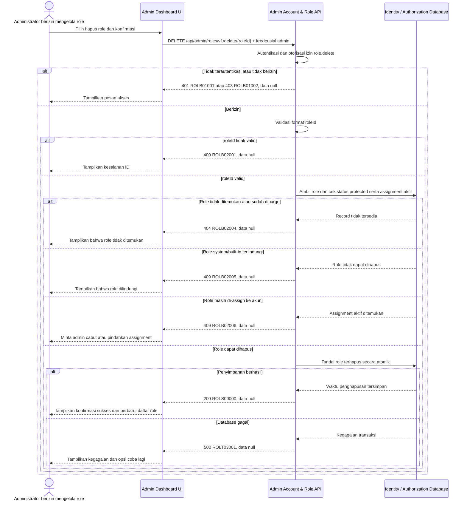

# Admin Dashboard - Delete Role Interface Agreement

> **Document Type:** IFA / API Contract  
> **Status:** Draft  
> **Service / Domain:** Admin Dashboard — Account & Role Management  
> **Consumer / Partner:** JokiHub Admin Dashboard (authorized administrator)

## Design


## Sequence Diagram



## Performance / SLA Targets

| Success Rate                                                  | VUser                              | CPU / Memory                                                                | Response Time              |
| ------------------------------------------------------------- | ---------------------------------- | --------------------------------------------------------------------------- | -------------------------- |
| 99.9% monthly availability; valid-request server error ≤ 0.1% | 50 VUser / 20 request/s NFT target | Initial 2 vCPU / 4 GiB per instance; CPU ≤ 70%, memory ≤ 75% at target load | Write p95 ≤ 1 s; p99 ≤ 2 s |

## General Information

| Component          | Value                                                                                                                                                                                                                                                   |
| ------------------ | ------------------------------------------------------------------------------------------------------------------------------------------------------------------------------------------------------------------------------------------------------- |
| Description        | Menghapus secara soft-delete custom role yang tidak terlindungi dan tidak memiliki assignment aktif. `SUPER_ADMIN` tidak dapat dihapus.                                                                                                                 |
| Resource URL       | `https://{host}/api/admin/roles/v1/delete/{roleId}`                                                                                                                                                                                                     |
| Transport Protocol | HTTPS, REST                                                                                                                                                                                                                                             |
| Request Verb       | DELETE                                                                                                                                                                                                                                                  |
| Content Type       | Tidak ada request body                                                                                                                                                                                                                                  |
| Interaction Type   | Synchronous                                                                                                                                                                                                                                             |
| Security Policy    | Gunakan cookie access admin valid, akun ACTIVE, dan session family belum dicabut dan permission `role.delete` dari katalog Sprint 1. Hanya custom role dapat dihapus secara soft-delete; lindungi role system. Audit event tidak dicatat pada Sprint 1. |

### Path / Endpoint

| Section        | Value                                 |
| -------------- | ------------------------------------- |
| Host / Domain  | `{host}` (environment-specific)       |
| Service Name   | Admin Account & Role                  |
| Version        | `v1`                                  |
| Resource       | `/admin/roles/v1/delete/{roleId}`     |
| Final Endpoint | `/api/admin/roles/v1/delete/{roleId}` |

### API Versioning

- **Decision:** New Endpoint
- **Previous Endpoint:** Tidak ada API delete role yang teridentifikasi pada solutioning sprint ini.
- **Final Endpoint:** `DELETE /api/admin/roles/v1/delete/{roleId}`
- **Backward Compatibility:** Belum ada consumer API delete role yang teridentifikasi. Penambahan field response opsional bersifat kompatibel; perubahan kontrak yang mematahkan consumer memerlukan major version baru.
- **Reason:** Admin Dashboard memerlukan penghapusan role yang terkontrol dengan pemeriksaan assignment dan protected role.

## Business Rules

**Rate limit:** 1.200 request/IP/menit dan 60 request/admin/menit. Pelampauan mengembalikan HTTP 429 dengan `Retry-After`.

**Autentikasi bersama:** Setiap request dashboard wajib memakai cookie access admin dari backend, Origin yang exact-match dengan allowlist, dan X-CSRF-Token. Backend memeriksa session family aktif serta status akun ACTIVE/non-deleted pada setiap autentikasi. Jika akun INACTIVE, request ditolak pada pemeriksaan berikutnya dan session family aktif dicabut. Setiap endpoint tetap memerlukan permission sesuai metode. Lihat [IFA login](../auth/login.md), [refresh token](../auth/refresh-token.md), dan [logout](../auth/logout.md).

1. Hanya Super Admin dengan cookie access admin valid, akun ACTIVE, dan session family belum dicabut dan permission `role.delete` yang dapat menghapus custom role.
2. Operasi menggunakan soft delete. Service mengisi `deleted_at` dan memperbarui `updated_at` secara atomik.
3. `SUPER_ADMIN` (`Super Admin`) adalah satu-satunya role hasil seed Sprint 1, ditandai `is_system=true`, dan tidak dapat dihapus oleh endpoint ini. Setiap upaya menghapusnya ditolak dengan `ROLB02005`. Role lain yang dibuat secara eksplisit setelah bootstrap mengikuti aturan delete custom role.
4. Role dengan assignment akun aktif tidak dapat dihapus. Admin harus terlebih dahulu mencabut assignment atau memindahkan akun ke role lain melalui proses yang disetujui. Kebijakan ini mencegah hilangnya otorisasi tanpa pengganti.
5. API tidak menghapus akun, permission catalog, atau riwayat assignment. Tidak ada cascade delete.
6. Jika role tombstone masih dalam retensi, delete berulang mengembalikan HTTP 200 dengan `data: null` tanpa mengubah data. ID yang tidak pernah ada atau sudah dipurge mengembalikan HTTP 404 `ROLB02004`.
7. Audit event tidak dicatat pada Sprint 1.
8. Pemeriksaan status protected, assignment aktif, dan penandaan soft delete harus dijalankan konsisten dalam satu transaksi atau memakai mekanisme concurrency yang setara.
9. Role terhapus tidak dapat dipulihkan melalui produk. Penghapusan berulang pada tombstone yang masih berada dalam retensi mengembalikan sukses yang sama; role yang sudah dipurge atau tidak pernah ada mengembalikan HTTP 404.
10. Jika model assignment tidak dapat memeriksa akun pemegang role secara andal, endpoint tidak boleh menghapus role sampai dependency tersebut tersedia.

## Request Headers

| Header   | E/N/T | Type   | M/O/C | Max Length | Description                                                                                                | Example                             |
| -------- | ----- | ------ | ----- | ---------: | ---------------------------------------------------------------------------------------------------------- | ----------------------------------- |
| `Cookie` | N     | String | M     |       4096 | Browser mengirim cookie access admin secara otomatis; token tidak dikirim melalui Authorization atau body. | `__Host-jokihub-admin-access={JWT}` |

| `Origin` | N | String | M | 2048 | Origin dashboard harus exact-match dengan allowlist API. | `https://dashboard.example.test` |
| `X-CSRF-Token` | N | String | M | 128 | CSRF token sinkronisasi untuk request cookie-authenticated. | `{csrf-token}` |
| `Accept` | N | String | O | 100 | Tipe media response yang diinginkan; default JSON. | `application/json` |
| `X-Request-Id` | N | String | O | 100 | ID korelasi request untuk tracing/support. | `req-6ef271` |

## Request Parameters

| Parameter | E/N/T | Type   | M/O/C | Max Length | Description                          | Example       |
| --------- | ----- | ------ | ----- | ---------: | ------------------------------------ | ------------- |
| `roleId`  | N     | String | M     |         64 | ID immutable role yang akan dihapus. | `role_01JXYZ` |

## Request Query Parameters

None.

## Request Body

Tidak ada request body.

### Request Validation

1. Request harus membawa cookie access admin valid, Origin dashboard yang diizinkan, CSRF token valid, akun ACTIVE/non-deleted, session family aktif, dan permission `role.delete`. Kembalikan `ROLB01001` bila belum terautentikasi dan `ROLB01002` bila permission tidak tersedia.
2. `roleId` wajib tersedia, tidak kosong, dan maksimal 64 karakter. ID memakai prefix `role_` diikuti suffix unik yang dibuat service; nilai tidak valid mengembalikan `ROLB02001`.
3. Role harus ditemukan. Jika masih aktif, lanjutkan soft delete. Jika sudah menjadi tombstone dalam retensi, kembalikan sukses yang sama; jika ID tidak pernah ada atau sudah dipurge, kembalikan HTTP 404 `ROLB02004`.
4. Role protected/system/built-in ditolak dengan `ROLB02005`.
5. Jika role memiliki satu atau lebih assignment akun aktif, tolak dengan `ROLB02006`. Tidak ada assignment yang dicabut otomatis.
6. Request body tidak digunakan. Parameter tambahan tidak mengubah target atau aturan penghapusan.
7. Perubahan status penghapusan harus tersimpan atomik. Kegagalan database mengembalikan HTTP 500 dan tidak mengungkap detail internal.

## Response Body

| Attribute | E/N/T | Type   | M/O/C | Max Length | Description                             | Example        |
| --------- | ----- | ------ | ----- | ---------: | --------------------------------------- | -------------- |
| `code`    | N     | String | M     |         20 | Service status code.                    | `ROLS00000`    |
| `message` | N     | String | O     |        200 | Pesan hasil untuk consumer.             | `Role deleted` |
| `data`    | N     | null   | M     |          — | Selalu `null` pada sukses maupun error. | `null`         |

### Success Example

```json
{
  "code": "ROLS00000",
  "message": "Role deleted",
  "data": null
}
```

### Business Error Example

```json
{
  "code": "ROLB02006",
  "message": "Role is assigned to one or more accounts",
  "data": null
}
```

### Technical Error Example

```json
{
  "code": "ROLT03001",
  "message": "Role service is temporarily unavailable",
  "data": null
}
```

## HTTP Status Codes

| HTTP Status | Usage                                                                                                                 |
| ----------- | --------------------------------------------------------------------------------------------------------------------- |
| `200`       | Role berhasil ditandai terhapus; response memakai `data: null`.                                                       |
| `400`       | ID role tidak valid.                                                                                                  |
| `401`       | Admin belum terautentikasi atau session tidak valid.                                                                  |
| `403`       | Admin tidak memiliki permission `role.delete`, Origin tidak diizinkan, atau CSRF tidak valid.                         |
| `404`       | Role ID tidak pernah ada atau sudah dipurge. Tombstone dalam retensi tetap mengembalikan sukses pada delete berulang. |
| `409`       | Role masih ditugaskan ke akun aktif atau role merupakan `SUPER_ADMIN`.                                                |
| `500`       | Kegagalan service atau database identity/authorization yang tidak terduga.                                            |
| `429`       | Rate limit terlampaui; response menyertakan header `Retry-After`.                                                     |

## Service Status Codes

Format: `[Service Prefix][Status Type][Category][Specific Error Code]`

| Code        | Type      | Category        | Meaning                                                     |
| ----------- | --------- | --------------- | ----------------------------------------------------------- |
| `ROLS00000` | Success   | General         | Role berhasil ditandai terhapus.                            |
| `ROLB01001` | Business  | Authentication  | Administrator belum terautentikasi.                         |
| `ROLB01002` | Business  | Authentication  | Administrator tidak memiliki izin role.delete.              |
| `ROLB02001` | Business  | User validation | `roleId` tidak tersedia atau format/panjangnya tidak valid. |
| `ROLB02004` | Business  | User validation | Role ID tidak pernah ada atau sudah dipurge.                |
| `ROLB02005` | Business  | User validation | Role system/built-in dilindungi dan tidak dapat dihapus.    |
| `ROLB02006` | Business  | User validation | Role masih memiliki assignment akun aktif.                  |
| `ROLT03001` | Technical | Database        | Role gagal diperbarui atau database tidak tersedia.         |

## API Exposure Classification

| Classification | Rationale                                                                                                         |
| -------------- | ----------------------------------------------------------------------------------------------------------------- |
| Public         | Route dashboard dapat diakses dari internet dan dilindungi session admin, permission, CORS allowlist, serta CSRF. |

## Testing & Documentation Scope

| Scope      | Required | Rationale / Handoff                                                                                                                                                                                                                     |
| ---------- | -------- | --------------------------------------------------------------------------------------------------------------------------------------------------------------------------------------------------------------------------------------- |
| NFT        | Yes      | API admin write baru. Uji penghapusan sukses, role tidak ditemukan, protected role, assignment aktif, concurrency dengan perubahan assignment, serta atomicity pada 50 VUser / 20 request per detik; ukur CPU/memory terhadap baseline. |
| VA/Pentest | Yes      | Endpoint mengubah kontrol akses. Uji authentication/authorization, IDOR pada `roleId`, bypass protected-role/assignment checks, privilege escalation, replay.                                                                           |

## Assumptions

- Soft delete menggunakan `deleted_at` adalah kebijakan yang berlaku. Role terhapus tidak dapat dipulihkan melalui produk, dikecualikan dari daftar/detail, lalu dipurge permanen setelah retensi 2 bulan.
- Endpoint `DELETE /api/admin/roles/v1/delete/{roleId}`, envelope `{code,message,data}`, prefix service `ROL`, dan kode status adalah kontrak Sprint 1 pada IFA ini. Mutasi sukses mengembalikan `data: null`.
- Role ERD Sprint 1 mendefinisikan `admin_role`, `account_role`, dan `deleted_at`. Penghapusan ditolak selama role masih memiliki assignment aktif; ERD mendefinisikan relasi dan penanda `deleted_at`.
- `ROLB02005` digunakan untuk role system yang dilindungi; `ROLB02006` digunakan untuk role dengan assignment aktif.
- Data role yang dihapus dipurge permanen setelah 2 bulan; tidak tersedia flow pemulihan. SLA dan HTTP status mengikuti BRD. Audit event tidak dicatat pada Sprint 1.
- Cakupan hanya menghapus definisi role; penghapusan permission catalog, pencabutan assignment akun otomatis, hard delete, dan pemindahan akun ke role pengganti tidak termasuk.

## References

- `./get-list-roles.md` — field dan aturan daftar role Sprint 1.
- `./get-detail-role.md` — detail role dan aturan permission visibility.
- `docs-game-service-platform/sprint_1/solutioning/TEMPLATE.md` — template kontrak API sprint.
