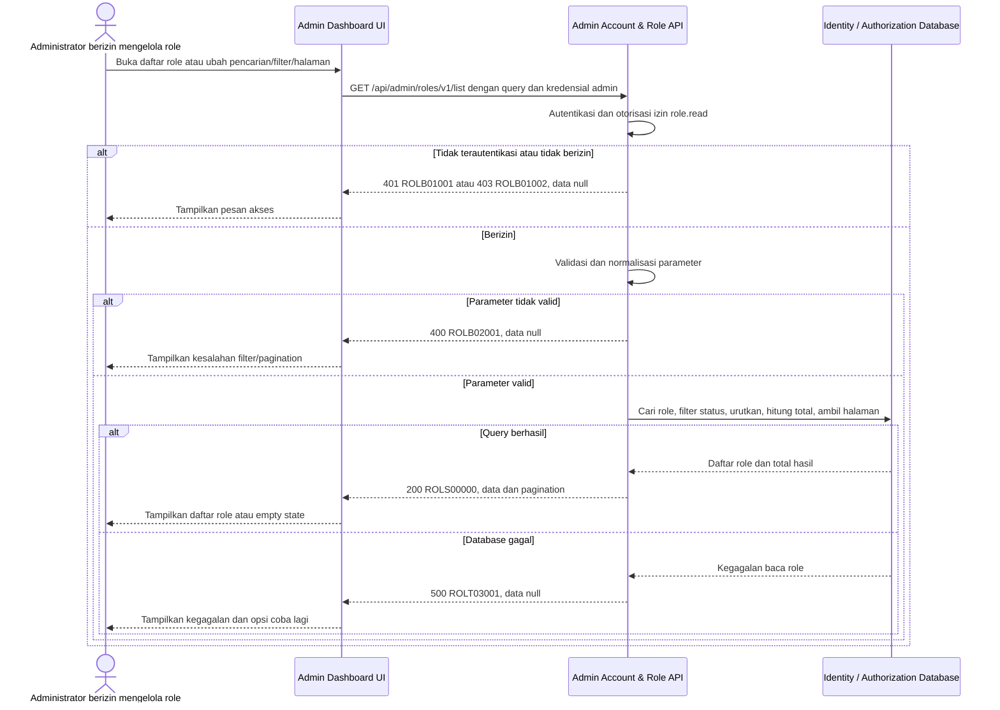

# Admin Dashboard - Get List Roles Interface Agreement

> **Document Type:** IFA / API Contract  
> **Status:** Draft  
> **Service / Domain:** Admin Dashboard — Account & Role Management  
> **Consumer / Partner:** JokiHub Admin Dashboard (authorized administrator)

## Design


## Sequence Diagram



## Performance / SLA Targets

| Success Rate                                                  | VUser                              | CPU / Memory                                                                | Response Time                |
| ------------------------------------------------------------- | ---------------------------------- | --------------------------------------------------------------------------- | ---------------------------- |
| 99.9% monthly availability; valid-request server error ≤ 0.1% | 50 VUser / 20 request/s NFT target | Initial 2 vCPU / 4 GiB per instance; CPU ≤ 70%, memory ≤ 75% at target load | Read p95 ≤ 500 ms; p99 ≤ 2 s |

## General Information

| Component          | Value                                                                                                                                                                                                                                                    |
| ------------------ | -------------------------------------------------------------------------------------------------------------------------------------------------------------------------------------------------------------------------------------------------------- |
| Description        | Mengambil daftar role, termasuk `SUPER_ADMIN` dan custom role yang dibuat eksplisit, untuk Admin Dashboard.                                                                                                                                              |
| Resource URL       | `https://{host}/api/admin/roles/v1/list`                                                                                                                                                                                                                 |
| Transport Protocol | HTTPS, REST                                                                                                                                                                                                                                              |
| Request Verb       | GET                                                                                                                                                                                                                                                      |
| Content Type       | Tidak ada request body                                                                                                                                                                                                                                   |
| Interaction Type   | Synchronous                                                                                                                                                                                                                                              |
| Security Policy    | Gunakan cookie access admin valid, akun ACTIVE, dan session family belum dicabut dan permission `role.read` dari katalog Sprint 1. Kembalikan seluruh permission yang ditetapkan pada role; terapkan rate limiting. Sprint 1 tidak mencatat audit event. |

### Path / Endpoint

| Section        | Value                           |
| -------------- | ------------------------------- |
| Host / Domain  | `{host}` (environment-specific) |
| Service Name   | Admin Account & Role            |
| Version        | `v1`                            |
| Resource       | `/admin/roles/v1/list`          |
| Final Endpoint | `/api/admin/roles/v1/list`      |

### API Versioning

- **Decision:** New Endpoint
- **Previous Endpoint:** Tidak ada API get list role yang teridentifikasi pada solutioning sprint ini.
- **Final Endpoint:** `GET /api/admin/roles/v1/list`
- **Backward Compatibility:** Belum ada consumer API daftar role yang teridentifikasi. Penambahan field response opsional bersifat kompatibel; perubahan kontrak yang mematahkan consumer memerlukan major version baru.
- **Reason:** Admin Dashboard memerlukan daftar role yang dapat dicari dan ditinjau.

## Business Rules

**Rate limit:** 1.200 request/IP/menit dan 600 request/admin/menit. Pelampauan mengembalikan HTTP 429 dengan `Retry-After`.

**Autentikasi bersama:** Setiap request dashboard wajib memakai cookie access admin dari backend, Origin yang exact-match dengan allowlist, dan X-CSRF-Token. Backend memeriksa session family aktif serta status akun ACTIVE/non-deleted pada setiap autentikasi. Jika akun INACTIVE, request ditolak pada pemeriksaan berikutnya dan session family aktif dicabut. Setiap endpoint tetap memerlukan permission sesuai metode. Lihat [IFA login](../auth/login.md), [refresh token](../auth/refresh-token.md), dan [logout](../auth/logout.md).

1. Hanya administrator dengan cookie access admin valid, akun ACTIVE/non-deleted, session family aktif, Origin allowlist, dan CSRF token valid dan permission `role.read` yang dapat mengakses endpoint.
2. Pada seed awal Sprint 1, hasil hanya memuat satu role aktif `SUPER_ADMIN` (`Super Admin`) dengan `isSystem=true`. Role ini selalu ditampilkan dan tidak dapat dihapus. Custom roles hanya muncul setelah dibuat eksplisit; role dengan `deleted_at` terisi dikecualikan.
3. Pencarian mencocokkan `name` atau `code` secara case-insensitive setelah trim. Pencarian permission tidak termasuk dalam kontrak ini.
4. Filter `status` menerima `ACTIVE` atau `INACTIVE`.
5. Hasil diurutkan secara deterministik berdasarkan `createdAt` descending secara default; tie-breaker `id` ascending. `sortBy` dapat memilih `name`, `createdAt`, atau `updatedAt`; `sortOrder` dapat memilih `ASC` atau `DESC`.
6. Pagination menggunakan `page` berbasis 1 dan `limit` sebagai jumlah record per halaman. Default `page=1`, default `limit=10`, maksimum `limit=100`.
7. `total` mencakup semua hasil yang memenuhi filter sebelum pagination; `totalPages` bernilai `0` bila tidak ada hasil.
8. Response memuat key permission untuk tiap role agar daftar bisa menampilkan jumlah permission atau dipakai sebagai pilihan; deskripsi permission tidak dikembalikan. Bila daftar role besar, evaluasi endpoint detail/summary terpisah.
9. Daftar permission menampilkan seluruh key permission yang ditetapkan pada role.
10. Endpoint hanya membaca data dan tidak mengubah role atau assignment akun.

## Request Headers

| Header   | E/N/T | Type   | M/O/C | Max Length | Description                                                                                                | Example                             |
| -------- | ----- | ------ | ----- | ---------: | ---------------------------------------------------------------------------------------------------------- | ----------------------------------- |
| `Cookie` | N     | String | M     |       4096 | Browser mengirim cookie access admin secara otomatis; token tidak dikirim melalui Authorization atau body. | `__Host-jokihub-admin-access={JWT}` |

| `Origin` | N | String | M | 2048 | Origin dashboard harus exact-match dengan allowlist API. | `https://dashboard.example.test` |
| `X-CSRF-Token` | N | String | M | 128 | CSRF token sinkronisasi untuk request cookie-authenticated. | `{csrf-token}` |
| `Accept` | N | String | O | 100 | Tipe media response yang diinginkan; default JSON. | `application/json` |
| `X-Request-Id` | N | String | O | 100 | ID korelasi request untuk tracing/support. | `req-890bc2` |

## Request Parameters

None.

## Request Query Parameters

| Parameter   | E/N/T | Type    | M/O/C | Max Length | Description                                                                           | Example     |
| ----------- | ----- | ------- | ----- | ---------: | ------------------------------------------------------------------------------------- | ----------- |
| `search`    | N     | String  | O     |        100 | Cari pada `name` dan `code`; trim sebelum pencarian.                                  | `support`   |
| `status`    | N     | String  | O     |         20 | Filter status role: `ACTIVE` atau `INACTIVE`.                                         | `ACTIVE`    |
| `sortBy`    | N     | String  | O     |         20 | Field urutan: `name`, `createdAt`, `updatedAt`; default `createdAt`.                  | `createdAt` |
| `sortOrder` | N     | String  | O     |          4 | Arah urutan `ASC`/`DESC`; default `DESC`.                                             | `DESC`      |
| `page`      | N     | Integer | O     |  10 digits | Nomor halaman berbasis 1; default `1`.                                                | `1`         |
| `limit`     | N     | Integer | O     |  10 digits | Jumlah record per halaman (bukan batas teks pencarian); default `10`, maksimum `100`. | `10`        |

## Request Body

Tidak ada request body.

### Request Validation

1. Request harus membawa cookie access admin valid, Origin dashboard yang diizinkan, CSRF token valid, akun ACTIVE/non-deleted, session family aktif, dan permission `role.read`. Kembalikan HTTP 401 `ROLB01001` bila belum terautentikasi dan HTTP 403 `ROLB01002` bila permission tidak tersedia.
2. `search`, bila dikirim, harus berupa string maksimal 100 karakter setelah trim.
3. `status`, bila dikirim, harus `ACTIVE` atau `INACTIVE`; nilai lain mengembalikan `ROLB02001`.
4. `sortBy` harus `name`, `createdAt`, atau `updatedAt`; `sortOrder` harus `ASC` atau `DESC`. Default `createdAt DESC`, lalu `id ASC`.
5. `page` harus integer lebih besar atau sama dengan 1. Default `1`.
6. `limit` harus integer antara 1 dan 100. Default `10`.
7. Parameter query yang tidak dikenal diabaikan.
8. Hasil kosong adalah respons sukses dengan `roles: []`, `total: 0`, dan `totalPages: 0`.
9. Kegagalan baca database mengembalikan HTTP 500 tanpa detail internal.

## Response Body

| Attribute               | E/N/T | Type                 | M/O/C |    Max Length | Description                                                                                | Example                           |
| ----------------------- | ----- | -------------------- | ----- | ------------: | ------------------------------------------------------------------------------------------ | --------------------------------- |
| `code`                  | N     | String               | M     |            20 | Service status code.                                                                       | `ROLS00000`                       |
| `message`               | N     | String               | O     |           200 | Pesan hasil untuk consumer.                                                                | `Role list retrieved`             |
| `data`                  | N     | Array of Object/null | M     |             — | Daftar role; `null` ketika error.                                                          | `[]`                              |
| `data[]`                | N     | Object               | M     | `limit` items | Satu role pada halaman yang diminta.                                                       | `{}`                              |
| `data[].id`             | N     | String               | M     |            64 | ID role immutable.                                                                         | `role_01JXYZ`                     |
| `data[].name`           | N     | String               | M     |           100 | Nama tampilan role.                                                                        | `Support Agent`                   |
| `data[].code`           | N     | String               | M     |            50 | Kode role unik.                                                                            | `SUPPORT_AGENT`                   |
| `data[].description`    | N     | String/null          | O     |           500 | Deskripsi role.                                                                            | `Menangani pertanyaan pelanggan.` |
| `data[].status`         | N     | String               | C     |            20 | Status role (`ACTIVE`/`INACTIVE`); initial Super Admin is `ACTIVE`.                        | `ACTIVE`                          |
| `data[].isSystem`       | N     | Boolean              | M     |             — | `true` untuk seeded `SUPER_ADMIN`; penanda bahwa role immutable.                           | `true`                            |
| `data[].permissions`    | N     | Array of String      | M     |     100 items | Key permission yang diberikan ke role; akses penuh `SUPER_ADMIN` ditandai `isSystem=true`. | `["role.read", "game.read"]`      |
| `data[].createdAt`      | N     | String (date-time)   | M     |            35 | Waktu pembuatan ISO 8601 UTC.                                                              | `2026-10-11T09:45:00Z`            |
| `data[].updatedAt`      | N     | String (date-time)   | M     |            35 | Waktu perubahan terakhir ISO 8601 UTC.                                                     | `2026-10-11T09:45:00Z`            |
| `pagination`            | N     | Object               | M     |             — | Metadata pagination.                                                                       | `{}`                              |
| `pagination.page`       | N     | Integer              | M     |     10 digits | Halaman yang dikembalikan.                                                                 | `1`                               |
| `pagination.limit`      | N     | Integer              | M     |     10 digits | Ukuran halaman efektif.                                                                    | `10`                              |
| `pagination.total`      | N     | Integer              | M     |     10 digits | Jumlah seluruh hasil setelah filter.                                                       | `1`                               |
| `pagination.totalPages` | N     | Integer              | M     |     10 digits | Jumlah halaman; `0` bila tidak ada hasil.                                                  | `1`                               |

### Success Example

```json
{
  "code": "ROLS00000",
  "message": "Role list retrieved",
  "data": [
    {
      "id": "role_01JXYZ",
      "name": "Super Admin",
      "code": "SUPER_ADMIN",
      "description": "Role system dengan akses ke seluruh fungsi admin.",
      "status": "ACTIVE",
      "isSystem": true,
      "permissions": [
        "role.read",
        "role.create",
        "role.update",
        "role.delete",
        "admin-account.read",
        "game.read",
        "game.create",
        "game.update",
        "game.delete"
      ],
      "createdAt": "2026-10-11T09:45:00Z",
      "updatedAt": "2026-10-11T09:45:00Z"
    },
    {
      "id": "role_01JABC",
      "name": "Support Agent",
      "code": "SUPPORT_AGENT",
      "description": "Melihat role, akun admin, dan katalog game.",
      "status": "ACTIVE",
      "isSystem": false,
      "permissions": ["role.read", "admin-account.read", "game.read"],
      "createdAt": "2026-10-12T09:45:00Z",
      "updatedAt": "2026-10-12T09:45:00Z"
    }
  ],
  "pagination": {
    "page": 1,
    "limit": 10,
    "total": 2,
    "totalPages": 1
  }
}
```

### Business Error Example

```json
{
  "code": "ROLB02001",
  "message": "Invalid role-list query parameters",
  "data": null
}
```

### Technical Error Example

```json
{
  "code": "ROLT03001",
  "message": "Role service is temporarily unavailable",
  "data": null
}
```

## HTTP Status Codes

| HTTP Status | Usage                                                                                                 |
| ----------- | ----------------------------------------------------------------------------------------------------- |
| `200`       | Daftar berhasil diambil, termasuk ketika hasil kosong.                                                |
| `400`       | Query tidak valid.                                                                                    |
| `401`       | Admin belum terautentikasi atau session tidak valid.                                                  |
| `403`       | Admin tidak memiliki permission `role.read`, Origin tidak diizinkan, atau CSRF tidak valid.           |
| `500`       | Kegagalan service atau database identity/authorization yang tidak terduga.                            |
| `429`       | Rate limit terlampaui; response memakai `ROLB02007` dan menyertakan header `Retry-After` dalam detik. |

## Service Status Codes

Format: `[Service Prefix][Status Type][Category][Specific Error Code]`

| Code        | Type      | Category        | Meaning                                                                      |
| ----------- | --------- | --------------- | ---------------------------------------------------------------------------- |
| `ROLS00000` | Success   | General         | Daftar role berhasil dikembalikan.                                           |
| `ROLB01001` | Business  | Authentication  | Administrator belum terautentikasi.                                          |
| `ROLB01002` | Business  | Authentication  | Administrator tidak memiliki izin role.read.                                 |
| `ROLB02001` | Business  | User validation | Parameter pencarian, status, atau pagination tidak valid.                    |
| `ROLB02007` | Business  | User validation | Batas request role tercapai; response menyertakan `Retry-After` dalam detik. |
| `ROLT03001` | Technical | Database        | Daftar role gagal dibaca atau database tidak tersedia.                       |

## API Exposure Classification

| Classification | Rationale                                                                                                           |
| -------------- | ------------------------------------------------------------------------------------------------------------------- |
| Public         | Route dashboard dapat dijangkau dari internet dan dilindungi session admin, permission, CORS allowlist, serta CSRF. |

## Testing & Documentation Scope

| Scope      | Required | Rationale / Handoff                                                                                                                                                                        |
| ---------- | -------- | ------------------------------------------------------------------------------------------------------------------------------------------------------------------------------------------ |
| NFT        | Yes      | API admin baru. Uji pencarian, filter status, pagination, empty result, permission visibility, serta beban 50 VUser / 20 request per detik dan target CPU/memory baseline.                 |
| VA/Pentest | Yes      | Data otorisasi admin. Uji authentication/authorization, permission disclosure, privilege boundaries, parameter tampering, dan akses lintas tenant/organisasi bila konsep tersebut berlaku. |

## Assumptions

- Endpoint `/api/admin/roles/v1/list`, query parameters, response envelope, prefix `ROL`, dan HTTP mapping adalah kontrak target Sprint 1.
- Field `status`, permission keys, dan timestamps mengikuti kontrak create-role dan Role ERD Sprint 1.
- Role list memakai default `limit=10`, maksimum `100`, pencarian name/code case-insensitive, dan sortBy name/createdAt/updatedAt dengan ASC/DESC. `SUPER_ADMIN` wajib disertakan dan `isSystem=true`.
- Seluruh permission keys pada role ditampilkan kepada pemanggil yang memiliki `role.read`.
- Audit event tidak dicatat pada Sprint 1. SLA dan HTTP status mengikuti BRD. Identifier target role.read mengikuti katalog permission Sprint 1.
- Cakupan hanya daftar role; detail, create, update, delete, dan assignment role ke akun berada di API terpisah.

## References

- `docs-game-service-platform/sprint_1/solutioning/TEMPLATE.md` — template kontrak API sprint.
- `docs-game-service-platform/sprint_1/solutioning/dashboard/games/get-list-games.md` — pola daftar admin, filter, pagination, dan response envelope.
