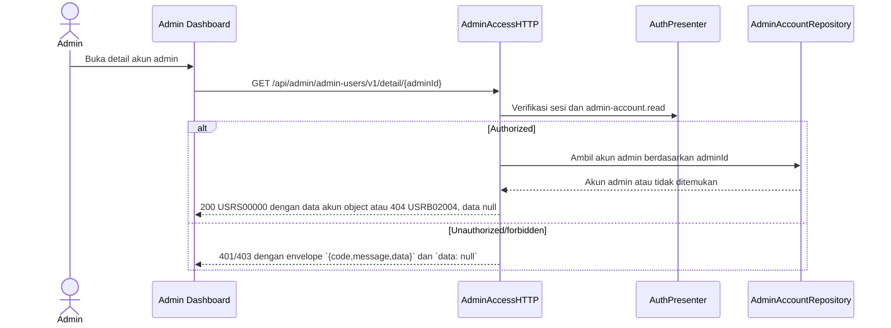

# Get Admin Account Detail — Interface Agreement

> **Document Type:** IFA / API Contract  
> **Status:** Sprint 1 target  
> **Service / Domain:** Admin Access and Accounts  
> **Consumer / Partner:** JokiHub Admin Dashboard

## Design


Dokumen ini menetapkan kontrak untuk melihat detail akun admin pada Sprint 1.

## Sequence Diagram



## Performance / SLA Targets

| Success Rate                                                  | VUser                             | CPU / Memory                                                                 | Response Time                |
| ------------------------------------------------------------- | --------------------------------- | ---------------------------------------------------------------------------- | ---------------------------- |
| 99.9% monthly availability; valid-request server error ≤ 0.1% | 50 VUser, 20 request/s NFT target | Baseline 2 vCPU / 4 GiB per instance; CPU ≤ 70%, memory ≤ 75% at target load | Read p95 ≤ 500 ms; p99 ≤ 2 s |

## General Information

| Component          | Value                                                                                                         |
| ------------------ | ------------------------------------------------------------------------------------------------------------- |
| Description        | Mengambil detail satu akun administrator berdasarkan ID.                                                      |
| Resource URL       | `https://{host}/api/admin/admin-users/v1/detail/{adminId}`                                                    |
| Transport Protocol | HTTPS REST                                                                                                    |
| Request Verb       | GET                                                                                                           |
| Content Type       | Tidak ada request body                                                                                        |
| Interaction Type   | Synchronous                                                                                                   |
| Security Policy    | Cookie access admin valid, akun ACTIVE, dan session family belum dicabut dan permission `admin-account.read`. |

### Path / Endpoint

| Section        | Value                                            |
| -------------- | ------------------------------------------------ |
| Host / Domain  | `{host}`                                         |
| Service Name   | Admin Access                                     |
| Version        | `v1`                                             |
| Resource       | `/admin/admin-users/v1/detail/{adminId}`         |
| Final Endpoint | `GET /api/admin/admin-users/v1/detail/{adminId}` |

### API Versioning

- **Decision:** Use route v1 yang ditetapkan untuk Sprint 1.
- **Backward Compatibility:** Pertahankan path/action dan ID path parameter yang berjalan.
- **Reason:** Tidak ada permintaan perubahan endpoint atau major-version dalam sumber.

## Business Rules

**Rate limit:** 1.200 request/IP/menit dan 600 request/admin/menit. Pelampauan mengembalikan HTTP 429 dengan `Retry-After`.

**Autentikasi bersama:** Setiap request dashboard wajib memakai cookie access admin dari backend, Origin yang exact-match dengan allowlist, dan X-CSRF-Token. Backend memeriksa session family aktif serta status akun ACTIVE/non-deleted pada setiap autentikasi. Jika akun INACTIVE, request ditolak pada pemeriksaan berikutnya dan session family aktif dicabut. Setiap endpoint tetap memerlukan permission sesuai metode. Lihat [IFA login](../auth/login.md), [refresh token](../auth/refresh-token.md), dan [logout](../auth/logout.md).

1. Endpoint hanya mengakses `AdminAccount` administrator.
2. Pemanggil harus memiliki cookie access admin valid, akun ACTIVE, dan session family belum dicabut dan permission `admin-account.read`.
3. Akun tidak ditemukan atau soft-deleted menghasilkan `404 USRB02004`. Akun `INACTIVE` tidak dapat login dan session aktifnya dibatalkan pada pemeriksaan autentikasi berikutnya.
4. Setiap akun administrator hanya memiliki satu role aktif; response menyajikannya sebagai object `role` tunggal.
5. Response hanya memuat projection admin; credential dan password hash tidak dikembalikan.
6. Response mengikuti envelope Sprint 1 `{code, message, data}`.

## Request Headers

| Header         | Type   | M/O/C | Max Length | Description                                                                                                | Example                             |
| -------------- | ------ | ----- | ---------: | ---------------------------------------------------------------------------------------------------------- | ----------------------------------- |
| `Cookie`       | String | M     |       4096 | Browser mengirim cookie access admin secara otomatis; token tidak dikirim melalui Authorization atau body. | `__Host-jokihub-admin-access={JWT}` |
| `Origin`       | String | M     |       2048 | Origin dashboard harus exact-match dengan allowlist API.                                                   | `https://dashboard.example.test`    |
| `X-CSRF-Token` | String | M     |        128 | CSRF token sinkronisasi untuk request cookie-authenticated.                                                | `{csrf-token}`                      |

## Request Parameters

| Parameter | Type   | M/O/C | Max Length | Description                                   | Example        |
| --------- | ------ | ----- | ---------: | --------------------------------------------- | -------------- |
| `adminId` | String | M     |         64 | ID akun administrator dengan prefix `admin_`. | `admin_01JXYZ` |

### Request Validation

1. `adminId` harus diawali `admin_` dan memiliki suffix nonkosong.
2. Akun yang tidak ditemukan atau soft-deleted dipetakan ke `404 USRB02004`.

## Response Body

| Attribute          | Type          | M/O/C | Max Length | Description                                           | Example                                                                        |
| ------------------ | ------------- | ----- | ---------: | ----------------------------------------------------- | ------------------------------------------------------------------------------ |
| `code`             | String        | M     |         10 | Kode hasil API.                                       | `USRS00000`                                                                    |
| `message`          | String        | M     |        200 | Pesan hasil.                                          | `Detail admin berhasil diambil.`                                               |
| `data`             | Object/null   | C     |          — | Projection akun admin langsung; `null` pada error.    | `{}`                                                                           |
| `data.id`          | String        | C     |         64 | ID akun administrator dengan prefix `admin_`.         | `admin_01JXYZ`                                                                 |
| `data.username`    | String        | C     |         30 | Username administrator.                               | `support.ops`                                                                  |
| `data.name`        | String        | C     |        150 | Nama tampilan.                                        | `Support Admin`                                                                |
| `data.email`       | String        | C     |        254 | Email administrator.                                  | `support@example.test`                                                         |
| `data.status`      | String        | C     |          — | `ACTIVE` atau `INACTIVE`.                             | `ACTIVE`                                                                       |
| `data.role`        | Object        | C     |          — | Satu role aktif `{id,name,code,system}`.              | `{"id":"role_01JXYZ","name":"Super Admin","code":"SUPER_ADMIN","system":true}` |
| `data.role.id`     | String        | C     |         64 | ID role dengan prefix `role_`.                        | `role_01JXYZ`                                                                  |
| `data.role.name`   | String        | C     |        100 | Nama role.                                            | `Super Admin`                                                                  |
| `data.role.code`   | String        | C     |         50 | Kode role.                                            | `SUPER_ADMIN`                                                                  |
| `data.role.system` | Boolean       | C     |          — | `true` untuk role system `SUPER_ADMIN`.               | `true`                                                                         |
| `data.lastActive`  | DateTime/null | C     |          — | Waktu aktivitas terakhir; `null` bila belum tersedia. | `null`                                                                         |
| `data.updatedAt`   | DateTime      | C     |          — | Waktu perubahan data akun terakhir.                   | `2026-10-23T10:00:00Z`                                                         |

### Success Example

```json
{
  "code": "USRS00000",
  "message": "Detail admin berhasil diambil.",
  "data": {
    "id": "admin_01JXYZ",
    "username": "support.ops",
    "name": "Support Admin",
    "email": "support@example.test",
    "status": "ACTIVE",
    "role": {
      "id": "role_01JXYZ",
      "name": "Super Admin",
      "code": "SUPER_ADMIN",
      "system": true
    },
    "lastActive": null,
    "updatedAt": "2026-10-23T10:00:00Z"
  }
}
```

### Business Error Example

```json
{
  "code": "USRB02004",
  "message": "Akun admin tidak ditemukan.",
  "data": null
}
```

### Technical Error Example

```json
{
  "code": "USRT03001",
  "message": "Layanan admin tidak tersedia.",
  "data": null
}
```

## HTTP Status Codes

| HTTP Status | Usage                                                             |
| ----------- | ----------------------------------------------------------------- |
| 200         | Detail berhasil diambil.                                          |
| 401         | Sesi admin tidak tersedia atau tidak valid.                       |
| 403         | Permission `admin-account.read` tidak tersedia.                   |
| 404         | Akun admin tidak ditemukan atau tidak tersedia.                   |
| 500         | Kegagalan repository/service yang dipetakan ke error teknis.      |
| `429`       | Rate limit terlampaui; response menyertakan header `Retry-After`. |

## Service Status Codes

| Code        | Type      | Category | Meaning                                     |
| ----------- | --------- | -------- | ------------------------------------------- |
| `USRS00000` | Success   | 00       | Detail akun admin berhasil diambil.         |
| `USRB01001` | Business  | 01       | Sesi admin tidak tersedia atau tidak valid. |
| `USRB01002` | Business  | 01       | Permission ditolak.                         |
| `USRB02004` | Business  | 02       | Akun admin tidak ditemukan.                 |
| `USRT03001` | Technical | 03       | Kegagalan persistence akun admin.           |

## API Exposure Classification

| Classification | Rationale                                                                                                         |
| -------------- | ----------------------------------------------------------------------------------------------------------------- |
| Public         | Route dashboard dapat diakses dari internet dan dilindungi session admin, permission, CORS allowlist, serta CSRF. |

## Testing & Documentation Scope

| Scope      | Required | Rationale / Handoff                                                                               |
| ---------- | -------- | ------------------------------------------------------------------------------------------------- |
| NFT        | Yes      | Uji ID valid/tidak valid, akun tidak ada/soft-deleted, 50 VUser / 20 request/s, dan SLA baseline. |
| VA/Pentest | Yes      | Uji authorization, IDOR lintas akun, PII exposure, dan kebocoran credential.                      |

## Sprint 1 Alignment

- ERD akun memakai ID dengan prefix admin_ sesuai IFA.

API daftar dan detail akun admin memakai permission `admin-account.read` dari katalog permission. Kebijakan autentikasi admin dijelaskan pada IFA auth.

## References

- [List Admin Accounts IFA](./get-list-admin-accounts.md)
