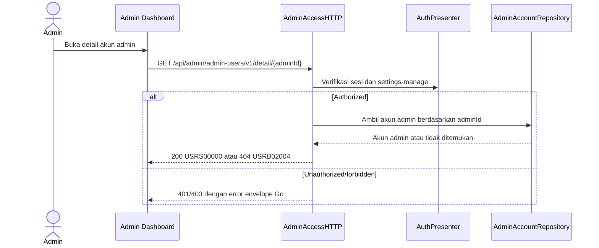

# Get Admin Account Detail — Interface Agreement

> **Document Type:** IFA / API Contract  
> **Status:** Source-mapped draft  
> **Service / Domain:** Admin Access and Accounts  
> **Consumer / Partner:** JokiHub Admin Dashboard

## Design

UI design reference belum tersedia. Dokumen ini memetakan endpoint Go yang berjalan.

## Sequence Diagram



## Performance / SLA Targets

| Success Rate                                                  | VUser                             | CPU / Memory                                                                 | Response Time                |
| ------------------------------------------------------------- | --------------------------------- | ---------------------------------------------------------------------------- | ---------------------------- |
| 99.9% monthly availability; valid-request server error ≤ 0.1% | 50 VUser, 20 request/s NFT target | Baseline 2 vCPU / 4 GiB per instance; CPU ≤ 70%, memory ≤ 75% at target load | Read p95 ≤ 500 ms; p99 ≤ 2 s |

## General Information

| Component          | Value                                                      |
| ------------------ | ---------------------------------------------------------- |
| Description        | Mengambil detail satu akun administrator berdasarkan ID.   |
| Resource URL       | `https://{host}/api/admin/admin-users/v1/detail/{adminId}` |
| Transport Protocol | HTTPS REST                                                 |
| Request Verb       | GET                                                        |
| Content Type       | Tidak ada request body                                     |
| Interaction Type   | Synchronous                                                |
| Security Policy    | Sesi admin valid dan permission `settings-manage`.         |

### Path / Endpoint

| Section        | Value                                            |
| -------------- | ------------------------------------------------ |
| Host / Domain  | `{host}`                                         |
| Service Name   | Admin Access                                     |
| Version        | `v1`                                             |
| Resource       | `/admin/admin-users/v1/detail/{adminId}`         |
| Final Endpoint | `GET /api/admin/admin-users/v1/detail/{adminId}` |

### API Versioning

- **Decision:** Existing v1 route, source-mapped.
- **Backward Compatibility:** Pertahankan path/action dan ID path parameter yang berjalan.
- **Reason:** Tidak ada permintaan perubahan endpoint atau major-version dalam sumber.

## Business Rules

1. Endpoint hanya mengakses `AdminAccount` administrator.
2. Pemanggil harus memiliki sesi admin valid dan permission `settings-manage`.
3. Akun tidak ditemukan atau soft-deleted menghasilkan `404 USRB02004`.
4. Response hanya memuat projection admin; credential dan password hash tidak dikembalikan.
5. Current Go response envelope adalah `{code,message,data?}`; ini bukti implementasi, bukan keputusan format target lintas API.

## Request Headers

| Header          | Type   | M/O/C | Max Length | Description                                             | Example                       |
| --------------- | ------ | ----- | ---------: | ------------------------------------------------------- | ----------------------------- |
| `Authorization` | String | C     |        TBD | Bearer admin token; handler juga menerima admin cookie. | `Bearer {admin-access-token}` |

## Request Parameters

| Parameter | Type   | M/O/C | Max Length | Description                             | Example                    |
| --------- | ------ | ----- | ---------: | --------------------------------------- | -------------------------- |
| `adminId` | String | M     |         24 | ID akun admin dalam Mongo ObjectID hex. | `507f1f77bcf86cd799439011` |

### Request Validation

1. `adminId` harus berupa 24 karakter hex ObjectID.
2. Akun yang tidak ditemukan atau soft-deleted dipetakan ke `404 USRB02004`.

## Response Body

Current Go wire envelope `{code,message,data?}`; field berikut adalah source projection.

| Attribute             | Type     | M/O/C | Max Length | Description                               | Example                          |
| --------------------- | -------- | ----- | ---------: | ----------------------------------------- | -------------------------------- |
| `code`                | String   | M     |         10 | Kode hasil Go service.                    | `USRS00000`                      |
| `message`             | String   | M     |        200 | Pesan hasil.                              | `Detail admin berhasil diambil.` |
| `data.admin`          | Object   | C     |          — | Projection akun admin.                    | `{}`                             |
| `data.admin.id`       | String   | C     |         24 | Mongo ObjectID hex.                       | `507f1f77bcf86cd799439011`       |
| `data.admin.username` | String   | C     |         30 | Username administrator.                   | `support.ops`                    |
| `data.admin.name`     | String   | C     |        150 | Nama tampilan.                            | `Support Admin`                  |
| `data.admin.email`    | String   | C     |        254 | Email administrator.                      | `support@example.test`           |
| `data.admin.status`   | String   | C     |          — | `ACTIVE` atau `INACTIVE`.                 | `ACTIVE`                         |
| `data.admin.roleIds`  | String[] | C     |          — | ID role aktif.                            | `[]`                             |
| `data.admin.roles[]`  | Object[] | C     |          — | Assignment aktif `{id,name,code,system}`. | `[]`                             |

### Success Example

```json
{
  "code": "USRS00000",
  "message": "Detail admin berhasil diambil.",
  "data": {
    "admin": {
      "id": "507f1f77bcf86cd799439011",
      "username": "support.ops",
      "name": "Support Admin",
      "email": "support@example.test",
      "status": "ACTIVE",
      "roleIds": [],
      "roles": []
    }
  }
}
```

### Business Error Example

```json
{ "code": "USRB02004", "message": "Akun admin tidak ditemukan.", "data": null }
```

### Technical Error Example

```json
{ "code": "USRT03001", "message": "Layanan admin tidak tersedia.", "data": null }
```

## HTTP Status Codes

| HTTP Status | Usage                                                        |
| ----------- | ------------------------------------------------------------ |
| 200         | Detail berhasil diambil.                                     |
| 401         | Sesi admin tidak tersedia atau tidak valid.                  |
| 403         | Permission `settings-manage` tidak tersedia.                 |
| 404         | Akun admin tidak ditemukan atau tidak tersedia.              |
| 500         | Kegagalan repository/service yang dipetakan ke error teknis. |

## Service Status Codes

| Code        | Type      | Category | Meaning                                     |
| ----------- | --------- | -------- | ------------------------------------------- |
| `USRS00000` | Success   | 00       | Detail akun admin berhasil diambil.         |
| `USRB01001` | Business  | 01       | Sesi admin tidak tersedia atau tidak valid. |
| `USRB01002` | Business  | 01       | Permission ditolak.                         |
| `USRB02004` | Business  | 02       | Akun admin tidak ditemukan.                 |
| `USRT03001` | Technical | 03       | Kegagalan persistence akun admin.           |

## API Exposure Classification

| Classification | Rationale                                                                                                |
| -------------- | -------------------------------------------------------------------------------------------------------- |
| Public         | Endpoint dashboard dapat dijangkau web; wajib autentikasi, authorization, audit, dan proteksi perimeter. |

## Testing & Documentation Scope

| Scope      | Required | Rationale / Handoff                                                                               |
| ---------- | -------- | ------------------------------------------------------------------------------------------------- |
| NFT        | Yes      | Uji ID valid/tidak valid, akun tidak ada/soft-deleted, 50 VUser / 20 request/s, dan SLA baseline. |
| VA/Pentest | Yes      | Uji authorization, IDOR lintas akun, PII exposure, dan kebocoran credential.                      |

## References

- [Admin account IFA index](README.md)
- `../../../../../go-game-service-platform/internal/controller/http/admin_access_http.go`
