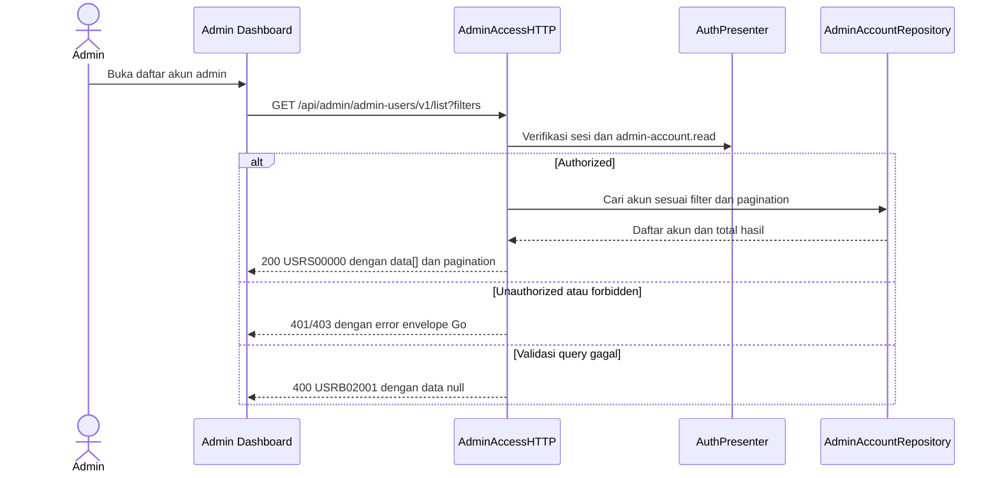

# Get List Admin Accounts — Interface Agreement

> **Document Type:** IFA / API Contract  
> **Status:** Source-mapped draft  
> **Service / Domain:** Admin Access and Accounts  
> **Consumer / Partner:** JokiHub Admin Dashboard

## Design


## Sequence Diagram



## Performance / SLA Targets

| Success Rate                                                  | VUser                             | CPU / Memory                                                                 | Response Time                |
| ------------------------------------------------------------- | --------------------------------- | ---------------------------------------------------------------------------- | ---------------------------- |
| 99.9% monthly availability; valid-request server error ≤ 0.1% | 50 VUser, 20 request/s NFT target | Baseline 2 vCPU / 4 GiB per instance; CPU ≤ 70%, memory ≤ 75% at target load | Read p95 ≤ 500 ms; p99 ≤ 2 s |

## General Information

| Component          | Value                                                                                                         |
| ------------------ | ------------------------------------------------------------------------------------------------------------- |
| Description        | Mengambil daftar akun administrator dengan pencarian, filter, dan pagination.                                 |
| Resource URL       | `https://{host}/api/admin/admin-users/v1/list`                                                                |
| Transport Protocol | HTTPS REST                                                                                                    |
| Request Verb       | GET                                                                                                           |
| Content Type       | Tidak ada request body                                                                                        |
| Interaction Type   | Synchronous                                                                                                   |
| Security Policy    | Cookie access admin valid, akun ACTIVE, dan session family belum dicabut dan permission `admin-account.read`. |

### Path / Endpoint

| Section        | Value                                |
| -------------- | ------------------------------------ |
| Host / Domain  | `{host}`                             |
| Service Name   | Admin Access                         |
| Version        | `v1`                                 |
| Resource       | `/admin/admin-users/v1/list`         |
| Final Endpoint | `GET /api/admin/admin-users/v1/list` |

### API Versioning

- **Decision:** Existing v1 route, source-mapped.
- **Backward Compatibility:** Pertahankan path/action dan parameter query Go yang berjalan.
- **Reason:** Tidak ada permintaan perubahan endpoint atau major-version dalam sumber.

## Business Rules

**Rate limit:** 1.200 request/IP/menit dan 600 request/admin/menit. Pelampauan mengembalikan HTTP 429 dengan `Retry-After`.

**Autentikasi bersama:** Setiap request dashboard wajib memakai cookie access admin dari backend, Origin yang exact-match dengan allowlist, dan X-CSRF-Token. Backend memeriksa session family aktif serta status akun ACTIVE/non-deleted pada setiap autentikasi. Jika akun INACTIVE, request ditolak pada pemeriksaan berikutnya dan session family aktif dicabut. Setiap endpoint tetap memerlukan permission sesuai metode. Lihat [IFA login](../auth/login.md), [refresh token](../auth/refresh-token.md), dan [logout](../auth/logout.md).

1. Endpoint hanya membaca `AdminAccount` administrator. Admin account provisioning is performed through a restricted backend/database/script bootstrap; no dashboard CRUD or email invitation flow is in scope.
2. Pemanggil harus memiliki cookie access admin valid, akun ACTIVE, dan session family belum dicabut dan permission `admin-account.read`.
3. Akun soft-deleted tidak ditampilkan. Akun `INACTIVE` tidak dapat login; session aktifnya dibatalkan pada pemeriksaan autentikasi berikutnya.
4. Filter status menerima `ACTIVE` atau `INACTIVE`; filter role menggunakan `roleId`. Akun `INACTIVE` tidak dapat login dan session aktifnya dibatalkan.
5. Pagination default `page=1`, `limit=20`, maksimum `limit=100`; `limit` adalah jumlah record per halaman.
6. Current Go response envelope adalah `{code,message,data?}`; ini bukti implementasi, bukan keputusan format target lintas API.

## Request Headers

| Header         | Type   | M/O/C | Max Length | Description                                                                                                | Example                             |
| -------------- | ------ | ----- | ---------: | ---------------------------------------------------------------------------------------------------------- | ----------------------------------- |
| `Cookie`       | String | M     |       4096 | Browser mengirim cookie access admin secara otomatis; token tidak dikirim melalui Authorization atau body. | `__Host-jokihub-admin-access={JWT}` |
| `Origin`       | String | M     |       2048 | Origin dashboard harus exact-match dengan allowlist API.                                                   | `https://dashboard.example.test`    |
| `X-CSRF-Token` | String | M     |        128 | CSRF token sinkronisasi untuk request cookie-authenticated.                                                | `{csrf-token}`                      |

## Request Parameters

| Parameter | Type    | M/O/C |     Max Length | Description                                           | Example     |
| --------- | ------- | ----- | -------------: | ----------------------------------------------------- | ----------- |
| `page`    | Integer | O     |              — | Halaman positif; default `1`.                         | `1`         |
| `limit`   | Integer | O     |            100 | Ukuran halaman positif; default `20`, maksimum `100`. | `20`        |
| `search`  | String  | O     |            100 | Pencarian identitas admin.                            | `operator`  |
| `status`  | String  | O     |              — | Filter `ACTIVE` atau `INACTIVE`.                      | `ACTIVE`    |
| `roleId`  | String  | O     | Source-defined | Filter berdasarkan role.                              | `{role-id}` |

### Request Validation

1. Hanya query key `page`, `limit`, `search`, `status`, dan `roleId` yang diterima.
2. `page` dan `limit` harus integer positif; `limit` tidak boleh lebih dari `100`.
3. `search` maksimum 100 karakter.
4. `status` hanya boleh kosong, `ACTIVE`, atau `INACTIVE`.
5. `roleId` harus memenuhi format ID role yang diterima handler.

## Response Body

Current Go wire envelope `{code,message,data?}`; field berikut adalah source projection.

| Attribute               | Type          | M/O/C | Max Length | Description                                           | Example                          |
| ----------------------- | ------------- | ----- | ---------: | ----------------------------------------------------- | -------------------------------- |
| `code`                  | String        | M     |         10 | Kode hasil Go service.                                | `USRS00000`                      |
| `message`               | String        | M     |        200 | Pesan hasil.                                          | `Daftar admin berhasil diambil.` |
| `data[]`                | Object[]      | C     |          — | Baris akun admin; tanpa record soft-deleted.          | `[{}]`                           |
| `data[].id`             | String        | C     |         64 | ID akun administrator dengan prefix `admin_`.         | `admin_01JXYZ`                   |
| `data[].username`       | String        | C     |         30 | Username administrator.                               | `support.ops`                    |
| `data[].name`           | String        | C     |        150 | Nama tampilan.                                        | `Support Admin`                  |
| `data[].email`          | String        | C     |        254 | Email administrator.                                  | `support@example.test`           |
| `data[].status`         | String        | C     |          — | Status `ACTIVE` atau `INACTIVE`.                      | `ACTIVE`                         |
| `data[].role`           | Object        | C     |          — | Satu role aktif `{id,name,code,system}`.              | `{}`                             |
| `data[].role.id`        | String        | C     |         64 | ID role dengan prefix `role_`.                        | `role_01JXYZ`                    |
| `data[].role.name`      | String        | C     |        100 | Nama role.                                            | `Super Admin`                    |
| `data[].role.code`      | String        | C     |         50 | Kode role.                                            | `SUPER_ADMIN`                    |
| `data[].role.system`    | Boolean       | C     |          — | `true` untuk role system `SUPER_ADMIN`.               | `true`                           |
| `data[].lastActive`     | DateTime/null | C     |          — | Waktu aktivitas terakhir; `null` bila belum tersedia. | `null`                           |
| `data[].updatedAt`      | DateTime      | C     |          — | Waktu update.                                         | `2026-10-23T10:00:00Z`           |
| `pagination.page`       | Integer       | C     |          — | Halaman aktif.                                        | `1`                              |
| `pagination.limit`      | Integer       | C     |          — | Ukuran halaman efektif.                               | `20`                             |
| `pagination.total`      | Integer       | C     |          — | Total item hasil filter.                              | `1`                              |
| `pagination.totalPages` | Integer       | C     |          — | Jumlah halaman.                                       | `1`                              |

### Success Example

```json
{
  "code": "USRS00000",
  "message": "Daftar admin berhasil diambil.",
  "data": [
    {
      "id": "admin_01JXYZ",
      "username": "support.ops",
      "name": "Support Admin",
      "email": "support@example.test",
      "status": "ACTIVE",
      "role": {
        "id": "role_01JXYZ",
        "name": "Super Admin",
        "code": "SUPER_ADMIN",
        "system": true
      },
      "lastActive": null,
      "updatedAt": "2026-10-23T10:00:00Z"
    }
  ],
  "pagination": {
    "page": 1,
    "limit": 20,
    "total": 1,
    "totalPages": 1
  }
}
```

### Business Error Example

```json
{
  "code": "USRB02001",
  "message": "Filter admin tidak valid.",
  "data": null
}
```

### Technical Error Example

```json
{
  "code": "USRT03001",
  "message": "Layanan admin tidak tersedia.",
  "data": null
}
```

## HTTP Status Codes

| HTTP Status | Usage                                                             |
| ----------- | ----------------------------------------------------------------- |
| 200         | Daftar berhasil diambil.                                          |
| 400         | Query/filter tidak valid.                                         |
| 401         | Sesi admin tidak tersedia atau tidak valid.                       |
| 403         | Permission `admin-account.read` tidak tersedia.                   |
| 500         | Kegagalan repository/service yang dipetakan ke error teknis.      |
| `429`       | Rate limit terlampaui; response menyertakan header `Retry-After`. |

## Service Status Codes

| Code        | Type      | Category | Meaning                                     |
| ----------- | --------- | -------- | ------------------------------------------- |
| `USRS00000` | Success   | 00       | Daftar akun admin berhasil diambil.         |
| `USRB01001` | Business  | 01       | Sesi admin tidak tersedia atau tidak valid. |
| `USRB01002` | Business  | 01       | Permission ditolak.                         |
| `USRB02001` | Business  | 02       | Query atau filter tidak valid.              |
| `USRT03001` | Technical | 03       | Kegagalan persistence akun admin.           |

## API Exposure Classification

| Classification | Rationale                                                                                                         |
| -------------- | ----------------------------------------------------------------------------------------------------------------- |
| Public         | Route dashboard dapat diakses dari internet dan dilindungi session admin, permission, CORS allowlist, serta CSRF. |

## Testing & Documentation Scope

| Scope      | Required | Rationale / Handoff                                                                                          |
| ---------- | -------- | ------------------------------------------------------------------------------------------------------------ |
| NFT        | Yes      | Uji filter, pagination, dataset besar, 50 VUser / 20 request/s, dan SLA baseline pada dataset representatif. |
| VA/Pentest | Yes      | Uji authorization, IDOR, PII exposure, filter injection, dan akses record soft-deleted.                      |

## Implementation Alignment

- ERD akun memakai ID dengan prefix admin_ sesuai IFA.

Target Sprint 1 memakai permission `admin-account.read` dari katalog permission. Implementasi Go yang ada masih memeriksa legacy `settings-manage`; selaraskan middleware ke key target Sprint 1 `admin-account.read` saat API admin disesuaikan. Perubahan login tidak termasuk Sprint 1.

## References

- [Admin Account Detail IFA](./get-admin-account-detail.md)
- `../../../../../go-game-service-platform/internal/controller/http/admin_access_http.go`
