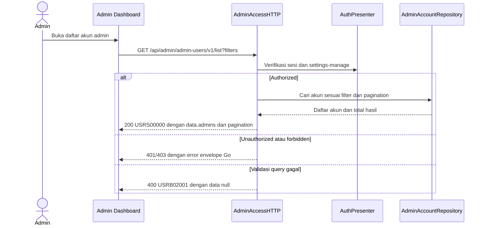

# Get List Admin Accounts — Interface Agreement

> **Document Type:** IFA / API Contract  
> **Status:** Source-mapped draft  
> **Service / Domain:** Admin Access and Accounts  
> **Consumer / Partner:** JokiHub Admin Dashboard

## Design

UI design reference belum tersedia. Dokumen ini memetakan endpoint Go yang berjalan.

## Sequence Diagram



## Performance / SLA Targets

| Success Rate                                                  | VUser                             | CPU / Memory                                                                 | Response Time                |
| ------------------------------------------------------------- | --------------------------------- | ---------------------------------------------------------------------------- | ---------------------------- |
| 99.9% monthly availability; valid-request server error ≤ 0.1% | 50 VUser, 20 request/s NFT target | Baseline 2 vCPU / 4 GiB per instance; CPU ≤ 70%, memory ≤ 75% at target load | Read p95 ≤ 500 ms; p99 ≤ 2 s |

## General Information

| Component          | Value                                                                         |
| ------------------ | ----------------------------------------------------------------------------- |
| Description        | Mengambil daftar akun administrator dengan pencarian, filter, dan pagination. |
| Resource URL       | `https://{host}/api/admin/admin-users/v1/list`                                |
| Transport Protocol | HTTPS REST                                                                    |
| Request Verb       | GET                                                                           |
| Content Type       | Tidak ada request body                                                        |
| Interaction Type   | Synchronous                                                                   |
| Security Policy    | Sesi admin valid dan permission `settings-manage`.                            |

### Path / Endpoint

| Section        | Value                                |
| -------------- | ------------------------------------ |
| Host / Domain  | `{host}`                             |
| Service Name   | Admin Access                         |
| Version        | `v1`                                 |
| Resource       | `/admin/admin-users/v1/list`         |
| Final Endpoint | `GET /api/admin/admin-users/v1/list` |

### API Versioning

- **Decision:** Existing v1 route, source-mapped.
- **Backward Compatibility:** Pertahankan path/action dan parameter query Go yang berjalan.
- **Reason:** Tidak ada permintaan perubahan endpoint atau major-version dalam sumber.

## Business Rules

1. Endpoint hanya membaca `AdminAccount` administrator. Admin account provisioning is performed through a restricted backend/database/script bootstrap; no dashboard CRUD or email invitation flow is in scope.
2. Pemanggil harus memiliki sesi admin valid dan permission `settings-manage`.
3. Akun soft-deleted tidak ditampilkan.
4. Filter status menerima `ACTIVE` atau `INACTIVE`; filter role menggunakan `roleId`.
5. Pagination default `page=1`, `pageSize=20`, maksimum `pageSize=100`; urutan harus mengikuti perilaku handler Go.
6. Current Go response envelope adalah `{code,message,data?}`; ini bukti implementasi, bukan keputusan format target lintas API.

## Request Headers

| Header          | Type   | M/O/C | Max Length | Description                                             | Example                       |
| --------------- | ------ | ----- | ---------: | ------------------------------------------------------- | ----------------------------- |
| `Authorization` | String | C     |        TBD | Bearer admin token; handler juga menerima admin cookie. | `Bearer {admin-access-token}` |

## Request Parameters

| Parameter  | Type    | M/O/C |     Max Length | Description                                           | Example     |
| ---------- | ------- | ----- | -------------: | ----------------------------------------------------- | ----------- |
| `page`     | Integer | O     |              — | Halaman positif; default `1`.                         | `1`         |
| `pageSize` | Integer | O     |            100 | Ukuran halaman positif; default `20`, maksimum `100`. | `20`        |
| `search`   | String  | O     |            100 | Pencarian identitas admin.                            | `operator`  |
| `status`   | String  | O     |              — | Filter `ACTIVE` atau `INACTIVE`.                      | `ACTIVE`    |
| `roleId`   | String  | O     | Source-defined | Filter berdasarkan role.                              | `{role-id}` |

### Request Validation

1. Hanya query key `page`, `pageSize`, `search`, `status`, dan `roleId` yang diterima.
2. `page` dan `pageSize` harus integer positif; `pageSize` tidak boleh lebih dari `100`.
3. `search` maksimum 100 karakter.
4. `status` hanya boleh kosong, `ACTIVE`, atau `INACTIVE`.
5. `roleId` harus memenuhi format ID role yang diterima handler.

## Response Body

Current Go wire envelope `{code,message,data?}`; field berikut adalah source projection.

| Attribute                    | Type     | M/O/C | Max Length | Description                                     | Example                          |
| ---------------------------- | -------- | ----- | ---------: | ----------------------------------------------- | -------------------------------- |
| `code`                       | String   | M     |         10 | Kode hasil Go service.                          | `USRS00000`                      |
| `message`                    | String   | M     |        200 | Pesan hasil.                                    | `Daftar admin berhasil diambil.` |
| `data.admins[]`              | Object[] | C     |          — | Baris admin; tanpa record soft-deleted.         | `[]`                             |
| `data.admins[].id`           | String   | C     |         24 | Mongo ObjectID hex.                             | `507f1f77bcf86cd799439011`       |
| `data.admins[].username`     | String   | C     |         30 | Username administrator.                         | `support.ops`                    |
| `data.admins[].name`         | String   | C     |        150 | Nama tampilan.                                  | `Support Admin`                  |
| `data.admins[].email`        | String   | C     |        254 | Email administrator.                            | `support@example.test`           |
| `data.admins[].status`       | String   | C     |          — | Status `ACTIVE` atau `INACTIVE`.                | `ACTIVE`                         |
| `data.admins[].roleId`       | String   | C     |         24 | Primary role projection.                        | `507f1f77bcf86cd799439012`       |
| `data.admins[].role`         | String   | C     |          — | Label role.                                     | `Admin`                          |
| `data.admins[].roleIds`      | String[] | C     |          — | Role ID aktif.                                  | `[]`                             |
| `data.admins[].roleNames`    | String[] | C     |          — | Nama role aktif.                                | `[]`                             |
| `data.admins[].lastActive`   | String   | C     |          — | Placeholder sumber saat ini.                    | `Belum tersedia`                 |
| `data.admins[].updatedAt`    | DateTime | C     |          — | Waktu update.                                   | `2026-10-23T10:00:00Z`           |
| `data.total`                 | Integer  | C     |          — | Total hasil setelah filter, sebelum pagination. | `1`                              |
| `data.pagination.page`       | Integer  | C     |          — | Halaman aktif.                                  | `1`                              |
| `data.pagination.pageSize`   | Integer  | C     |          — | Ukuran halaman efektif.                         | `20`                             |
| `data.pagination.total`      | Integer  | C     |          — | Total item hasil filter.                        | `1`                              |
| `data.pagination.totalPages` | Integer  | C     |          — | Jumlah halaman.                                 | `1`                              |

### Success Example

```json
{
  "code": "USRS00000",
  "message": "Daftar admin berhasil diambil.",
  "data": { "admins": [], "total": 0, "pagination": { "page": 1, "pageSize": 20, "total": 0, "totalPages": 0 } }
}
```

### Business Error Example

```json
{ "code": "USRB02001", "message": "Filter admin tidak valid.", "data": null }
```

### Technical Error Example

```json
{ "code": "USRT03001", "message": "Layanan admin tidak tersedia.", "data": null }
```

## HTTP Status Codes

| HTTP Status | Usage                                                        |
| ----------- | ------------------------------------------------------------ |
| 200         | Daftar berhasil diambil.                                     |
| 400         | Query/filter tidak valid.                                    |
| 401         | Sesi admin tidak tersedia atau tidak valid.                  |
| 403         | Permission `settings-manage` tidak tersedia.                 |
| 500         | Kegagalan repository/service yang dipetakan ke error teknis. |

## Service Status Codes

| Code        | Type      | Category | Meaning                                     |
| ----------- | --------- | -------- | ------------------------------------------- |
| `USRS00000` | Success   | 00       | Daftar akun admin berhasil diambil.         |
| `USRB01001` | Business  | 01       | Sesi admin tidak tersedia atau tidak valid. |
| `USRB01002` | Business  | 01       | Permission ditolak.                         |
| `USRB02001` | Business  | 02       | Query atau filter tidak valid.              |
| `USRT03001` | Technical | 03       | Kegagalan persistence akun admin.           |

## API Exposure Classification

| Classification | Rationale                                                                                                |
| -------------- | -------------------------------------------------------------------------------------------------------- |
| Public         | Endpoint dashboard dapat dijangkau web; wajib autentikasi, authorization, audit, dan proteksi perimeter. |

## Testing & Documentation Scope

| Scope      | Required | Rationale / Handoff                                                                                          |
| ---------- | -------- | ------------------------------------------------------------------------------------------------------------ |
| NFT        | Yes      | Uji filter, pagination, dataset besar, 50 VUser / 20 request/s, dan SLA baseline pada dataset representatif. |
| VA/Pentest | Yes      | Uji authorization, IDOR, PII exposure, filter injection, dan akses record soft-deleted.                      |

## References

- [Admin account IFA index](README.md)
- `../../../../../go-game-service-platform/internal/controller/http/admin_access_http.go`
