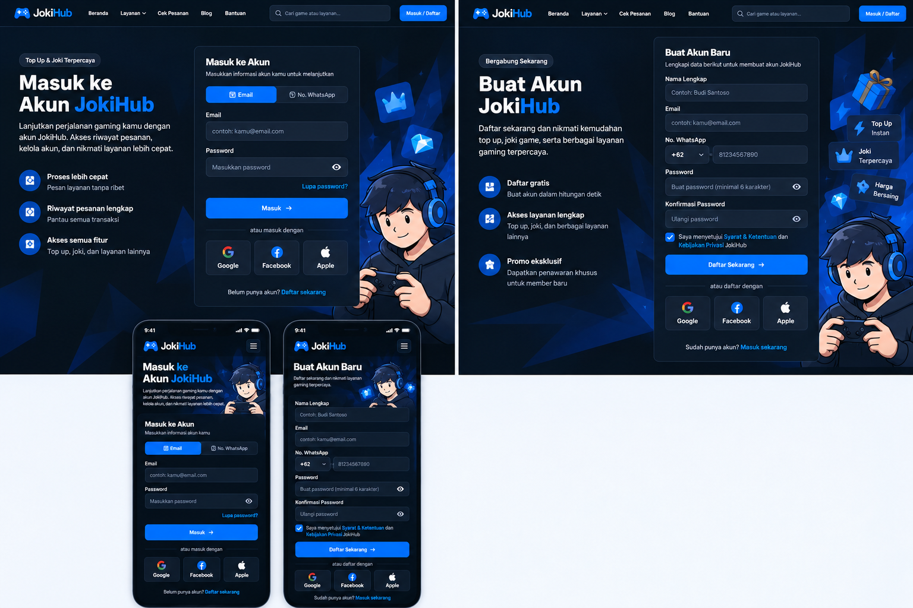

# Admin Login — Interface Agreement

> **Document Type:** IFA / API Contract  
> **Status:** Target solutioning  
> **Service / Domain:** Admin Authentication  
> **Consumer / Partner:** JokiHub Admin Dashboard

## Design



## Sequence Diagram

```mermaid
sequenceDiagram
    actor Admin
    participant UI as Dashboard
    participant API as Auth API
    participant Account as ADMIN_ACCOUNT
    participant Credential as ADMIN_CREDENTIAL
    participant Role as Role and Permission
    participant Session as ADMIN_SESSION

    Admin->>UI: Submit identifier and password
    UI->>API: POST /api/admin/auth/v1/login with Origin
    API->>API: Check Origin allowlist, CORS and request format
    alt Origin invalid or payload invalid
        API-->>UI: 403 or 400, safe envelope, data null
    else Request accepted
        API->>Account: Find trimmed identifier using case-insensitive collation; require ACTIVE and non-deleted
        Account-->>API: Admin account or no match
        alt Account missing, inactive, or deleted
            API-->>UI: 401 generic credentials error, data null
        else Active account found
            API->>Credential: Read Argon2id hash by admin_account_id
            alt Credential record missing
                API-->>UI: 401 generic credentials error, data null
            else Credential available
                Credential-->>API: Password hash
                API->>API: Verify Argon2id password
                alt Password mismatch
                    API-->>UI: 401 generic credentials error, data null
                else Password matches
                    API->>Role: Read active role for admin
                    Role-->>API: Active role or no valid role
                    alt Role invalid
                        API-->>UI: 401 generic credentials error, data null
                    else Role active
                        API->>API: Prepare access JWT, opaque refresh token, and CSRF token
                        API->>Session: Persist session family and refresh/CSRF digests
                        alt Session store failure
                            Session-->>API: Persistence failed
                            API-->>UI: 500 ADMT03001, safe envelope, data null; set no cookies
                        else Session committed
                            Session-->>API: Session created
                            API-->>UI: 200, set access/refresh cookies, return admin profile and csrfToken
                            UI-->>Admin: Show dashboard
                        end
                    end
                end
            end
        end
    end
```

## Performance / SLA Targets

| Success Rate                                                  | VUser                                                                  | CPU / Memory                                                           | Response Time                      |
| ------------------------------------------------------------- | ---------------------------------------------------------------------- | ---------------------------------------------------------------------- | ---------------------------------- |
| 99,9% monthly availability; valid-request server error ≤ 0,1% | 50 VUser / 20 request per detik sesuai baseline Sprint 1; validasi NFT | 2 vCPU / 4 GiB per instance; CPU ≤ 70%, memory ≤ 75% pada beban target | Write p95 ≤ 1 detik; p99 ≤ 2 detik |

Target merupakan baseline Sprint 1, bukan hasil benchmark. Uji beban autentikasi secara terpisah dan sesuaikan berdasarkan hasil NFT.

## General Information

| Component          | Value                                                                                                   |
| ------------------ | ------------------------------------------------------------------------------------------------------- |
| Description        | Membuat sesi administrator setelah verifikasi username/email dan password.                              |
| Resource URL       | `https://{api-host}/api/admin/auth/v1/login`                                                            |
| Transport Protocol | HTTPS REST                                                                                              |
| Request Verb       | POST                                                                                                    |
| Content Type       | application/json                                                                                        |
| Interaction Type   | Synchronous                                                                                             |
| Security Policy    | Origin allowlist, rate limit, password verification, access/refresh HttpOnly cookies, CORS credentialed |

### Path / Endpoint

| Section        | Value                           |
| -------------- | ------------------------------- |
| Host / Domain  | `{api-host}`                    |
| Service Name   | Admin Authentication            |
| Version        | `v1`                            |
| Resource       | `/admin/auth/v1/login`          |
| Final Endpoint | `POST /api/admin/auth/v1/login` |

### API Versioning

- **Decision:** New Sprint 1 admin authentication endpoint, version `v1`.
- **Backward Compatibility:** Tidak menggantikan endpoint login pelanggan.
- **Reason:** Admin dashboard memerlukan autentikasi sendiri; login pelanggan tetap di luar cakupan.

## Business Rules

1. Hanya akun administrator berstatus `ACTIVE`, belum soft-deleted, memiliki credential valid, dan memiliki tepat satu role aktif yang dapat login.
2. `identifier` menerima username atau email. Nilai yang mengandung `@` diperlakukan sebagai email; selain itu diperlakukan sebagai username. Username tidak boleh mengandung `@`. API menghapus whitespace di tepi dan mencari pada field `email` atau `username` memakai case-insensitive collation MongoDB; database menyimpan field asli tanpa whitespace tepi. Password diverifikasi persis seperti dikirim; API tidak trim atau mengubah password.
3. Akun tidak ditemukan, password salah, akun `INACTIVE`/terhapus, credential tidak tersedia, atau role tidak aktif menghasilkan error kredensial generik yang sama. Kegagalan infrastruktur saat membaca credential/session atau menjalankan verifikasi hash menghasilkan HTTP 500 dengan pesan aman, bukan error kredensial.
4. Password hash disimpan di MongoDB collection `ADMIN_CREDENTIAL` dengan Argon2id. Password mentah tidak disimpan, ditulis ke log, atau dikembalikan melalui API.
5. Provisioning credential dilakukan melalui proses backend/database/script terkendali. Tidak ada password default, reset password melalui email, SMTP, atau CRUD akun admin di dashboard.
6. Login membuat satu session family. API menyimpan digest refresh token dan CSRF token, lalu menetapkan access JWT dan refresh token opaque acak minimal 32 byte yang dikodekan base64url lewat dua header `Set-Cookie`.
7. Cookie bernama `__Host-jokihub-admin-access` berlaku 900 detik dan `__Host-jokihub-admin-refresh` berlaku 604800 detik. Keduanya memakai `HttpOnly; Secure; Path=/; SameSite=None`; atribut `Domain` tidak diatur.
8. Access JWT dan refresh token tidak pernah dimasukkan ke response body. Response mengembalikan profil admin ringkas dan CSRF token untuk header request berikutnya. Dashboard menyimpan CSRF token di localStorage agar dapat dipakai lintas tab, bukan di URL atau log.
9. API hanya mengizinkan origin dashboard yang terkonfigurasi secara eksplisit. CORS memakai origin exact-match dan `Access-Control-Allow-Credentials: true`; wildcard origin dilarang. Preflight OPTIONS mengizinkan POST dan headers Content-Type serta X-CSRF-Token tanpa memerlukan cookie.
10. Dashboard mengirim request dengan credentials. Dashboard menyimpan hanya CSRF token di localStorage agar dapat dipakai lintas tab; access/refresh token tidak pernah disimpan di web storage. Untuk cookie-authenticated requests, dashboard mengirim `X-CSRF-Token`. Token CSRF disimpan di `ADMIN_SESSION` dalam bentuk digest dan dikembalikan lagi setelah refresh.
11. Login dan refresh token membatasi maksimal 20 request per alamat IP dalam jendela bergulir 15 menit. Login juga membatasi maksimal 5 kegagalan autentikasi per identifier setelah trim dan lowercase dalam jendela yang sama. Rate limit mengembalikan HTTP 429 dan `Retry-After` sampai slot tersedia. Login menolak origin yang tidak diizinkan, payload invalid, rate limit terlampaui, dan kegagalan penyimpanan dengan error aman tanpa membuat session parsial.
12. Semua response login memakai `Cache-Control: no-store`. Cookie hanya dapat diterima melalui HTTPS; lingkungan pengembangan harus menyediakan HTTPS.
13. Access JWT memuat sub admin ID, sid session family, issuer, audience admin, iat, exp, dan jti. API memeriksa family aktif, status akun, dan role/permission terkini pada setiap request admin. Signing key disimpan sebagai secret deployment dan tidak masuk dokumen atau log.
14. Keberhasilan login memperbarui `last_active`. Kegagalan kredensial tidak mengungkap apakah username/email terdaftar.

## Request Headers

| Header         | Type   | M/O/C | Max Length | Description                                               | Example                          |
| -------------- | ------ | ----- | ---------: | --------------------------------------------------------- | -------------------------------- |
| `Origin`       | String | M     |       2048 | Origin dashboard yang harus cocok dengan konfigurasi API. | `https://dashboard.example.test` |
| `Content-Type` | String | M     |        100 | Harus `application/json`.                                 | `application/json`               |
| `Accept`       | String | O     |        100 | Tipe response yang diterima.                              | `application/json`               |

## Request Parameters

Tidak ada path atau query parameter.

## Request Body

| Attribute    | Type   | M/O/C | Max Length | Description                                                                                                                                                   | Example       |
| ------------ | ------ | ----- | ---------: | ------------------------------------------------------------------------------------------------------------------------------------------------------------- | ------------- |
| `identifier` | String | M     |        254 | Username atau email administrator. Nilai yang mengandung `@` diperlakukan sebagai email; selain itu sebagai username. Whitespace tepi dihapus sebelum lookup. | `support.ops` |
| `password`   | String | M     |        128 | Password administrator; tidak ditrim atau dinormalisasi.                                                                                                      | `{password}`  |

### Example Request Body

```json
{
  "identifier": "support.ops",
  "password": "{password}"
}
```

### Request Validation

1. Body harus JSON object dan hanya boleh berisi `identifier` serta `password`.
2. `identifier` wajib string nonkosong setelah whitespace tepi dihapus dan panjang maksimum 254 karakter.
3. `password` wajib string nonkosong dan panjang maksimum 128 karakter; jangan trim atau normalisasi nilainya.
4. Origin harus tercantum persis pada daftar origin dashboard yang disetujui. Request origin yang tidak cocok ditolak.
5. Rate limit login: maksimal 5 kegagalan autentikasi per identifier setelah trim dan lowercase dalam jendela bergulir 15 menit. Percobaan berikutnya ditolak sampai kegagalan tertua keluar dari jendela; `Retry-After` menunjukkan sisa waktu dalam detik.
6. Validasi gagal tidak membuat session dan tidak mengubah credential.

## Response Body

| Attribute              | Type        | M/O/C | Max Length | Description                                                                         | Example                 |
| ---------------------- | ----------- | ----- | ---------: | ----------------------------------------------------------------------------------- | ----------------------- |
| `code`                 | String      | M     |          9 | Service status code.                                                                | `ADMS00000`             |
| `message`              | String      | M     |        200 | Pesan hasil untuk consumer.                                                         | `Login admin berhasil.` |
| `data`                 | Object/null | M     |          — | Profil admin, role, CSRF, dan expiry saat sukses; null saat error.                  | `{}`                    |
| `data.id`              | String      | M     |         64 | ID akun dengan prefix `admin_`.                                                     | `admin_01JXYZ`          |
| `data.username`        | String      | M     |         30 | Username administrator.                                                             | `support.ops`           |
| `data.name`            | String      | M     |        150 | Nama tampilan admin.                                                                | `Support Admin`         |
| `data.email`           | String      | M     |        254 | Email administrator.                                                                | `support@example.test`  |
| `data.role`            | Object      | M     |          — | Satu role aktif administrator.                                                      | `{}`                    |
| `data.role.id`         | String      | M     |         64 | ID role aktif.                                                                      | `role_01JXYZ`           |
| `data.role.name`       | String      | M     |        100 | Nama tampilan role aktif.                                                           | `Super Admin`           |
| `data.role.code`       | String      | M     |         50 | Kode role aktif.                                                                    | `SUPER_ADMIN`           |
| `data.role.system`     | Boolean     | M     |          — | Penanda role system.                                                                | `true`                  |
| `data.csrfToken`       | String      | M     |        128 | Token CSRF acak untuk header request dashboard berikutnya; bukan token autentikasi. | `{csrf-token}`          |
| `data.accessExpiresIn` | Integer     | M     |          — | Masa berlaku access cookie dalam detik.                                             | `900`                   |

### Success Example

```json
{
  "code": "ADMS00000",
  "message": "Login admin berhasil.",
  "data": {
    "id": "admin_01JXYZ",
    "username": "support.ops",
    "name": "Support Admin",
    "email": "support@example.test",
    "role": {
      "id": "role_01JXYZ",
      "name": "Super Admin",
      "code": "SUPER_ADMIN",
      "system": true
    },
    "csrfToken": "{csrf-token}",
    "accessExpiresIn": 900
  }
}
```

Header response menetapkan access JWT dan refresh token melalui dua `Set-Cookie`. Cookie token tidak disalin ke body atau log.

### Business Error Example

```json
{
  "code": "ADMB01001",
  "message": "Username/email atau password tidak valid.",
  "data": null
}
```

### Technical Error Example

```json
{
  "code": "ADMT03001",
  "message": "Layanan autentikasi sedang tidak tersedia.",
  "data": null
}
```

## HTTP Status Codes

| HTTP Status | Usage                                                                                                    |
| ----------- | -------------------------------------------------------------------------------------------------------- |
| 200         | Login berhasil; cookie access/refresh diterbitkan.                                                       |
| 400         | Body atau field wajib tidak valid.                                                                       |
| 401         | Kredensial tidak valid atau account tidak memenuhi kebijakan login; pesan tetap generik.                 |
| 403         | Origin dashboard tidak diizinkan.                                                                        |
| 429         | Batas 5 kegagalan per identifier atau 20 request per IP dalam 15 menit tercapai; sertakan `Retry-After`. |
| 500         | Credential/session store, hash verification, atau signing service gagal.                                 |

## Service Status Codes

| Code        | Type      | Category          | Meaning                                                                    |
| ----------- | --------- | ----------------- | -------------------------------------------------------------------------- |
| `ADMS00000` | Success   | General           | Login admin berhasil.                                                      |
| `ADMB01001` | Business  | Authentication    | Username/email atau password tidak valid; tidak mengungkap status akun.    |
| `ADMB02001` | Business  | User validation   | Payload login tidak valid.                                                 |
| `ADMB02002` | Business  | User validation   | Batas rate limit login tercapai.                                           |
| `ADMB01002` | Business  | Authentication    | Origin dashboard tidak diizinkan.                                          |
| `ADMT03001` | Technical | Database/security | Credential/session store, hash verification, atau pembentukan token gagal. |

## API Exposure Classification

| Classification | Rationale                                                                                                                                             |
| -------------- | ----------------------------------------------------------------------------------------------------------------------------------------------------- |
| Public         | Endpoint login dapat dijangkau browser melalui internet; wajib origin allowlist, throttling, HTTPS, CORS credential policy, dan proteksi brute force. |

## Testing & Documentation Scope

| Scope      | Required | Rationale / Handoff                                                                                                                                                                                       |
| ---------- | -------- | --------------------------------------------------------------------------------------------------------------------------------------------------------------------------------------------------------- |
| NFT        | Yes      | Uji login username/email, puncak 50 VUser / 20 request per detik sesuai baseline, dampak Argon2id, kapasitas DB, dan target CPU/memory; validasi target melalui NFT.                                      |
| VA/Pentest | Yes      | Uji brute force, credential stuffing, account enumeration, timing leak, cookie flags, CORS credential policy, CSRF, session fixation, token leakage, log redaction, dan pemisahan privilege admin/member. |

## Assumptions

- Origin dashboard adalah konfigurasi deployment. Nilai rate limit mengikuti batas tetap pada business rules.
- Pemanggil adalah dashboard JokiHub; login pelanggan menggunakan flow terpisah di sprint lain.
- Password hash yang disiapkan operator menggunakan Argon2id; API tidak menerima atau mengembalikan password hash.

## References

- [BRD Sprint 1](../../../BRD.md)
- [Admin Account ERD](../../../erd/admin-account-erd.md)
- [Refresh Token IFA](./refresh-token.md)
- [Logout IFA](./logout.md)
