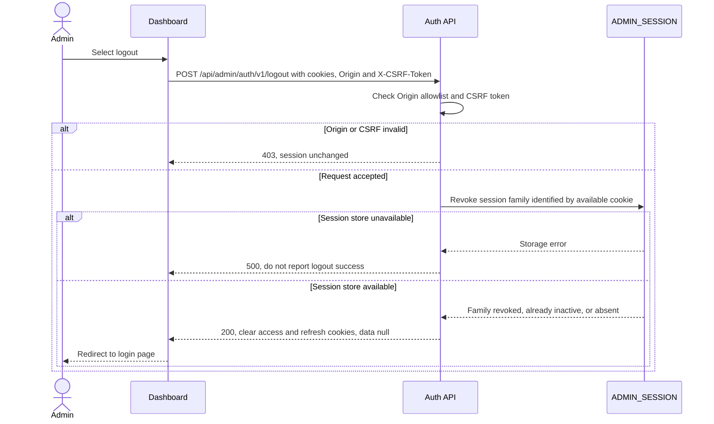

# Admin Logout — Interface Agreement

> **Document Type:** IFA / API Contract  
> **Status:** Target solutioning  
> **Service / Domain:** Admin Authentication  
> **Consumer / Partner:** JokiHub Admin Dashboard

## Design


## Sequence Diagram



## Performance / SLA Targets

| Success Rate                                                  | VUser                                                                  | CPU / Memory                                                           | Response Time                      |
| ------------------------------------------------------------- | ---------------------------------------------------------------------- | ---------------------------------------------------------------------- | ---------------------------------- |
| 99,9% monthly availability; valid-request server error ≤ 0,1% | 50 VUser / 20 request per detik sesuai baseline Sprint 1; validasi NFT | 2 vCPU / 4 GiB per instance; CPU ≤ 70%, memory ≤ 75% pada beban target | Write p95 ≤ 1 detik; p99 ≤ 2 detik |

Baseline Sprint 1; validasi kapasitas melalui NFT.

## General Information

| Component          | Value                                                                    |
| ------------------ | ------------------------------------------------------------------------ |
| Description        | Mencabut session family admin dan menghapus cookie autentikasi browser.  |
| Resource URL       | `https://{api-host}/api/admin/auth/v1/logout`                            |
| Transport Protocol | HTTPS REST                                                               |
| Request Verb       | POST                                                                     |
| Content Type       | application/json                                                         |
| Interaction Type   | Synchronous                                                              |
| Security Policy    | Origin allowlist, session cookie, CSRF synchronization token, revocation |

### Path / Endpoint

| Section        | Value                            |
| -------------- | -------------------------------- |
| Host / Domain  | `{api-host}`                     |
| Service Name   | Admin Authentication             |
| Version        | `v1`                             |
| Resource       | `/admin/auth/v1/logout`          |
| Final Endpoint | `POST /api/admin/auth/v1/logout` |

### API Versioning

- **Decision:** New Sprint 1 admin session endpoint, version `v1`.
- **Backward Compatibility:** Tidak mengubah logout pelanggan.
- **Reason:** Admin dan customer memiliki cookie dan session family terpisah.

## Business Rules

1. Browser mengirim `Origin`, access/refresh cookie yang tersedia, serta `X-CSRF-Token` jika memiliki session aktif.
2. Origin wajib cocok persis dengan allowlist dashboard. Jika ada session cookie, CSRF token harus cocok dengan digest session aktif. Preflight OPTIONS mengizinkan POST dan headers Content-Type serta X-CSRF-Token tanpa cookie.
3. API mencabut session family dari refresh-token record atau claim sid pada access JWT, sehingga refresh token generasi mana pun dan access token family tersebut tidak dapat dipakai lagi.
4. API menghapus cookie `__Host-jokihub-admin-access` dan `__Host-jokihub-admin-refresh` dengan atribut `HttpOnly; Secure; Path=/; SameSite=None; Max-Age=0`; atribut `Domain` tidak diatur.
5. Logout dengan cookie/session yang tidak ada atau sudah dicabut tetap mengembalikan sukses setelah menghapus cookie. Operasi ini idempotent. Dashboard juga menghapus CSRF token dari localStorage.
6. Jika session store gagal, API mengembalikan 500 dan tidak menyatakan revokasi berhasil. Cookie tidak dihapus agar pengguna dapat mengulangi request.
7. CSRF/origin gagal menghasilkan 403 tanpa mencabut session. Token autentikasi tidak dimasukkan ke body, error, atau log.
8. Semua response memakai `Cache-Control: no-store`. Session yang dicabut langsung ditolak oleh middleware pada pemeriksaan access berikutnya.
9. Request logout tidak memerlukan permission role karena endpoint berfungsi untuk mengakhiri session milik pemanggil sendiri.

## Request Headers

| Header         | Type   | M/O/C | Max Length | Description                                         | Example                                       |
| -------------- | ------ | ----- | ---------: | --------------------------------------------------- | --------------------------------------------- |
| `Origin`       | String | M     |       2048 | Origin dashboard yang diizinkan.                    | `https://dashboard.example.test`              |
| `Cookie`       | String | C     |          — | Cookie access/refresh admin yang tersedia.          | `__Host-jokihub-admin-refresh={opaque-token}` |
| `X-CSRF-Token` | String | C     |        128 | Wajib jika session cookie masih aktif.              | `{csrf-token}`                                |
| `Content-Type` | String | O     |        100 | Body kosong; bila dikirim harus `application/json`. | `application/json`                            |

## Request Parameters

Tidak ada path atau query parameter.

## Request Body

Tidak ada request body.

### Request Validation

1. Origin wajib exact-match dengan allowlist.
2. Bila session aktif teridentifikasi, CSRF token wajib dan harus cocok.
3. Bila tidak ada session aktif, API tetap membersihkan cookie dan mengembalikan sukses.
4. Jika revocation gagal disimpan, jangan menghapus cookie dan kembalikan error teknis.

## Response Body

| Attribute | Type        | M/O/C | Max Length | Description          | Example                  |
| --------- | ----------- | ----- | ---------: | -------------------- | ------------------------ |
| `code`    | String      | M     |          9 | Service status code. | `ADMS00000`              |
| `message` | String      | M     |        200 | Pesan hasil.         | `Logout admin berhasil.` |
| `data`    | Object/null | M     |          — | Null setelah logout. | `null`                   |

### Success Example

```json
{
  "code": "ADMS00000",
  "message": "Logout admin berhasil.",
  "data": null
}
```

Response mengirim header `Set-Cookie` untuk menghapus kedua cookie admin.

### Business Error Example

```json
{
  "code": "ADMB01004",
  "message": "CSRF token tidak valid.",
  "data": null
}
```

### Technical Error Example

```json
{
  "code": "ADMT03001",
  "message": "Layanan autentikasi sedang tidak tersedia.",
  "data": null
}
```

## HTTP Status Codes

| HTTP Status | Usage                                                        |
| ----------- | ------------------------------------------------------------ |
| 200         | Session dicabut atau memang tidak ada; cookie dihapus.       |
| 403         | Origin tidak diizinkan atau CSRF invalid pada session aktif. |
| 500         | Session store gagal mencabut family.                         |

## Service Status Codes

| Code        | Type      | Category       | Meaning                                   |
| ----------- | --------- | -------------- | ----------------------------------------- |
| `ADMS00000` | Success   | General        | Logout admin berhasil/idempotent.         |
| `ADMB01002` | Business  | Authentication | Origin dashboard tidak diizinkan.         |
| `ADMB01004` | Business  | Authentication | CSRF token tidak valid.                   |
| `ADMT03001` | Technical | Database       | Session store gagal memproses revocation. |

## API Exposure Classification

| Classification | Rationale                                                                                     |
| -------------- | --------------------------------------------------------------------------------------------- |
| Public         | Endpoint dipanggil browser dari internet; origin, CSRF, cookie scope, dan HTTPS wajib dijaga. |

## Testing & Documentation Scope

| Scope      | Required | Rationale / Handoff                                                                                                  |
| ---------- | -------- | -------------------------------------------------------------------------------------------------------------------- |
| NFT        | Yes      | Uji revoke DB, logout berulang, concurrency dengan refresh, dan SLA baseline Sprint 1.                               |
| VA/Pentest | Yes      | Uji CSRF, origin spoofing, logout CSRF, session-family revocation, cookie deletion attributes, dan token disclosure. |

## Assumptions

- Cookie names dan flags mengikuti [Admin Login IFA](./login.md).
- Revocation bersifat per session family, bukan memaksa logout semua perangkat milik admin.
- Session store unavailable menghasilkan error; response tidak menghapus cookie agar logout bisa diulang.

## References

- [BRD Sprint 1](../../../BRD.md)
- [Admin Account ERD](../../../erd/admin-account-erd.md)
- [Admin Login IFA](./login.md)
- [Refresh Token IFA](./refresh-token.md)
