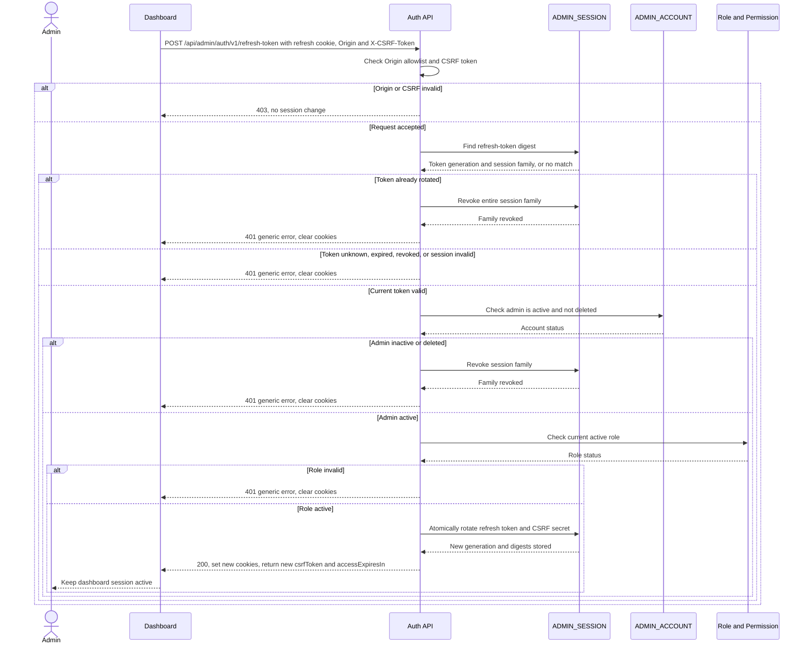

# Admin Refresh Token — Interface Agreement

> **Document Type:** IFA / API Contract  
> **Status:** Target solutioning  
> **Service / Domain:** Admin Authentication  
> **Consumer / Partner:** JokiHub Admin Dashboard

## Design


## Sequence Diagram



## Performance / SLA Targets

| Success Rate                                                  | VUser                                                                  | CPU / Memory                                                           | Response Time                      |
| ------------------------------------------------------------- | ---------------------------------------------------------------------- | ---------------------------------------------------------------------- | ---------------------------------- |
| 99,9% monthly availability; valid-request server error ≤ 0,1% | 50 VUser / 20 request per detik sesuai baseline Sprint 1; validasi NFT | 2 vCPU / 4 GiB per instance; CPU ≤ 70%, memory ≤ 75% pada beban target | Write p95 ≤ 1 detik; p99 ≤ 2 detik |

Baseline Sprint 1; validasi kapasitas autentikasi melalui NFT.

## General Information

| Component          | Value                                                                                             |
| ------------------ | ------------------------------------------------------------------------------------------------- |
| Description        | Rotasi refresh token dan penerbitan access cookie baru untuk sesi admin valid.                    |
| Resource URL       | `https://{api-host}/api/admin/auth/v1/refresh-token`                                              |
| Transport Protocol | HTTPS REST                                                                                        |
| Request Verb       | POST                                                                                              |
| Content Type       | application/json                                                                                  |
| Interaction Type   | Synchronous                                                                                       |
| Security Policy    | Refresh cookie HttpOnly, origin allowlist, CSRF synchronization token, rotation, replay detection |

### Path / Endpoint

| Section        | Value                                   |
| -------------- | --------------------------------------- |
| Host / Domain  | `{api-host}`                            |
| Service Name   | Admin Authentication                    |
| Version        | `v1`                                    |
| Resource       | `/admin/auth/v1/refresh-token`          |
| Final Endpoint | `POST /api/admin/auth/v1/refresh-token` |

### API Versioning

- **Decision:** New Sprint 1 admin session endpoint, version `v1`.
- **Backward Compatibility:** Tidak menggantikan refresh session pelanggan.
- **Reason:** Cookie admin memiliki audience, store, dan kebijakan terpisah dari member.

## Business Rules

1. Browser mengirim cookie `__Host-jokihub-admin-refresh`, `Origin`, dan `X-CSRF-Token`. Request tanpa body; access cookie boleh sudah kedaluwarsa.
2. API mencari digest refresh token, bukan token mentah. Token harus cocok dengan generasi yang belum kedaluwarsa, belum dirotasi, dan belum dicabut.
3. Refresh token opaque acak minimal 32 byte berlaku 7 hari sejak diterbitkan. Setiap refresh sukses menerbitkan token baru dengan masa berlaku 7 hari sejak refresh tersebut; setiap token hanya dapat dipakai satu kali.
4. API menandai generasi lama sebagai rotated dan menyimpan generasi baru secara atomik dalam family yang sama. Response menetapkan access JWT 15 menit dan refresh cookie baru.
5. Refresh sukses menerbitkan CSRF token acak baru. Digest token disimpan di MongoDB; token mentah hanya dikembalikan dalam JSON agar dashboard dapat mengirimkannya melalui `X-CSRF-Token`.
6. Response menetapkan cookie `__Host-jokihub-admin-access` (JWT 900 detik) dan `__Host-jokihub-admin-refresh` (opaque 604800 detik). Keduanya memakai `HttpOnly; Secure; Path=/; SameSite=None` tanpa atribut `Domain`. Response memakai `Cache-Control: no-store`.
7. Token generasi lama yang dipakai ulang dianggap replay; API mencabut seluruh session family, membersihkan cookie, dan mengembalikan error sesi generik.
8. Token hilang, tidak dikenal, kedaluwarsa, telah dicabut, atau akun admin `INACTIVE`/terhapus menghasilkan error sesi generik. API tidak membedakan alasan kepada browser dan membersihkan cookie.
9. Account status, session family, dan role aktif diverifikasi sebelum menerbitkan token baru. Jika admin tidak aktif, seluruh session family akun tersebut dicabut.
10. Origin harus cocok persis dengan allowlist. CORS hanya mengizinkan origin eksplisit dan credentials; wildcard tidak diperbolehkan. Preflight OPTIONS mengizinkan POST dan headers Content-Type serta X-CSRF-Token tanpa cookie.
11. CSRF token harus cocok dengan digest generasi token yang sedang aktif. Token salah atau kosong ditolak tanpa merotasi token.
12. Dashboard menyimpan hanya CSRF token di localStorage agar dapat dipakai lintas tab; access/refresh token tidak pernah disimpan di web storage. Dashboard menyertakan header CSRF pada refresh serta aksi cookie-authenticated.
13. Dashboard menserialisasi refresh lintas tab dalam satu browser profile. Request serentak tidak boleh memakai ulang token lama; reuse tetap diperlakukan sebagai replay dan mencabut family.
14. Refresh token dibatasi maksimal 20 request per alamat IP dalam jendela bergulir 15 menit. Request di atas batas mengembalikan HTTP 429 dan `Retry-After` sampai slot tersedia.
15. Semua endpoint admin memeriksa session family belum dicabut dan status akun masih ACTIVE pada setiap pemeriksaan autentikasi; role/permission mengikuti data aktif, bukan klaim yang bisa basi.

## Request Headers

| Header         | Type   | M/O/C | Max Length | Description                                                       | Example                                       |
| -------------- | ------ | ----- | ---------: | ----------------------------------------------------------------- | --------------------------------------------- |
| `Origin`       | String | M     |       2048 | Origin dashboard yang diizinkan.                                  | `https://dashboard.example.test`              |
| `Cookie`       | String | M     |          — | Memuat `__Host-jokihub-admin-refresh`; access cookie tidak wajib. | `__Host-jokihub-admin-refresh={opaque-token}` |
| `X-CSRF-Token` | String | M     |        128 | CSRF token terbaru dari login/refresh.                            | `{csrf-token}`                                |
| `Content-Type` | String | O     |        100 | Bila dikirim harus `application/json`; body kosong.               | `application/json`                            |

## Request Parameters

Tidak ada path/query parameter.

## Request Body

Tidak ada request body.

### Request Validation

1. Cookie refresh wajib ada dan harus berisi opaque token sesuai format yang diterbitkan service.
2. Header CSRF wajib cocok dengan digest pada generasi session aktif.
3. Origin wajib exact-match dengan allowlist dashboard.
4. Refresh generation hanya dapat dirotasi satu kali. Operasi mark-rotated dan insert generasi baru harus atomik.
5. Refresh replay mencabut seluruh family; kegagalan penyimpanan tidak boleh menerbitkan cookie baru.

## Response Body

| Attribute              | Type        | M/O/C | Max Length | Description                                    | Example                     |
| ---------------------- | ----------- | ----- | ---------: | ---------------------------------------------- | --------------------------- |
| `code`                 | String      | M     |          9 | Service status code.                           | `ADMS00000`                 |
| `message`              | String      | M     |        200 | Pesan hasil.                                   | `Session admin diperbarui.` |
| `data`                 | Object/null | M     |          — | Masa access dan CSRF terbaru; null saat error. | `{}`                        |
| `data.accessExpiresIn` | Integer     | M     |          — | Masa berlaku access cookie baru dalam detik.   | `900`                       |
| `data.csrfToken`       | String      | M     |        128 | CSRF token generasi baru.                      | `{csrf-token}`              |

### Success Example

```json
{
  "code": "ADMS00000",
  "message": "Session admin diperbarui.",
  "data": {
    "accessExpiresIn": 900,
    "csrfToken": "{csrf-token}"
  }
}
```

Response menetapkan access JWT baru dan refresh token opaque baru. Kedua token hanya ada di cookie.

### Business Error Example

```json
{
  "code": "ADMB01003",
  "message": "Session tidak valid atau telah berakhir.",
  "data": null
}
```

### Technical Error Example

```json
{
  "code": "ADMT03001",
  "message": "Layanan autentikasi sedang tidak tersedia.",
  "data": null
}
```

## HTTP Status Codes

| HTTP Status | Usage                                                                                        |
| ----------- | -------------------------------------------------------------------------------------------- |
| 200         | Session berhasil dirotasi.                                                                   |
| 401         | Refresh tidak valid, kedaluwarsa, telah dicabut, atau replay terdeteksi; cookie dibersihkan. |
| 403         | Origin atau CSRF token tidak diizinkan.                                                      |
| 429         | Batas 20 request per IP dalam 15 menit tercapai; sertakan `Retry-After`.                     |
| 500         | Session/account/role store atau pembentukan token gagal.                                     |

## Service Status Codes

| Code        | Type      | Category          | Meaning                                                 |
| ----------- | --------- | ----------------- | ------------------------------------------------------- |
| `ADMS00000` | Success   | General           | Session admin berhasil diperbarui.                      |
| `ADMB01002` | Business  | Authentication    | Origin dashboard tidak diizinkan.                       |
| `ADMB01003` | Business  | Authentication    | Session tidak valid, kedaluwarsa, dicabut, atau replay. |
| `ADMB01004` | Business  | Authentication    | CSRF token tidak valid.                                 |
| `ADMB02002` | Business  | User validation   | Rate limit terlampaui.                                  |
| `ADMT03001` | Technical | Database/security | Session store atau pembentukan token tidak tersedia.    |

## API Exposure Classification

| Classification | Rationale                                                                                                              |
| -------------- | ---------------------------------------------------------------------------------------------------------------------- |
| Public         | Dipanggil browser dari internet menggunakan cookie; wajib CORS exact-origin, credentials, CSRF, HTTPS, dan rate limit. |

## Testing & Documentation Scope

| Scope      | Required | Rationale / Handoff                                                                                                       |
| ---------- | -------- | ------------------------------------------------------------------------------------------------------------------------- |
| NFT        | Yes      | Uji rotasi normal, concurrency, session store, replay, 50 VUser / 20 request per detik, dan SLA baseline.                 |
| VA/Pentest | Yes      | Uji refresh replay, token fixation/theft, CSRF, CORS, cookie flags, account/session revocation, dan token/log disclosure. |

## Assumptions

- Cookie policy dan JWT/refresh lifetime sama dengan [Admin Login IFA](./login.md).
- Exact origin dashboard disediakan sebagai konfigurasi. Nilai rate limit mengikuti batas tetap pada business rules.
- Login pelanggan dan refresh session member berada di luar kontrak ini.

## References

- [BRD Sprint 1](../../../BRD.md)
- [Admin Account ERD](../../../erd/admin-account-erd.md)
- [Admin Login IFA](./login.md)
- [Logout IFA](./logout.md)
