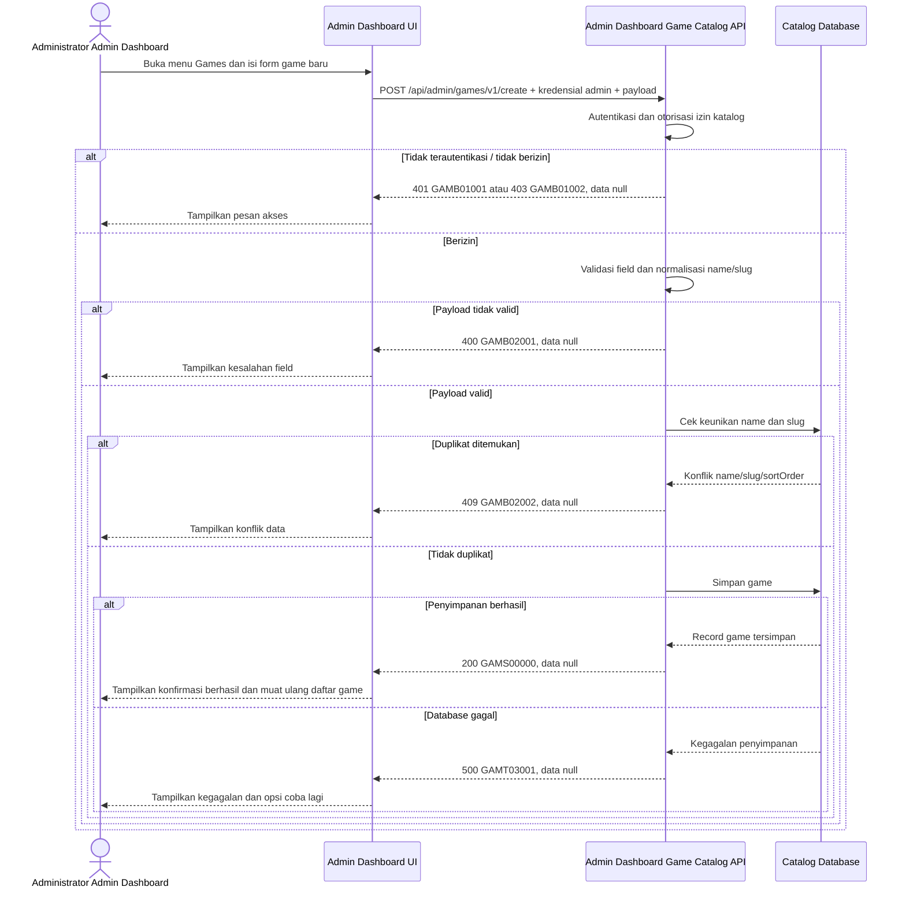

# Admin Dashboard - Create Game Interface Agreement

> **Document Type:** IFA / API Contract  
> **Status:** Draft  
> **Service / Domain:** Admin Dashboard — Game Catalog Management  
> **Consumer / Partner:** JokiHub Admin Dashboard (authorized administrator)

## Design


## Sequence Diagram



## Performance / SLA Targets

| Success Rate                                                  | VUser                              | CPU / Memory                                                                | Response Time              |
| ------------------------------------------------------------- | ---------------------------------- | --------------------------------------------------------------------------- | -------------------------- |
| 99.9% monthly availability; valid-request server error ≤ 0.1% | 50 VUser / 20 request/s NFT target | Initial 2 vCPU / 4 GiB per instance; CPU ≤ 70%, memory ≤ 75% at target load | Write p95 ≤ 1 s; p99 ≤ 2 s |

## General Information

| Component          | Value                                                                                                                                                                           |
| ------------------ | ------------------------------------------------------------------------------------------------------------------------------------------------------------------------------- |
| Description        | Membuat record game baru pada katalog JokiHub.                                                                                                                                  |
| Resource URL       | `https://{host}/api/admin/games/v1/create`                                                                                                                                      |
| Transport Protocol | HTTPS, REST                                                                                                                                                                     |
| Request Verb       | POST                                                                                                                                                                            |
| Content Type       | `application/json`                                                                                                                                                              |
| Interaction Type   | Synchronous                                                                                                                                                                     |
| Security Policy    | cookie access admin valid, akun ACTIVE, dan session family belum dicabut dan permission `game.create` dari katalog Sprint 1. Terapkan rate limiting dan pemantauan operasional. |

### Path / Endpoint

| Section        | Value                           |
| -------------- | ------------------------------- |
| Host / Domain  | `{host}` (environment-specific) |
| Service Name   | Game Catalog                    |
| Version        | `v1`                            |
| Resource       | `/admin/games/v1/create`        |
| Final Endpoint | `/api/admin/games/v1/create`    |

### API Versioning

- **Decision:** New Endpoint
- **Previous Endpoint:** Not applicable; no game creation API identified.
- **Final Endpoint:** `POST /api/admin/games/v1/create`
- **Backward Compatibility:** No existing consumer identified. Additive optional response fields remain compatible; breaking request/response changes require a new major version.
- **Reason:** Introduce protected creation of catalog game records.

## Business Rules

**Rate limit:** 1.200 request/IP/menit dan 60 request/admin/menit. Pelampauan mengembalikan HTTP 429 dengan `Retry-After`.

**Autentikasi bersama:** Setiap request dashboard wajib memakai cookie access admin dari backend, Origin yang exact-match dengan allowlist, dan X-CSRF-Token. Backend memeriksa session family aktif serta status akun ACTIVE/non-deleted pada setiap autentikasi. Jika akun INACTIVE, request ditolak pada pemeriksaan berikutnya dan session family aktif dicabut. Setiap endpoint tetap memerlukan permission sesuai metode. Lihat [IFA login](../auth/login.md), [refresh token](../auth/refresh-token.md), dan [logout](../auth/logout.md).

1. Only an authenticated administrator with permission `game.create` may create a game. Permission keys follow the Sprint 1 catalog.
2. `id`, `createdAt`, and `updatedAt` are generated by the service and are not accepted in the request.
3. `name` and `slug` are required. Name is trimmed; slug must be lowercase and URL-safe.
4. Normalized `name` and `slug` must be unique. Duplicate name or slug is rejected; existing data is not overwritten.
5. `isActive` adalah satu-satunya gerbang visibilitas publik. Nilai default `false`; Super Admin dapat mengaktifkan game.
6. `isPopular` menentukan apakah game tampil di daftar populer. Nilai default `false`; game nonaktif tidak dapat dibuat dengan `isPopular=true`. Super Admin mengatur status ini.
7. sortOrder adalah bilangan bulat non-negatif dan unik di antara seluruh game tersimpan. Bila tidak dikirim, service menetapkan nilai berikutnya setelah nilai terbesar; game pertama mendapat nilai 0. Konflik nilai yang dikirim mengembalikan GAMB02002.
8. `imageUrl` wajib berupa URL HTTPS absolut. BRD mengizinkan host gambar HTTPS mana pun.
9. Sprint 1 tidak mencatat audit event sesuai keputusan BRD.

## Request Headers

| Header   | E/N/T | Type   | M/O/C | Max Length | Description                                                                                                | Example                             |
| -------- | ----- | ------ | ----- | ---------: | ---------------------------------------------------------------------------------------------------------- | ----------------------------------- |
| `Cookie` | N     | String | M     |       4096 | Browser mengirim cookie access admin secara otomatis; token tidak dikirim melalui Authorization atau body. | `__Host-jokihub-admin-access={JWT}` |

| `Origin` | N | String | M | 2048 | Origin dashboard harus exact-match dengan allowlist API. | `https://dashboard.example.test` |
| `X-CSRF-Token` | N | String | M | 128 | CSRF token sinkronisasi untuk request cookie-authenticated. | `{csrf-token}` |
| `Content-Type` | N | String | M | 100 | Request media type. | `application/json` |
| `Accept` | N | String | O | 100 | Desired response media type; defaults to JSON. | `application/json` |
| `X-Request-Id` | N | String | O | 100 | Correlation identifier for request tracing/support. | `req-8f41d2` |

## Request Parameters

None.

## Request Query Parameters

None.

## Request Body

| Attribute     | E/N/T | Type    | M/O/C | Max Length | Description                                                                                | Example                                                     |
| ------------- | ----- | ------- | ----- | ---------: | ------------------------------------------------------------------------------------------ | ----------------------------------------------------------- |
| `name`        | N     | String  | M     |        100 | Display name; trimmed, non-empty.                                                          | `Mobile Legends`                                            |
| `slug`        | N     | String  | M     |        100 | Unique route identifier; lowercase alphanumeric segments separated by hyphens.             | `mobile-legends`                                            |
| `description` | N     | String  | O     |        500 | Deskripsi game yang ditampilkan pada kartu game.                                           | `Permainan strategi untuk perangkat seluler`                |
| `imageUrl`    | N     | String  | M     |       2048 | Absolute HTTPS image URL; any HTTPS host is permitted.                                     | `https://cdn.example.test/images/games/mobile-legends.webp` |
| `platform`    | N     | String  | O     |         30 | Platform opsional; nilai yang diterima `MOBILE`, `PC`, atau `CONSOLE`.                     | `MOBILE`                                                    |
| `isActive`    | N     | Boolean | O     |          - | Storefront availability flag. Default `false`; Super Admin mengatur visibilitas publik.    | `true`                                                      |
| `isPopular`   | N     | Boolean | O     |          - | Popular-list eligibility. Default `false`; Super Admin mengatur visibilitas publik.        | `true`                                                      |
| `sortOrder`   | N     | Integer | O     |  10 digits | Optional unique non-negative value; service allocates next available integer when omitted. | `2`                                                         |

### Example Request Body

```json
{
  "name": "Mobile Legends",
  "slug": "mobile-legends",
  "description": "Permainan strategi untuk perangkat seluler",
  "imageUrl": "https://cdn.example.test/images/games/mobile-legends.webp",
  "platform": "MOBILE",
  "isActive": true,
  "isPopular": true,
  "sortOrder": 2
}
```

### Request Validation

1. Request harus membawa cookie access admin valid, Origin dashboard yang diizinkan, CSRF token valid, akun ACTIVE/non-deleted, session family aktif, dan permission `game.create`. Return `GAMB01001` when unauthenticated and `GAMB01002` when permission is missing.
2. `name` and `slug` are mandatory, non-empty after trimming, and must fit their maximum lengths.
3. `slug` must match `^[a-z0-9]+(?:-[a-z0-9]+)*$`.
4. Normalized name or slug duplicate, atau sortOrder yang diminta sudah digunakan game lain, mengembalikan HTTP 409 `GAMB02002`.
5. `description`, bila dikirim, maksimal 500 karakter. `imageUrl` wajib berupa URL HTTPS absolut; host tidak dibatasi.
6. `isActive` and `isPopular`, when present, must be booleans. `isActive=false` with `isPopular=true` returns `GAMB02003`.
7. sortOrder adalah bilangan bulat non-negatif dan unik di antara seluruh game tersimpan. Bila tidak dikirim, service menetapkan nilai berikutnya setelah nilai terbesar; game pertama mendapat nilai 0. Konflik nilai yang dikirim mengembalikan GAMB02002.
8. Unknown request fields, including `id`, `createdAt`, and `updatedAt`, are rejected with `GAMB02001`.
9. Validasi gagal mengembalikan HTTP 400; duplicate key mengembalikan HTTP 409; kegagalan database mengembalikan HTTP 500. Semua error memakai `data: null` tanpa detail internal. Tidak ada `Idempotency-Key`; retry setelah create sukses dapat menghasilkan HTTP 409 karena unique business key.

## Response Body

| Attribute | E/N/T | Type   | M/O/C | Max Length | Description                                              | Example        |
| --------- | ----- | ------ | ----- | ---------: | -------------------------------------------------------- | -------------- |
| `code`    | N     | String | M     |         20 | Service status code.                                     | `GAMS00000`    |
| `message` | N     | String | O     |        200 | Human-readable result.                                   | `Game created` |
| `data`    | N     | null   | M     |          - | Selalu `null`; endpoint tidak mengembalikan record game. | `null`         |

### Success Example

```json
{
  "code": "GAMS00000",
  "message": "Game created",
  "data": null
}
```

### Business Error Example

```json
{
  "code": "GAMB02002",
  "message": "Name, slug, or sortOrder is already in use",
  "data": null
}
```

### Technical Error Example

```json
{
  "code": "GAMT03001",
  "message": "Game catalog is temporarily unavailable",
  "data": null
}
```

## HTTP Status Codes

| HTTP Status | Usage                                                                                         |
| ----------- | --------------------------------------------------------------------------------------------- |
| `200`       | Game berhasil dibuat sesuai envelope Sprint 1; `data` bernilai `null`.                        |
| `400`       | Request tidak valid.                                                                          |
| `401`       | Admin belum terautentikasi atau session tidak valid.                                          |
| `403`       | Admin tidak memiliki permission `game.create`, Origin tidak diizinkan, atau CSRF tidak valid. |
| `409`       | Nama/slug atau sortOrder sudah digunakan.                                                     |
| `500`       | Unexpected service or catalog database failure.                                               |
| `429`       | Rate limit terlampaui; response menyertakan header `Retry-After`.                             |

## Service Status Codes

Format: `[Service Prefix][Status Type][Category][Specific Error Code]`

| Code        | Type      | Category        | Meaning                                                        |
| ----------- | --------- | --------------- | -------------------------------------------------------------- |
| `GAMS00000` | Success   | General         | Game created.                                                  |
| `GAMB01001` | Business  | Authentication  | Administrator is not authenticated.                            |
| `GAMB01002` | Business  | Authentication  | Administrator lacks create permission.                         |
| `GAMB02001` | Business  | User validation | Required field, format, length, or state validation failed.    |
| `GAMB02002` | Business  | User validation | Game name, slug, or sortOrder already exists.                  |
| `GAMB02003` | Business  | User validation | Popular flag conflicts with inactive state.                    |
| `GAMT03001` | Technical | Database        | Catalog record could not be stored or database is unavailable. |

## API Exposure Classification

| Classification | Rationale                                                                                                         |
| -------------- | ----------------------------------------------------------------------------------------------------------------- |
| Public         | Route dashboard dapat diakses dari internet dan dilindungi session admin, permission, CORS allowlist, serta CSRF. |

## Testing & Documentation Scope

| Scope      | Required | Rationale / Handoff                                                                                                                         |
| ---------- | -------- | ------------------------------------------------------------------------------------------------------------------------------------------- |
| NFT        | Yes      | Uji pembuatan sukses, validasi, duplikasi, dan persistensi pada 50 VUser / 20 request per detik; bandingkan CPU/memori dengan baseline BRD. |
| VA/Pentest | Yes      | Admin write API. Verify authentication and authorization, privilege boundaries, payload validation, injection resistance.                   |

## Assumptions

- Kontrak mengikuti endpoint create game Sprint 1, envelope `{code,message,data}`, dan kebijakan katalog di BRD.
- Scope covers creating a game catalog record only; listing, detail, update, delete, game services, pricing, and order management are excluded.
- Current UI model has `name`, `service`, `art`, and `mark`; `description` and `imageUrl` are proposed API mappings for `service` and `art`. `mark` is excluded from this catalog contract because it has no confirmed product need.
- ID game memakai `game_` + ULID kanonis 26 karakter. Data disimpan di MongoDB. Route dashboard bersifat Public dengan session admin, permission, CORS allowlist, dan CSRF. Asset host menerima URL HTTPS absolut tanpa allowlist host.
  Default isActive=false dan isPopular=false mengikuti dokumen ini. Service mengalokasikan sortOrder unik sesuai aturan di atas.

## References

- `docs-game-service-platform/sprint_1/solutioning/public/games/get-popular-games.md` — storefront consumer contract.
- `src/features/HomeV2/views/interfaces/homeV2.interface.ts` — current UI game fields.
- `src/features/HomeV2/views/molecules/GameCard.molecule.tsx` — game card consumption and order link.
