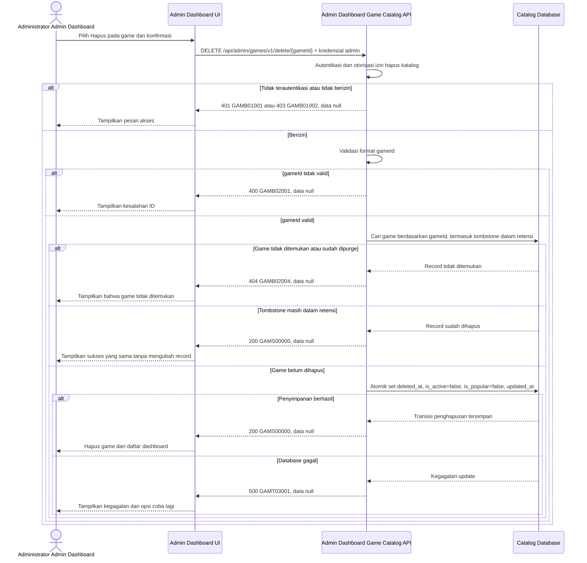

# Admin Dashboard - Delete Game Interface Agreement

> **Document Type:** IFA / API Contract  
> **Status:** Draft  
> **Service / Domain:** Admin Dashboard — Game Catalog Management  
> **Consumer / Partner:** JokiHub Admin Dashboard (authorized administrator)

## Design


## Sequence Diagram



## Performance / SLA Targets

| Success Rate                                                  | VUser                              | CPU / Memory                                                                | Response Time              |
| ------------------------------------------------------------- | ---------------------------------- | --------------------------------------------------------------------------- | -------------------------- |
| 99.9% monthly availability; valid-request server error ≤ 0.1% | 50 VUser / 20 request/s NFT target | Initial 2 vCPU / 4 GiB per instance; CPU ≤ 70%, memory ≤ 75% at target load | Write p95 ≤ 1 s; p99 ≤ 2 s |

## General Information

| Component          | Value                                                                                                                                                                           |
| ------------------ | ------------------------------------------------------------------------------------------------------------------------------------------------------------------------------- |
| Description        | Menandai satu record game katalog sebagai terhapus tanpa menghapus riwayat atau record terkait.                                                                                 |
| Resource URL       | `https://{host}/api/admin/games/v1/delete/{gameId}`                                                                                                                             |
| Transport Protocol | HTTPS, REST                                                                                                                                                                     |
| Request Verb       | DELETE                                                                                                                                                                          |
| Content Type       | Tidak ada request body                                                                                                                                                          |
| Interaction Type   | Synchronous                                                                                                                                                                     |
| Security Policy    | cookie access admin valid, akun ACTIVE, dan session family belum dicabut dan permission `game.delete` dari katalog Sprint 1. Terapkan rate limiting dan pemantauan operasional. |

### Path / Endpoint

| Section        | Value                                 |
| -------------- | ------------------------------------- |
| Host / Domain  | `{host}` (environment-specific)       |
| Service Name   | Game Catalog                          |
| Version        | `v1`                                  |
| Resource       | `/admin/games/v1/delete/{gameId}`     |
| Final Endpoint | `/api/admin/games/v1/delete/{gameId}` |

### API Versioning

- **Decision:** New Endpoint
- **Previous Endpoint:** Tidak ada API delete game yang teridentifikasi.
- **Final Endpoint:** `DELETE /api/admin/games/v1/delete/{gameId}`
- **Backward Compatibility:** Tidak ada consumer delete game yang teridentifikasi. Penambahan field response bersifat kompatibel; perubahan kontrak yang mematahkan consumer memerlukan major version baru.
- **Reason:** Admin Dashboard memerlukan operasi penghapusan terkontrol untuk satu game katalog.

## Business Rules

**Rate limit:** 1.200 request/IP/menit dan 60 request/admin/menit. Pelampauan mengembalikan HTTP 429 dengan `Retry-After`.

**Autentikasi bersama:** Setiap request dashboard wajib memakai cookie access admin dari backend, Origin yang exact-match dengan allowlist, dan X-CSRF-Token. Backend memeriksa session family aktif serta status akun ACTIVE/non-deleted pada setiap autentikasi. Jika akun INACTIVE, request ditolak pada pemeriksaan berikutnya dan session family aktif dicabut. Setiap endpoint tetap memerlukan permission sesuai metode. Lihat [IFA login](../auth/login.md), [refresh token](../auth/refresh-token.md), dan [logout](../auth/logout.md).

1. Hanya administrator terautentikasi dengan permission `game.delete` yang dapat menghapus game. Permission key mengikuti katalog Sprint 1.
2. Penghapusan menggunakan soft delete: secara atomik set `deleted_at`, `is_active=false`, `is_popular=false`, dan `updated_at` sesuai lifecycle game pada ERD. Perubahan flag merupakan efek otomatis delete, bukan perubahan status langsung oleh caller; izin endpoint tetap `game.delete`.
3. Game dengan `deleted_at` terisi tidak dikembalikan pada daftar/detail admin, daftar publik, atau daftar game populer.
4. Operasi tidak menghapus fisik record, layanan, transaksi, atau pesanan terkait. Tidak ada cascade delete.
5. Jika game tombstone masih dalam retensi, delete berulang mengembalikan HTTP 200 dengan `data: null` tanpa mengubah data. ID yang tidak pernah ada atau sudah dipurge mengembalikan HTTP 404 `GAMB02004`.
6. Sprint 1 tidak mencatat audit event sesuai keputusan BRD.
7. Perubahan `deleted_at`, `is_active`, `is_popular`, dan `updated_at` dilakukan atomik. Jika database gagal, tidak ada field yang berubah.
8. Game terhapus tidak dapat dipulihkan melalui produk. Penghapusan berulang pada tombstone yang masih berada dalam retensi mengembalikan sukses yang sama; game yang tidak ada atau sudah dipurge mengembalikan HTTP 404.
9. Relasi game dengan layanan, transaksi, dan pesanan berada di luar ERD dan cakupan Sprint 1. Penghapusan tidak mengubah atau menghapus data terkait; record katalog mengikuti retensi dua bulan pada BRD dan ERD.

## Request Headers

| Header   | E/N/T | Type   | M/O/C | Max Length | Description                                                                                                | Example                             |
| -------- | ----- | ------ | ----- | ---------: | ---------------------------------------------------------------------------------------------------------- | ----------------------------------- |
| `Cookie` | N     | String | M     |       4096 | Browser mengirim cookie access admin secara otomatis; token tidak dikirim melalui Authorization atau body. | `__Host-jokihub-admin-access={JWT}` |

| `Origin` | N | String | M | 2048 | Origin dashboard harus exact-match dengan allowlist API. | `https://dashboard.example.test` |
| `X-CSRF-Token` | N | String | M | 128 | CSRF token sinkronisasi untuk request cookie-authenticated. | `{csrf-token}` |
| `Accept` | N | String | O | 100 | Tipe media response yang diinginkan; default JSON. | `application/json` |
| `X-Request-Id` | N | String | O | 100 | ID korelasi untuk request tracing/support. | `req-3c10af` |

## Request Parameters

| Parameter | E/N/T | Type   | M/O/C | Max Length | Description                                  | Example                           |
| --------- | ----- | ------ | ----- | ---------: | -------------------------------------------- | --------------------------------- |
| `gameId`  | N     | String | M     |         64 | ID immutable game katalog yang akan dihapus. | `game_01ARZ3NDEKTSV4RRFFQ69G5FAV` |

## Request Body

Tidak ada request body.

### Request Validation

1. Request harus membawa cookie access admin valid, Origin dashboard yang diizinkan, CSRF token valid, akun ACTIVE/non-deleted, session family aktif, dan permission `game.delete`. Kembalikan `GAMB01001` bila belum terautentikasi dan `GAMB01002` bila izin tidak tersedia.
2. `gameId` wajib tersedia, tidak kosong, dan panjang maksimal 64 karakter. ID memakai prefix `game_` diikuti suffix unik yang dibuat service; nilai format tidak valid mengembalikan `GAMB02001`.
3. Game harus ditemukan. Jika masih aktif, lanjutkan soft delete. Jika sudah menjadi tombstone dalam retensi, kembalikan sukses yang sama; jika ID tidak pernah ada atau sudah dipurge, kembalikan HTTP 404 `GAMB02004`.
4. Endpoint DELETE tidak memerlukan request body. Body kosong diterima; body nonkosong ditolak dengan HTTP 400 `GAMB02001`.
5. Perubahan `deleted_at` dan `updated_at` harus tersimpan atomik. Kegagalan database mengembalikan HTTP 500 tanpa detail internal.

## Response Body

| Attribute | E/N/T | Type   | M/O/C | Max Length | Description                                             | Example        |
| --------- | ----- | ------ | ----- | ---------: | ------------------------------------------------------- | -------------- |
| `code`    | N     | String | M     |         20 | Service status code.                                    | `GAMS00000`    |
| `message` | N     | String | O     |        200 | Pesan hasil untuk consumer.                             | `Game deleted` |
| `data`    | N     | null   | M     |          — | Selalu `null`; metadata penghapusan tidak dikembalikan. | `null`         |

### Success Example

```json
{
  "code": "GAMS00000",
  "message": "Game deleted",
  "data": null
}
```

### Business Error Example

```json
{
  "code": "GAMB02004",
  "message": "Game not found",
  "data": null
}
```

### Technical Error Example

```json
{
  "code": "GAMT03001",
  "message": "Game catalog is temporarily unavailable",
  "data": null
}
```

## HTTP Status Codes

| HTTP Status | Usage                                                                                                                 |
| ----------- | --------------------------------------------------------------------------------------------------------------------- |
| `200`       | Game berhasil ditandai terhapus; `data` bernilai `null`.                                                              |
| `400`       | ID tidak valid atau body nonkosong.                                                                                   |
| `401`       | Admin belum terautentikasi atau session tidak valid.                                                                  |
| `403`       | Admin tidak memiliki permission `game.delete`, Origin tidak diizinkan, atau CSRF tidak valid.                         |
| `404`       | Game ID tidak pernah ada atau sudah dipurge. Tombstone dalam retensi tetap mengembalikan sukses pada delete berulang. |
| `409`       | State game tidak mengizinkan penghapusan.                                                                             |
| `500`       | Kegagalan service atau database katalog yang tidak terduga.                                                           |
| `429`       | Rate limit terlampaui; response menyertakan header `Retry-After`.                                                     |

## Service Status Codes

Format: `[Service Prefix][Status Type][Category][Specific Error Code]`

| Code        | Type      | Category        | Meaning                                                       |
| ----------- | --------- | --------------- | ------------------------------------------------------------- |
| `GAMS00000` | Success   | General         | Game berhasil ditandai terhapus.                              |
| `GAMB01001` | Business  | Authentication  | Administrator belum terautentikasi.                           |
| `GAMB01002` | Business  | Authentication  | Administrator tidak memiliki izin hapus katalog game.         |
| `GAMB02001` | Business  | User validation | `gameId` tidak tersedia/invalid atau request body nonkosong.  |
| `GAMB02004` | Business  | User validation | Game ID tidak pernah ada atau sudah dipurge.                  |
| `GAMT03001` | Technical | Database        | Record katalog gagal diperbarui atau database tidak tersedia. |

## API Exposure Classification

| Classification | Rationale                                                                                                         |
| -------------- | ----------------------------------------------------------------------------------------------------------------- |
| Public         | Route dashboard dapat diakses dari internet dan dilindungi session admin, permission, CORS allowlist, serta CSRF. |

## Testing & Documentation Scope

| Scope      | Required | Rationale / Handoff                                                                                                                                                                                                |
| ---------- | -------- | ------------------------------------------------------------------------------------------------------------------------------------------------------------------------------------------------------------------ |
| NFT        | Yes      | API admin write baru. Cakup penghapusan sukses, ID invalid, game tidak ditemukan/sudah terhapus, kegagalan database, dan konkurensi admin. Gunakan 50 VUser / 20 request per detik dan target CPU/memory baseline. |
| VA/Pentest | Yes      | API admin write. Uji autentikasi/otorisasi, IDOR pada `gameId`, privilege escalation, validasi input, replay request.                                                                                              |

## Assumptions

- Soft delete dengan `deleted_at` berlaku. Data langsung dikecualikan dari daftar/detail admin dan API publik, tidak memiliki API pemulihan, lalu dipurge permanen setelah retensi 2 bulan.
- Path `/api/admin/games/v1/delete/{gameId}`, HTTP `DELETE`, response envelope, prefix `GAM`, dan kode status mengikuti kontrak game Sprint 1 serta pemetaan HTTP BRD.
- Daftar admin, detail admin, daftar publik, dan endpoint popular games mengecualikan record dengan `deleted_at` terisi.
- Retensi soft-delete 2 bulan tanpa pemulihan. Route dapat dijangkau dari internet dan memerlukan session admin, permission, CORS allowlist, dan CSRF. SLA serta HTTP mapping mengikuti BRD.
- Tidak tersedia kebutuhan hard delete, restore, atau penghapusan layanan/pesanan terkait.

## References

- `./create-game.md` — field katalog dan pola izin admin.
- `./get-list-games.md` — daftar game admin; perlu mengecualikan soft-deleted games.
- `./update-game.md` — pola endpoint update dan status code Game Catalog.
- `../../../erd/game-catalog-erd.md` — skema katalog game yang memuat penanda soft delete `deleted_at`.
- `docs-game-service-platform/sprint_1/solutioning/public/games/get-popular-games.md` — consumer storefront yang perlu mengecualikan soft-deleted games.
