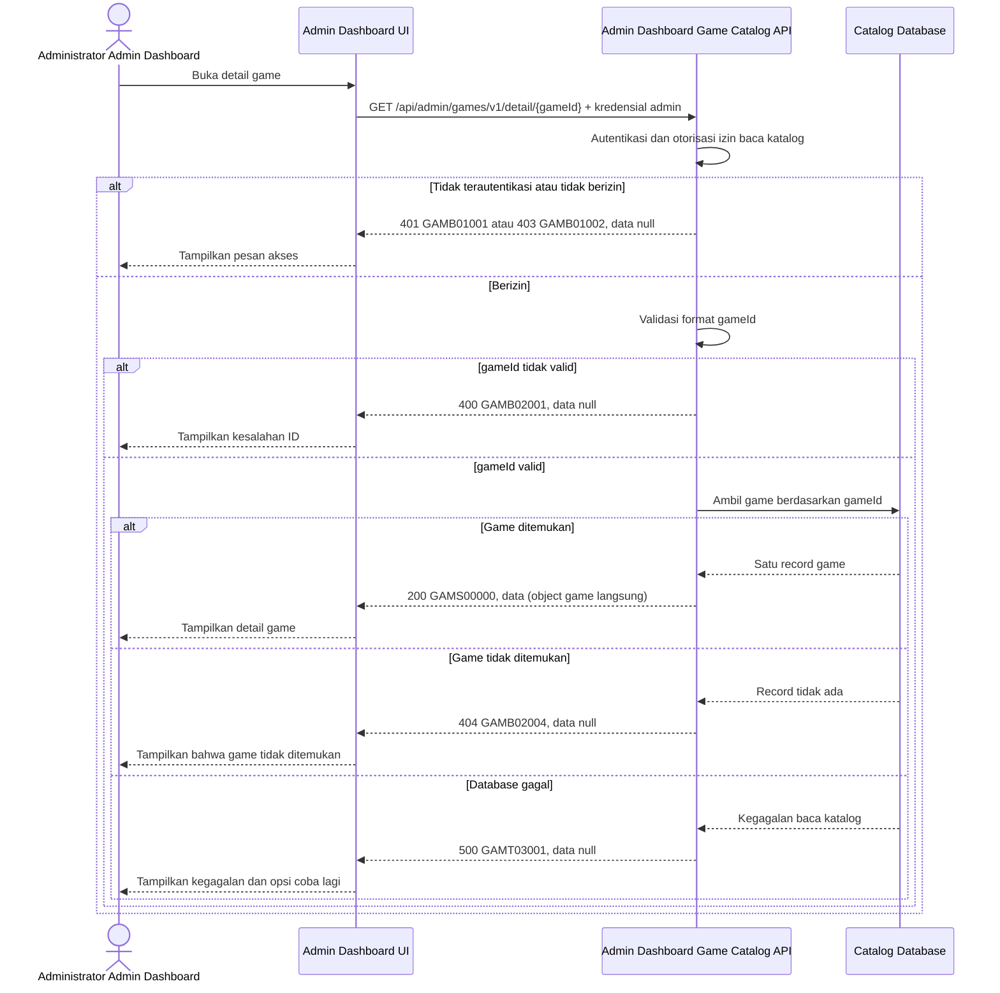

# Admin Dashboard - Get Detail Game Interface Agreement

> **Document Type:** IFA / API Contract  
> **Status:** Draft  
> **Service / Domain:** Admin Dashboard — Game Catalog Management  
> **Consumer / Partner:** JokiHub Admin Dashboard (authorized administrator)

## Design


## Sequence Diagram



## Performance / SLA Targets

| Success Rate                                                  | VUser                              | CPU / Memory                                                                | Response Time                |
| ------------------------------------------------------------- | ---------------------------------- | --------------------------------------------------------------------------- | ---------------------------- |
| 99.9% monthly availability; valid-request server error ≤ 0.1% | 50 VUser / 20 request/s NFT target | Initial 2 vCPU / 4 GiB per instance; CPU ≤ 70%, memory ≤ 75% at target load | Read p95 ≤ 500 ms; p99 ≤ 2 s |

## General Information

| Component          | Value                                                                                                                                              |
| ------------------ | -------------------------------------------------------------------------------------------------------------------------------------------------- |
| Description        | Mengambil detail satu record game katalog berdasarkan ID.                                                                                          |
| Resource URL       | `https://{host}/api/admin/games/v1/detail/{gameId}`                                                                                                |
| Transport Protocol | HTTPS, REST                                                                                                                                        |
| Request Verb       | GET                                                                                                                                                |
| Content Type       | Tidak ada request body                                                                                                                             |
| Interaction Type   | Synchronous                                                                                                                                        |
| Security Policy    | cookie access admin valid, akun ACTIVE, dan session family belum dicabut dan permission `game.read` dari katalog Sprint 1. Terapkan rate limiting. |

### Path / Endpoint

| Section        | Value                                 |
| -------------- | ------------------------------------- |
| Host / Domain  | `{host}` (environment-specific)       |
| Service Name   | Game Catalog                          |
| Version        | `v1`                                  |
| Resource       | `/admin/games/v1/detail/{gameId}`     |
| Final Endpoint | `/api/admin/games/v1/detail/{gameId}` |

### API Versioning

- **Decision:** New Endpoint
- **Previous Endpoint:** Tidak ada API detail game admin yang teridentifikasi.
- **Final Endpoint:** `GET /api/admin/games/v1/detail/{gameId}`
- **Backward Compatibility:** Belum ada consumer detail game yang teridentifikasi. Penambahan field response bersifat kompatibel; perubahan kontrak yang mematahkan consumer memerlukan major version baru.
- **Reason:** Admin Dashboard memerlukan pembacaan satu game untuk halaman detail dan pengisian form edit.

## Business Rules

**Rate limit:** 1.200 request/IP/menit dan 600 request/admin/menit. Pelampauan mengembalikan HTTP 429 dengan `Retry-After`.

**Autentikasi bersama:** Setiap request dashboard wajib memakai cookie access admin dari backend, Origin yang exact-match dengan allowlist, dan X-CSRF-Token. Backend memeriksa session family aktif serta status akun ACTIVE/non-deleted pada setiap autentikasi. Jika akun INACTIVE, request ditolak pada pemeriksaan berikutnya dan session family aktif dicabut. Setiap endpoint tetap memerlukan permission sesuai metode. Lihat [IFA login](../auth/login.md), [refresh token](../auth/refresh-token.md), dan [logout](../auth/logout.md).

1. Hanya administrator dengan cookie access admin valid, akun ACTIVE/non-deleted, session family aktif, Origin allowlist, dan CSRF token valid dan permission `game.read` yang dapat mengakses endpoint.
2. `gameId` mengidentifikasi satu record katalog dan tidak dapat diubah.
3. API mengembalikan seluruh field katalog yang didefinisikan dalam kontrak: `id`, `name`, `slug`, `description`, `imageUrl`, `isActive`, `isPopular`, `sortOrder`, `createdAt`, dan `updatedAt`.
4. Nilai opsional yang belum diisi dikembalikan sebagai `null`, bukan dihilangkan, agar consumer dapat membedakan nilai kosong secara konsisten.
5. Jika record tidak ditemukan, API mengembalikan HTTP 404 dengan `GAMB02004`.
6. Endpoint tidak mengubah data game. Perubahan dilakukan melalui endpoint update terpisah.
7. Cache detail, bila digunakan, harus dihentikan atau diinvalidate setelah update game agar Admin Dashboard tidak menerima data lama. Strategi cache belum ditentukan.
8. Game dengan `deleted_at` terisi tidak dikembalikan oleh endpoint detail dan dipetakan sebagai tidak ditemukan.

## Request Headers

| Header   | E/N/T | Type   | M/O/C | Max Length | Description                                                                                                | Example                             |
| -------- | ----- | ------ | ----- | ---------: | ---------------------------------------------------------------------------------------------------------- | ----------------------------------- |
| `Cookie` | N     | String | M     |       4096 | Browser mengirim cookie access admin secara otomatis; token tidak dikirim melalui Authorization atau body. | `__Host-jokihub-admin-access={JWT}` |

| `Origin` | N | String | M | 2048 | Origin dashboard harus exact-match dengan allowlist API. | `https://dashboard.example.test` |
| `X-CSRF-Token` | N | String | M | 128 | CSRF token sinkronisasi untuk request cookie-authenticated. | `{csrf-token}` |
| `Accept` | N | String | O | 100 | Tipe media response yang diinginkan; default JSON. | `application/json` |
| `X-Request-Id` | N | String | O | 100 | ID korelasi untuk audit/support. | `req-5d8c31` |

## Request Parameters

| Parameter | E/N/T | Type   | M/O/C | Max Length | Description                                 | Example                           |
| --------- | ----- | ------ | ----- | ---------: | ------------------------------------------- | --------------------------------- |
| `gameId`  | N     | String | M     |         64 | ID immutable game katalog yang akan dibaca. | `game_01ARZ3NDEKTSV4RRFFQ69G5FAV` |

## Request Query Parameters

None.

## Request Body

Tidak ada request body.

### Request Validation

1. Request harus membawa cookie access admin valid, Origin dashboard yang diizinkan, CSRF token valid, akun ACTIVE/non-deleted, session family aktif, dan permission `game.read`. Kembalikan `GAMB01001` bila belum terautentikasi dan `GAMB01002` bila permission tidak tersedia.
2. `gameId` wajib tersedia, tidak kosong, dan maksimal 64 karakter. ID memakai prefix `game_` diikuti suffix unik yang dibuat service; nilai yang tidak valid mengembalikan `GAMB02001`.
3. Jika `gameId` valid tetapi tidak memiliki record katalog, kembalikan `GAMB02004`.
4. Request body tidak digunakan. Parameter tambahan yang tidak didukung tidak boleh mengubah pemilihan record.
5. Kegagalan baca database mengembalikan HTTP 500 dan tidak mengungkap detail internal.

## Response Body

| Attribute          | E/N/T | Type               | M/O/C | Max Length | Description                                                            | Example                                                     |
| ------------------ | ----- | ------------------ | ----- | ---------: | ---------------------------------------------------------------------- | ----------------------------------------------------------- |
| `code`             | N     | String             | M     |         20 | Service status code.                                                   | `GAMS00000`                                                 |
| `message`          | N     | String             | O     |        200 | Pesan hasil untuk consumer.                                            | `Game detail retrieved`                                     |
| `data`             | N     | Object/null        | M     |          — | Object game langsung pada sukses; `null` pada error.                   | `{}`                                                        |
| `data.id`          | N     | String             | C     |         64 | ID immutable katalog.                                                  | `game_01ARZ3NDEKTSV4RRFFQ69G5FAV`                           |
| `data.name`        | N     | String             | C     |        100 | Nama tampilan.                                                         | `Mobile Legends`                                            |
| `data.slug`        | N     | String             | C     |        100 | Slug unik untuk route.                                                 | `mobile-legends`                                            |
| `data.description` | N     | String/null        | O     |        500 | Deskripsi game.                                                        | `Permainan strategi untuk perangkat seluler`                |
| `data.imageUrl`    | N     | String             | M     |       2048 | URL HTTPS gambar; host tidak dibatasi.                                 | `https://cdn.example.test/images/games/mobile-legends.webp` |
| `data.platform`    | N     | String/null        | O     |         30 | Platform opsional; nilai yang diterima `MOBILE`, `PC`, atau `CONSOLE`. | `MOBILE`                                                    |
| `data.isActive`    | N     | Boolean            | C     |          — | Status ketersediaan storefront.                                        | `true`                                                      |
| `data.isPopular`   | N     | Boolean            | C     |          — | Kelayakan game pada daftar populer.                                    | `true`                                                      |
| `data.sortOrder`   | N     | Integer            | C     |  10 digits | Urutan tampilan; nilai lebih kecil ditampilkan lebih dahulu.           | `2`                                                         |
| `data.createdAt`   | N     | String (date-time) | C     |         35 | Waktu pembuatan ISO 8601 UTC.                                          | `2026-10-11T08:30:00Z`                                      |
| `data.updatedAt`   | N     | String (date-time) | C     |         35 | Waktu perubahan terakhir ISO 8601 UTC.                                 | `2026-10-11T09:15:00Z`                                      |

### Success Example

```json
{
  "code": "GAMS00000",
  "message": "Game detail retrieved",
  "data": {
    "id": "game_01ARZ3NDEKTSV4RRFFQ69G5FAV",
    "name": "Mobile Legends",
    "slug": "mobile-legends",
    "description": "Permainan strategi untuk perangkat seluler",
    "imageUrl": "https://cdn.example.test/images/games/mobile-legends.webp",
    "platform": "MOBILE",
    "isActive": true,
    "isPopular": true,
    "sortOrder": 2,
    "createdAt": "2026-10-11T08:30:00Z",
    "updatedAt": "2026-10-11T09:15:00Z"
  }
}
```

### Business Error Example

```json
{
  "code": "GAMB02004",
  "message": "Game not found",
  "data": null
}
```

### Technical Error Example

```json
{
  "code": "GAMT03001",
  "message": "Game catalog is temporarily unavailable",
  "data": null
}
```

## HTTP Status Codes

| HTTP Status | Usage                                                                                       |
| ----------- | ------------------------------------------------------------------------------------------- |
| `200`       | Game detail berhasil ditemukan dan dikembalikan.                                            |
| `400`       | ID game tidak valid.                                                                        |
| `401`       | Admin belum terautentikasi atau session tidak valid.                                        |
| `403`       | Admin tidak memiliki permission `game.read`, Origin tidak diizinkan, atau CSRF tidak valid. |
| `404`       | Game tidak ditemukan, sudah dihapus, atau sudah dipurge.                                    |
| `500`       | Kegagalan service atau database katalog yang tidak terduga.                                 |
| `429`       | Rate limit terlampaui; response menyertakan header `Retry-After`.                           |

## Service Status Codes

Format: `[Service Prefix][Status Type][Category][Specific Error Code]`

| Code        | Type      | Category        | Meaning                                                     |
| ----------- | --------- | --------------- | ----------------------------------------------------------- |
| `GAMS00000` | Success   | General         | Detail game berhasil dikembalikan.                          |
| `GAMB01001` | Business  | Authentication  | Administrator belum terautentikasi.                         |
| `GAMB01002` | Business  | Authentication  | Administrator tidak memiliki izin baca katalog game.        |
| `GAMB02001` | Business  | User validation | `gameId` tidak tersedia atau format/panjangnya tidak valid. |
| `GAMB02004` | Business  | User validation | Game dengan `gameId` tersebut tidak ditemukan.              |
| `GAMT03001` | Technical | Database        | Record katalog gagal dibaca atau database tidak tersedia.   |

## API Exposure Classification

| Classification | Rationale                                                                                                         |
| -------------- | ----------------------------------------------------------------------------------------------------------------- |
| Public         | Route dashboard dapat diakses dari internet dan dilindungi session admin, permission, CORS allowlist, serta CSRF. |

## Testing & Documentation Scope

| Scope      | Required | Rationale / Handoff                                                                                                                                                                          |
| ---------- | -------- | -------------------------------------------------------------------------------------------------------------------------------------------------------------------------------------------- |
| NFT        | Yes      | API admin baru. Uji detail ditemukan, ID invalid/tidak ditemukan, volume akses halaman edit, dan kegagalan database. Gunakan 50 VUser / 20 request per detik dan target CPU/memory baseline. |
| VA/Pentest | Yes      | Endpoint admin. Uji authentication/authorization, IDOR pada `gameId`, akses role tidak berwenang, parameter tampering, dan kebocoran data internal.                                          |

## Assumptions

- Endpoint `/api/admin/games/v1/detail/{gameId}`, field response, envelope, prefix `GAM`, dan kode status mengikuti pola API admin game yang sudah didokumentasikan dan memerlukan persetujuan API owner.
- Route segmen `/detail/{gameId}` dipilih agar konsisten dengan action-based endpoint project (`/list`, `/create`, `/update/{gameId}`, `/delete/{gameId}`). Konfirmasi bila API standard memakai resource REST `GET /api/admin/games/v1/{gameId}`.
- Response detail memakai field yang sama dengan item pada [Get List Games](get-list-games.md) dan record pada [Game ERD](../../../erd/game-catalog-erd.md).
- Format ID game mengikuti `game_` + ULID kanonis 26 karakter. Route dashboard bersifat Public dengan session admin, permission, CORS allowlist, dan CSRF. SLA mengikuti BRD; HTTP mapping memakai 400/401/403/404/429/500.
- Soft delete dengan `deleted_at` adalah kebijakan yang berlaku; game terhapus tidak dikembalikan oleh endpoint ini.

## References

- `./create-game.md` — definisi field game katalog.
- `./get-list-games.md` — kontrak daftar game dan pola response.
- `./update-game.md` — operasi update game.
- `./delete-game.md` — kebijakan soft delete dan perilaku record terhapus.
- `../../../erd/game-catalog-erd.md` — skema game katalog saat ini.
