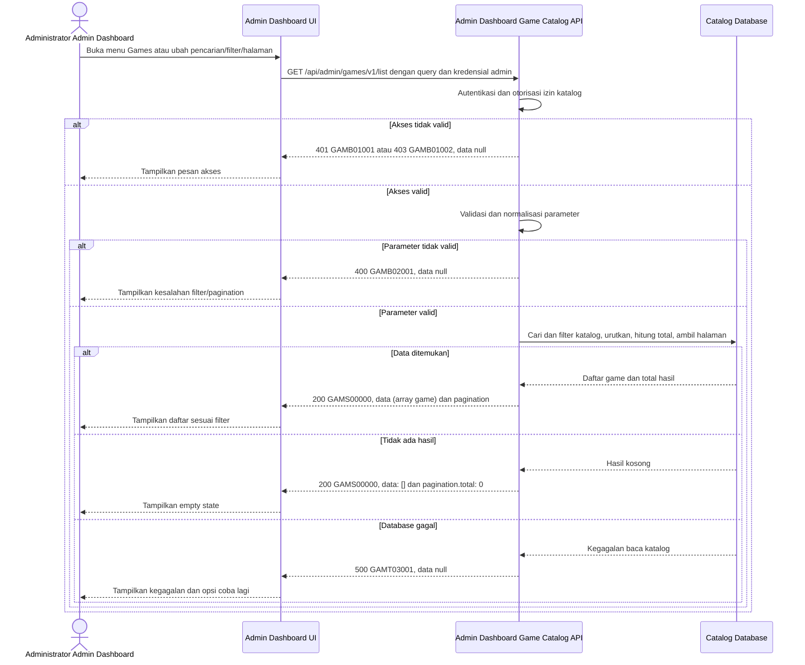

# Admin Dashboard - Get List Games Interface Agreement

> **Document Type:** IFA / API Contract  
> **Status:** Draft  
> **Service / Domain:** Admin Dashboard — Game Catalog Management  
> **Consumer / Partner:** JokiHub Admin Dashboard (authorized administrator)

## Design


## Sequence Diagram



## Performance / SLA Targets

| Success Rate                                                  | VUser                              | CPU / Memory                                                                | Response Time                |
| ------------------------------------------------------------- | ---------------------------------- | --------------------------------------------------------------------------- | ---------------------------- |
| 99.9% monthly availability; valid-request server error ≤ 0.1% | 50 VUser / 20 request/s NFT target | Initial 2 vCPU / 4 GiB per instance; CPU ≤ 70%, memory ≤ 75% at target load | Read p95 ≤ 500 ms; p99 ≤ 2 s |

## General Information

| Component          | Value                                                                                                                                              |
| ------------------ | -------------------------------------------------------------------------------------------------------------------------------------------------- |
| Description        | Mengambil daftar game katalog untuk ditampilkan dan dikelola administrator melalui Admin Dashboard.                                                |
| Resource URL       | `https://{host}/api/admin/games/v1/list`                                                                                                           |
| Transport Protocol | HTTPS, REST                                                                                                                                        |
| Request Verb       | GET                                                                                                                                                |
| Content Type       | `application/json` response; GET request has no body.                                                                                              |
| Interaction Type   | Synchronous                                                                                                                                        |
| Security Policy    | cookie access admin valid, akun ACTIVE, dan session family belum dicabut dan permission `game.read` dari katalog Sprint 1. Terapkan rate limiting. |

### Path / Endpoint

| Section        | Value                           |
| -------------- | ------------------------------- |
| Host / Domain  | `{host}` (environment-specific) |
| Service Name   | Game Catalog                    |
| Version        | `v1`                            |
| Resource       | `/admin/games/v1/list`          |
| Final Endpoint | `/api/admin/games/v1/list`      |

### API Versioning

- **Decision:** New Endpoint
- **Previous Endpoint:** Not applicable; no admin game-list API identified.
- **Final Endpoint:** `GET /api/admin/games/v1/list`
- **Backward Compatibility:** No existing consumer identified. Additive optional response fields remain compatible; breaking request/response changes require a new major version.
- **Reason:** Admin Dashboard needs a protected, searchable catalog list separate from the public popular-games feed.

## Business Rules

**Rate limit:** 1.200 request/IP/menit dan 600 request/admin/menit. Pelampauan mengembalikan HTTP 429 dengan `Retry-After`.

**Autentikasi bersama:** Setiap request dashboard wajib memakai cookie access admin dari backend, Origin yang exact-match dengan allowlist, dan X-CSRF-Token. Backend memeriksa session family aktif serta status akun ACTIVE/non-deleted pada setiap autentikasi. Jika akun INACTIVE, request ditolak pada pemeriksaan berikutnya dan session family aktif dicabut. Setiap endpoint tetap memerlukan permission sesuai metode. Lihat [IFA login](../auth/login.md), [refresh token](../auth/refresh-token.md), dan [logout](../auth/logout.md).

1. Only an authenticated administrator with permission `game.read` may access this list. Pemeriksaan permission memakai katalog Sprint 1.
2. Daftar mencakup game aktif maupun nonaktif yang belum dihapus secara lunak.
3. `q`, when supplied, matches `name` or `slug` case-insensitively after trimming.
4. `isActive` and `isPopular`, when supplied, filter by exact boolean value. Omitted filters do not restrict results.
5. Results use deterministic ordering: sortOrder ascending, then name ascending, then id ascending. Game sortOrder is unique across retained game records.
6. Pagination uses one-based `page` and `limit`. Defaults are `page=1` and `limit=20`; `limit` range is 1–100.
7. `total` represents all records matching search and filters before pagination; `totalPages` is the resulting page count and is `0` when `total` is `0`.
8. No matching records is a successful result with `data: []`, `pagination.total: 0`, and `pagination.totalPages: 0`, not an error.
9. Response contains only catalog fields needed for admin list management; it must not expose internal audit data, credentials, or unrelated customer/order data.
10. Current game fields follow [Create Game](create-game.md); soft-deleted records are excluded.

## Request Headers

| Header   | E/N/T | Type   | M/O/C | Max Length | Description                                                                                                | Example                             |
| -------- | ----- | ------ | ----- | ---------: | ---------------------------------------------------------------------------------------------------------- | ----------------------------------- |
| `Cookie` | N     | String | M     |       4096 | Browser mengirim cookie access admin secara otomatis; token tidak dikirim melalui Authorization atau body. | `__Host-jokihub-admin-access={JWT}` |

| `Origin` | N | String | M | 2048 | Origin dashboard harus exact-match dengan allowlist API. | `https://dashboard.example.test` |
| `X-CSRF-Token` | N | String | M | 128 | CSRF token sinkronisasi untuk request cookie-authenticated. | `{csrf-token}` |
| `Accept` | N | String | O | 100 | Desired response media type; defaults to JSON. | `application/json` |
| `X-Request-Id` | N | String | O | 100 | Correlation identifier for support/monitoring. | `req-8f41d2` |

## Request Parameters

None.

## Request Query Parameters

| Parameter   | E/N/T | Type    | M/O/C | Max Length | Description                                                                           | Example  |
| ----------- | ----- | ------- | ----- | ---------: | ------------------------------------------------------------------------------------- | -------- |
| `q`         | N     | String  | O     |        100 | Case-insensitive search on game name or slug. Leading/trailing whitespace is trimmed. | `mobile` |
| `isActive`  | N     | Boolean | O     |          5 | Filter by active state; accepted values `true` or `false`.                            | `true`   |
| `isPopular` | N     | Boolean | O     |          5 | Filter by popular state; accepted values `true` or `false`.                           | `false`  |
| `page`      | N     | Integer | O     |   9 digits | One-based page number; default 1; minimum 1.                                          | `1`      |
| `limit`     | N     | Integer | O     |   3 digits | Number of records per page; default 20; range 1–100.                                  | `20`     |

## Request Body

None. GET request has no body.

### Request Validation

1. Request harus membawa cookie access admin valid, Origin dashboard yang diizinkan, CSRF token valid, akun ACTIVE/non-deleted, session family aktif, dan permission `game.read`. Return `GAMB01001` when unauthenticated and `GAMB01002` when permission is missing.
2. `q`, when present, must be a string no longer than 100 characters. Trim surrounding whitespace; an empty normalized value behaves as omitted.
3. `isActive` and `isPopular`, when present, must be literal `true` or `false`; other values return `GAMB02001`.
4. `page`, when present, must be an integer greater than or equal to 1; otherwise return `GAMB02001`.
5. `limit`, when present, must be an integer from 1 through 100; otherwise return `GAMB02001`.
6. Unknown query parameters are ignored for forward compatibility. `Accept-Language` is ignored; content is returned in Indonesian because Sprint 1 does not support localization.
7. Validation errors return HTTP 400 and `data: null`; catalog read failures return HTTP 500 and `data: null` without internal details.

## Response Body

| Attribute               | E/N/T | Type               | M/O/C | Max Length | Description                                                  | Example                                                     |
| ----------------------- | ----- | ------------------ | ----- | ---------: | ------------------------------------------------------------ | ----------------------------------------------------------- |
| `code`                  | N     | String             | M     |         20 | Service status code.                                         | `GAMS00000`                                                 |
| `message`               | N     | String             | O     |        200 | Human-readable result.                                       | `Games retrieved`                                           |
| `data`                  | N     | Array of Object    | M     |          - | Current page of matching games; empty array when none match. | `[]`                                                        |
| `data[].id`             | N     | String             | M     |         64 | ID game dengan prefix `game_`.                               | `game_01ARZ3NDEKTSV4RRFFQ69G5FAV`                           |
| `data[].name`           | N     | String             | M     |        100 | Display name.                                                | `Mobile Legends`                                            |
| `data[].slug`           | N     | String             | M     |        100 | URL-safe route identifier.                                   | `mobile-legends`                                            |
| `data[].description`    | N     | String/null        | O     |        500 | Deskripsi game untuk katalog publik.                         | `Permainan strategi untuk perangkat seluler`                |
| `data[].imageUrl`       | N     | String             | M     |       2048 | Absolute HTTPS image URL; any HTTPS host is permitted.       | `https://cdn.example.test/images/games/mobile-legends.webp` |
| `data[].platform`       | N     | String/null        | O     |         30 | Platform opsional; nilainya `MOBILE`, `PC`, atau `CONSOLE`.  | `MOBILE`                                                    |
| `data[].isActive`       | N     | Boolean            | M     |          - | Storefront availability.                                     | `true`                                                      |
| `data[].isPopular`      | N     | Boolean            | M     |          - | Popular-list eligibility.                                    | `true`                                                      |
| `data[].sortOrder`      | N     | Integer            | M     |  10 digits | Display order.                                               | `2`                                                         |
| `data[].createdAt`      | N     | String (date-time) | M     |         35 | Creation time in ISO 8601 UTC.                               | `2026-10-11T08:30:00Z`                                      |
| `data[].updatedAt`      | N     | String (date-time) | M     |         35 | Last update time in ISO 8601 UTC.                            | `2026-10-11T08:30:00Z`                                      |
| `pagination`            | N     | Object             | M     |          - | Pagination metadata, sejajar dengan `data`.                  | `{}`                                                        |
| `pagination.page`       | N     | Integer            | M     |   9 digits | Applied one-based page number.                               | `1`                                                         |
| `pagination.limit`      | N     | Integer            | M     |   3 digits | Applied page size.                                           | `20`                                                        |
| `pagination.total`      | N     | Integer            | M     |  10 digits | Total matching records before pagination.                    | `1`                                                         |
| `pagination.totalPages` | N     | Integer            | M     |   9 digits | Number of pages; `0` when no records match.                  | `1`                                                         |

### Success Example

```json
{
  "code": "GAMS00000",
  "message": "Games retrieved",
  "data": [
    {
      "id": "game_01ARZ3NDEKTSV4RRFFQ69G5FAV",
      "name": "Mobile Legends",
      "slug": "mobile-legends",
      "description": "Permainan strategi untuk perangkat seluler",
      "imageUrl": "https://cdn.example.test/images/games/mobile-legends.webp",
      "platform": "MOBILE",
      "isActive": true,
      "isPopular": true,
      "sortOrder": 2,
      "createdAt": "2026-10-11T08:30:00Z",
      "updatedAt": "2026-10-11T08:30:00Z"
    }
  ],
  "pagination": {
    "page": 1,
    "limit": 20,
    "total": 1,
    "totalPages": 1
  }
}
```

### Business Error Example

```json
{
  "code": "GAMB02001",
  "message": "Invalid list parameter",
  "data": null
}
```

### Technical Error Example

```json
{
  "code": "GAMT03001",
  "message": "Game catalog is temporarily unavailable",
  "data": null
}
```

## HTTP Status Codes

| HTTP Status | Usage                                                                                       |
| ----------- | ------------------------------------------------------------------------------------------- |
| `200`       | Query valid; returns matching games or an empty list.                                       |
| `400`       | Query tidak valid.                                                                          |
| `401`       | Admin belum terautentikasi atau session tidak valid.                                        |
| `403`       | Admin tidak memiliki permission `game.read`, Origin tidak diizinkan, atau CSRF tidak valid. |
| `500`       | Unexpected API or catalog database failure.                                                 |
| `429`       | Rate limit terlampaui; response menyertakan header `Retry-After`.                           |

## Service Status Codes

Format: `[Service Prefix][Status Type][Category][Specific Error Code]`

| Code        | Type      | Category        | Meaning                                               |
| ----------- | --------- | --------------- | ----------------------------------------------------- |
| `GAMS00000` | Success   | General         | Game list retrieved, including empty result.          |
| `GAMB01001` | Business  | Authentication  | Administrator is not authenticated.                   |
| `GAMB01002` | Business  | Authentication  | Administrator lacks permission `game.read`.           |
| `GAMB02001` | Business  | User validation | Query parameter is invalid.                           |
| `GAMT03001` | Technical | Database        | Catalog could not be read or database is unavailable. |

## API Exposure Classification

| Classification | Rationale                                                                                                         |
| -------------- | ----------------------------------------------------------------------------------------------------------------- |
| Public         | Route dashboard dapat diakses dari internet dan dilindungi session admin, permission, CORS allowlist, serta CSRF. |

## Testing & Documentation Scope

| Scope      | Required | Rationale / Handoff                                                                                                                                                      |
| ---------- | -------- | ------------------------------------------------------------------------------------------------------------------------------------------------------------------------ |
| NFT        | Yes      | New admin list API. Test common and maximum page sizes, filters, search, and 50 VUser / 20 requests per second; measure CPU/memory against baseline.                     |
| VA/Pentest | Yes      | Admin API. Verify authentication/authorization, privilege boundaries, query validation, injection resistance, and that customer/order/audit-private data is not exposed. |

## Assumptions

- Endpoint `/api/admin/games/v1/list`, query names, response envelope, service codes, and page defaults are proposed to align with [Create Game](create-game.md), pending API owner approval.
- `description`/`imageUrl` dipetakan dari model UI saat ini (`service`/`art`); skema persistensi final mengikuti [ERD katalog game](../../../erd/game-catalog-erd.md).
- Search covers only `name` and `slug`; sort and exact-match rules need product confirmation.
- Rate limit route baca admin: 1.200 request/IP/menit dan 600 request/admin/menit. SLA mengikuti BRD. Cache policy bukan bagian dari kontrak.

## References

- `./create-game.md` — proposed game catalog fields and admin access assumptions.
- `docs-game-service-platform/sprint_1/solutioning/public/games/get-popular-games.md` — public popular-games consumer contract.
- `src/features/AdminDashboard/views/pages/AdminDashboard.page.tsx` — existing Admin Dashboard entry point; Games list UI is not yet implemented.
