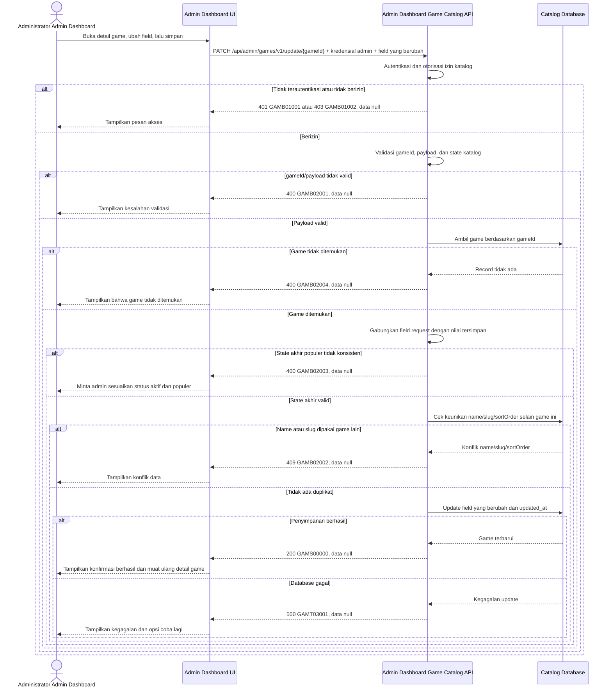

# Admin Dashboard - Update Game Interface Agreement

> **Document Type:** IFA / API Contract  
> **Status:** Draft  
> **Service / Domain:** Admin Dashboard — Game Catalog Management  
> **Consumer / Partner:** JokiHub Admin Dashboard (authorized administrator)

## Design


## Sequence Diagram



## Performance / SLA Targets

| Success Rate                                                  | VUser                              | CPU / Memory                                                                | Response Time              |
| ------------------------------------------------------------- | ---------------------------------- | --------------------------------------------------------------------------- | -------------------------- |
| 99.9% monthly availability; valid-request server error ≤ 0.1% | 50 VUser / 20 request/s NFT target | Initial 2 vCPU / 4 GiB per instance; CPU ≤ 70%, memory ≤ 75% at target load | Write p95 ≤ 1 s; p99 ≤ 2 s |

## General Information

| Component          | Value                                                                                                                                                                           |
| ------------------ | ------------------------------------------------------------------------------------------------------------------------------------------------------------------------------- |
| Description        | Memperbarui satu record game katalog berdasarkan `gameId`.                                                                                                                      |
| Resource URL       | `https://{host}/api/admin/games/v1/update/{gameId}`                                                                                                                             |
| Transport Protocol | HTTPS, REST                                                                                                                                                                     |
| Request Verb       | PATCH                                                                                                                                                                           |
| Content Type       | `application/json`                                                                                                                                                              |
| Interaction Type   | Synchronous                                                                                                                                                                     |
| Security Policy    | cookie access admin valid, akun ACTIVE, dan session family belum dicabut dan permission `game.update` dari katalog Sprint 1. Terapkan rate limiting dan pemantauan operasional. |

### Path / Endpoint

| Section        | Value                                 |
| -------------- | ------------------------------------- |
| Host / Domain  | `{host}` (environment-specific)       |
| Service Name   | Game Catalog                          |
| Version        | `v1`                                  |
| Resource       | `/admin/games/v1/update/{gameId}`     |
| Final Endpoint | `/api/admin/games/v1/update/{gameId}` |

### API Versioning

- **Decision:** New Endpoint
- **Previous Endpoint:** Tidak ada API update game yang teridentifikasi.
- **Final Endpoint:** `PATCH /api/admin/games/v1/update/{gameId}`
- **Backward Compatibility:** Belum ada consumer update game yang teridentifikasi. Penambahan field response bersifat kompatibel; perubahan kontrak yang mematahkan consumer memerlukan major version baru.
- **Reason:** Admin Dashboard memerlukan operasi update parsial terhadap record katalog yang ditargetkan.

## Business Rules

**Rate limit:** 1.200 request/IP/menit dan 60 request/admin/menit. Pelampauan mengembalikan HTTP 429 dengan `Retry-After`.

**Autentikasi bersama:** Setiap request dashboard wajib memakai cookie access admin dari backend, Origin yang exact-match dengan allowlist, dan X-CSRF-Token. Backend memeriksa session family aktif serta status akun ACTIVE/non-deleted pada setiap autentikasi. Jika akun INACTIVE, request ditolak pada pemeriksaan berikutnya dan session family aktif dicabut. Setiap endpoint tetap memerlukan permission sesuai metode. Lihat [IFA login](../auth/login.md), [refresh token](../auth/refresh-token.md), dan [logout](../auth/logout.md).

1. Hanya administrator terautentikasi dengan permission `game.update` yang dapat memperbarui game. Permission key mengikuti katalog Sprint 1.
2. `gameId` mengidentifikasi satu record katalog. `id` tidak dapat diubah melalui request.
3. Request bersifat parsial: field yang tidak dikirim mempertahankan nilai tersimpan; `description` dan `imageUrl` yang dikirim sebagai `null` menghapus nilai opsional tersebut.
4. Minimal satu field mutable harus dikirim. `createdAt` dan `updatedAt` bukan field mutable yang diterima dari consumer.
5. `name` setelah trim dan normalisasi harus unik dibandingkan game lain. `slug` harus unik dibandingkan game lain. Record yang sedang diperbarui dikecualikan dari pemeriksaan duplikasi.
6. `isPopular=true` hanya berlaku bila hasil akhir `isActive=true`. Bila game populer dinonaktifkan, consumer harus sekaligus mengirim `isPopular=false`; API menolak state akhir yang tidak konsisten.
7. sortOrder tidak boleh negatif dan harus unik di antara seluruh game tersimpan, termasuk game tidak aktif dan soft-deleted. Nilai yang tidak dikirim tetap.
8. `imageUrl`, bila dikirim, harus berupa URL HTTPS absolut; host tidak dibatasi. Nilai `null` ditolak karena URL gambar wajib.
9. `updatedAt` dibuat oleh service dalam UTC pada setiap update sukses. `createdAt` tidak berubah.
10. Sprint 1 tidak mencatat audit event sesuai keputusan BRD.
11. API mengembalikan `data: null` setelah update berhasil. UI memuat ulang detail game untuk mengambil nilai terbaru. Bila satu validasi gagal, tidak ada field yang disimpan; operasi bersifat atomik.
12. Sprint 1 tidak memakai optimistic locking (`ETag`, `If-Match`, atau version field); concurrent update memakai last-write-wins dan perubahan terakhir memperbarui `updatedAt`.

## Request Headers

| Header   | E/N/T | Type   | M/O/C | Max Length | Description                                                                                                | Example                             |
| -------- | ----- | ------ | ----- | ---------: | ---------------------------------------------------------------------------------------------------------- | ----------------------------------- |
| `Cookie` | N     | String | M     |       4096 | Browser mengirim cookie access admin secara otomatis; token tidak dikirim melalui Authorization atau body. | `__Host-jokihub-admin-access={JWT}` |

| `Origin` | N | String | M | 2048 | Origin dashboard harus exact-match dengan allowlist API. | `https://dashboard.example.test` |
| `X-CSRF-Token` | N | String | M | 128 | CSRF token sinkronisasi untuk request cookie-authenticated. | `{csrf-token}` |
| `Content-Type` | N | String | M | 100 | Tipe media request. | `application/json` |
| `Accept` | N | String | O | 100 | Tipe media response yang diinginkan; default JSON. | `application/json` |
| `X-Request-Id` | N | String | O | 100 | ID korelasi untuk request tracing/support. | `req-91b7c4` |

## Request Parameters

| Parameter | E/N/T | Type   | M/O/C | Max Length | Description                             | Example                           |
| --------- | ----- | ------ | ----- | ---------: | --------------------------------------- | --------------------------------- |
| `gameId`  | N     | String | M     |         64 | ID immutable game yang akan diperbarui. | `game_01ARZ3NDEKTSV4RRFFQ69G5FAV` |

## Request Body

| Attribute     | E/N/T | Type        | M/O/C | Max Length | Description                                                                                                     | Example                                                               |
| ------------- | ----- | ----------- | ----- | ---------: | --------------------------------------------------------------------------------------------------------------- | --------------------------------------------------------------------- |
| `name`        | N     | String      | O     |        100 | Nama tampilan baru; trim sebelum disimpan.                                                                      | `Mobile Legends: Bang Bang`                                           |
| `slug`        | N     | String      | O     |        100 | Slug unik baru, huruf kecil dan segmen dipisahkan tanda hubung.                                                 | `mobile-legends-bang-bang`                                            |
| `description` | N     | String/null | O     |        500 | Deskripsi game; kirim `null` untuk menghapus.                                                                   | `Permainan strategi untuk perangkat seluler`                          |
| `imageUrl`    | N     | String      | O     |       2048 | URL HTTPS gambar; host tidak dibatasi. Field opsional pada request parsial; `null` ditolak karena gambar wajib. | `https://cdn.example.test/images/games/mobile-legends-bang-bang.webp` |
| `platform`    | N     | String      | O     |         30 | Klasifikasi platform; nilai yang diterima `MOBILE`, `PC`, atau `CONSOLE`.                                       | `MOBILE`                                                              |
| `isActive`    | N     | Boolean     | O     |          — | Status ketersediaan storefront.                                                                                 | `true`                                                                |
| `isPopular`   | N     | Boolean     | O     |          — | Kelayakan masuk daftar populer.                                                                                 | `false`                                                               |
| `sortOrder`   | N     | Integer     | O     |  10 digits | Urutan tampilan non-negatif.                                                                                    | `3`                                                                   |

### Example Request Body

```json
{
  "name": "Mobile Legends: Bang Bang",
  "slug": "mobile-legends-bang-bang",
  "description": "Permainan strategi untuk perangkat seluler",
  "imageUrl": "https://cdn.example.test/images/games/mobile-legends-bang-bang.webp",
  "platform": "MOBILE",
  "isActive": true,
  "isPopular": false,
  "sortOrder": 3
}
```

### Request Validation

1. Request harus membawa cookie access admin valid, Origin dashboard yang diizinkan, CSRF token valid, akun ACTIVE/non-deleted, session family aktif, dan permission `game.update`. Kembalikan HTTP 401 `GAMB01001` bila belum terautentikasi dan HTTP 403 `GAMB01002` bila izin tidak tersedia.
2. `gameId` wajib ada, tidak kosong, maksimal 64 karakter, dan mengikuti format ID yang diterbitkan service. ID memakai prefix `game_` diikuti suffix unik yang dibuat service.
3. Body wajib berupa JSON object dan memuat minimal satu field mutable. Field tidak dikenal, termasuk `id`, `createdAt`, dan `updatedAt`, ditolak dengan `GAMB02001`.
4. `name`, bila dikirim, harus string tidak kosong setelah trim dan maksimal 100 karakter.
5. `slug`, bila dikirim, harus cocok dengan `^[a-z0-9]+(?:-[a-z0-9]+)*$` dan maksimal 100 karakter.
6. description, imageUrl, dan platform, bila dikirim, harus memenuhi batas panjang. imageUrl harus menggunakan HTTPS absolut dari host mana pun; platform harus MOBILE, PC, atau CONSOLE.
7. `isActive` dan `isPopular`, bila dikirim, harus boolean. API validasi kombinasi request dengan nilai tersimpan dan menolak hasil akhir `isActive=false` serta `isPopular=true` dengan `GAMB02003`.
8. sortOrder, bila dikirim, harus integer non-negatif dan tidak boleh digunakan game lain. Abaikan game saat ini pada pemeriksaan keunikan. Konflik mengembalikan GAMB02002.
9. Nilai `name`/`slug` yang sudah dinormalisasi tidak boleh digunakan game lain. Konflik mengembalikan `GAMB02002`; nilai milik `gameId` yang sama bukan konflik.
10. Jika `gameId` valid tetapi record tidak ditemukan, kembalikan `GAMB02004`.
11. Validasi gagal tidak boleh menyimpan sebagian perubahan. Error validasi mengembalikan HTTP 400, konflik mengembalikan HTTP 409, dan kegagalan database mengembalikan HTTP 500; semua error memakai `data: null`. Tidak ada `Idempotency-Key`; update dengan payload sama tidak menimbulkan efek tambahan.

## Response Body

| Attribute | E/N/T | Type   | M/O/C | Max Length | Description                                                   | Example        |
| --------- | ----- | ------ | ----- | ---------: | ------------------------------------------------------------- | -------------- |
| `code`    | N     | String | M     |         20 | Service status code.                                          | `GAMS00000`    |
| `message` | N     | String | O     |        200 | Pesan hasil untuk consumer.                                   | `Game updated` |
| `data`    | N     | null   | M     |          — | Selalu `null`; record terbaru dibaca melalui endpoint detail. | `null`         |

### Success Example

```json
{
  "code": "GAMS00000",
  "message": "Game updated",
  "data": null
}
```

### Business Error Example

```json
{
  "code": "GAMB02002",
  "message": "Name, slug, or sortOrder is already in use",
  "data": null
}
```

### Technical Error Example

```json
{
  "code": "GAMT03001",
  "message": "Game catalog is temporarily unavailable",
  "data": null
}
```

## HTTP Status Codes

| HTTP Status | Usage                                                                                         |
| ----------- | --------------------------------------------------------------------------------------------- |
| `200`       | Game berhasil diperbarui; `data` bernilai `null`.                                             |
| `400`       | Payload tidak valid.                                                                          |
| `401`       | Admin belum terautentikasi atau session tidak valid.                                          |
| `403`       | Admin tidak memiliki permission `game.update`, Origin tidak diizinkan, atau CSRF tidak valid. |
| `404`       | Game tidak ditemukan, sudah dihapus, atau sudah dipurge.                                      |
| `409`       | Konflik unik atau perubahan state tidak diizinkan.                                            |
| `500`       | Kegagalan service atau database katalog yang tidak terduga.                                   |
| `429`       | Rate limit terlampaui; response menyertakan header `Retry-After`.                             |

## Service Status Codes

Format: `[Service Prefix][Status Type][Category][Specific Error Code]`

| Code        | Type      | Category        | Meaning                                                           |
| ----------- | --------- | --------------- | ----------------------------------------------------------------- |
| `GAMS00000` | Success   | General         | Game berhasil diperbarui.                                         |
| `GAMB01001` | Business  | Authentication  | Administrator belum terautentikasi.                               |
| `GAMB01002` | Business  | Authentication  | Administrator tidak memiliki izin update katalog game.            |
| `GAMB02001` | Business  | User validation | ID, body, field, format, panjang, atau state request tidak valid. |
| GAMB02002   | Business  | User validation | name, slug, atau sortOrder sudah digunakan game lain.             |
| `GAMB02003` | Business  | User validation | State populer tidak konsisten dengan state aktif.                 |
| `GAMB02004` | Business  | User validation | Game dengan `gameId` tersebut tidak ditemukan.                    |
| `GAMT03001` | Technical | Database        | Record katalog gagal diperbarui atau database tidak tersedia.     |

## API Exposure Classification

| Classification | Rationale                                                                                                         |
| -------------- | ----------------------------------------------------------------------------------------------------------------- |
| Public         | Route dashboard dapat diakses dari internet dan dilindungi session admin, permission, CORS allowlist, serta CSRF. |

## Testing & Documentation Scope

| Scope      | Required | Rationale / Handoff                                                                                                                                                                                       |
| ---------- | -------- | --------------------------------------------------------------------------------------------------------------------------------------------------------------------------------------------------------- |
| NFT        | Yes      | API admin write baru. Uji update parsial, konflik unik, perubahan state aktif-populer, record tidak ditemukan, persistensi, dan beban 50 VUser / 20 request per detik; ukur CPU/memory terhadap baseline. |
| VA/Pentest | Yes      | API admin write. Uji autentikasi/otorisasi, batas privilege, IDOR pada `gameId`, payload validation, injection, mass assignment.                                                                          |

## Assumptions

- Path `/api/admin/games/v1/update/{gameId}`, HTTP `PATCH`, field request, envelope, dan kode status mengikuti kontrak game Sprint 1 serta BRD.
- Field katalog mengikuti [Create Game](create-game.md); response mengikuti struktur item pada [Get List Games](get-list-games.md).
- `description` dan `imageUrl` adalah mapping dari field storefront `service` dan `art`. `mark` tidak disertakan karena belum ada kebutuhan produk yang dikonfirmasi.
- Asset berupa URL HTTPS absolut tanpa pembatasan host. Rate limit mutasi 1.200 request/IP/menit dan 60 request/admin/menit. SLA mengikuti BRD. Kebijakan concurrency optimistis di luar cakupan kontrak Sprint 1.
- HTTP mapping: 400 validasi, 401 authentication, 403 authorization, 404 not-found, 409 conflict, 429 rate limit, 500 kegagalan teknis.

## References

- `./create-game.md` — field katalog, izin admin, dan aturan create.
- `./get-list-games.md` — response item dan daftar game admin.
- `../../../erd/game-catalog-erd.md` — model data game katalog.
- `docs-game-service-platform/sprint_1/solutioning/public/games/get-popular-games.md` — consumer storefront daftar game populer.
