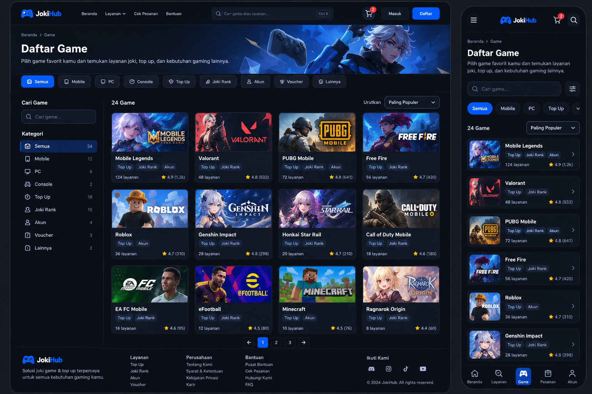
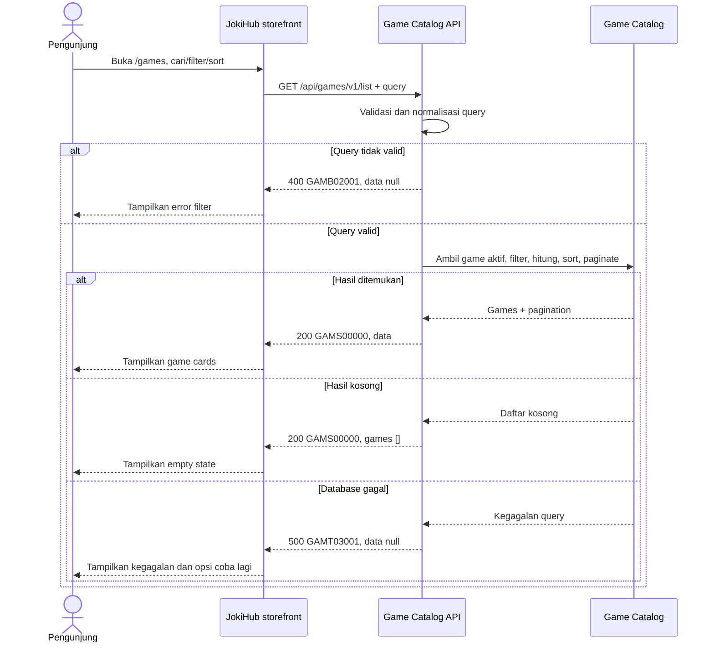

# Game Catalog Service - Get List Games Interface Agreement

> **Document Type:** API Contract  
> **Status:** Draft  
> **Service / Domain:** Game Catalog  
> **Consumer / Partner:** JokiHub public storefront

## Design




## Sequence Diagram



## Performance / SLA Targets

| Success Rate                                                  | VUser                              | CPU / Memory                                                                | Response Time                |
| ------------------------------------------------------------- | ---------------------------------- | --------------------------------------------------------------------------- | ---------------------------- |
| 99.9% monthly availability; valid-request server error ≤ 0.1% | 50 VUser / 20 request/s NFT target | Initial 2 vCPU / 4 GiB per instance; CPU ≤ 70%, memory ≤ 75% at target load | Read p95 ≤ 500 ms; p99 ≤ 2 s |

## General Information

| Component          | Value                                                                                                |
| ------------------ | ---------------------------------------------------------------------------------------------------- |
| Description        | Mengambil katalog game aktif untuk listing publik dengan search, filter, sort, dan pagination.       |
| Resource URL       | `https://{host}/api/games/v1/list`                                                                   |
| Transport Protocol | HTTPS, REST                                                                                          |
| Request Verb       | GET                                                                                                  |
| Content Type       | `application/json`                                                                                   |
| Interaction Type   | Synchronous                                                                                          |
| Security Policy    | Public read API; rate limiting, cache policy, dan input validation. Tidak mengembalikan data privat. |

### Path / Endpoint

| Section        | Value                           |
| -------------- | ------------------------------- |
| Host / Domain  | `{host}` (environment-specific) |
| Service Name   | Game Catalog                    |
| Version        | `v1`                            |
| Resource       | `/list`                         |
| Final Endpoint | `/api/games/v1/list`            |

### API Versioning

- **Decision:** New Endpoint
- **Previous Endpoint:** Tidak ada API list katalog game yang teridentifikasi; `/api/games/v1/popular` hanya mengembalikan subset game populer.
- **Final Endpoint:** `GET /api/games/v1/list`
- **Backward Compatibility:** API popular tetap terpisah dan tidak berubah. Penambahan field response opsional kompatibel; perubahan semantik/filter atau field wajib memerlukan koordinasi/major version.
- **Reason:** Halaman `/games` membutuhkan seluruh katalog aktif dan opsi filter/sort, bukan hanya game populer.

## Business Rules

1. Hanya game dengan `isActive=true` dan `deleted_at=null` yang dapat ditampilkan. `isActive` adalah gerbang visibilitas publik.
2. Pengurutan mengikuti parameter sort; default `SORT_ORDER_ASC`; pilihan `POPULAR` mengurutkan `isPopular DESC` lalu `sortOrder ASC`, sedangkan `NAME_ASC` mengurutkan nama ascending.
3. `NAME_ASC` mengurutkan nama A–Z secara locale `id-ID`, lalu `id` sebagai tie-breaker.
4. `RATING_DESC` tidak didukung pada Sprint 1 karena katalog tidak memiliki rating dan review count.
5. Search mencocokkan nama game dan alias publik yang disetujui. Query di-trim; case-insensitive behavior disarankan. Maksimal 100 karakter.
6. `platform` mengacu pada platform game, bukan jenis layanan. Field bersifat opsional dan menerima `MOBILE`, `PC`, atau `CONSOLE`.
7. Filter platform mencocokkan nilai `platform` pada katalog aktif. Nilai filter yang diterima adalah `MOBILE`, `PC`, atau `CONSOLE`.
8. Response tidak mencakup service categories atau service count karena katalog layanan dan relasi game-service belum termasuk Sprint 1.
9. API tidak mengembalikan rating atau review count; sort `RATING_DESC` tidak didukung pada Sprint 1.
10. imageUrl adalah URL HTTPS absolut dari host mana pun. API mengembalikan URL untuk ditampilkan storefront.
11. Pagination menggunakan `page` berbasis 1 dan `limit`; default `page=1`, `limit=20`, maksimum `limit=100`.
12. `total` adalah jumlah seluruh hasil filter sebelum pagination; `totalPages` adalah jumlah halaman dan bernilai `0` jika tidak ada hasil.
13. Bila tidak ada hasil, response sukses berisi `data: []`, `pagination.total: 0`, dan `pagination.totalPages: 0`.
14. API tidak mengembalikan game nonaktif, data admin/internal, service privat, atau informasi inventory yang belum dipublikasikan.

## Request Headers

| Header            | E/N/T | Type   | M/O/C | Max Length | Description                                              | Example            |
| ----------------- | ----- | ------ | ----- | ---------: | -------------------------------------------------------- | ------------------ |
| `Accept`          | N     | String | O     |        100 | Response media type. Defaults to JSON.                   | `application/json` |
| `Accept-Language` | N     | String | O     |         35 | Diabaikan; konten Sprint 1 menggunakan bahasa Indonesia. | `id-ID`            |

## Request Parameters

None.

## Request Query Parameters

| Parameter  | E/N/T | Type    | M/O/C | Max Length | Description                                                                   | Example    |
| ---------- | ----- | ------- | ----- | ---------: | ----------------------------------------------------------------------------- | ---------- |
| `search`   | N     | String  | O     |        100 | Cari nama/alias game; trim dan case-insensitive.                              | `mobile`   |
| `platform` | N     | String  | O     |         30 | Filter platform opsional; nilai yang diterima `MOBILE`, `PC`, atau `CONSOLE`. | `MOBILE`   |
| `sort`     | N     | String  | O     |         20 | `SORT_ORDER_ASC`, `POPULAR`, atau `NAME_ASC`; default `SORT_ORDER_ASC`.       | `NAME_ASC` |
| `page`     | N     | Integer | O     |   9 digits | One-based page number; default `1`, minimum `1`.                              | `1`        |
| `limit`    | N     | Integer | O     |   3 digits | Page size; default `20`, range `1–100`.                                       | `20`       |

## Request Body

None. GET request has no body.

### Request Validation

1. `search`, bila ada, harus string maksimal 100 karakter setelah trim.
2. `platform` harus `MOBILE`, `PC`, atau `CONSOLE`; nilai lain mengembalikan HTTP 400 `GAMB02001`.
3. `sort` harus `POPULAR` atau `NAME_ASC`; nilai lain, termasuk `RATING_DESC`, ditolak dengan `GAMB02001`.
4. `page` harus integer lebih besar atau sama dengan `1`; default `1`, selain itu `GAMB02001`.
5. `limit` harus integer 1–100; default `20`, selain itu `GAMB02001`.
6. Unknown query parameters diabaikan. `Accept-Language` juga diabaikan karena Sprint 1 belum mendukung multi-bahasa; konten menggunakan bahasa Indonesia.
7. Query menggunakan parameterized statements; wildcard dan karakter khusus di-escape sesuai search policy.
8. Filter dan pagination hanya diterapkan pada game aktif/publik. `total` memakai predicate yang sama sebelum pagination.
9. Kegagalan database mengembalikan HTTP 500 `GAMT03001` tanpa detail internal.

## Response Body

| Attribute               | E/N/T | Type        | M/O/C |         Max Length | Description                                                   | Example                                                     |
| ----------------------- | ----- | ----------- | ----- | -----------------: | ------------------------------------------------------------- | ----------------------------------------------------------- |
| `code`                  | N     | String      | M     |                 20 | Service status code.                                          | `GAMS00000`                                                 |
| `message`               | N     | String      | O     |                200 | Human-readable result.                                        | `Games retrieved`                                           |
| `data`                  | N     | Array       | M     | `pagination.limit` | Current page of matching active games; empty when none match. | `[]`                                                        |
| `data[].id`             | N     | String      | M     |                 64 | Stable catalog identifier.                                    | `game_01ARZ3NDEKTSV4RRFFQ69G5FAV`                           |
| `data[].name`           | N     | String      | M     |                100 | Display name.                                                 | `Mobile Legends`                                            |
| `data[].slug`           | N     | String      | M     |                100 | URL-safe game identifier used by storefront navigation.       | `mobile-legends`                                            |
| `data[].description`    | N     | String/null | O     |                500 | Deskripsi game untuk katalog publik.                          | `Permainan strategi untuk perangkat seluler`                |
| `data[].imageUrl`       | N     | String      | M     |               2048 | Absolute HTTPS image URL; any HTTPS host is permitted.        | `https://cdn.example.test/images/games/mobile-legends.webp` |
| `data[].platform`       | N     | String/null | O     |                 30 | Platform opsional: `MOBILE`, `PC`, atau `CONSOLE`.            | `MOBILE`                                                    |
| `data[].isPopular`      | N     | Boolean     | M     |                  — | Catalog popularity flag set by Super Admin.                   | `true`                                                      |
| `data[].sortOrder`      | N     | Integer     | O     |          10 digits | Catalog display order, ascending.                             | `2`                                                         |
| `pagination`            | N     | Object      | M     |                  — | Pagination metadata.                                          | `{}`                                                        |
| `pagination.page`       | N     | Integer     | M     |           9 digits | Applied one-based page number.                                | `1`                                                         |
| `pagination.limit`      | N     | Integer     | M     |           3 digits | Applied page size.                                            | `20`                                                        |
| `pagination.total`      | N     | Integer     | M     |          10 digits | Total matching active games before pagination.                | `1`                                                         |
| `pagination.totalPages` | N     | Integer     | M     |           9 digits | Number of pages; `0` when no games match.                     | `1`                                                         |

### Success Example

```json
{
  "code": "GAMS00000",
  "message": "Games retrieved",
  "data": [
    {
      "id": "game_01ARZ3NDEKTSV4RRFFQ69G5FAV",
      "name": "Mobile Legends",
      "slug": "mobile-legends",
      "description": "Permainan strategi untuk perangkat seluler",
      "imageUrl": "https://cdn.example.test/images/games/mobile-legends.webp",
      "platform": "MOBILE",
      "isPopular": true,
      "sortOrder": 2
    }
  ],
  "pagination": {
    "page": 1,
    "limit": 20,
    "total": 1,
    "totalPages": 1
  }
}
```

### Business Error Example

```json
{
  "code": "GAMB02001",
  "message": "Invalid game-list query parameters",
  "data": null
}
```

### Technical Error Example

```json
{
  "code": "GAMT03001",
  "message": "Game catalog is temporarily unavailable",
  "data": null
}
```

## HTTP Status Codes

| HTTP Status | Usage                                                             |
| ----------- | ----------------------------------------------------------------- |
| `200`       | Request valid; results may contain games or an empty array.       |
| `400`       | Invalid search/filter/sort/pagination parameter.                  |
| `500`       | Unexpected service or catalog database failure.                   |
| `429`       | Rate limit terlampaui; response menyertakan header `Retry-After`. |

## Service Status Codes

Format: `[Service Prefix][Status Type][Category][Specific Error Code]`

| Code        | Type      | Category        | Meaning                                              |
| ----------- | --------- | --------------- | ---------------------------------------------------- |
| `GAMS00000` | Success   | General         | Daftar game berhasil dikembalikan.                   |
| `GAMB02001` | Business  | User validation | Search/filter/sort/pagination parameter tidak valid. |
| `GAMT03001` | Technical | Database        | Game catalog gagal dibaca/database unavailable.      |

## API Exposure Classification

| Classification | Rationale                                                                                 |
| -------------- | ----------------------------------------------------------------------------------------- |
| Public         | Customer-facing storefront reads non-sensitive catalog and service availability metadata. |

## Testing & Documentation Scope

| Scope      | Required | Rationale / Handoff                                                                                                                                                    |
| ---------- | -------- | ---------------------------------------------------------------------------------------------------------------------------------------------------------------------- |
| NFT        | Yes      | Uji list/search/filter/sort/page pada peak visitors, termasuk cache hit/miss dan katalog besar. Target TPS, CPU/memory, serta response time menunggu traffic forecast. |
| VA/Pentest | Yes      | Public API. Uji validasi query, injection, pagination bounds, inactive-game leakage, asset URL handling, platform filter bypass, dan excessive data exposure.          |

## Assumptions

- Kontrak endpoint `/api/games/v1/list`, sort/platform, pagination, response, envelope, dan unknown-query behavior mengikuti keputusan BRD Sprint 1.
- Existing `/api/games/v1/popular` remains the dedicated popular-games subset endpoint.
- [Game ERD](../../../erd/game-catalog-erd.md) supplies active state, popular flag, sort order, name, slug, summary, image URL, and nullable platform. Nilai platform yang didukung adalah `MOBILE`, `PC`, atau `CONSOLE`.
- Service categories, service counts, and game-service relationships are deferred until the service catalog enters scope in a later sprint.
- Game `description` dikelola Super Admin melalui API game dashboard. Rate limit katalog publik 1.200 request/IP/menit; SLA mengikuti BRD. Cache/CDN policy bukan bagian dari kontrak Sprint 1.
- Current `/games` UI count/rating/tags/platform values are mock data and are not verified catalog facts; rating and review count are excluded from this API response.

## References

- `./get-popular-games.md` — public popular games subset contract and shared catalog conventions.
- `../../../../sprint_1/solutioning/erd/game-catalog-erd.md` — game fields and active/popular/sort constraints.
- `src/features/Games/views/pages/Games.page.tsx` — current catalog UI mock data, search/filter/sort/pagination state.
- `src/features/Games/views/interfaces/game.interface.ts` — current game card display fields.
- `src/features/Games/views/atoms/SortSelect.atom.tsx` — visible sort choices.

- ERD game memakai ID berprefix game_, platform opsional MOBILE/PC/CONSOLE, dan sort_order unik; skema selaras dengan kontrak ini.
