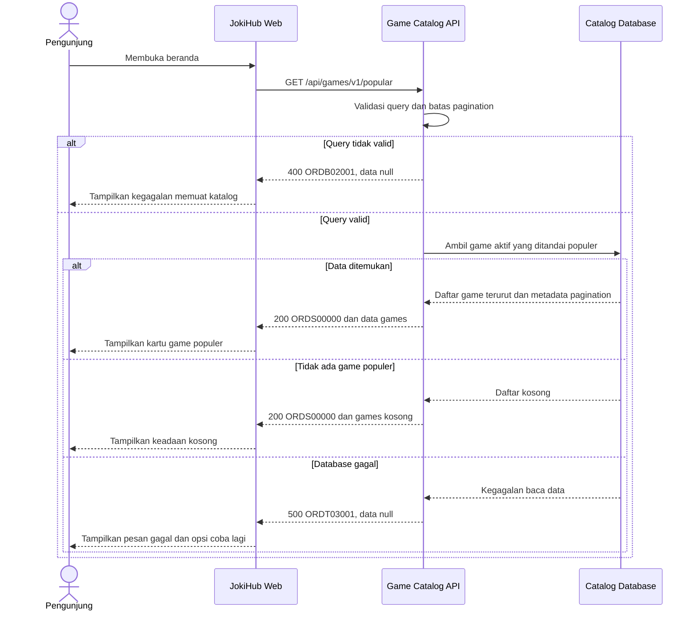

# Game Catalog Service - Get Popular Games Interface Agreement

> **Document Type:** API Contract  
> **Status:** Draft  
> **Service / Domain:** Game Catalog  
> **Consumer / Partner:** JokiHub storefront

## Design


## Sequence Diagram



## Performance / SLA Targets

| Success Rate                                                  | VUser                              | CPU / Memory                                                                | Response Time                |
| ------------------------------------------------------------- | ---------------------------------- | --------------------------------------------------------------------------- | ---------------------------- |
| 99.9% monthly availability; valid-request server error ≤ 0.1% | 50 VUser / 20 request/s NFT target | Initial 2 vCPU / 4 GiB per instance; CPU ≤ 70%, memory ≤ 75% at target load | Read p95 ≤ 500 ms; p99 ≤ 2 s |

## General Information

| Component          | Value                                                                                 |
| ------------------ | ------------------------------------------------------------------------------------- |
| Description        | Mengambil daftar game aktif yang ditandai populer untuk ditampilkan pada storefront.  |
| Resource URL       | `https://{host}/api/games/v1/popular`                                                 |
| Transport Protocol | HTTPS, REST                                                                           |
| Request Verb       | GET                                                                                   |
| Content Type       | `application/json`                                                                    |
| Interaction Type   | Synchronous                                                                           |
| Security Policy    | Public read API; rate limiting dan input validation. Tidak mengembalikan data privat. |

### Path / Endpoint

| Section        | Value                           |
| -------------- | ------------------------------- |
| Host / Domain  | `{host}` (environment-specific) |
| Service Name   | Game Catalog                    |
| Version        | `v1`                            |
| Resource       | `/popular`                      |
| Final Endpoint | `/api/games/v1/popular`         |

### API Versioning

- **Decision:** New Endpoint
- **Previous Endpoint:** Not applicable; current HomeV2 list is static UI data.
- **Final Endpoint:** `/api/games/v1/popular`
- **Backward Compatibility:** No existing API consumer identified. Additive optional response fields are backward-compatible; breaking field or semantic changes require a new major version.
- **Reason:** Storefront needs a catalog-owned source for popular game cards.

## Business Rules

1. Hanya game aktif, populer, dan belum dihapus secara lunak yang masuk daftar.
2. Hanya game dengan `isActive=true`, `isPopular=true`, dan `deleted_at=null` yang dikembalikan. Super Admin mengatur kedua nilai tersebut.
3. Game populer diurutkan berdasarkan sortOrder secara ascending; sortOrder unik antar game sehingga urutan deterministik.
4. Pagination uses one-based `page` and `limit`. Defaults are `page=1` and `limit=6`; allowed `limit` range is 1–50.
5. `total` counts all matching popular games before pagination; `totalPages` is the number of pages and is `0` when no games match.
6. No matching popular games is a successful response with `data: []`, `pagination.total: 0`, and `pagination.totalPages: 0`.
7. `description`, `imageUrl`, and `mark` are presentation metadata. `imageUrl` is an absolute HTTPS URL from any HTTPS host; it is not an embedded image.
8. Example game names from current UI are illustrative until availability is confirmed in the catalog.

## Request Headers

| Header            | E/N/T | Type   | M/O/C | Max Length | Description                                              | Example            |
| ----------------- | ----- | ------ | ----- | ---------: | -------------------------------------------------------- | ------------------ |
| `Accept`          | N     | String | O     |        100 | Response media type. Defaults to JSON.                   | `application/json` |
| `Accept-Language` | N     | String | O     |         35 | Diabaikan; konten Sprint 1 menggunakan bahasa Indonesia. | `id-ID`            |

## Request Parameters

None.

## Request Query Parameters

| Parameter | E/N/T | Type    | M/O/C | Max Length | Description                                  | Example |
| --------- | ----- | ------- | ----- | ---------: | -------------------------------------------- | ------- |
| `page`    | N     | Integer | O     |   9 digits | One-based page number; default 1, minimum 1. | `1`     |
| `limit`   | N     | Integer | O     |   2 digits | Page size; default 6, range 1–50.            | `6`     |

## Request Body

None. GET request has no body.

### Request Validation

1. `page`, when present, must be an integer greater than or equal to 1; otherwise return HTTP 400 with service code `GAMB02001`.
2. `limit`, when present, must be an integer from 1 through 50; otherwise return HTTP 400 with `GAMB02001`.
3. Unknown query parameters diabaikan. `Accept-Language` juga diabaikan karena Sprint 1 belum mendukung multi-bahasa; konten menggunakan bahasa Indonesia.

## Response Body

| Attribute               | E/N/T | Type    | M/O/C | Max Length | Description                                             | Example                                                     |
| ----------------------- | ----- | ------- | ----- | ---------: | ------------------------------------------------------- | ----------------------------------------------------------- |
| `code`                  | N     | String  | M     |         20 | Service status code.                                    | `GAMS00000`                                                 |
| `message`               | N     | String  | O     |        200 | Human-readable result.                                  | `Popular games retrieved`                                   |
| `data`                  | N     | Array   | M     |          - | Current page of popular games; empty when none match.   | `[]`                                                        |
| `data[].id`             | N     | String  | M     |         64 | ID game dengan prefix `game_`.                          | `game_01ARZ3NDEKTSV4RRFFQ69G5FAV`                           |
| `data[].name`           | N     | String  | M     |        100 | Display name.                                           | `Mobile Legends`                                            |
| `data[].slug`           | N     | String  | M     |        100 | URL-safe game identifier used by storefront navigation. | `mobile-legends`                                            |
| `data[].description`    | N     | String  | O     |        500 | Deskripsi game untuk katalog publik.                    | `Permainan strategi untuk perangkat seluler`                |
| `data[].imageUrl`       | N     | String  | M     |       2048 | Absolute HTTPS image URL; any HTTPS host is permitted.  | `https://cdn.example.test/images/games/mobile-legends.webp` |
| `data[].platform`       | N     | String  | O     |         30 | Platform classification from the game catalog.          | `MOBILE`                                                    |
| `data[].sortOrder`      | N     | Integer | M     |  10 digits | Stable ordering value, ascending.                       | `2`                                                         |
| `pagination`            | N     | Object  | M     |          - | Pagination metadata.                                    | `{}`                                                        |
| `pagination.page`       | N     | Integer | M     |   9 digits | Applied one-based page number.                          | `1`                                                         |
| `pagination.limit`      | N     | Integer | M     |   2 digits | Applied page size.                                      | `6`                                                         |
| `pagination.total`      | N     | Integer | M     |  10 digits | Total matching active popular games before pagination.  | `1`                                                         |
| `pagination.totalPages` | N     | Integer | M     |   9 digits | Number of pages; `0` when no games match.               | `1`                                                         |

### Success Example

```json
{
  "code": "GAMS00000",
  "message": "Popular games retrieved",
  "data": [
    {
      "id": "game_01ARZ3NDEKTSV4RRFFQ69G5FAV",
      "name": "Mobile Legends",
      "slug": "mobile-legends",
      "description": "Permainan strategi untuk perangkat seluler",
      "imageUrl": "https://cdn.example.test/images/games/mobile-legends.webp",
      "platform": "MOBILE",
      "sortOrder": 2
    }
  ],
  "pagination": {
    "page": 1,
    "limit": 6,
    "total": 1,
    "totalPages": 1
  }
}
```

### Business Error Example

```json
{
  "code": "GAMB02001",
  "message": "Invalid pagination parameter",
  "data": null
}
```

### Technical Error Example

```json
{
  "code": "GAMT03001",
  "message": "Game catalog is temporarily unavailable",
  "data": null
}
```

## HTTP Status Codes

| HTTP Status | Usage                                                             |
| ----------- | ----------------------------------------------------------------- |
| `200`       | Request valid; results may contain games or an empty array.       |
| `400`       | Invalid `page` or `limit`.                                        |
| `500`       | Unexpected service or catalog database failure.                   |
| `429`       | Rate limit terlampaui; response menyertakan header `Retry-After`. |

## Service Status Codes

Format: `[Service Prefix][Status Type][Category][Specific Error Code]`

| Code        | Type      | Category        | Meaning                                          |
| ----------- | --------- | --------------- | ------------------------------------------------ |
| `GAMS00000` | Success   | General         | Popular games retrieved, including empty result. |
| `GAMB02001` | Business  | User validation | Invalid pagination parameter.                    |
| `GAMT03001` | Technical | Database        | Catalog data could not be read.                  |

## API Exposure Classification

| Classification | Rationale                                                    |
| -------------- | ------------------------------------------------------------ |
| Public         | Customer-facing storefront reads non-sensitive catalog data. |

## Testing & Documentation Scope

| Scope      | Required | Rationale / Handoff                                                                                                                |
| ---------- | -------- | ---------------------------------------------------------------------------------------------------------------------------------- |
| NFT        | Yes      | New customer-facing read API. Measure list retrieval at agreed peak concurrency; target TPS and CPU/memory await traffic forecast. |
| VA/Pentest | Yes      | Public API. Include valid pagination, invalid bounds, unknown query parameters, empty catalog, and response data exposure checks.  |

## Assumptions

- Endpoint prefix `/api`, service name, service codes, response envelope, pagination, and response field names are proposed contract decisions pending API owner review.
- `Accept-Language` diabaikan dan konten menggunakan bahasa Indonesia. Rate limit katalog publik adalah 1.200 request/IP/menit; SLA mengikuti BRD. Urutan populer mengikuti `sortOrder ASC`; host gambar HTTPS tidak dibatasi. Super Admin mengatur status aktif dan populer game.
- Current static list in HomeV2 contains Roblox, Mobile Legends, Free Fire, PUBG Mobile, Valorant, and Genshin Impact as illustrative UI data only.

## References

- `src/features/HomeV2/views/organisms/PopularGames.organism.tsx` — current section display and list consumer.
- `src/features/HomeV2/views/molecules/GameCard.molecule.tsx` — current card fields and order link behavior.
- `src/features/HomeV2/views/interfaces/homeV2.interface.ts` — current UI model (`name`, `service`, `art`, `mark`).
