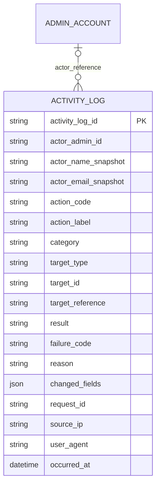

# Activity Log ERD

> **Document Type:** ERD
> **Status:** Draft
> **Scope:** Logical MongoDB document proposal for append-only administrative business-action audit events required by BR-022. Security telemetry outside an authenticated/attributed admin business action and Sprint 3 activity read API contract details are outside this schema scope.
> Decisions still open in this proposal are tracked in the [Sprint 2 decision register](../solutioning/open-decisions.md).

## ERD

`ACTIVITY_LOG` is a proposed logical MongoDB collection; field names/types are not approved physical schema. Every stored event must retain a stable actor identity and a target identity even if the read projection later masks display details. For human-admin events, the actor may reference `ADMIN_ACCOUNT`; system/automation identity still needs an approved representation. `actor_admin_id` and target identifiers are application references, not MongoDB-enforced foreign keys; targets span domains and may outlive target records. Any erasure/anonymization of stored actor identity requires an owner decision. Append-only behavior, access restriction, retention, and redaction require application/database-role/operational enforcement; a collection definition alone does not guarantee immutability.

BR-022 minimum event content is actor, action, target, outcome, and time, with secrets and unnecessary personal/payment data redacted. Other fields in this proposal—including actor name/email snapshots, labels/category, reason/diff, request ID, IP, and user-agent—are optional candidates requiring purpose, minimization, access, and retention decisions; they are not all required by BR-022.

## Table: `activity_log` (proposed MongoDB collection)

| Field                  | Data Type                      | Null | Key / Constraint                                                                                                                                  | Description                                                                                                                                                                                                                                                      |
| ---------------------- | ------------------------------ | ---- | ------------------------------------------------------------------------------------------------------------------------------------------------- | ---------------------------------------------------------------------------------------------------------------------------------------------------------------------------------------------------------------------------------------------------------------- |
| `activity_log_id`      | String, max 64 (logical)       | TBD  | Stable event identifier; mapping to MongoDB `_id` or a separate field TBD                                                                         | Consumer IFA requires a stable event `id`; choose one physical identity and align ordering/pagination to it.                                                                                                                                                     |
| `actor_admin_id`       | String, max 64 (logical)       | TBD  | Human admin identity is logically required by BR-022; stable application reference, not FK. Physical representation and system-actor mapping TBD. | Stored event actor identity required by BR-022. A read projection may omit display details after approved anonymization, but must not imply the source event had no actor. System/automation actor representation and treatment under erasure policy remain TBD. |
| `actor_name_snapshot`  | String, max 150 (proposed)     | TBD  | PII/retention-controlled                                                                                                                          | Actor display snapshot if required by read UX.                                                                                                                                                                                                                   |
| `actor_email_snapshot` | String, max 254 (proposed)     | TBD  | Sensitive PII; access/retention policy required                                                                                                   | Snapshot is proposed from mock activity UI, not a BR-022 requirement. Confirm necessity versus resolving actor at read time.                                                                                                                                     |
| `action_code`          | String, max 100 (logical)      | TBD  | Action identity is logically required by BR-022; stable taxonomy TBD                                                                              | Machine-readable action identifier. No approved event catalogue exists.                                                                                                                                                                                          |
| `action_label`         | String, max 200 (proposed)     | TBD  | Snapshot or runtime localization TBD                                                                                                              | Human-readable label; storage strategy not selected.                                                                                                                                                                                                             |
| `category`             | String, max 30 (proposed)      | TBD  | Taxonomy TBD                                                                                                                                      | Filter/grouping category. Candidate enum from ERD is unapproved and conflicts with some UI categories.                                                                                                                                                           |
| `target_type`          | String, max 50 (logical)       | TBD  | Target identity is logically required by BR-022; no cross-collection FK                                                                           | Domain/resource type affected by the action.                                                                                                                                                                                                                     |
| `target_id`            | String, max 64 (logical)       | TBD  | One stable target identity is logically required; this field may be replaced by an approved singleton key or safe `target_reference`              | A stored event must retain one stable target identity under BR-022; exact representation is TBD.                                                                                                                                                                 |
| `target_reference`     | String, max 150 (proposed)     | TBD  | Conditional candidate only if selected as the sole stable target identity; otherwise optional/TBD                                                 | Human-readable reference only if needed by approved use case; minimize/redact PII. A stored event still needs one stable target identity.                                                                                                                        |
| `result`               | String, max 20 (logical)       | TBD  | Outcome is logically required by BR-022; candidate `SUCCESS`/`FAILED` taxonomy TBD                                                                | Outcome is required; exact result taxonomy and attempted-vs-completed boundary need decision.                                                                                                                                                                    |
| `failure_code`         | String, max 100 (proposed)     | TBD  | Safe code only                                                                                                                                    | Failure category/code; never raw exception or secret-bearing text.                                                                                                                                                                                               |
| `reason`               | String, max 500 (proposed)     | TBD  | Sanitization/redaction required                                                                                                                   | Optional reason, only if business action requires one.                                                                                                                                                                                                           |
| `changed_fields`       | BSON document/array or omitted | TBD  | Allowlist and payload limit required                                                                                                              | Proposed change diff. Exact structure and permitted fields are TBD.                                                                                                                                                                                              |
| `request_id`           | String, max 100 (proposed)     | TBD  | Correlation only; uniqueness/dedupe semantics TBD                                                                                                 | Correlates the event to application logs/request.                                                                                                                                                                                                                |
| `source_ip`            | String, max 45 (proposed)      | TBD  | Sensitive data; trusted-proxy derivation required                                                                                                 | Client IP only if security/audit policy requires collection.                                                                                                                                                                                                     |
| `user_agent`           | String, max 512 (proposed)     | TBD  | Sensitive/retention-controlled                                                                                                                    | Client agent only if needed by approved investigation workflow.                                                                                                                                                                                                  |
| `occurred_at`          | BSON Date                      | TBD  | Event time is logically required by BR-022; server-generated UTC proposal                                                                         | Event time; exact event point (attempt, commit, outcome) must be defined.                                                                                                                                                                                        |

Field names, lengths, and requiredness above are estimates from the draft ERD/UI, not accepted requirements. Prefer only fields required by an approved event catalog and audit display/investigation policy.

## Indexes

The draft activity-list IFA needs query patterns finalized before selecting compound indexes. Candidate indexes below do not approve every displayed/searchable field, PII indexing, or retention strategy.

| Index                                       | Columns                                                                   | Type                         | Purpose                                                                                                                                                                                                     |
| ------------------------------------------- | ------------------------------------------------------------------------- | ---------------------------- | ----------------------------------------------------------------------------------------------------------------------------------------------------------------------------------------------------------- |
| `_id_`                                      | MongoDB `_id`                                                             | Unique (provided by MongoDB) | Document identity. A separate `activity_log_id` and index may be unnecessary.                                                                                                                               |
| `ix_activity_log_occurred` (candidate)      | `occurred_at` descending, approved stable event ID descending             | Non-unique candidate         | Newest-first timeline with stable tie-break. Sprint 3 consumer IFA proposes `activityLogId`; decide whether that maps to `activity_log_id` or MongoDB `_id` and use the same key in the query/index (D-08). |
| `ix_activity_log_category_time` (candidate) | `category`, `occurred_at` descending, approved stable event ID descending | Non-unique candidate         | Filtered activity list only if category/date filters are approved; use the same event ID as the consumer's deterministic tie-break (D-08).                                                                  |
| `ix_activity_log_actor_time` (candidate)    | `actor_admin_id`, `occurred_at` descending                                | Non-unique candidate         | Actor history if an approved use case needs it.                                                                                                                                                             |
| `ix_activity_log_target_time` (candidate)   | `target_type`, `target_id`, `occurred_at` descending                      | Non-unique candidate         | Resource-specific investigation if authorized.                                                                                                                                                              |
| `ix_activity_log_request_id` (candidate)    | `request_id`                                                              | Non-unique candidate         | Request correlation; deduplication requires a separately defined stable key.                                                                                                                                |

Do not add indexes on actor email, IP, user-agent, labels, reason, or changed values until privacy/access/query needs are approved. TTL indexes are not a default: retention, legal hold, archival, and purge ownership must be decided first.

## Relationships

| Parent                     | Child                     | Cardinality                                                  | Rule                                                                                                                                                                                                                                       |
| -------------------------- | ------------------------- | ------------------------------------------------------------ | ------------------------------------------------------------------------------------------------------------------------------------------------------------------------------------------------------------------------------------------ |
| `admin_account` collection | `activity_log` collection | Candidate 1:N logical actor reference for human-admin events | One admin may be associated with events. `actor_admin_id` is a stable reference captured at event time; no FK or cascade delete exists. Display snapshot, system/automation principal, and erasure/anonymization policy are TBD.           |
| Domain target collections  | `activity_log` collection | Polymorphic 0..N logical reference                           | `target_type` and a safe target identity are required logically; identity may use `target_id`, an approved singleton key, or `target_reference`. No target FK is proposed; identifier meaning and reference exposure require allowlisting. |

There is no confirmed event bus/outbox relation or atomic commit topology. Such a component, if selected, belongs in HLD and mutation IFA sequence diagrams.

## Data Rules

1. BR-022 requires administrative actions to be recorded as append-only events containing actor, action, target, outcome, and time, with secrets and unnecessary personal/payment data redacted. It does not approve all fields or event taxonomy in this draft ERD.
2. Every stored event must identify its target through a stable `target_id`, an approved singleton key, or a safe `target_reference`; target type alone is insufficient. The Sprint 3 consumer IFA is a read projection and must not silently turn a missing stored target identity into an apparently complete event. If a reader is authorized to receive a redacted projection with no identifier, that exception and its representation require explicit privacy/audit policy approval.
3. The Sprint 3 read projection may omit or anonymize actor display fields, but this does not make the persisted event actor optional. Define whether a stable or pseudonymous actor identifier must remain after account deletion/anonymization; system/automation principals also need an approved representation (D-07/D-08).
4. Define whether an event represents an attempted action, a committed mutation, or both. Failure-event coverage must align with authentication/authorization boundaries and must avoid recording unauthenticated noise as a business audit event without policy.
5. Actor, event time, target, outcome, and changed values must be derived from trusted server state; never accept these as authoritative client-supplied values.
6. `changed_fields` must use an approved allowlist, size limit, and redaction policy. Do not persist entire request/response bodies, tokens, passwords, OTPs, credentials, payment secrets, or unnecessary customer PII.
7. Append-only is required at the business level, but enforcement model is TBD: restricted MongoDB roles, application interface, append-only storage, audit trail, or operational controls need security/platform decision. Retention purge must be privileged and separately auditable.
8. Define event deduplication semantics for retry/replay. Mongo `_id` uniqueness alone prevents duplicate insertion only if a stable deterministic event key is selected; random IDs do not deduplicate retries.
9. Any IP/user-agent/email/name snapshot requires privacy purpose, access, masking, retention, and erasure/legal-hold policy. Do not assume UI mock columns establish lawful/necessary collection.
10. Timestamp is generated by trusted service and stored as BSON Date in UTC if adopted. Choose whether it records attempt time or committed outcome time and retain ordering tie-break behavior.
11. Audit write atomicity, outbox, retry, and fail-open/fail-closed behavior must be decided by mutation criticality. The ERD does not promise atomic persistence.
12. Sprint 3 activity read contract may request filters and summaries; align its query predicate to approved event taxonomy and indexes without exposing fields outside reader authorization.
13. Retention period, archive/purge schedule, legal holds, actor-deletion behavior, and storage capacity are TBD; do not infer Sprint 1 account retention policies apply to audit events.

## Decisions

- **BRD requirement:** BR-022 requires append-only administrative audit events with actor/action/target/outcome/time and redaction of secrets/unnecessary personal/payment data. Those five logical values are marked required above; their physical mapping and taxonomy remain open.
- **Documented baseline/evidence:** Sprint 1 HLD/ERD identifies MongoDB for the Go platform; the in-repository route-to-handler coverage document records a settings `PUT` activity event. Neither statement was reverified against code in this work. The route document does not establish a dedicated Sprint 2 audit collection, event schema, append-only enforcement, or delivery/failure guarantees that satisfy BR-022.
- **Observed UI fact:** Sprint 3 activity mock displays actor name/email, action, target, category, time, IP, and result; mock display alone does not approve collection of those values.
- **TBD:** physical collection/ID, action taxonomy, category taxonomy, attempt/success/failure boundary, field allowlist, actor snapshots, PII/IP/user-agent treatment, event ordering, dedupe key, append-only enforcement, storage topology, write guarantee, failure policy, retention/archive/legal hold, access control, and read indexes. Security/audit, product/domain, data, and platform owners must decide.

## SLA Baseline

No approved audit-write availability, delivery latency, durability, throughput, retention, or read SLA exists for Sprint 2. Targets and measurement scope are **TBD** in the [Sprint 2 BRD](../BRD.md#6-sla-awal); this ERD makes no database-only SLA claim.

## References

- [Sprint 2 decision register](../solutioning/open-decisions.md) — D-07/D-08.
- [Sprint 2 BRD](../BRD.md) — BR-022 audit requirement and redaction constraint.
- [Sprint 2 HLD](../hld/sprint-2-hld.md) — target boundary; audit delivery topology is TBD.
- [Go admin dashboard route inventory document](../../sprint-3/solutioning/backend-go/dashboard-source-ifa.md#route-to-handler-coverage) — documentary note on settings PUT activity event, not reverified against code in this work and not a complete BR-022 audit implementation.
- [Sprint 3 activity log list IFA](../../sprint-3/solutioning/dashboard/activity-logs/get-list-activity-logs.md) — proposed consumer read/filter needs, not approval for event schema.
- [Sprint 1 Admin Account ERD](../../sprint-1/erd/admin-account-erd.md) and [Role ERD](../../sprint-1/erd/role-erd.md) — actor identity/access baseline.
