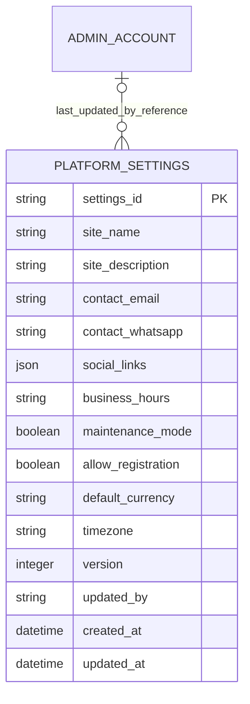

# Platform Settings ERD

> **Document Type:** ERD
> **Status:** Draft
> **Scope:** Logical document proposal for general platform settings edited by Admin Dashboard and selectively consumed by public services. The in-repository route-to-handler coverage document records GET/PUT behavior, but was not reverified against code in this work and does not establish physical persistence detail. Payment credentials/provider secrets and detailed audit history are out of scope.
> Decisions still open in this proposal are tracked in the [Sprint 2 decision register](../solutioning/open-decisions.md).

## ERD

`PLATFORM_SETTINGS` is a proposed logical document collection, not a relational table. `updated_by` is a candidate application-level reference to an admin identifier; MongoDB does not enforce a foreign key. The in-repository route-to-handler coverage document records admin GET/PUT and settings fields, version, timestamp, and activity-event behavior, but was not reverified against code in this work and does not establish physical collection/field mapping. Earlier local notes describe a public settings projection (`socialLinks`, `businessHours`) and fallback values; treat them as historical context, not verified implementation facts or approval to expose all admin settings.

## Table: `platform_settings` (proposed MongoDB collection)

| Field                | Data Type                                           | Null | Key / Constraint                                                                                                 | Description                                                                                                                     |
| -------------------- | --------------------------------------------------- | ---- | ---------------------------------------------------------------------------------------------------------------- | ------------------------------------------------------------------------------------------------------------------------------- |
| `settings_id`        | String, max 32 (proposed)                           | No   | Candidate fixed document key `default`; singleton enforcement strategy TBD                                       | Stable platform-wide settings identifier. A fixed `_id` may enforce one document by MongoDB document-key uniqueness.            |
| `site_name`          | String, max 100 (proposed)                          | TBD  | Target IFA requires a non-empty value; physical nullability TBD                                                  | Public-facing site name. Initial production value must be explicitly configured, not copied from mock UI.                       |
| `site_description`   | String or null, max 500 (proposed)                  | TBD  | TBD                                                                                                              | Public descriptive copy; escaping and empty/null semantics need confirmation.                                                   |
| `contact_email`      | String, max 254 (proposed)                          | TBD  | Target request requires the field; physical nullability and validation beyond source behavior need confirmation  | Support email. Public response exposure and initial value require approval.                                                     |
| `contact_whatsapp`   | String, max 16 (proposed)                           | TBD  | Target request requires the field; E.164 is only a proposal                                                      | Support contact number. Public exposure and formatting policy require approval.                                                 |
| `social_links`       | Array of `{label,url}` documents (logical proposal) | TBD  | Target request requires the field and allows up to 12 entries; physical BSON mapping TBD                         | The route inventory document uses `socialLinks`; each URL is described as HTTPS. Confirm normalization and persistence mapping. |
| `business_hours`     | String or null, max 160 in route inventory document | TBD  | Target request requires the field; nullable value and physical BSON mapping need confirmation                    | The route inventory document includes this admin/public field; exact display and timezone semantics remain a product decision.  |
| `maintenance_mode`   | Boolean                                             | TBD  | Target IFA requires the field; no approved storage default                                                       | Storefront maintenance switch. Exact blocked routes/availability behavior TBD.                                                  |
| `allow_registration` | Boolean                                             | TBD  | Target IFA requires the field; no approved storage default                                                       | Proposed switch for member registration; member auth/registration is scoped in Sprint 3 and policy must be coordinated.         |
| `default_currency`   | String, length 3 (proposed)                         | TBD  | `IDR` is UI/source assumption only; storage rule is not approved                                                 | Candidate storefront currency setting; ownership and relation to service/payment money model TBD.                               |
| `timezone`           | String, max 64 (proposed)                           | TBD  | IANA timezone allowlist proposed                                                                                 | Display/operation timezone purpose and supported values TBD. Persisted timestamps remain UTC if selected.                       |
| `version`            | Integer                                             | TBD  | Route inventory document records missing row returns 0 and new row starts at 1; optimistic compare semantics TBD | Version value returned beside the settings object; storage placement is not established by the response contract.               |
| `updated_by`         | String, max 64 (proposed)                           | Yes  | Application reference to admin ID; not a Mongo FK                                                                | Last interactive updater; may be absent/null for bootstrap/system update. Public projection must exclude it.                    |
| `created_at`         | BSON Date (proposed)                                | TBD  | UTC/server-generated proposal                                                                                    | Initialization timestamp.                                                                                                       |
| `updated_at`         | BSON Date (proposed)                                | TBD  | UTC/server-generated proposal                                                                                    | Last settings mutation time.                                                                                                    |

The target admin and public contracts both include `socialLinks` and `businessHours`, but public settings are a separately proposed smaller projection. The route-to-handler coverage document describes `version` and `updatedAt` as sibling fields; this was not reverified against code in this work. This ERD keeps physical storage mapping unconfirmed; do not infer automatic exposure of admin-only controls before D-05/D-09 are decided.

## Indexes

| Index                                        | Columns                                  | Type                                                          | Purpose                                                                                                                                             |
| -------------------------------------------- | ---------------------------------------- | ------------------------------------------------------------- | --------------------------------------------------------------------------------------------------------------------------------------------------- |
| `_id_` / fixed settings key (candidate only) | MongoDB `_id` or `settings_id` fixed key | Unique by MongoDB document identity; storage key strategy TBD | Candidate singleton enforcement only if a fixed key and global scope are approved; no index strategy is established by the available documentation. |
| `ix_platform_settings_updated` (candidate)   | `updated_at` descending                  | Non-unique candidate                                          | Operational freshness lookup only if an actual query uses it; unnecessary for a direct fixed-key singleton read.                                    |

Do not index individual settings fields without an approved query need. If multi-tenant/brand settings are required, define the tenant key and a compound unique key instead of assuming global singleton semantics.

## Relationships

| Parent                     | Child                          | Cardinality                                                                                                               | Rule                                                                                                                                                                                                                                            |
| -------------------------- | ------------------------------ | ------------------------------------------------------------------------------------------------------------------------- | ----------------------------------------------------------------------------------------------------------------------------------------------------------------------------------------------------------------------------------------------- |
| `admin_account` collection | `platform_settings` collection | Optional 0..1 current admin reference per settings document; one admin may be current updater for 0..N settings documents | `updated_by` may be absent/null for bootstrap or system updates and is a scalar application reference, not an enforced foreign key. The settings document stores only the current updater; historical actor history belongs to the audit model. |

No direct relationship to audit event is modeled. Audit storage may be same database, an outbox, or an external service; topology and atomicity are unresolved.

## Data Rules

1. Current settings UI provides candidate form fields and session-only save behavior; it does not establish production values, persistence defaults, or approved public data.
2. The in-repository route inventory document describes `GET` and `PUT /api/admin/settings/v1/general`; its summary says `PUT` requires ten settings keys, increments version, and writes an activity event. It was not reverified against code in this work. The physical collection, singleton/tenant scope, and exact field-to-document mapping still require confirmation.
3. Admin API must return only fields authorized for the admin consumer. Public settings must use an explicit allowlist. Earlier local notes (not reverified against code in this work) describe a distinct schema (`siteName`, `siteDescription`, `contactEmail`, `contactWhatsapp`, `socialLinks`, `businessHours`) and `Cache-Control: no-store`; these notes do not approve the target public projection.
4. Registration switch must be coordinated with Sprint 3 member registration behavior; it must not implicitly disable admin provisioning. Exact enforcement location is TBD.
5. Maintenance switch semantics, emergency bypass, behavior for health/admin APIs, and interaction with deployment/operations are TBD; no route should be assumed blocked based on the field name alone.
6. The route inventory document describes a settings version in the response and an increment on update, but does not establish whether clients submit a version or receive a stale-write conflict. Do not equate version increments with optimistic concurrency; finalize the compare-and-update contract before physical design.
7. Currency and timezone fields are proposals. Currency ownership must align with catalog price precision/payment and timezone's business meaning must be approved. Do not treat UI options/defaults as production policy.
8. Secret credentials, provider tokens, SMTP passwords, payment credentials, or signing keys must not be stored in this collection.
9. If settings updates are persisted, actor/time attribution must be available for BR-022. Atomic audit recording, outbox/retry, and failure behavior are not decided here.
10. Cache/config propagation is not established by the route inventory. Freshness, invalidation, retry, and response semantics must be designed before publishing settings changes to consumers.

## Decisions

- **Documented route inventory (not reverified against code in this work):** The in-repository route-to-handler coverage document describes admin settings GET/PUT, `settings-manage`, ten settings fields, version increment, `updatedAt`, and an activity event. It does not name or fully describe physical collection schema.
- **Historical route note, not reverified:** Earlier local notes describe public settings fields `siteName`, `siteDescription`, `contactEmail`, `contactWhatsapp`, `socialLinks`, and `businessHours`, defaults, `no-store`, and omission of admin controls/version. These remain unverified and do not approve the target public projection.
- **Observed UI fact:** Admin form has general identity/contact/regional/switch fields and simulated save; mock values are not approved initial settings.
- **TBD:** Physical collection and BSON mapping, global vs tenant scope, bootstrap values, permission/status contract alignment, public projection, registration/maintenance semantics, currency/timezone owner, stale-write handling, settings/audit consistency, and propagation policy. Product/platform/API owners must decide.

## SLA Baseline

No approved Sprint 2 settings SLA, propagation target, or measured baseline exists. End-to-end API availability, VUser/TPS, latency, capacity, and freshness are **TBD** in the [Sprint 2 BRD](../BRD.md#6-sla-awal); this document makes no database-only SLA claim.

## References

- [Sprint 2 decision register](../solutioning/open-decisions.md) — D-05/D-06/D-07/D-08/D-09/D-16.
- [Sprint 2 BRD](../BRD.md) — BR-020/022 and public settings exposure gate.
- [GET general settings IFA](../solutioning/dashboard/settings/get-general-settings.md) and [PUT general settings IFA](../solutioning/dashboard/settings/update-general-settings.md) — read and update contracts for the admin settings resource.
- [Public settings IFA](../solutioning/public/settings/get-public-settings.md) — target public projection and cache policy.
- [Go dashboard route inventory document](../../sprint-3/solutioning/backend-go/dashboard-source-ifa.md#route-to-handler-coverage) — documentary admin settings summary; not reverified against code in this work.
- [Sprint 1 Admin Account ERD](../../sprint-1/erd/admin-account-erd.md) — actor identity baseline.
