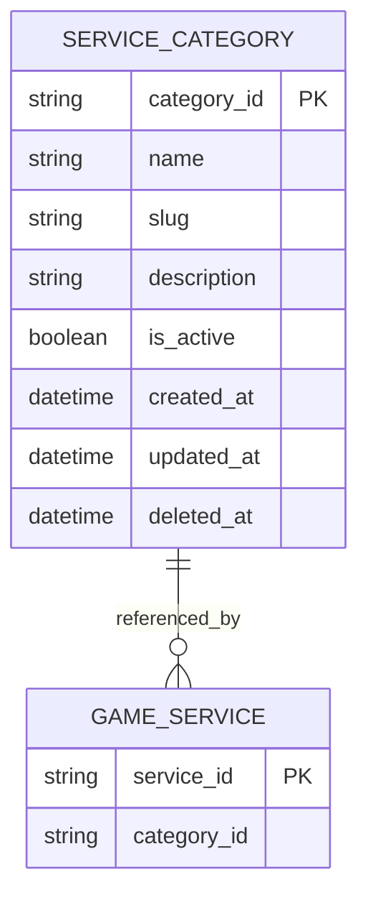

# Service Category ERD

> **Document Type:** ERD
> **Status:** Draft
> **Scope:** Logical MongoDB collection proposal for Admin Dashboard service categories and public category discovery. Physical collection names, keys, indexes, lifecycle, and service-count rules require confirmation before implementation.
> Decisions still open in this proposal are tracked in the [Sprint 2 decision register](../solutioning/open-decisions.md).

## ERD

`SERVICE_CATEGORY` and `GAME_SERVICE` denote logical document sets, not relational tables. The one-category-per-service relationship is inferred from the Admin Services UI single-select control. MongoDB stores the service's `category_id` as a reference; MongoDB does not enforce a foreign key or cascade behavior. Confirm physical collection names and whether this cardinality is a business decision.

## Table: `service_category` (proposed MongoDB collection)

| Field         | Data Type                  | Null | Key / Constraint                                        | Description                                                                                                                                                                                                                                           |
| ------------- | -------------------------- | ---- | ------------------------------------------------------- | ----------------------------------------------------------------------------------------------------------------------------------------------------------------------------------------------------------------------------------------------------- |
| `category_id` | String, max 64 (proposed)  | No   | Logical ID; generation/format TBD                       | Stable category identifier; the available UI calls this field `id`.                                                                                                                                                                                   |
| `name`        | String, max 100 (proposed) | No   | Trimmed, non-empty; uniqueness scope TBD                | Category display name. Case sensitivity and uniqueness across inactive/deleted records require decision.                                                                                                                                              |
| `slug`        | String, max 100 (proposed) | No   | URL-safe format proposed; uniqueness and mutability TBD | Category route/filter identifier. Public usage and slug lifecycle require product decision.                                                                                                                                                           |
| `description` | String, max 500 (proposed) | TBD  | TBD                                                     | Optional descriptive text; nullable/empty semantics and limit require confirmation.                                                                                                                                                                   |
| `is_active`   | Boolean                    | No   | No default approved                                     | Admin status field used by proposed public visibility rules.                                                                                                                                                                                          |
| `created_at`  | BSON Date                  | No   | UTC; server-generated proposal                          | Creation time; immutability rule needs API owner confirmation.                                                                                                                                                                                        |
| `updated_at`  | BSON Date                  | No   | UTC; server-generated proposal                          | Last successful mutation time.                                                                                                                                                                                                                        |
| `deleted_at`  | BSON Date or absent        | TBD  | Logical field mapping proposed                          | The in-repository route inventory document describes `deletedAt` on successful category delete and treats soft-deleted categories as not found. It was not reverified against code in this work; physical mapping, restore, and retention remain TBD. |

## Table: `game_service` reference fields (defined fully in Service ERD)

| Field         | Data Type                 | Null                | Key / Constraint                                                                                         | Description                                                                                                                                                                                    |
| ------------- | ------------------------- | ------------------- | -------------------------------------------------------------------------------------------------------- | ---------------------------------------------------------------------------------------------------------------------------------------------------------------------------------------------- |
| `service_id`  | String, max 64 (proposed) | No                  | Logical ID; format TBD                                                                                   | Reference only; full service document is in [Service ERD](service-erd.md).                                                                                                                     |
| `category_id` | String, max 64 (proposed) | No (logical target) | Required scalar reference to `service_category.category_id`; referential validation is application-level | Category chosen for a service. The target create IFA requires `categoryId`; physical null handling for legacy/dangling references and deactivation/deletion behavior still require a decision. |

## Indexes

Index definitions are candidates based on proposed IFA query patterns, not approved indexes. Exact field order, collation, partial-filter expressions, and whether deleted/inactive records participate need query plans and product lifecycle rules.

| Index                                                                   | Columns                          | Type                                  | Purpose                                                                                                                                                                   |
| ----------------------------------------------------------------------- | -------------------------------- | ------------------------------------- | ------------------------------------------------------------------------------------------------------------------------------------------------------------------------- |
| `uq_service_category_name_candidate`                                    | normalized `name`                | Unique candidate; scope/predicate TBD | Candidate name uniqueness only if product confirms normalization and whether inactive/deleted categories participate. The index name does not assert an active-only rule. |
| `uq_service_category_slug_candidate`                                    | `slug`                           | Unique candidate; scope/predicate TBD | Candidate slug uniqueness only if slug and reuse policy are approved. The index name does not assert an active-only rule.                                                 |
| `ix_service_category_admin_list` (candidate)                            | `is_active`, `name`, category ID | Non-unique candidate                  | Support admin status filter and deterministic listing if these are retained query/sort fields.                                                                            |
| `ix_game_service_category` (candidate; defined with service collection) | `category_id`                    | Non-unique candidate                  | Support category reference lookup and proposed count aggregation. Index belongs to the service collection.                                                                |

MongoDB supports single-field, compound, unique, partial, collation, and TTL indexes subject to version/configuration. No index option is final here: check the actual predicates, soft-delete policy, uniqueness semantics, and count queries before selecting them. TTL must not be used for business retention without an approved retention rule.

## Relationships

| Parent                        | Child                     | Cardinality  | Rule                                                                                                                                                                                                                                                                    |
| ----------------------------- | ------------------------- | ------------ | ----------------------------------------------------------------------------------------------------------------------------------------------------------------------------------------------------------------------------------------------------------------------- |
| `service_category` collection | `game_service` collection | Proposed 1:N | Each service holds a scalar `category_id` reference under the available single-select UI. Referential checks, category deletion, and service reassignment are application workflows; MongoDB provides no FK/cascade enforcement. Multi-category service support is TBD. |

No embedded category snapshot is confirmed. Public/admin responses may project category name/slug at read time; whether orders retain a purchase-time category snapshot is owned by the order data model, not this ERD.

## Data Rules

1. UI evidence shows category `name`, `slug`, `description`, and active status, but does not establish approved persistence schema, field limits, default values, or identity format.
2. Admin category-list IFA proposes excluding deleted categories and matching `name`/`slug`; public IFA proposes returning active categories with eligible services. Earlier local route notes (not reverified) describe active categories with active services on active games, omission of zero-match categories, and absence of target `iconKey`/`sortOrder`. Confirm whether that historical behavior is the approved BR-003 eligibility/presentation policy.
3. Admin service-category IFA proposes deriving `serviceCount` from `game_service`; count inclusion for inactive/deleted services and eligibility across game state is unresolved. Product must decide whether the public eligible-service metric and admin operational metric are the same or intentionally distinct, then define each predicate.
4. The in-repository admin route inventory document describes a category-delete conflict (`409` with `linkedServiceCount`) when linked services prevent deletion, checks linked services including soft-deleted ones, and returns `deletedAt` on successful deletion. It was not reverified against code in this work. The target IFA proposes a similar restriction; whether to retain this count predicate, deletion/reactivation semantics, reassignment flow, and physical mapping still require approval.
5. Category ordering, icon/artwork key, public category display source, slug mutation/reuse, and uniqueness for inactive/deleted records are TBD; do not create stored fields/indexes until approved. The target public response and historical route notes are not field-equivalent.
6. Timestamps, if persisted, are generated by the trusted service and represented as BSON Date in UTC. Exact requiredness and update semantics need alignment with category CRUD IFAs and repository conventions.
7. Category changes that alter a public projection must be reflected by the read path according to a cache/freshness policy; no cache policy is currently approved.
8. Category mutations must be audit-attributed as required by BR-022, but audit event shape, atomicity, delivery, and failure policy belong to the shared audit model and remain TBD.

## Decisions

- **Documented baseline:** [Sprint 1 Game ERD](../../sprint-1/erd/game-catalog-erd.md) identifies `GAME_CATALOG` as a MongoDB collection; this is not a Sprint 2 source-code verification.
- **Observed UI fact:** The available admin service form mock exposes one category selection per service; this is interface evidence, not business approval for a permanent 1:N model.
- **Route inventory documentation (not reverified against code in this work):** Admin category delete is described as checking linked services including soft-deleted ones, returning HTTP 409 with `linkedServiceCount` on conflict and `deletedAt` on success; detail treats soft-deleted categories as not found. Whether the target preserves these rules is open; physical MongoDB field mapping, recovery, and retention are not established by the document.
- **Historical route note, not reverified:** Earlier local notes describe public categories with counts from active services on active games and omission of categories with zero qualifying services; target exposure/eligibility still requires product confirmation.
- **TBD:** Physical collection/field names, identifier format, validation bounds, defaults, uniqueness/collation, index definitions, target delete/reactivation and reassignment policy, source-to-physical `deletedAt` mapping, retention, slug lifecycle, count predicate, and public order/icon source. Product/catalog and API/data owners must confirm these before implementation.

## SLA Baseline

No Sprint 2 category SLA is approved. End-to-end public/admin API availability, VUser/TPS, response time, resource targets, and catalog freshness are **TBD** in the [Sprint 2 BRD](../BRD.md#6-sla-awal); this ERD makes no database-only SLA claim.

## References

- [Sprint 2 decision register](../solutioning/open-decisions.md) — D-02/D-04/D-07/D-08/D-10/D-14.
- [Sprint 2 BRD](../BRD.md) — BR-003, BR-019, BR-022 and proposed delivery boundaries.
- [Admin category list IFA](../solutioning/dashboard/service-categories/get-list-service-categories.md)
- [Admin category create IFA](../solutioning/dashboard/service-categories/create-service-category.md)
- [Admin category detail IFA](../solutioning/dashboard/service-categories/get-detail-service-category.md)
- [Admin category update IFA](../solutioning/dashboard/service-categories/update-service-category.md)
- [Admin category delete IFA](../solutioning/dashboard/service-categories/delete-service-category.md)
- [Public category list IFA](../solutioning/public/service-categories/get-list-service-categories.md)
- [Go admin dashboard route inventory document](../../sprint-3/solutioning/backend-go/dashboard-source-ifa.md#route-to-handler-coverage) — documentary admin category CRUD summary; not reverified against code in this work.
- [Service ERD](service-erd.md)
