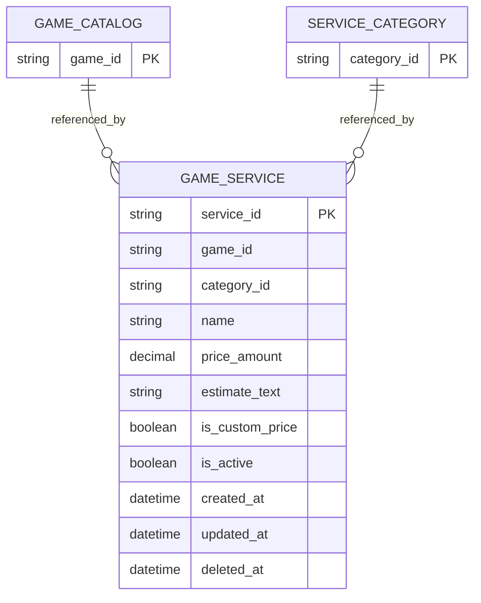

# Service ERD

> **Document Type:** ERD
> **Status:** Draft
> **Scope:** Logical MongoDB collection proposal for game services managed in Admin Dashboard and read by public catalog. Order records/snapshots and fulfillment execution are out of scope and belong to Sprint 3 data design.

## ERD

`GAME_CATALOG`, `SERVICE_CATEGORY`, and `GAME_SERVICE` denote logical document sets, not relational tables. The existing [Game ERD](../../../sprint-1/erd/game-catalog-erd.md) is MongoDB-backed. This document proposes service references by identifier; MongoDB does not enforce foreign keys or delete restrictions. The physical collection name, field names, money representation, and reference lifecycle are not approved. Target IFA's camelCase response fields (`priceAmount`, `currency`, `estimateText`, `isCustomPrice`) also differ from current Go source wire fields (`price`, `customPrice`, `estimate`); mapping must be decided and documented consistently.

The ERD field `game_id` and IFA field `gameId` are logical model/API names, not evidence of the current Go Game Catalog identifier's physical format or a source-to-target mapping. Confirm the identifier and mapping before implementation; do not infer it from sample IDs. Public IFA's target `pricingType` is derived from the target fixed/quote state; target `currency` has no service-level stored field and is proposed to derive from platform `defaultCurrency`, pending D-03/D-05 and Sprint 3 snapshot consistency decisions.

## Table: `game_service` (proposed MongoDB collection)

| Field             | Data Type                                   | Null | Key / Constraint                                                | Description                                                                                                                                                                                                                                        |
| ----------------- | ------------------------------------------- | ---- | --------------------------------------------------------------- | -------------------------------------------------------------------------------------------------------------------------------------------------------------------------------------------------------------------------------------------------- |
| `service_id`      | String, max 64 (proposed)                   | No   | Logical ID; generation/format TBD                               | Stable service identifier; current UI uses `id`.                                                                                                                                                                                                   |
| `game_id`         | String, max 64 (proposed)                   | No   | Reference to Game Catalog ID; application validation            | Game to which the service is associated. UI currently selects one game.                                                                                                                                                                            |
| `category_id`     | String, max 64 (proposed)                   | No   | Reference to Service Category ID; application validation        | Category associated with service. UI currently selects one category.                                                                                                                                                                               |
| `name`            | String, max 150 (proposed)                  | No   | Non-empty is proposed; uniqueness TBD                           | Service display name. Search and duplicate rules require approval.                                                                                                                                                                                 |
| `price_amount`    | MongoDB Decimal128, JSON representation TBD | TBD  | Non-negative for fixed-price target; precision/currency TBD     | Candidate fixed price. UI mock represents custom price as `null`; money precision and storage serialization are open API/finance decisions.                                                                                                        |
| `is_custom_price` | Boolean                                     | TBD  | Redundant with null price unless product chooses explicit state | Candidate quote-required indicator. UI currently derives it from null price; storage representation requires decision.                                                                                                                             |
| `estimate_text`   | String, max 100 (proposed)                  | TBD  | No approved bound/requiredness                                  | Display estimate such as `Instan`; not a fulfillment SLA.                                                                                                                                                                                          |
| `is_active`       | Boolean                                     | TBD  | No approved default                                             | Whether service is enabled for admin/public use; exact visibility predicate must be approved.                                                                                                                                                      |
| `created_at`      | BSON Date                                   | TBD  | UTC, server-generated proposal                                  | Creation timestamp; physical requiredness and retention policy TBD.                                                                                                                                                                                |
| `updated_at`      | BSON Date                                   | TBD  | UTC, server-generated proposal                                  | Last successful update timestamp; physical requiredness TBD.                                                                                                                                                                                       |
| `deleted_at`      | BSON Date or absent                         | TBD  | Logical field mapping proposed                                  | Local admin route inventory reports `deletedAt` on successful service delete and treats deleted services as absent on detail/update. The physical field name/type, restore behavior, and retention policy are not verified by that route contract. |

Description, URL slug, service inputs, variants/quantity tiers, sort order, fulfillment instructions, and historical order snapshot fields are omitted because current source does not establish a final service schema for them.

## Indexes

These index candidates follow the draft IFA read patterns. They are not approved production indexes; confirm collection name, predicates, pagination/order, actual query plans, and whether inactive/deleted services are queried before implementation.

| Index                                         | Columns                                                         | Type                                               | Purpose                                                                              |
| --------------------------------------------- | --------------------------------------------------------------- | -------------------------------------------------- | ------------------------------------------------------------------------------------ |
| `ix_game_service_game_status` (candidate)     | `game_id`, `is_active`, display sort/name TBD, `service_id`     | Non-unique candidate; partial filter TBD           | Admin/public lookup by game and stable list ordering if supported by approved query. |
| `ix_game_service_category_status` (candidate) | `category_id`, `is_active`, display sort/name TBD, `service_id` | Non-unique candidate; partial filter TBD           | Admin category association and proposed service count.                               |
| `ix_game_service_storefront` (candidate)      | `game_id`, `category_id`, `name` or approved display order      | Non-unique candidate; active/deleted predicate TBD | Public eligible service query; field order depends on final filter/sort pattern.     |
| `uq_game_service_business_key`                | TBD                                                             | No unique index proposed                           | Name uniqueness scope is not established by UI/BRD.                                  |

MongoDB supports compound and partial indexes, but exact definitions must match query predicates and retention policy. Do not add uniqueness or partial filters based only on the current relational ERD proposal.

## Relationships

| Parent                        | Child                     | Cardinality      | Rule                                                                                                                                                                |
| ----------------------------- | ------------------------- | ---------------- | ------------------------------------------------------------------------------------------------------------------------------------------------------------------- |
| `game_catalog` collection     | `game_service` collection | Proposed 1:N     | One service points to one game ID under current UI. Reference validity, inactivation, and deletion behavior are enforced in application workflow; not an FK.        |
| `service_category` collection | `game_service` collection | Proposed 1:N     | One service points to one category ID under current UI. Multi-category support and category deletion/reassignment behavior are TBD.                                 |
| `game_service` collection     | Sprint 3 order snapshot   | Outside this ERD | Order must define its own purchase-time snapshot and must not depend on mutable catalog values; exact snapshot schema belongs to order ERD/approved order contract. |

No order collection fields or order references are defined here. The Sprint 3 order ERD must define a durable snapshot before checkout implementation.

## Data Rules

1. The current Admin Services UI indicates one game and one category selector per service. This is interface evidence only; multi-game or multi-category business support needs product approval and would change the data model/API.
2. A candidate public response lists only services eligible under game, service, and category state. The exact predicate must align with BR-003/004/005; source currently filters active services/categories and active games. Deleted-state behavior is not represented consistently by all source routes and requires a decision.
3. Fixed-price versus quote-required behavior is a business requirement (BR-005), but `price_amount`, `is_custom_price`, currency, decimal precision, quote lifecycle, and publishability are not approved schema decisions. A quote-required item must not be treated as having a payable amount; order eligibility is governed by a later approved checkout flow.
4. Public source currently exposes numeric price converted from MongoDB Decimal128 to JSON floating point. Precision-safe representation is an open question shared with Sprint 3 checkout; do not assume the proposed Decimal(18,2) relational type is an implementation contract.
5. `estimate_text` is customer display copy and is not a guaranteed completion SLA. Structured duration is out of scope unless a requirement establishes operational scheduling/reporting needs.
6. Uniqueness of service names, game/category active-state transitions, defaults, and slug/order fields are TBD. No unique index is approved.
7. Local admin route inventory records a service-delete response with `deletedAt`; deleted services are excluded from the admin list and treated as not found on detail/update. This documents soft-delete behavior at the route boundary, but not physical MongoDB field mapping, retention, restore policy, or public-read handling. Category/game deletion with associated services remains governed by separate lifecycle decisions; MongoDB references do not enforce restrict/cascade behavior.
8. When a service changes, previously created order facts must remain immutable through order snapshots. Snapshot fields and retention are owned by Sprint 3 order data design.
9. Successful catalog mutations must carry audit attribution under BR-022; audit event taxonomy, atomicity/outbox, deduplication, and failure behavior remain shared audit decisions.
10. Stored timestamp fields, if selected, use server-generated BSON Date values in UTC; requiredness and no-op update semantics must align with the approved API contract.

## Decisions

- **Confirmed source fact:** Go platform uses MongoDB v2 driver; Sprint 1 game catalog is a MongoDB collection.
- **Observed UI fact:** Current service form has one game selector, one category selector, name, price/custom-price representation, estimate, and active state. Seed/mock data does not approve these as a final stored schema.
- **Observed source inventory fact:** Admin service delete returns a deletion timestamp; admin list/detail/update treat deleted services as excluded or absent. The route inventory does not prove the physical field name, retention, restore behavior, or that public reads apply the same deleted predicate.
- **Confirmed business need:** BR-005 requires customers to distinguish fixed-price and quote-required services and forbids invented pricing/charging an unapproved quote.
- **TBD:** Physical collection and identifiers; price storage/wire precision and currency; quote lifecycle; visibility predicate; display ordering; defaults; uniqueness; target delete/reactivation, physical `deletedAt` mapping and retention; and order snapshot fields. Product, finance/API, and data owners must decide before the ERD is implementable.

## SLA Baseline

No approved Sprint 2 service/catalog SLA is present. End-to-end public/admin availability, VUser/TPS, latency, resource, and cache-freshness targets are **TBD** in the [Sprint 2 BRD](../../BRD.md#6-sla-awal). This ERD defines no database-only SLA.

## References

- [Sprint 2 BRD](../../BRD.md) — BR-003/004/005/019/022 and delivery boundaries.
- [Admin service list IFA](../dashboard/services/get-list-services.md)
- [Admin service create IFA](../dashboard/services/create-service.md)
- [Admin service detail IFA](../dashboard/services/get-detail-service.md)
- [Admin service update IFA](../dashboard/services/update-service.md)
- [Admin service delete IFA](../dashboard/services/delete-service.md)
- [Public services-by-game IFA](../public/services/get-list-services-by-game.md)
- [Public catalog implementation audit](../public/catalog/source-audit-2026-10-23.md) and [open catalog decisions](../public/catalog/QUESTION.md)
- [Go admin dashboard route inventory](../../../sprint-3/solutioning/backend-go/dashboard-source-ifa.md#route-to-handler-coverage) — documented admin service CRUD behavior.
- [Service Category ERD](service-category-erd.md)
- [Game ERD](../../../sprint-1/erd/game-catalog-erd.md)
- [Sprint 3 Order ERD](../../../sprint-3/solutioning/erd/order-erd.md) — order-owned lifecycle/snapshot baseline.
