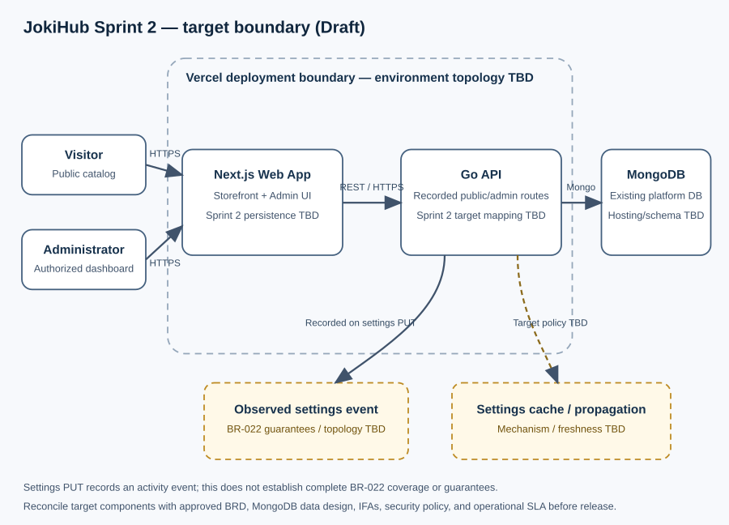
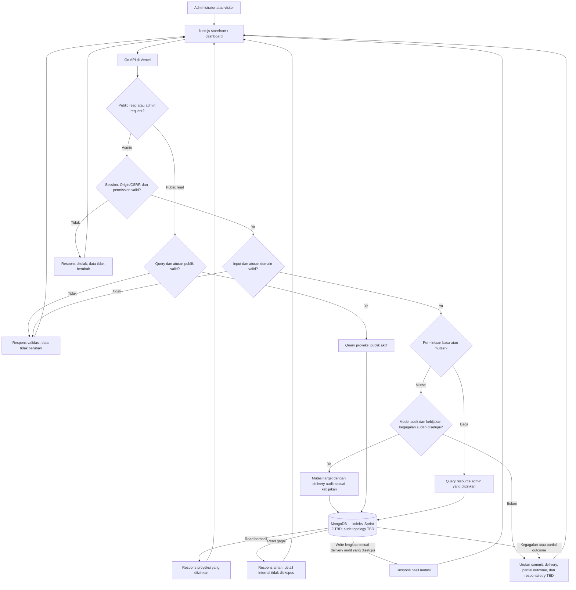

# Sprint 2 — High-Level Design

> **Status:** Draft target architecture. Komponen dan behavior Sprint 2 yang belum ada pada implementasi saat ini ditandai TBD; diagram ini bukan bukti delivery atau persetujuan design.

## Stack Teknologi

| Komponen                   | Teknologi                | Tanggung jawab                                                                                                                                                                                                                                   |
| -------------------------- | ------------------------ | ------------------------------------------------------------------------------------------------------------------------------------------------------------------------------------------------------------------------------------------------ |
| Aplikasi web               | Next.js                  | Menyediakan storefront publik dan Admin Dashboard; stack proyek teridentifikasi dari HLD Sprint 1. UI Sprint 2 saat ini tidak membuktikan persistensi fitur.                                                                                     |
| Backend API                | Go (`net/http`)          | Route inventory lokal mencatat admin category/service CRUD di bawah `catalog-manage`; kontrak target dalam IFA dan pemetaan model/data masih perlu diselaraskan. Jaminan audit BR-022 dan settings GET/PUT target juga belum lengkap/disepakati. |
| Database aplikasi          | MongoDB                  | Database yang dipakai Go API saat ini. ERD Sprint 2 sudah berupa proposal logical collections; persistensi, physical collection/field mapping, dan index belum disetujui atau diverifikasi.                                                      |
| Deployment web/API         | Vercel                   | Men-deploy aplikasi Next.js dan backend Go sesuai baseline HLD Sprint 1; konfigurasi dan batas setiap environment Sprint 2 perlu dikonfirmasi sebelum release.                                                                                   |
| Cache / konfigurasi publik | TBD                      | Belum ditemukan cache atau propagation component terkonfirmasi. Hindari mengasumsikan CDN/cache semantics atau consistency target.                                                                                                               |
| Audit delivery/storage     | TBD untuk jaminan BR-022 | Source settings `PUT` sudah mencatat activity event. Store/topology umum, taxonomy, coverage, append-only enforcement, durability, atomicity, retry, dan retention untuk BR-022 belum terkonfirmasi.                                             |

## Arsitektur Tingkat Tinggi

## Penjelasan Arsitektur

Pengunjung dan administrator menggunakan aplikasi Next.js dan backend Go yang dideploy melalui Vercel sesuai baseline HLD Sprint 1; API membaca MongoDB untuk game/katalog yang sudah tersedia. Konfigurasi dan batas tiap environment Sprint 2 masih perlu dikonfirmasi. HLD Sprint 1 mendokumentasikan fondasi autentikasi dan permission admin; IFA admin Sprint 2 memakai session cookie, pemeriksaan Origin, dan token CSRF sebagai baseline proposal. API owner masih perlu mengonfirmasi mapping kegagalan HTTP/status dan rate limit agar seluruh kontrak konsisten. Model key permission dan grant custom-role untuk route kategori/layanan Sprint 2 belum selaras antara source `catalog-manage` dan key granular dalam IFA; keputusan extension katalog system-managed ada di [D-18](../README.md#keputusan-yang-menghalangi-finalisasi) dan [solutioning akses Sprint 2](../dashboard/accounts-roles/permission-catalog-extension.md). Kategori dan layanan publik target membaca entitas katalog aktif; IFA target mewajibkan server tetap menjadi sumber harga, sedangkan order/checkout berada di Sprint 3.

Route inventory dokumenter lokal mencatat lima method/path CRUD admin category dan lima method/path CRUD admin service yang sama dengan sepuluh IFA, seluruhnya di bawah permission source `catalog-manage`. Kontrak target Sprint 2 mengikuti envelope root Sprint 1; permission, projection/payload, dan HTTP status masih belum disepakati; selaraskan melalui D-02/D-03/D-11. Admin settings GET/PUT juga tercatat, memakai `settings-manage`, `socialLinks`, version, dan activity event. Event settings yang ada merupakan bukti terbatas dan tidak membuktikan pemenuhan kebutuhan audit BR-022 secara umum. BRD menetapkan audit administratif append-only dengan redaksi data sensitif, tetapi taxonomy, coverage, atomicity, durable outbox, fail-open/fail-closed, retention, dan store/topology BR-022 masih TBD. Settings public projection dan cache/propagation juga TBD; pengaturan admin tidak boleh otomatis dipublikasikan utuh. Rujukan route adalah [route-to-handler coverage Sprint 3](../../../sprint-3/solutioning/backend-go/dashboard-source-ifa.md#route-to-handler-coverage), dokumen dalam repo ini, bukan verifikasi kode Go langsung.

Implementasi Go saat ini menggunakan MongoDB. ERD Sprint 2 memodelkan logical collections dan referensi aplikasi; nama collection/field, index, transaksi, dan constraints fisik belum diputuskan. Keputusan D-04 pada [assessment](../README.md#keputusan-yang-menghalangi-finalisasi) harus selesai sebelum persetujuan HLD/data design. Public contract target juga berbeda dari wire behavior Go saat ini untuk service fields (target `priceAmount`/`estimateText`; source `price`/`estimate`) dan public settings projection; API owner perlu menentukan kompatibilitas/migrasi.

## Flowchart Mutasi Katalog, Settings, dan Audit (Target)

## Penjelasan Flow

- **Penemuan katalog publik:** Target Go API menyajikan hanya game, kategori, dan layanan yang eligible; definisi eligibility, urutan, harga/quote, dan cache menunggu keputusan katalog. Implementasi saat ini mencakup beberapa route baca, bukan target penuh.
- **Admin read:** List, detail, dan settings `GET` melewati pemeriksaan akses dan validasi yang berlaku, lalu membaca proyeksi yang diizinkan tanpa mengubah state bisnis. Apakah pembacaan admin perlu dicatat sebagai audit event ditentukan oleh batas event BR-022 (D-07).
- **Mutasi katalog admin:** Target memerlukan autentikasi/otorisasi dan validasi server-side sebelum perubahan. Inventaris repo mencatat route CRUD kategori/layanan, sedangkan kontrak IFA menetapkan response Sprint 1 root envelope dengan data list/pagination root; permission, projection, dan status masih perlu disepakati. Inventaris dokumenter ini bukan verifikasi langsung terhadap implementasi Go.
- **Pembaruan settings:** Admin `GET` membaca snapshot settings; `PUT` memvalidasi dan memperbarui snapshot. Source GET/PUT tercatat pada route inventory. Field target, permission, envelope, audit semantics, public projection, maintenance behavior, dan propagation perlu diselaraskan dengan source behavior sebelum HLD dianggap final.
- **Audit aksi admin:** Route inventory mendokumentasikan bahwa settings `PUT` saat ini menulis activity event. Bukti terbatas ini tidak menetapkan cakupan aksi lain, event taxonomy, append-only enforcement, durability, atomicity, delivery guarantee, atau failure behavior BR-022. HLD memisahkan event settings teramati dari jaminan audit target yang masih TBD.
- **Kegagalan dependency:** API tidak boleh mengembalikan data sukses palsu saat query gagal. Semantik bagi mutasi bisnis yang berhasil tetapi audit/propagation gagal menunggu keputusan owner dan harus dinyatakan pada IFA.
- **Gerbang audit:** Diagram tidak menetapkan urutan commit atau menyiratkan mutasi sukses sebelum audit. Implementasi mutasi menunggu keputusan delivery/atomicity/failure policy BR-022; hingga itu, response dan retry untuk partial outcome tetap TBD.

## SLA Baseline

Belum ada target SLA Sprint 2 yang disetujui atau hasil NFT. Availability, VUser/TPS, CPU/memory, response time, cache freshness, dan settings propagation semuanya **TBD**. Target harus memiliki cakupan endpoint, kondisi ukur, sumber angka, dan owner; lihat [BRD Sprint 2](../../BRD.md#6-sla-awal).

Kontrak dan data terkait: [BRD](../../BRD.md); [service-category ERD](../erd/service-category-erd.md), [service ERD](../erd/service-erd.md), [platform-settings ERD](../erd/platform-settings-erd.md), [activity-log ERD](../erd/activity-log-erd.md); IFA kategori admin di [`dashboard/service-categories/`](../dashboard/service-categories/create-service-category.md), IFA layanan admin di [`dashboard/services/`](../dashboard/services/create-service.md), [IFA settings](../dashboard/settings/general-settings.md), [public settings IFA](../public/settings/get-public-settings.md), dan [source audit/katalog decisions](../public/catalog/QUESTION.md). [HLD Sprint 1](../../../sprint-1/hld/sprint-1-hld.md) menjadi baseline stack, deployment, dan keamanan route yang sudah tersedia.
