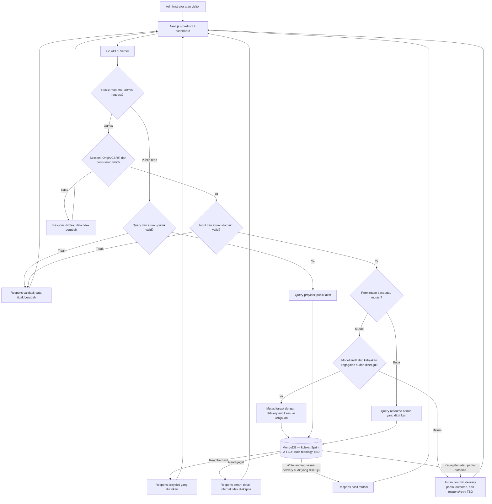

# Sprint 2 — High-Level Design

> **Status:** Draft target architecture. Component/behavior statements drawn from Sprint 1 baselines or in-repository route inventory are documentary evidence, not code verification; unapproved Sprint 2 design decisions are marked TBD.

## Stack Teknologi

| Komponen                   | Teknologi                | Tanggung jawab                                                                                                                                                                                                                                                                                  |
| -------------------------- | ------------------------ | ----------------------------------------------------------------------------------------------------------------------------------------------------------------------------------------------------------------------------------------------------------------------------------------------- |
| Aplikasi web               | Next.js                  | Menyediakan storefront publik dan Admin Dashboard; stack proyek teridentifikasi dari HLD Sprint 1. UI Sprint 2 saat ini tidak membuktikan persistensi fitur.                                                                                                                                    |
| Backend API                | Go (`net/http`)          | Dokumen route-to-handler coverage dalam repo mencatat admin category/service CRUD di bawah `catalog-manage`; ini bukti dokumenter, bukan pemeriksaan kode pada pekerjaan ini. Kontrak target dalam IFA dan pemetaan model/data masih perlu diselaraskan; jaminan audit BR-022 belum disepakati. |
| Database aplikasi          | MongoDB                  | HLD dan Game ERD Sprint 1 mendokumentasikan MongoDB untuk Go API. ERD Sprint 2 berupa proposal logical collections; persistensi dan physical collection/field mapping serta index belum disetujui.                                                                                              |
| Deployment web/API         | Vercel                   | Men-deploy aplikasi Next.js dan backend Go sesuai baseline HLD Sprint 1; konfigurasi dan batas setiap environment Sprint 2 perlu dikonfirmasi sebelum release.                                                                                                                                  |
| Cache / konfigurasi publik | TBD                      | Belum ditemukan cache atau propagation component terkonfirmasi. Hindari mengasumsikan CDN/cache semantics atau consistency target.                                                                                                                                                              |
| Audit delivery/storage     | TBD untuk jaminan BR-022 | Route inventory dokumenter mencatat activity event pada settings `PUT`, namun belum diverifikasi ulang terhadap kode. Store/topology umum, taxonomy, coverage, append-only enforcement, durability, atomicity, retry, dan retention untuk BR-022 belum terkonfirmasi.                           |

## Arsitektur Tingkat Tinggi

## Penjelasan Arsitektur

Pengunjung dan administrator menggunakan aplikasi Next.js dan backend Go yang dideploy melalui Vercel sesuai baseline HLD Sprint 1; API membaca MongoDB untuk game/katalog yang sudah tersedia. Konfigurasi dan batas tiap environment Sprint 2 masih perlu dikonfirmasi. HLD Sprint 1 mendokumentasikan fondasi autentikasi dan permission admin; IFA admin Sprint 2 memakai session cookie, pemeriksaan Origin, dan token CSRF sebagai baseline proposal. API owner masih perlu mengonfirmasi mapping kegagalan HTTP/status dan rate limit agar seluruh kontrak konsisten. Model key permission dan grant custom-role untuk route kategori/layanan Sprint 2 belum selaras antara permission `catalog-manage` yang tercatat dalam route inventory dokumenter dan key granular dalam IFA; keputusan extension katalog system-managed masih terbuka dan dirangkum di [solutioning akses Sprint 2](../solutioning/dashboard/accounts-roles/permission-catalog-extension.md). Kategori dan layanan publik target membaca entitas katalog aktif; IFA target mewajibkan server tetap menjadi sumber harga, sedangkan order/checkout berada di Sprint 3.

Dokumen route-to-handler coverage dalam repo mencatat lima method/path CRUD admin category dan lima method/path CRUD admin service yang sama dengan sepuluh IFA, seluruhnya di bawah permission `catalog-manage`. Catatan itu merupakan dokumentasi kontrak dan tidak diverifikasi ulang ke kode pada pekerjaan ini. Kontrak target Sprint 2 mengikuti envelope root Sprint 1; permission, projection/payload, dan HTTP status masih belum disepakati. Dokumen tersebut juga mencatat admin settings GET/PUT dengan `settings-manage`, `socialLinks`, version, dan activity event; bukti dokumenter ini tidak membuktikan pemenuhan BR-022 secara umum. BRD menetapkan audit administratif append-only dengan redaksi data sensitif, tetapi taxonomy, coverage, atomicity, durable outbox, fail-open/fail-closed, retention, dan store/topology BR-022 masih TBD. Settings public projection dan cache/propagation juga TBD; pengaturan admin tidak boleh otomatis dipublikasikan utuh. Lihat [route-to-handler coverage Sprint 3](../../sprint-3/solutioning/backend-go/dashboard-source-ifa.md#route-to-handler-coverage) sebagai rujukan dokumenter lokal.

Baseline HLD/ERD Sprint 1 mendokumentasikan MongoDB untuk Go API. ERD Sprint 2 memodelkan logical collections dan referensi aplikasi; nama collection/field, index, transaksi, dan constraints fisik belum diputuskan. Dokumen route-to-handler coverage yang tersedia dan catatan lokal terdahulu menyebut wire fields service (`price`/`estimate`) berbeda dari target (`priceAmount`/`estimateText`) serta sebuah public settings projection. Itu konteks dokumenter yang belum diverifikasi ulang ke kode; API owner perlu menetapkan kompatibilitas/migrasi.

## Flowchart Mutasi Katalog, Settings, dan Audit (Target)

## Penjelasan Flow

- **Penemuan katalog publik:** Target Go API menyajikan hanya game, kategori, dan layanan yang eligible; definisi eligibility, urutan, harga/quote, dan cache menunggu keputusan katalog. Implementasi saat ini mencakup beberapa route baca, bukan target penuh.
- **Admin read:** List, detail, dan settings `GET` melewati pemeriksaan akses dan validasi yang berlaku, lalu membaca proyeksi yang diizinkan tanpa mengubah state bisnis. Apakah pembacaan admin perlu dicatat sebagai audit event ditentukan oleh batas event BR-022 (D-07).
- **Mutasi katalog admin:** Target memerlukan autentikasi/otorisasi dan validasi server-side sebelum perubahan. Inventaris repo mencatat route CRUD kategori/layanan, sedangkan kontrak IFA menetapkan response Sprint 1 root envelope dengan data list/pagination root; permission, projection, dan status masih perlu disepakati. Inventaris dokumenter ini bukan verifikasi langsung terhadap implementasi Go.
- **Pembaruan settings:** Admin `GET` membaca snapshot settings; `PUT` memvalidasi dan memperbarui snapshot sebagai target. Route inventory dokumenter mencatat GET/PUT settings, namun perilaku kode tidak diverifikasi ulang pada pekerjaan ini. Field target, permission, envelope, audit semantics, public projection, maintenance behavior, dan propagation perlu ditinjau terhadap catatan route tersebut sebelum HLD dianggap final.
- **Audit aksi admin:** Dokumen route-to-handler coverage mencatat settings `PUT` menulis activity event; catatan ini tidak diverifikasi ulang terhadap kode pada pekerjaan ini. Bukti dokumenter tersebut tidak menetapkan cakupan aksi lain, event taxonomy, append-only enforcement, durability, atomicity, delivery guarantee, atau failure behavior BR-022. HLD memisahkan catatan event settings itu dari jaminan audit target yang masih TBD.
- **Kegagalan dependency:** API tidak boleh mengembalikan data sukses palsu saat query gagal. Semantik bagi mutasi bisnis yang berhasil tetapi audit/propagation gagal menunggu keputusan owner dan harus dinyatakan pada IFA.
- **Gerbang audit:** Diagram tidak menetapkan urutan commit atau menyiratkan mutasi sukses sebelum audit. Implementasi mutasi menunggu keputusan delivery/atomicity/failure policy BR-022; hingga itu, response dan retry untuk partial outcome tetap TBD.

## SLA Baseline

Belum ada target SLA Sprint 2 yang disetujui atau hasil NFT. Kelima belas IFA memuat baseline numerik turunan Sprint 1 sebagai **usulan** per jenis operasi; baseline itu belum menjadi komitmen karena cakupan, forecast beban, kondisi ukur, dan persetujuan owner masih TBD. Cache freshness, settings propagation, serta target audit juga TBD. Lihat [BRD Sprint 2](../BRD.md#6-sla-awal).

Kontrak dan data terkait: [BRD](../BRD.md); [register keputusan terbuka](../solutioning/open-decisions.md); [service-category ERD](../erd/service-category-erd.md), [service ERD](../erd/service-erd.md), [platform-settings ERD](../erd/platform-settings-erd.md), [activity-log ERD](../erd/activity-log-erd.md); [IFA kategori admin](../solutioning/dashboard/service-categories/create-service-category.md), [IFA layanan admin](../solutioning/dashboard/services/create-service.md), [GET general settings](../solutioning/dashboard/settings/get-general-settings.md), [PUT general settings](../solutioning/dashboard/settings/update-general-settings.md), [public category IFA](../solutioning/public/service-categories/get-list-service-categories.md), [public service IFA](../solutioning/public/services/get-list-services-by-game.md), dan [public settings IFA](../solutioning/public/settings/get-public-settings.md). [HLD Sprint 1](../../sprint-1/hld/sprint-1-hld.md) menjadi baseline dokumenter stack, deployment, dan keamanan route.
