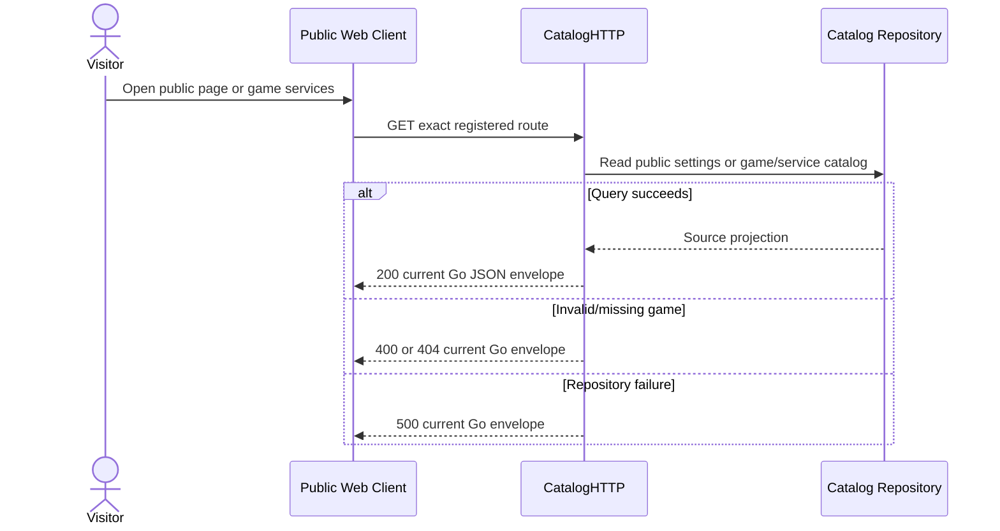

# Go Public Catalog Extensions - Interface Agreement

> **Document Type:** IFA / API Contract  
> **Status:** Source-mapped draft; public settings business exposure requires confirmation  
> **Service / Domain:** Go Public Catalog  
> **Consumer / Partner:** JokiHub public web client

## Design

This IFA covers `GET /api/settings/v1/public` and the alternate services alias `GET /api/services/v1/games/{gameSlug}`. The first has no product-facing AC in this task and remains a technical capability pending exposure decision. The alias coexists with canonical `GET /api/games/v1/{gameSlug}/services`; source methods differ in slug/query validation and use different service-code prefixes. Do not assume alias removal or equivalence.

## Sequence Diagram



## Performance / SLA Targets

| Success Rate                         | VUser                                    | CPU / Memory                | Response Time           |
| ------------------------------------ | ---------------------------------------- | --------------------------- | ----------------------- |
| TBD; no approved availability target | TBD; public traffic forecast unavailable | TBD; capacity test required | TBD; no measured target |

## General Information

| Component          | Value                                                                                      |
| ------------------ | ------------------------------------------------------------------------------------------ |
| Description        | Read public platform settings or service list through legacy alternate route               |
| Resource URL       | `https://{host}/api/settings/v1/public`; `https://{host}/api/services/v1/games/{gameSlug}` |
| Transport Protocol | HTTPS REST                                                                                 |
| Request Verb       | GET                                                                                        |
| Content Type       | No request body                                                                            |
| Interaction Type   | Synchronous                                                                                |
| Security Policy    | Public read; settings response uses `Cache-Control: no-store`                              |

### Path / Endpoint

| Section        | Value                                                  |
| -------------- | ------------------------------------------------------ |
| Host / Domain  | `{host}`                                               |
| Service Name   | Public Catalog                                         |
| Version        | `v1`                                                   |
| Resource       | `/settings/v1/public`; `/services/v1/games/{gameSlug}` |
| Final Endpoint | GET each exact route above                             |

### API Versioning

- Decision: Existing v1 routes.
- Alias canonicalization is unresolved. Keep both registered paths until API owner approves deprecation and FE migration.

## Business Rules

1. Public settings handler returns `siteName`, `siteDescription`, `contactEmail`, `contactWhatsapp`, `socialLinks`, `businessHours`; social links contain `{label,url}` pairs. Missing setting document falls back to JokiHub name, empty contact/social defaults, and null business hours.
2. Settings response is non-cacheable (`Cache-Control: no-store`). Whether this route is product-required or internal configuration read requires product/API owner decision; no AC is authored here.
3. Alternate services alias does not validate slug format or reject query parameters at HTTP layer. It returns 404 when game cannot be resolved and a service-list projection on success.
4. Canonical route validates lowercase hyphenated slug and rejects all query parameters. The two route handlers differ operationally and are not interchangeable without migration.
5. Current Go JSON envelope is `{code,message,data?}`. Any target nested status envelope change requires explicit client coordination.

## Request Headers

| Header | Type   | M/O/C | Max Length | Description            | Example            |
| ------ | ------ | ----- | ---------: | ---------------------- | ------------------ |
| Accept | String | O     |          - | JSON response expected | `application/json` |

## Request Parameters

| Parameter  | Type   | M/O/C |     Max Length | Description                                 | Example         |
| ---------- | ------ | ----- | -------------: | ------------------------------------------- | --------------- |
| `gameSlug` | String | M     | Source-defined | Path game slug for alternate services alias | `arena-legends` |

## Request Body

GET routes have no request body.

### Example Request Body

Not applicable.

### Request Validation

1. `GET /api/services/v1/games/{gameSlug}` accepts path value as received; handler performs no slug/query validation.
2. Public settings route accepts no parameters or body; it sets `Cache-Control: no-store`.
3. Exact public settings response fields must come from `CatalogRepository.GetPublicSettings`; do not expose admin-only settings.

## Response Body

Current Go wire envelope is `{code,message,data?}`. Settings data fields are repository-projected and source-defined. Alias data is `ListServicesByGame` projection. Target nested status format below is not current wire behavior.

| Attribute              | Type              | M/O/C |     Max Length | Description                                 | Example                                                |
| ---------------------- | ----------------- | ----- | -------------: | ------------------------------------------- | ------------------------------------------------------ |
| `code`                 | String            | M     |             10 | Current Go service code                     | `SETS00000`                                            |
| `message`              | String            | M     |            200 | Current Go result message                   | `Pengaturan situs berhasil diambil.`                   |
| `data`                 | Object/Array/null | M     |              - | Source projection by route                  | `{}`                                                   |
| `data.siteName`        | String            | M     | Source-defined | Public site label                           | `JokiHub`                                              |
| `data.siteDescription` | String            | M     | Source-defined | Public description; empty string when unset | `Game service platform`                                |
| `data.contactEmail`    | String            | M     | Source-defined | Public contact email                        | `help@example.test`                                    |
| `data.contactWhatsapp` | String            | M     | Source-defined | Public WhatsApp contact                     | `+6281234567890`                                       |
| `data.socialLinks[]`   | Object[]          | M     |              - | Public links with `label` and `url`         | `[{"label":"Instagram","url":"https://example.test"}]` |
| `data.businessHours`   | Object/null       | M     | Source-defined | Public business hours or null               | `null`                                                 |

### Success Example

```json
{
  "code": "SETS00000",
  "message": "Pengaturan situs berhasil diambil.",
  "data": {
    "siteName": "JokiHub",
    "siteDescription": "",
    "contactEmail": "",
    "contactWhatsapp": "",
    "socialLinks": [],
    "businessHours": null
  }
}
```

### Business Error Example

```json
{ "code": "SRVB02001", "message": "Game tidak ditemukan.", "data": null }
```

### Technical Error Example

```json
{ "code": "SETT03001", "message": "Pengaturan platform sementara tidak tersedia.", "data": null }
```

Target template envelope, not current Go wire: `{"status":{"code":"SETS00000","message":"..."},"data":{}}`.

## HTTP Status Codes

| HTTP Status | Usage                                  |
| ----------- | -------------------------------------- |
| 200         | Public settings or alias list returned |
| 404         | Alias game not found                   |
| 500         | Catalog/settings repository failure    |

## Service Status Codes

| Code        | Type      | Category | Meaning                                                |
| ----------- | --------- | -------- | ------------------------------------------------------ |
| `SETS00000` | Success   | 00       | Public settings returned                               |
| `SETT03001` | Technical | 03       | Public settings repository failure                     |
| `SRVS00000` | Success   | 00       | Alias services returned                                |
| `SRVB02001` | Business  | 02       | Alias game not found (source currently uses this code) |
| `SRVT03001` | Technical | 03       | Alias catalog read failure                             |

## API Exposure Classification

| Classification | Rationale                                                                                                                                                |
| -------------- | -------------------------------------------------------------------------------------------------------------------------------------------------------- |
| Public         | Both routes are unauthenticated reads. Public-settings business use requires explicit product disposition; technical existence alone does not create AC. |

## Testing & Documentation Scope

| Scope      | Required | Rationale / Handoff                                                                                  |
| ---------- | -------- | ---------------------------------------------------------------------------------------------------- |
| NFT        | TBD      | Public read routes; decide based on traffic/criticality and target forecast.                         |
| VA/Pentest | Yes      | Verify settings data minimization and alias enumeration/query behavior; endpoint is internet-facing. |

## References

- [Public catalog QUESTION.md](../public/catalog/QUESTION.md)
- `../public/services/get-list-services-by-game.md`
- `../../../../go-game-service-platform/internal/controller/http/catalog_http.go`
- `../../../../go-game-service-platform/internal/controller/catalog.go`
