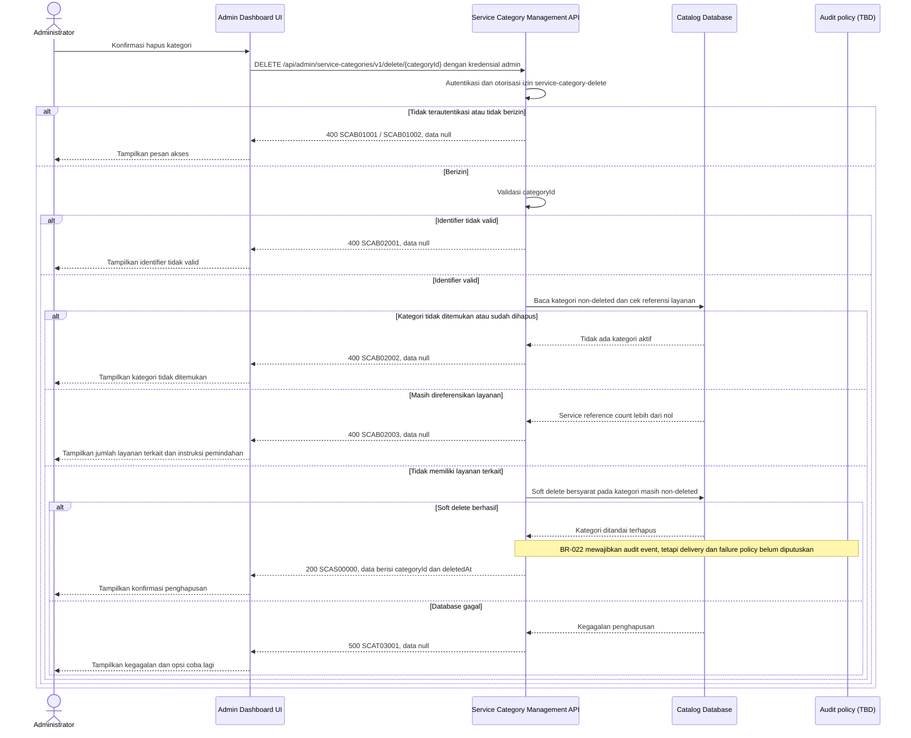

# Admin Dashboard - Delete Service Category Interface Agreement

> **Document Type:** IFA / API Contract  
> **Status:** Draft  
> **Service / Domain:** Admin Dashboard — Service Category Management  
> **Consumer / Partner:** JokiHub Admin Dashboard (authorized administrator)

## Design

API target mengusulkan soft delete kategori untuk mempertahankan referensi historis dan menolak penghapusan selama kategori masih direferensikan layanan. Ini adalah aturan referensi di level aplikasi, bukan foreign key yang ditegakkan MongoDB; kebijakan lifecycle dan referensi masih perlu disepakati bersama [Service Category ERD](../../../erd/service-category-erd.md). UI saat ini memakai konfirmasi delete, tetapi perilaku persistence dan aturan relasi belum terimplementasi.

> **Status kontrak target:** Struktur response mengikuti baseline Sprint 1 `{code,message,data}`. Service code, HTTP mapping, dan permission per route masih perlu disepakati terhadap inventory; auth/HTTP compatibility dicatat di D-11 dan extension permission/grant role di D-18.

## Sequence Diagram



## Performance / SLA Targets

| Success Rate                                        | VUser                                   | CPU / Memory                             | Response Time                                                 |
| --------------------------------------------------- | --------------------------------------- | ---------------------------------------- | ------------------------------------------------------------- |
| TBD; konfirmasi criticality dan availability target | TBD; konfirmasi concurrent admin puncak | TBD; tetapkan dari capacity estimate/NFT | TBD; target belum ditetapkan; baseline opsional menunggu D-12 |

## General Information

| Component          | Value                                                                                                                                               |
| ------------------ | --------------------------------------------------------------------------------------------------------------------------------------------------- |
| Description        | Menandai kategori layanan sebagai terhapus secara soft setelah memastikan tidak ada layanan yang mereferensikannya.                                 |
| Resource URL       | `https://{host}/api/admin/service-categories/v1/delete/{categoryId}`                                                                                |
| Transport Protocol | HTTPS, REST                                                                                                                                         |
| Request Verb       | DELETE                                                                                                                                              |
| Content Type       | `application/json` response; tidak ada request body.                                                                                                |
| Interaction Type   | Synchronous                                                                                                                                         |
| Security Policy    | Admin authentication dan izin `service-category-delete`. Identity provider dan permission final TBD. Terapkan rate limiting dan audit actor/action. |

### Path / Endpoint

| Section                  | Value                                                         |
| ------------------------ | ------------------------------------------------------------- |
| Host / Domain            | `{host}` (environment-specific)                               |
| Service Name             | Service Category Management                                   |
| Version                  | `v1`                                                          |
| Resource                 | `/admin/service-categories/v1/delete/{categoryId}`            |
| Proposed target endpoint | `DELETE /api/admin/service-categories/v1/delete/{categoryId}` |

### API Versioning

- **Inventory status:** Method/path yang sama tercatat pada route inventory repo ini; bagian ini bukan klaim bahwa route belum ada.
- **Target contract:** IFA mengusulkan perilaku pada `DELETE /api/admin/service-categories/v1/delete/{categoryId}`; lifecycle, permission, response, dan status target belum disetujui terhadap inventory.
- **Versioning:** Tetap `v1` pada usulan ini; perubahan kompatibilitas perlu keputusan API owner.
- **Proposed target endpoint:** `DELETE /api/admin/service-categories/v1/delete/{categoryId}`
- **Backward Compatibility:** Consumer belum dinilai. Response atau perubahan semantik/status harus diverifikasi terhadap consumer; perubahan yang mematahkan consumer memerlukan keputusan versioning API owner.
- **Reason:** Admin UI menyediakan aksi hapus kategori; endpoint mengimplementasikan penghapusan aman yang menjaga relasi katalog.

## Business Rules

1. Hanya administrator terautentikasi dengan izin `service-category-delete` yang dapat menghapus kategori. Role mapping final TBD.
2. `categoryId` mengidentifikasi kategori secara immutable. Nama/slug tidak digunakan sebagai target delete.
3. Operasi adalah soft delete: set `deleted_at` dan `updated_at` ke waktu UTC server. Record fisik dan referensi historis dipertahankan.
4. Kategori aktif maupun nonaktif dapat dihapus bila tidak memiliki layanan yang mereferensikannya.
5. Jika satu atau lebih `game_service` masih menunjuk kategori, target mengusulkan penolakan delete dengan `SCAB02003`. Source inventory saat ini mencatat pemeriksaan semua layanan tertaut, termasuk yang soft-deleted, dan response `409` dengan `linkedServiceCount`; keputusan mempertahankan predicate source tersebut untuk target masih terbuka.
6. Referensi disimpan sebagai identifier aplikasi dan MongoDB tidak menegakkan foreign key. Strategi untuk mencegah service baru ditautkan di antara pemeriksaan referensi dan soft delete (misalnya koordinasi write atau validasi ulang) masih harus diputuskan; jangan mengklaim operasi ini atomik sebelum mekanismenya ditetapkan. Jangan cascade delete, reassign, atau deactivate layanan secara diam-diam.
7. Order historis, snapshot kategori/layanan, transaksi, dan entitas lain tidak dihapus maupun diubah.
8. Kategori yang tidak ditemukan atau sudah soft-deleted menghasilkan `SCAB02002`; operasi tidak mengungkap apakah kategori pernah ada.
9. Setelah soft delete, kategori tidak muncul pada list/default detail, tidak bisa dipilih untuk assignment baru, dan uniqueness scope mengikuti ERD. Reuse nama/slug setelah delete masih menunggu keputusan; sampai diputuskan, gunakan constraint yang dikonfirmasi pemilik database.
10. Kebutuhan serta event boundary audit untuk operasi delete ini harus ditetapkan konsisten dengan BR-022/D-07. Payload, delivery/durability, atomicity, retry/deduplication, dan respons saat gagal masih terbuka pada D-08; jangan mengasumsikan soft delete dan event pasti tersimpan bersama.
11. Endpoint tidak menerima request body dan tidak menyediakan permanent-delete atau restore operation.
12. Client retry setelah sukses mendapat hasil kategori tidak ditemukan/terhapus yang sama; delete tidak melakukan efek samping tambahan.

## Request Headers

| Header         | E/N/T | Type   | M/O/C | Max Length | Description                                                                     | Example                      |
| -------------- | ----- | ------ | ----- | ---------: | ------------------------------------------------------------------------------- | ---------------------------- |
| `Cookie`       | E     | String | M     |        TBD | Session admin dikirim browser; nama dan atribut cookie mengikuti auth Sprint 1. | `{admin session cookie}`     |
| `Origin`       | N     | String | M     |        TBD | Origin dashboard harus cocok dengan allowlist.                                  | `https://admin.example.test` |
| `X-CSRF-Token` | N     | String | M     |        TBD | Token CSRF untuk request admin cookie-authenticated.                            | `{csrf-token}`               |
| `Accept`       | N     | String | O     |        100 | Tipe media response yang diinginkan; default JSON.                              | `application/json`           |
| `X-Request-Id` | N     | String | O     |        100 | ID korelasi untuk audit/support; jangan memuat PII.                             | `req-95b2ef`                 |

## Request Parameters

| Parameter    | E/N/T | Type          | M/O/C | Max Length | Description                              | Example      |
| ------------ | ----- | ------------- | ----- | ---------: | ---------------------------------------- | ------------ |
| `categoryId` | N     | String (path) | M     |         64 | ID immutable kategori yang akan dihapus. | `cat_01JXYZ` |

## Request Body

Tidak ada request body.

### Request Validation

1. Session cookie harus valid; `Origin` harus exact-allowlisted; token CSRF dan permission `service-category-delete` harus valid. HTTP/service-code mapping auth dan CSRF tetap mengikuti API standard yang disetujui.
2. `categoryId` wajib, tidak kosong, maksimal 64 karakter, dan mengikuti format ID yang ditetapkan implementasi. Identifier invalid menghasilkan `SCAB02001`.
3. Tolak request body dan query parameter yang tidak didefinisikan.
4. Kategori valid tetapi tidak ditemukan atau sudah soft-deleted menghasilkan `SCAB02002`.
5. Jika masih ada layanan terkait, kembalikan `SCAB02003` dan `linkedServiceCount`; jangan melakukan update parsial.
6. Bila tidak ada layanan terkait, target melakukan soft delete bersyarat. Catatan audit wajib mengikuti policy BR-022 setelah D-07/D-08 menetapkan event boundary, delivery/failure handling, dan koordinasi perubahan data; transaksi lintas persistence/audit belum diasumsikan.
7. Kegagalan database menghasilkan HTTP 500 `SCAT03001` tanpa detail internal.

## Response Body

Semua response target menggunakan envelope Sprint 1 `{code,message,data}`; metadata konflik, bila diputuskan, berada di `data`. Error tanpa payload mengembalikan `data: null`.

| Attribute                 | E/N/T | Type               | M/O/C | Max Length | Description                                                            | Example                    |
| ------------------------- | ----- | ------------------ | ----- | ---------: | ---------------------------------------------------------------------- | -------------------------- |
| `code`                    | N     | String             | M     |         20 | Service code.                                                          | `SCAS00000`                |
| `message`                 | N     | String             | O     |        200 | Pesan hasil untuk consumer.                                            | `Service category deleted` |
| `data`                    | N     | Object/null        | M     |          — | Payload hasil; `null` ketika error selain konflik referensi.           | `{}`                       |
| `data.categoryId`         | N     | String             | C     |         64 | ID kategori yang ditandai terhapus.                                    | `cat_01JXYZ`               |
| `data.deletedAt`          | N     | String (date-time) | C     |         35 | Waktu soft delete dalam ISO 8601 UTC.                                  | `2026-10-11T10:00:00Z`     |
| `data.linkedServiceCount` | N     | Integer            | C     |  10 digits | Jumlah layanan yang masih mereferensikan kategori pada konflik delete. | `2`                        |

### Success Example

```json
{
  "code": "SCAS00000",
  "message": "Service category deleted",
  "data": {
    "categoryId": "cat_01JXYZ",
    "deletedAt": "2026-10-11T10:00:00Z"
  }
}
```

### Business Error Example — Category Has Services

```json
{
  "code": "SCAB02003",
  "message": "Service category is referenced by services",
  "data": {
    "linkedServiceCount": 2
  }
}
```

### Technical Error Example

```json
{
  "code": "SCAT03001",
  "message": "Service category data is temporarily unavailable",
  "data": null
}
```

## HTTP Status Codes

| HTTP Status | Usage                                                                                                                                                                 |
| ----------- | --------------------------------------------------------------------------------------------------------------------------------------------------------------------- |
| `200`       | Kategori berhasil ditandai terhapus sesuai baseline response project. Konfirmasi apakah DELETE standard memakai `204`.                                                |
| `400`       | Identifier invalid, akses admin ditolak sesuai baseline response project, kategori tidak ditemukan, atau masih ada layanan terkait. Konfirmasi auth-specific mapping. |
| `500`       | Kegagalan service/database yang tidak terduga.                                                                                                                        |

## Service Status Codes

Format: `[Service Prefix][Status Type][Category][Specific Error Code]`

| Code        | Type      | Category        | Meaning                                                                      |
| ----------- | --------- | --------------- | ---------------------------------------------------------------------------- |
| `SCAS00000` | Success   | General         | Kategori berhasil ditandai terhapus.                                         |
| `SCAB01001` | Business  | Authentication  | Administrator belum terautentikasi.                                          |
| `SCAB01002` | Business  | Authentication  | Administrator tidak memiliki izin delete kategori.                           |
| `SCAB02001` | Business  | User validation | `categoryId` invalid atau request memuat parameter/body yang tidak didukung. |
| `SCAB02002` | Business  | User validation | Kategori tidak ditemukan atau sudah terhapus.                                |
| `SCAB02003` | Business  | User validation | Kategori masih direferensikan oleh satu atau lebih layanan.                  |
| `SCAT03001` | Technical | Database        | Kategori gagal ditandai terhapus atau database tidak tersedia.               |

## API Exposure Classification

| Classification            | Rationale                                                                                                                                          |
| ------------------------- | -------------------------------------------------------------------------------------------------------------------------------------------------- |
| TBD (deployment exposure) | Operasi destruktif admin untuk katalog. Jika endpoint dapat diakses dari internet, klasifikasikan sebagai Public dan terapkan proteksi API publik. |

## Testing & Documentation Scope

| NFT / VA-Pentest handoff   | Value                                                                                                                                                                                  |
| -------------------------- | -------------------------------------------------------------------------------------------------------------------------------------------------------------------------------------- |
| Service / module           | Service Category Management                                                                                                                                                            |
| Endpoint                   | `DELETE /api/admin/service-categories/v1/delete/{categoryId}`                                                                                                                          |
| Sample parameter / request | Path: `categoryId=cat_01JXYZ`                                                                                                                                                          |
| Sample response            | Success code `SCAS00000`; use the complete Success Example below. Probe code `SCAB01002`; use its corresponding error example below. HTTP mapping remains subject to D-11 where noted. |
| NFT CPU / memory target    | TBD; capacity evidence and approval required under D-12.                                                                                                                               |
| NFT TPS target             | TBD; traffic forecast and approval required under D-12.                                                                                                                                |

| Scope      | Required | Rationale / Handoff                                                                                                                                                                                                                                                                               |
| ---------- | -------- | ------------------------------------------------------------------------------------------------------------------------------------------------------------------------------------------------------------------------------------------------------------------------------------------------- |
| NFT        | Yes      | Validasi target contract untuk route delete admin yang sudah tercatat di inventory. Uji kategori tanpa layanan, kategori dengan layanan aktif/nonaktif, kategori telah dihapus, race antara assignment service dan delete, dan retry. VUser, CPU/memory, serta target TPS TBD mengikuti forecast. |
| VA/Pentest | Yes      | Verifikasi authentication/authorization, IDOR, privilege boundaries, referential integrity, race condition, audit attribution, serta tidak ada cascade/permanent data loss.                                                                                                                       |

## Current Implementation Alignment

The local route inventory records `DELETE /api/admin/service-categories/v1/delete/{categoryId}` under `catalog-manage`; a linked-service conflict is mapped to HTTP 409 with `linkedServiceCount`. This IFA uses the same method/path, but deletion semantics, permission, response envelope, and other target status codes remain proposals not reconciled with the inventory. Decide reassignment, deletion, and history rules before implementation (D-02/D-04/D-14). See the [route-to-handler coverage](../../../../sprint-3/solutioning/backend-go/dashboard-source-ifa.md#route-to-handler-coverage).

## Assumptions

- Endpoint dan soft-delete semantics merupakan proposal; ERD menyebut soft delete tetapi kebijakan final masih TBD.
- Delete ditolak selama kategori memiliki service reference, mengikuti aturan ERD bahwa hard delete diblokir saat referensi ada dan soft delete memerlukan no-linked-service atau workflow reassignment yang disetujui.
- Source inventory saat ini mencatat pemeriksaan semua layanan tertaut, termasuk yang soft-deleted. Kontrak target belum memutuskan apakah predicate tersebut dipertahankan; dokumentasikan sebagai keputusan target setelah Product/API owner mengonfirmasi.
- Operation memakai HTTP `200` dan envelope standar proyek; `204` dapat dipilih bila API standard mensyaratkannya.
- Audit platform, identity provider, role mapping, database engine, unique-name/slug reuse policy, serta SLA TBD.
- Tidak ada permanent delete, reassignment, atau auto-deactivation dalam scope ini.

## References

- [Sprint 2 BRD](../../../BRD.md) — BR-019, pengelolaan dan lifecycle kategori layanan.
- `../../erd/service-category-erd.md` — relasi kategori-layanan, soft-delete proposal, dan larangan orphan/cascade delete.
- `./create-service-category.md` — kontrak create kategori dan identifier.
- `./get-detail-service-category.md` — detail kategori dan relasi layanan.
- `./update-service-category.md` — aturan update kategori dan dampak terhadap layanan.
