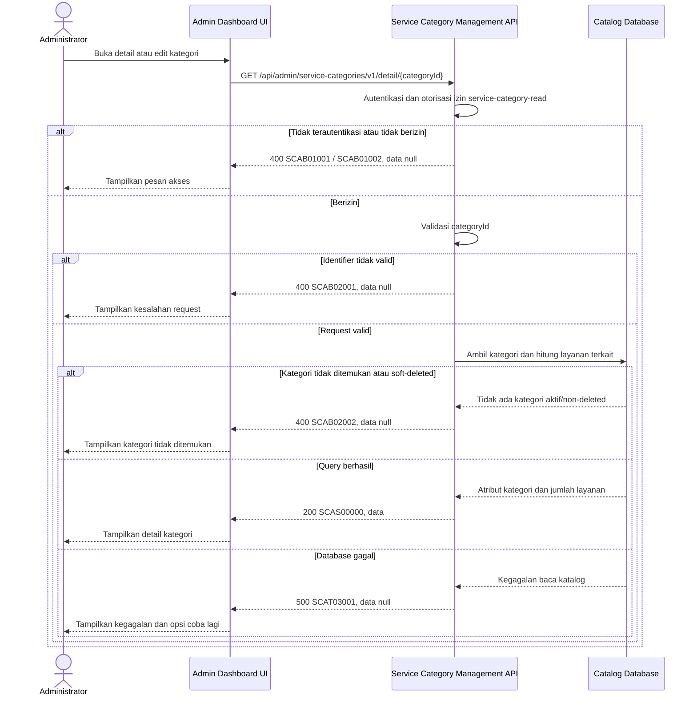

# Admin Dashboard - Get Service Category Detail Interface Agreement

> **Document Type:** IFA / API Contract  
> **Status:** Draft  
> **Service / Domain:** Admin Dashboard — Service Category Management  
> **Consumer / Partner:** JokiHub Admin Dashboard (authorized administrator)

## Design


## Sequence Diagram



## Performance / SLA Targets

| Success Rate                                                  | VUser                              | CPU / Memory                                                                | Response Time                |
| ------------------------------------------------------------- | ---------------------------------- | --------------------------------------------------------------------------- | ---------------------------- |
| 99.9% monthly availability; valid-request server error ≤ 0.1% | 50 VUser / 20 request/s NFT target | Initial 2 vCPU / 4 GiB per instance; CPU ≤ 70%, memory ≤ 75% at target load | Read p95 ≤ 500 ms; p99 ≤ 2 s |

## General Information

| Component          | Value                                                                                                                                                       |
| ------------------ | ----------------------------------------------------------------------------------------------------------------------------------------------------------- |
| Description        | Mengambil atribut satu kategori layanan dan daftar layanan terkait untuk Admin Dashboard.                                                                   |
| Resource URL       | `https://{host}/api/admin/service-categories/v1/detail/{categoryId}`                                                                                        |
| Transport Protocol | HTTPS, REST                                                                                                                                                 |
| Request Verb       | GET                                                                                                                                                         |
| Content Type       | `application/json` response; GET tidak memiliki request body.                                                                                               |
| Interaction Type   | Synchronous                                                                                                                                                 |
| Security Policy    | Admin authentication dan izin `service-category-read`. Identity provider dan permission final TBD. Terapkan rate limiting dan audit akses sesuai kebijakan. |

### Path / Endpoint

| Section                  | Value                                                      |
| ------------------------ | ---------------------------------------------------------- |
| Host / Domain            | `{host}` (environment-specific)                            |
| Service Name             | Service Category Management                                |
| Version                  | `v1`                                                       |
| Resource                 | `/admin/service-categories/v1/detail/{categoryId}`         |
| Proposed target endpoint | `GET /api/admin/service-categories/v1/detail/{categoryId}` |

### API Versioning

- **Inventory status:** Method/path yang sama tercatat pada route inventory repo ini; bagian ini bukan klaim bahwa route belum ada.
- **Target contract:** IFA mengusulkan perilaku pada `GET /api/admin/service-categories/v1/detail/{categoryId}`; projection, permission, response, dan status target belum disetujui terhadap inventory.
- **Versioning:** Tetap `v1` pada usulan ini; perubahan kompatibilitas perlu keputusan API owner.
- **Backward Compatibility:** Consumer belum dinilai. Penambahan field hanya dapat dianggap kompatibel setelah perilaku consumer diverifikasi; perubahan field/semantik/status yang mematahkan consumer memerlukan keputusan versioning API owner.
- **Reason:** Admin membutuhkan satu resource kategori untuk melihat/edit atribut serta memeriksa layanan yang masih terhubung sebelum perubahan atau penghapusan.

## Business Rules

1. Hanya administrator terautentikasi dengan izin `service-category-read` yang dapat membaca detail. Izin ini dapat dipisahkan dari write permission; role mapping final TBD.
2. `categoryId` adalah identifier immutable pada `service_category.category_id`, bukan nama atau slug kategori.
3. Kategori aktif dan nonaktif dapat dibaca oleh admin. Kategori soft-deleted (`deleted_at IS NOT NULL`) tidak dikembalikan pada endpoint ini; kebijakan pemulihan kategori terhapus memerlukan endpoint/permission terpisah.
4. Field kategori berasal dari record `service_category`: `name`, `slug`, `description`, `is_active`, `created_at`, dan `updated_at`. `deleted_at` serta field internal lain tidak diekspos.
5. `serviceCount` adalah metrik operasional admin dengan usulan predicate yang sama dengan list endpoint: layanan non-deleted, baik aktif maupun nonaktif. Metrik publik berbeda (aktif services pada active games); tujuan dan predicate per context harus disetujui melalui D-14.
6. Endpoint detail mengembalikan satu object kategori di `data`, tanpa array `services` dan tanpa pagination. Daftar layanan menggunakan endpoint list layanan dengan filter kategori.
7. Kategori tanpa layanan terkait tetap sukses dengan `serviceCount: 0`.
8. Relasi satu kategori ke banyak layanan mengikuti model UI saat ini; response tidak mengubah assignment atau status layanan.
9. Endpoint bersifat read-only. Tidak memutasi kategori/layanan dan tidak menulis audit perubahan.
10. Untuk menghindari ID enumeration, kategori yang tidak ditemukan dan kategori soft-deleted mengembalikan kode bisnis yang sama.
11. Penghitungan `serviceCount` membatasi `category_id` sesuai kategori yang sudah lolos authorization dan pengecekan non-deleted.

## Request Headers

| Header         | E/N/T | Type   | M/O/C | Max Length | Description                                                                                                | Example                             |
| -------------- | ----- | ------ | ----- | ---------: | ---------------------------------------------------------------------------------------------------------- | ----------------------------------- |
| `Cookie`       | N     | String | M     |       4096 | Browser mengirim cookie access admin secara otomatis; token tidak dikirim melalui Authorization atau body. | `__Host-jokihub-admin-access={JWT}` |
| `Origin`       | N     | String | M     |        TBD | Origin dashboard harus cocok dengan allowlist.                                                             | `https://admin.example.test`        |
| `X-CSRF-Token` | N     | String | M     |        TBD | Token CSRF untuk request admin cookie-authenticated.                                                       | `{csrf-token}`                      |
| `Accept`       | N     | String | O     |        100 | Tipe media response yang diinginkan; default JSON.                                                         | `application/json`                  |
| `X-Request-Id` | N     | String | O     |        100 | ID korelasi untuk audit/support; jangan memuat PII.                                                        | `req-e4f09b`                        |

## Request Parameters

| Parameter    | E/N/T | Type          | M/O/C | Max Length | Description                    | Example      |
| ------------ | ----- | ------------- | ----- | ---------: | ------------------------------ | ------------ |
| `categoryId` | N     | String (path) | M     |         64 | ID immutable kategori layanan. | `cat_01JXYZ` |

## Request Body

Tidak ada request body.

### Request Validation

1. Session cookie harus valid; `Origin` harus exact-allowlisted; token CSRF dan permission `service-category-read` harus valid. HTTP/service-code mapping auth dan CSRF tetap mengikuti API standard yang disetujui.
2. `categoryId` wajib, tidak kosong, maksimal 64 karakter, dan mengikuti format ID yang ditetapkan implementasi. Format invalid menghasilkan `SCAB02001`.
3. Endpoint ini tidak menerima parameter query.
4. Parameter query yang tidak dikenal ditolak dengan `SCAB02001`.
5. Identifier valid yang tidak ditemukan atau menunjuk kategori soft-deleted menghasilkan `SCAB02002`.
6. Kategori valid tanpa layanan terkait tetap sukses dengan `serviceCount: 0`.
7. Kegagalan database mengembalikan HTTP 500 tanpa detail internal.

## Response Body

| Attribute           | E/N/T | Type               | M/O/C | Max Length | Description                                     | Example                             |
| ------------------- | ----- | ------------------ | ----- | ---------: | ----------------------------------------------- | ----------------------------------- |
| `code`              | N     | String             | M     |         20 | Service code.                                   | `SCAS00000`                         |
| `message`           | N     | String             | O     |        200 | Pesan hasil untuk consumer.                     | `Service category detail retrieved` |
| `data`              | N     | Object/null        | M     |          — | Satu object kategori; `null` ketika error.      | `{}`                                |
| `data.id`           | N     | String             | M     |         64 | ID internal kategori.                           | `cat_01JXYZ`                        |
| `data.name`         | N     | String             | M     |        100 | Nama kategori.                                  | `Top Up`                            |
| `data.slug`         | N     | String             | M     |        100 | Slug kategori.                                  | `top-up`                            |
| `data.description`  | N     | String/null        | O     |        500 | Deskripsi kategori.                             | `Layanan pengisian saldo game`      |
| `data.isActive`     | N     | Boolean            | M     |          — | Status aktif kategori.                          | `true`                              |
| `data.createdAt`    | N     | String (date-time) | M     |         35 | Waktu pembuatan UTC.                            | `2026-10-10T07:00:00Z`              |
| `data.updatedAt`    | N     | String (date-time) | M     |         35 | Waktu terakhir diperbarui UTC.                  | `2026-10-11T08:30:00Z`              |
| `data.serviceCount` | N     | Integer            | M     |  10 digits | Total layanan terkait menurut kebijakan hitung. | `8`                                 |

### Success Example

```json
{
  "code": "SCAS00000",
  "message": "Service category detail retrieved",
  "data": {
    "id": "cat_01JXYZ",
    "name": "Top Up",
    "slug": "top-up",
    "description": "Layanan pengisian saldo game",
    "isActive": true,
    "createdAt": "2026-10-10T07:00:00Z",
    "updatedAt": "2026-10-11T08:30:00Z",
    "serviceCount": 1
  }
}
```

### Business Error Example

```json
{
  "code": "SCAB02002",
  "message": "Service category not found",
  "data": null
}
```

### Technical Error Example

```json
{
  "code": "SCAT03001",
  "message": "Service category data is temporarily unavailable",
  "data": null
}
```

## HTTP Status Codes

| HTTP Status | Usage                                                                                                                                                                              |
| ----------- | ---------------------------------------------------------------------------------------------------------------------------------------------------------------------------------- |
| `200`       | Detail kategori berhasil diambil, termasuk kategori tanpa layanan terkait.                                                                                                         |
| `400`       | Identifier/parameter tidak valid, akses admin ditolak sesuai baseline response project, atau kategori tidak ditemukan. Konfirmasi apakah auth/not-found memakai `401`/`403`/`404`. |
| `500`       | Kegagalan service/database kategori yang tidak terduga.                                                                                                                            |

## Service Status Codes

Format: `[Service Prefix][Status Type][Category][Specific Error Code]`

| Code        | Type      | Category        | Meaning                                                   |
| ----------- | --------- | --------------- | --------------------------------------------------------- |
| `SCAS00000` | Success   | General         | Detail kategori berhasil dikembalikan.                    |
| `SCAB01001` | Business  | Authentication  | Administrator belum terautentikasi.                       |
| `SCAB01002` | Business  | Authentication  | Administrator tidak memiliki izin membaca kategori.       |
| `SCAB02001` | Business  | User validation | `categoryId` atau parameter layanan tidak valid.          |
| `SCAB02002` | Business  | User validation | Kategori tidak ditemukan atau soft-deleted.               |
| `SCAT03001` | Technical | Database        | Kategori atau layanan terkait gagal dibaca dari database. |

## API Exposure Classification

| Classification            | Rationale                                                                                                                                           |
| ------------------------- | --------------------------------------------------------------------------------------------------------------------------------------------------- |
| TBD (deployment exposure) | Endpoint admin untuk metadata katalog. Jika dapat diakses dari internet, klasifikasikan sebagai Public dan terapkan kontrol API publik yang sesuai. |

## Testing & Documentation Scope

| NFT / VA-Pentest handoff   | Value                                                                                                                                                                                  |
| -------------------------- | -------------------------------------------------------------------------------------------------------------------------------------------------------------------------------------- |
| Service / module           | Service Category Management                                                                                                                                                            |
| Endpoint                   | `GET /api/admin/service-categories/v1/detail/{categoryId}`                                                                                                                             |
| Sample parameter / request | Path: `categoryId=cat_01JXYZ`                                                                                                                                                          |
| Sample response            | Success code `SCAS00000`; use the complete Success Example below. Probe code `SCAB01002`; use its corresponding error example below. HTTP mapping remains subject to D-11 where noted. |
| NFT CPU / memory target    | TBD; capacity evidence and approval required under D-12.                                                                                                                               |
| NFT TPS target             | TBD; traffic forecast and approval required under D-12.                                                                                                                                |

| Scope      | Required | Rationale / Handoff                                                                                                                                                                                                                                                                             |
| ---------- | -------- | ----------------------------------------------------------------------------------------------------------------------------------------------------------------------------------------------------------------------------------------------------------------------------------------------- |
| NFT        | Yes      | Validasi target contract untuk route detail admin yang sudah tercatat di inventory. Uji kategori dengan nol dan banyak layanan, status kategori aktif/nonaktif, dan kategori soft-deleted; response detail tetap berupa satu object. VUser, CPU/memory, serta target TPS TBD menunggu forecast. |
| VA/Pentest | Yes      | Verifikasi authentication/authorization, IDOR terhadap `categoryId`, enumeration, query validation, dan pembatasan data layanan pada kategori yang diminta.                                                                                                                                     |

## Assumptions

- Projection dan kontrak response target merupakan usulan; method/path route tercatat pada inventory lokal.
- Service ERD menjadi sumber definitif nama field relasi, game mapping, status, timestamp, dan soft-delete layanan. Field ringkasan layanan yang belum terkonfirmasi bersifat TBD.
- Admin `serviceCount` dan daftar layanan menggunakan definisi yang sama: seluruh layanan non-deleted, termasuk inactive, sesuai usulan list kategori. Ini tidak menyamakan hitungan admin dengan public source `serviceCount`; putuskan makna per context melalui D-14.
- Kategori soft-deleted tidak dapat dilihat melalui API ini; recovery membutuhkan operasi terpisah.
- Permission, auth mapping HTTP, rate limit, SLA, dan kebijakan audit akses perlu dikonfirmasi.

## References

- [Sprint 2 BRD](../../../BRD.md) — BR-019, pengelolaan kategori layanan.
- `../../erd/service-category-erd.md` — atribut kategori dan relasi category-to-services.
- `../../erd/service-erd.md` — atribut layanan dan relasi ke game.
- `./get-list-service-categories.md` — aturan daftar dan definisi awal `serviceCount`.
