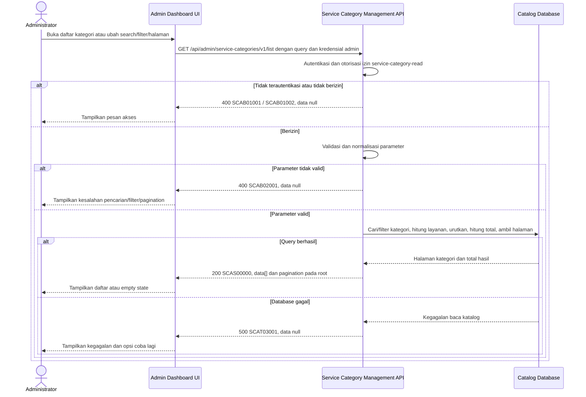

# Admin Dashboard - Get List Service Categories Interface Agreement

> **Document Type:** IFA / API Contract
> **Status:** Draft
> **Service / Domain:** Admin Dashboard — Service Category Management
> **Consumer / Partner:** JokiHub Admin Dashboard (authorized administrator)

## Design


## Sequence Diagram



## Performance / SLA Targets

| Success Rate                                                  | VUser                              | CPU / Memory                                                                | Response Time                |
| ------------------------------------------------------------- | ---------------------------------- | --------------------------------------------------------------------------- | ---------------------------- |
| 99.9% monthly availability; valid-request server error ≤ 0.1% | 50 VUser / 20 request/s NFT target | Initial 2 vCPU / 4 GiB per instance; CPU ≤ 70%, memory ≤ 75% at target load | Read p95 ≤ 500 ms; p99 ≤ 2 s |

## General Information

| Component          | Value                                                                                                                                                       |
| ------------------ | ----------------------------------------------------------------------------------------------------------------------------------------------------------- |
| Description        | Mengambil daftar kategori layanan beserta jumlah layanan untuk Admin Dashboard.                                                                             |
| Resource URL       | `https://{host}/api/admin/service-categories/v1/list`                                                                                                       |
| Transport Protocol | HTTPS, REST                                                                                                                                                 |
| Request Verb       | GET                                                                                                                                                         |
| Content Type       | `application/json` response; GET tidak memiliki request body.                                                                                               |
| Interaction Type   | Synchronous                                                                                                                                                 |
| Security Policy    | Admin authentication dan izin `service-category-read`. Identity provider dan permission final TBD. Terapkan rate limiting dan audit akses sesuai kebijakan. |

### Path / Endpoint

| Section                  | Value                                       |
| ------------------------ | ------------------------------------------- |
| Host / Domain            | `{host}` (environment-specific)             |
| Service Name             | Service Category Management                 |
| Version                  | `v1`                                        |
| Resource                 | `/admin/service-categories/v1/list`         |
| Proposed target endpoint | `GET /api/admin/service-categories/v1/list` |

### API Versioning

- **Inventory status:** Method/path yang sama tercatat pada route inventory repo ini; bagian ini bukan klaim bahwa route belum ada.
- **Target contract:** IFA mengusulkan perilaku pada `GET /api/admin/service-categories/v1/list`; query, permission, projection, pagination, response, dan status target belum disetujui terhadap inventory.
- **Versioning:** Tetap `v1` pada usulan ini; perubahan kompatibilitas perlu keputusan API owner.
- **Backward Compatibility:** Consumer belum dinilai. Penambahan field hanya dapat dianggap kompatibel setelah perilaku consumer diverifikasi; perubahan field/semantik/status yang mematahkan consumer memerlukan keputusan versioning API owner.
- **Reason:** Admin Dashboard memerlukan daftar kategori yang dapat dicari dan difilter untuk pengelolaan katalog layanan.

## Business Rules

1. Hanya administrator terautentikasi dengan izin `service-category-read` yang dapat mengakses endpoint. Mapping permission ke role final TBD.
2. Daftar admin mencakup kategori aktif dan nonaktif. Kategori soft-deleted (`deleted_at IS NOT NULL`) tidak ditampilkan; hard-delete policy mengikuti keputusan ERD.
3. Parameter `q`, bila diberikan, mencocokkan `name` atau `slug` setelah trim secara case-insensitive. Deskripsi tidak dicari pada versi ini.
4. Parameter `isActive`, bila diberikan, memfilter nilai boolean tepat. Bila tidak diberikan, kedua status aktif/nonaktif disertakan.
5. `serviceCount` merupakan metrik operasional turunan dari `game_service` yang terhubung. Usulan admin menghitung seluruh layanan non-deleted, termasuk inactive; ini berbeda dari public source count yang hanya menghitung layanan aktif pada game aktif. Product harus menetapkan tujuan dan predicate masing-masing context melalui D-14 sebelum implementasi.
6. Hasil diurutkan `name ASC`, lalu `category_id ASC` agar urutan deterministik. Kebutuhan custom sort order belum ada pada ERD/UI.
7. `total` menghitung kategori setelah filter sebelum pagination. Hasil kosong adalah sukses dengan `data: []` dan `pagination.total: 0`.
8. `updatedAt` menggunakan timestamp UTC dari `service_category.updated_at`; format response ISO 8601.
9. Response memuat data yang diperlukan tabel admin saja: `id`, `name`, `slug`, `description`, `serviceCount`, `isActive`, dan `updatedAt`. Field internal audit/soft-delete tidak diekspos.
10. API bersifat read-only; tidak membuat perubahan kategori atau layanan.
11. Pagination diterapkan di database sebelum serialisasi response. Perhitungan jumlah layanan harus menghindari duplikasi kategori maupun hasil total akibat join.

## Request Headers

| Header         | E/N/T | Type   | M/O/C | Max Length | Description                                                                                                | Example                             |
| -------------- | ----- | ------ | ----- | ---------: | ---------------------------------------------------------------------------------------------------------- | ----------------------------------- |
| `Cookie`       | N     | String | M     |       4096 | Browser mengirim cookie access admin secara otomatis; token tidak dikirim melalui Authorization atau body. | `__Host-jokihub-admin-access={JWT}` |
| `Origin`       | N     | String | M     |        TBD | Origin dashboard harus cocok dengan allowlist.                                                             | `https://admin.example.test`        |
| `X-CSRF-Token` | N     | String | M     |        TBD | Token CSRF untuk request admin cookie-authenticated.                                                       | `{csrf-token}`                      |
| `Accept`       | N     | String | O     |        100 | Tipe media response yang diinginkan; default JSON.                                                         | `application/json`                  |
| `X-Request-Id` | N     | String | O     |        100 | ID korelasi untuk audit/support; jangan memuat PII.                                                        | `req-c71a2d`                        |

## Request Parameters

Tidak ada path parameter.

## Request Query Parameters

| Parameter  | E/N/T | Type    | M/O/C | Max Length | Description                                                             | Example  |
| ---------- | ----- | ------- | ----- | ---------: | ----------------------------------------------------------------------- | -------- |
| `q`        | N     | String  | O     |        100 | Pencarian nama atau slug kategori.                                      | `top-up` |
| `isActive` | N     | Boolean | O     |          5 | Filter status aktif: `true` atau `false`.                               | `true`   |
| `page`     | N     | Integer | O     |   9 digits | Nomor halaman, dimulai dari `1`; default `1`.                           | `1`      |
| `limit`    | N     | Integer | O     |   3 digits | Jumlah maksimum hasil per halaman; default `20`, maksimum usulan `100`. | `20`     |

## Request Body

Tidak ada request body.

### Request Validation

1. Session cookie harus valid; `Origin` harus exact-allowlisted; token CSRF dan permission `service-category-read` harus valid. HTTP/service-code mapping auth dan CSRF tetap mengikuti API standard yang disetujui.
2. `q`, bila dikirim, harus berupa string maksimal 100 karakter setelah trim. Query harus diparameterisasi; wildcard dan escape mengikuti kebijakan pencarian database.
3. `isActive`, bila dikirim, harus tepat `true` atau `false`; nilai lain menghasilkan `SCAB02001`.
4. `page` harus integer >= 1; default `1`. `limit` harus integer dari 1 sampai 100; default `20`.
5. Parameter query yang tidak dikenal ditolak dengan `SCAB02001`.
6. Query hanya mengikutsertakan kategori yang belum soft-delete dan tidak boleh menghasilkan kategori duplikat akibat join ke layanan.
7. Jika tidak ada hasil, kembalikan HTTP 200 dengan `data: []` dan `pagination.total: 0`.
8. Kegagalan database mengembalikan HTTP 500 tanpa detail internal.

## Response Body

| Attribute               | E/N/T | Type               | M/O/C |    Max Length | Description                                                                          | Example                        |
| ----------------------- | ----- | ------------------ | ----- | ------------: | ------------------------------------------------------------------------------------ | ------------------------------ |
| `code`                  | N     | String             | M     |            20 | Service code.                                                                        | `SCAS00000`                    |
| `message`               | N     | String             | O     |           200 | Pesan hasil untuk consumer.                                                          | `Service categories retrieved` |
| `data`                  | N     | Array of Object    | M     | `limit` items | Halaman kategori; kosong bila tidak ada hasil.                                       | `[]`                           |
| `data[].id`             | N     | String             | M     |            64 | ID kategori internal (`category_id`).                                                | `cat_01JXYZ`                   |
| `data[].name`           | N     | String             | M     |           100 | Nama kategori.                                                                       | `Top Up`                       |
| `data[].slug`           | N     | String             | M     |           100 | Slug URL-safe kategori.                                                              | `top-up`                       |
| `data[].description`    | N     | String/null        | O     |           500 | Deskripsi kategori.                                                                  | `Layanan pengisian saldo game` |
| `data[].serviceCount`   | N     | Integer            | M     |     10 digits | Jumlah layanan terkait sesuai aturan hitung yang disetujui.                          | `8`                            |
| `data[].isActive`       | N     | Boolean            | M     |             — | Status aktif kategori.                                                               | `true`                         |
| `data[].updatedAt`      | N     | String (date-time) | M     |            35 | Waktu terakhir diperbarui dalam ISO 8601 UTC.                                        | `2026-10-11T08:30:00Z`         |
| `pagination`            | N     | Object             | C     |             — | Metadata pagination di root, sejajar dengan `data`; hadir pada response list sukses. | `{}`                           |
| `pagination.page`       | N     | Integer            | C     |      9 digits | Halaman efektif, dimulai dari 1; hadir pada response list sukses.                    | `1`                            |
| `pagination.limit`      | N     | Integer            | C     |      3 digits | Batas hasil efektif; hadir pada response list sukses.                                | `20`                           |
| `pagination.total`      | N     | Integer            | C     |     10 digits | Total kategori sebelum pagination; hadir pada response list sukses.                  | `1`                            |
| `pagination.totalPages` | N     | Integer            | C     |      9 digits | Jumlah halaman hasil; `0` bila tidak ada hasil; hadir pada response list sukses.     | `1`                            |

### Success Example

```json
{
  "code": "SCAS00000",
  "message": "Service categories retrieved",
  "data": [
    {
      "id": "cat_01JXYZ",
      "name": "Top Up",
      "slug": "top-up",
      "description": "Layanan pengisian saldo game",
      "serviceCount": 8,
      "isActive": true,
      "updatedAt": "2026-10-11T08:30:00Z"
    }
  ],
  "pagination": {
    "page": 1,
    "limit": 20,
    "total": 1,
    "totalPages": 1
  }
}
```

### Business Error Example

```json
{
  "code": "SCAB02001",
  "message": "Invalid service-category list parameters",
  "data": null
}
```

### Technical Error Example

```json
{
  "code": "SCAT03001",
  "message": "Service category data is temporarily unavailable",
  "data": null
}
```

## HTTP Status Codes

| HTTP Status | Usage                                                                                                                                     |
| ----------- | ----------------------------------------------------------------------------------------------------------------------------------------- |
| `200`       | Query valid; mengembalikan kategori yang cocok atau array kosong.                                                                         |
| `400`       | Query tidak valid atau akses admin ditolak sesuai baseline response project. Konfirmasi apakah autentikasi/otorisasi memakai `401`/`403`. |
| `500`       | Kegagalan service/database kategori yang tidak terduga.                                                                                   |

## Service Status Codes

Format: `[Service Prefix][Status Type][Category][Specific Error Code]`

| Code        | Type      | Category        | Meaning                                                       |
| ----------- | --------- | --------------- | ------------------------------------------------------------- |
| `SCAS00000` | Success   | General         | Daftar kategori berhasil dikembalikan, termasuk hasil kosong. |
| `SCAB01001` | Business  | Authentication  | Administrator belum terautentikasi.                           |
| `SCAB01002` | Business  | Authentication  | Administrator tidak memiliki izin membaca kategori layanan.   |
| `SCAB02001` | Business  | User validation | Parameter pencarian/filter/pagination tidak valid.            |
| `SCAT03001` | Technical | Database        | Kategori gagal dibaca atau database tidak tersedia.           |

## API Exposure Classification

| Classification            | Rationale                                                                                                                                              |
| ------------------------- | ------------------------------------------------------------------------------------------------------------------------------------------------------ |
| TBD (deployment exposure) | Endpoint admin untuk pengelolaan katalog. Jika dapat diakses dari internet, klasifikasikan sebagai Public dan terapkan kontrol API publik yang sesuai. |

## Testing & Documentation Scope

| NFT / VA-Pentest handoff   | Value                                                                                                                                                                                  |
| -------------------------- | -------------------------------------------------------------------------------------------------------------------------------------------------------------------------------------- |
| Service / module           | Service Category Management                                                                                                                                                            |
| Endpoint                   | `GET /api/admin/service-categories/v1/list`                                                                                                                                            |
| Sample parameter / request | Query: `q=top-up&isActive=true&page=1&limit=20`                                                                                                                                        |
| Sample response            | Success code `SCAS00000`; use the complete Success Example below. Probe code `SCAB01002`; use its corresponding error example below. HTTP mapping remains subject to D-11 where noted. |
| NFT CPU / memory target    | TBD; capacity evidence and approval required under D-12.                                                                                                                               |
| NFT TPS target             | TBD; traffic forecast and approval required under D-12.                                                                                                                                |

| Scope      | Required | Rationale / Handoff                                                                                                                                                                                                                                                      |
| ---------- | -------- | ------------------------------------------------------------------------------------------------------------------------------------------------------------------------------------------------------------------------------------------------------------------------ |
| NFT        | Yes      | Validasi target contract untuk route daftar admin yang sudah tercatat di inventory. Uji search, filter aktif/nonaktif, limit minimum/maksimum, page, hasil kosong, dan hitung `serviceCount` tanpa duplikasi. VUser, CPU/memory, serta target TPS TBD menunggu forecast. |
| VA/Pentest | Yes      | Verifikasi authentication/authorization, privilege boundaries, injection, query validation, serta tidak adanya field internal yang tidak diperlukan.                                                                                                                     |

## Assumptions

- Parameter, pagination, response payload, service codes, permission, dan perilaku target adalah usulan; root envelope mengikuti Sprint 1 karena kontrak target kategori belum disetujui. Method/path route tercatat pada inventory lokal.
- Admin `serviceCount` mengusulkan seluruh layanan non-deleted, termasuk inactive; public `serviceCount` saat ini hanya menghitung layanan aktif pada game aktif. Tujuan dan predicate kedua metric harus disetujui melalui D-14.
- Nama, slug, description, status aktif, serta batas panjang mengikuti proposal ERD/UI. Aturan uniqueness dan indeks final masih TBD.
- `deleted_at` tersedia di ERD, tetapi kebijakan penghapusan kategori belum disetujui; API mengecualikan soft-deleted rows sebagai asumsi.
- Sort `name ASC`, ID tie-break, default `page=1`, `limit=20`, dan maksimum `limit=100` adalah proposal.
- Identity provider, role mapping, rate limit, SLA, database engine, dan auth HTTP mapping TBD.

## References

- [Sprint 2 BRD](../../../BRD.md) — BR-019, pengelolaan kategori layanan.
- `../../erd/service-category-erd.md` — field kategori, relasi layanan, indeks, dan aturan soft delete.
- `../../erd/service-erd.md` — sumber relasi layanan yang dihitung pada `serviceCount`.
