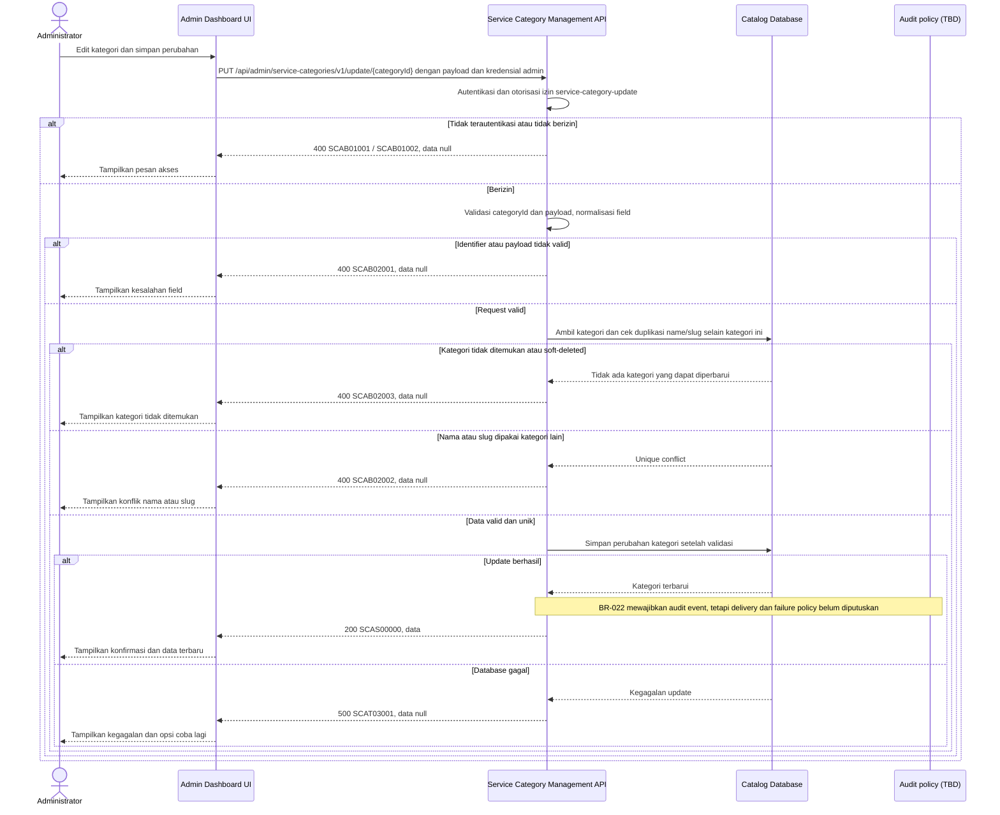

# Admin Dashboard - Update Service Category Interface Agreement

> **Document Type:** IFA / API Contract  
> **Status:** Draft  
> **Service / Domain:** Admin Dashboard — Service Category Management  
> **Consumer / Partner:** JokiHub Admin Dashboard (authorized administrator)

## Design

IFA ini mengusulkan pembaruan atribut kategori dari modal edit Admin Service Categories. UI mengirim seluruh form: nama, slug, deskripsi, dan status aktif. Target mempertahankan ID dan waktu pembuatan, memperbarui `updatedAt`, dan memvalidasi keunikan sesuai aturan yang masih perlu disetujui. Perubahan kategori tidak otomatis mengubah layanan yang terhubung.

> **Status kontrak target:** Struktur response mengikuti baseline Sprint 1 `{code,message,data}`. Service code, HTTP mapping, dan permission per route masih perlu disepakati terhadap inventory; auth/HTTP compatibility dicatat di D-11 dan extension permission/grant role di D-18.

## Sequence Diagram



## Performance / SLA Targets

| Success Rate                                        | VUser                                   | CPU / Memory                             | Response Time                                                 |
| --------------------------------------------------- | --------------------------------------- | ---------------------------------------- | ------------------------------------------------------------- |
| TBD; konfirmasi criticality dan availability target | TBD; konfirmasi concurrent admin puncak | TBD; tetapkan dari capacity estimate/NFT | TBD; target belum ditetapkan; baseline opsional menunggu D-12 |

## General Information

| Component          | Value                                                                                                                                               |
| ------------------ | --------------------------------------------------------------------------------------------------------------------------------------------------- |
| Description        | Memperbarui nama, slug, deskripsi, dan status kategori layanan.                                                                                     |
| Resource URL       | `https://{host}/api/admin/service-categories/v1/update/{categoryId}`                                                                                |
| Transport Protocol | HTTPS, REST                                                                                                                                         |
| Request Verb       | PUT                                                                                                                                                 |
| Content Type       | `application/json`                                                                                                                                  |
| Interaction Type   | Synchronous                                                                                                                                         |
| Security Policy    | Admin authentication dan izin `service-category-update`. Identity provider dan permission final TBD. Terapkan rate limiting dan audit actor/action. |

### Path / Endpoint

| Section                  | Value                                                      |
| ------------------------ | ---------------------------------------------------------- |
| Host / Domain            | `{host}` (environment-specific)                            |
| Service Name             | Service Category Management                                |
| Version                  | `v1`                                                       |
| Resource                 | `/admin/service-categories/v1/update/{categoryId}`         |
| Proposed target endpoint | `PUT /api/admin/service-categories/v1/update/{categoryId}` |

### API Versioning

- **Inventory status:** Method/path yang sama tercatat pada route inventory repo ini; bagian ini bukan klaim bahwa route belum ada.
- **Target contract:** IFA mengusulkan perilaku pada `PUT /api/admin/service-categories/v1/update/{categoryId}`; payload, permission, response, dan status target belum disetujui terhadap inventory.
- **Versioning:** Tetap `v1` pada usulan ini; perubahan kompatibilitas perlu keputusan API owner.
- **Proposed target endpoint:** `PUT /api/admin/service-categories/v1/update/{categoryId}`
- **Backward Compatibility:** Consumer belum dinilai. Penambahan field hanya dapat dianggap kompatibel setelah perilaku consumer diverifikasi; perubahan field/semantik/status yang mematahkan consumer memerlukan keputusan versioning API owner.
- **Reason:** Admin perlu mengubah atribut kategori yang sudah tersimpan. `PUT` dipilih karena UI edit mengirim seluruh field form, bukan patch parsial.

## Business Rules

1. Hanya administrator terautentikasi dengan izin `service-category-update` yang dapat memperbarui kategori. Role mapping final TBD.
2. `categoryId` adalah ID immutable pada `service_category.category_id`; body tidak boleh mengganti ID.
3. Hanya kategori yang ada dan belum soft-deleted yang dapat diperbarui. Kategori aktif maupun nonaktif dapat diedit.
4. Payload adalah full replacement untuk field bisnis yang dikelola form: `name`, `slug`, `description`, dan `isActive` semuanya wajib dikirim. `createdAt`, `updatedAt`, `deletedAt`, dan `serviceCount` tidak dapat diubah melalui request.
5. `name` disimpan setelah trim dan unik case-insensitive setelah normalisasi di antara kategori non-deleted, tidak termasuk kategori target itu sendiri.
6. `slug` disimpan lowercase setelah trim, harus mengikuti format URL-safe, dan unik di antara kategori non-deleted selain target. Slug boleh berubah; dampak link/storefront perlu dimitigasi oleh pemilik produk sebelum slug kategori dipakai sebagai URL permanen.
7. Nama atau slug yang sama dengan kategori lain menghasilkan konflik `SCAB02002`; tidak ada kategori lain yang ditimpa.
8. `description` boleh `null` atau string; whitespace-only dinormalisasi menjadi `null`, panjang maksimal usulan 500 karakter.
9. `isActive=false` menghentikan ketersediaan kategori untuk assignment/publikasi baru. Layanan yang sudah terkait tidak otomatis dinonaktifkan atau dipindahkan; referensi tetap ada sesuai ERD.
10. `updatedAt` ditetapkan service menggunakan waktu UTC saat perubahan tersimpan. `createdAt` tetap.
11. Update tanpa perubahan nilai dan dampaknya pada `updatedAt`/audit belum ditetapkan. Keputusan tersebut harus konsisten dengan event boundary BR-022 (D-07); jangan menjanjikan event atau meniadakannya untuk no-op sebelum kebijakan disetujui.
12. Nama/slug uniqueness dan perlindungan terhadap concurrent writes masih perlu disepakati bersama strategi penyimpanan. Draft ERD mengusulkan MongoDB; jangan menganggap constraint/indeks tertentu tersedia sebelum rancangan fisik dan mekanismenya diputuskan.
13. Kebutuhan serta event boundary audit untuk operasi update ini harus ditetapkan konsisten dengan BR-022/D-07. Field diff/allowlist, delivery/durability, atomicity, dan perilaku gagal belum ditetapkan (D-08); jangan mengasumsikan perubahan bisnis pasti bercommit bersama event.
14. Endpoint tidak mengubah nama snapshot layanan atau riwayat order; order memakai snapshot transaksi sendiri.

## Request Headers

| Header         | E/N/T | Type   | M/O/C | Max Length | Description                                                                                 | Example                      |
| -------------- | ----- | ------ | ----- | ---------: | ------------------------------------------------------------------------------------------- | ---------------------------- |
| `Cookie`       | E     | String | M     |        TBD | Session admin dikirim browser; nama dan atribut cookie mengikuti auth Sprint 1.             | `{admin session cookie}`     |
| `Origin`       | N     | String | M     |        TBD | Origin dashboard harus cocok dengan allowlist.                                              | `https://admin.example.test` |
| `X-CSRF-Token` | N     | String | M     |        TBD | Token CSRF untuk request admin cookie-authenticated.                                        | `{csrf-token}`               |
| `Content-Type` | N     | String | M     |        100 | Format payload.                                                                             | `application/json`           |
| `Accept`       | N     | String | O     |        100 | Tipe media response yang diinginkan; default JSON.                                          | `application/json`           |
| `X-Request-Id` | N     | String | O     |        100 | ID korelasi untuk audit/support; jangan memuat PII.                                         | `req-6a71d4`                 |
| `If-Match`     | N     | String | O     |        100 | ETag/version untuk optimistic concurrency bila mekanisme versioning tersedia; dukungan TBD. | `W/"v3"`                     |

## Request Parameters

| Parameter    | E/N/T | Type          | M/O/C | Max Length | Description                            | Example      |
| ------------ | ----- | ------------- | ----- | ---------: | -------------------------------------- | ------------ |
| `categoryId` | N     | String (path) | M     |         64 | ID immutable kategori yang diperbarui. | `cat_01JXYZ` |

## Request Body

| Attribute     | E/N/T | Type        | M/O/C | Max Length | Description                                        | Example                        |
| ------------- | ----- | ----------- | ----- | ---------: | -------------------------------------------------- | ------------------------------ |
| `name`        | N     | String      | M     |        100 | Nama kategori setelah trim.                        | `Top Up Game`                  |
| `slug`        | N     | String      | M     |        100 | Slug lowercase URL-safe.                           | `top-up-game`                  |
| `description` | N     | String/null | M     |        500 | Deskripsi; kirim `null` untuk menghapus deskripsi. | `Layanan pengisian saldo game` |
| `isActive`    | N     | Boolean     | M     |          — | Status aktif kategori.                             | `true`                         |

### Example Request Body

```json
{
  "name": "Top Up Game",
  "slug": "top-up-game",
  "description": "Layanan pengisian saldo game",
  "isActive": true
}
```

### Request Validation

1. Session cookie harus valid; `Origin` harus exact-allowlisted; token CSRF dan permission `service-category-update` harus valid. HTTP/service-code mapping auth dan CSRF tetap mengikuti API standard yang disetujui.
2. `categoryId` wajib, tidak kosong, maksimal 64 karakter, dan mengikuti format ID yang ditetapkan implementasi. Format invalid menghasilkan `SCAB02001`.
3. Body wajib berupa JSON object valid. Tolak field yang tidak dikenal termasuk `id`, `categoryId`, `createdAt`, `updatedAt`, `deletedAt`, dan `serviceCount` dengan `SCAB02001`.
4. `name` wajib string, trim sebelum simpan, tidak boleh kosong setelah trim, dan maksimal 100 karakter.
5. `slug` wajib string, trim dan lowercase sebelum validasi, maksimal 100 karakter, serta harus cocok dengan `^[a-z0-9]+(?:-[a-z0-9]+)*$`.
6. `description` wajib hadir dan harus string atau `null`; trim string, normalisasi kosong menjadi `null`, maksimal 500 karakter.
7. `isActive` wajib berupa boolean JSON; string seperti `"true"` tidak diterima.
8. `name` atau `slug` duplikat pada kategori non-deleted lain menghasilkan `SCAB02002`.
9. `categoryId` valid tetapi record tidak ada atau soft-deleted menghasilkan `SCAB02003`.
10. Jika `If-Match` didukung, nilai yang tidak cocok dengan versi terkini harus gagal tanpa menimpa perubahan terbaru; kode konflik/versioning response perlu diselaraskan dengan API standard sebelum implementasi.
11. Query parameter yang tidak didefinisikan ditolak. Kegagalan database menghasilkan HTTP 500 `SCAT03001` tanpa detail internal.

## Response Body

Semua response target menggunakan envelope Sprint 1 `{code,message,data}`. Untuk detail, `data` langsung berisi object resource; untuk list, `data` adalah array dan `pagination` sibling di root. Error mengembalikan `data: null`.

| Attribute           | E/N/T | Type               | M/O/C | Max Length | Description                                                         | Example                        |
| ------------------- | ----- | ------------------ | ----- | ---------: | ------------------------------------------------------------------- | ------------------------------ |
| `code`              | N     | String             | M     |         20 | Service code.                                                       | `SCAS00000`                    |
| `message`           | N     | String             | O     |        200 | Pesan hasil untuk consumer.                                         | `Service category updated`     |
| `data`              | N     | Object/null        | M     |          — | Payload hasil; `null` ketika error.                                 | `{}`                           |
| `data.id`           | N     | String             | M     |         64 | ID kategori yang tidak berubah.                                     | `cat_01JXYZ`                   |
| `data.name`         | N     | String             | M     |        100 | Nama kategori terbaru.                                              | `Top Up Game`                  |
| `data.slug`         | N     | String             | M     |        100 | Slug terbaru.                                                       | `top-up-game`                  |
| `data.description`  | N     | String/null        | O     |        500 | Deskripsi terbaru.                                                  | `Layanan pengisian saldo game` |
| `data.isActive`     | N     | Boolean            | M     |          — | Status aktif terbaru.                                               | `true`                         |
| `data.serviceCount` | N     | Integer            | M     |  10 digits | Jumlah layanan terhubung; read-only dan tidak diubah oleh endpoint. | `3`                            |
| `data.createdAt`    | N     | String (date-time) | M     |         35 | Waktu pembuatan awal yang tetap.                                    | `2026-10-10T07:00:00Z`         |
| `data.updatedAt`    | N     | String (date-time) | M     |         35 | Waktu update UTC.                                                   | `2026-10-11T09:20:00Z`         |

### Success Example

```json
{
  "code": "SCAS00000",
  "message": "Service category updated",
  "data": {
    "id": "cat_01JXYZ",
    "name": "Top Up Game",
    "slug": "top-up-game",
    "description": "Layanan pengisian saldo game",
    "isActive": true,
    "serviceCount": 3,
    "createdAt": "2026-10-10T07:00:00Z",
    "updatedAt": "2026-10-11T09:20:00Z"
  }
}
```

### Business Error Example

```json
{
  "code": "SCAB02002",
  "message": "Service category name or slug already exists",
  "data": null
}
```

### Technical Error Example

```json
{
  "code": "SCAT03001",
  "message": "Service category data is temporarily unavailable",
  "data": null
}
```

## HTTP Status Codes

| HTTP Status | Usage                                                                                                                                                                      |
| ----------- | -------------------------------------------------------------------------------------------------------------------------------------------------------------------------- |
| `200`       | Kategori berhasil diperbarui sesuai baseline IFA project.                                                                                                                  |
| `400`       | Payload/identifier tidak valid, akses admin ditolak sesuai baseline response project, kategori tidak ditemukan, atau nama/slug duplikat. Konfirmasi auth-specific mapping. |
| `500`       | Kegagalan service atau database yang tidak terduga.                                                                                                                        |

## Service Status Codes

Format: `[Service Prefix][Status Type][Category][Specific Error Code]`

| Code        | Type      | Category        | Meaning                                                 |
| ----------- | --------- | --------------- | ------------------------------------------------------- |
| `SCAS00000` | Success   | General         | Kategori layanan berhasil diperbarui.                   |
| `SCAB01001` | Business  | Authentication  | Administrator belum terautentikasi.                     |
| `SCAB01002` | Business  | Authentication  | Administrator tidak memiliki izin update kategori.      |
| `SCAB02001` | Business  | User validation | Identifier atau payload tidak valid.                    |
| `SCAB02002` | Business  | User validation | Nama atau slug sudah digunakan kategori lain.           |
| `SCAB02003` | Business  | User validation | Kategori tidak ditemukan atau soft-deleted.             |
| `SCAT03001` | Technical | Database        | Kategori gagal diperbarui atau database tidak tersedia. |

## API Exposure Classification

| Classification            | Rationale                                                                                                                                     |
| ------------------------- | --------------------------------------------------------------------------------------------------------------------------------------------- |
| TBD (deployment exposure) | Operasi tulis admin untuk katalog. Jika endpoint dapat diakses dari internet, klasifikasikan sebagai Public dan terapkan proteksi API publik. |

## Testing & Documentation Scope

| NFT / VA-Pentest handoff   | Value                                                                                                                                                                                  |
| -------------------------- | -------------------------------------------------------------------------------------------------------------------------------------------------------------------------------------- |
| Service / module           | Service Category Management                                                                                                                                                            |
| Endpoint                   | `PUT /api/admin/service-categories/v1/update/{categoryId}`                                                                                                                             |
| Sample parameter / request | Path: `categoryId=cat_01JXYZ`; body uses `name="Top Up"`, `slug="top-up"`                                                                                                              |
| Sample response            | Success code `SCAS00000`; use the complete Success Example below. Probe code `SCAB01002`; use its corresponding error example below. HTTP mapping remains subject to D-11 where noted. |
| NFT CPU / memory target    | TBD; capacity evidence and approval required under D-12.                                                                                                                               |
| NFT TPS target             | TBD; traffic forecast and approval required under D-12.                                                                                                                                |

| Scope      | Required | Rationale / Handoff                                                                                                                                                                                                                                                                           |
| ---------- | -------- | --------------------------------------------------------------------------------------------------------------------------------------------------------------------------------------------------------------------------------------------------------------------------------------------- |
| NFT        | Yes      | Validasi target contract untuk route update admin yang sudah tercatat di inventory. Uji perubahan tiap field, no-op, perubahan status, perubahan slug, duplicate check concurrent, referensi layanan tetap utuh, dan persistence. VUser, CPU/memory, serta target TPS TBD mengikuti forecast. |
| VA/Pentest | Yes      | Verifikasi authentication/authorization, IDOR, mass assignment, race condition uniqueness, input validation, audit attribution, serta tidak ada perubahan ke layanan/order snapshot.                                                                                                          |

## Current Implementation Alignment

The local route inventory records `PUT /api/admin/service-categories/v1/update/{categoryId}` under `catalog-manage`; missing or soft-deleted categories map to HTTP 404. This IFA uses the same method/path, while its payload, permission, concurrency, response envelope, and other target status codes remain proposals not reconciled with the inventory. Confirm field/lifecycle rules and audit behavior before implementation (D-02/D-04/D-11). See the [route-to-handler coverage](../../../../sprint-3/solutioning/backend-go/dashboard-source-ifa.md#route-to-handler-coverage).

## Assumptions

- Permission, response envelope, status code, field mapping, dan perilaku target adalah proposal; method/path route tercatat pada inventory lokal.
- `PUT` mewakili full update; seluruh field form wajib hadir. Jika API standard memakai `PATCH`, kontrak harus berubah menjadi partial update dengan semantik field omission yang eksplisit.
- Name uniqueness, slug uniqueness, slug format, dan batas field mengikuti draft ERD sebagai proposal. Strategi indeks/penegakan uniqueness dan concurrency menunggu keputusan penyimpanan fisik.
- Slug dapat diubah dari modal edit; redirect/compatibility untuk URL lama perlu diputuskan bila slug digunakan storefront.
- BR-022 mewajibkan event untuk aksi administratif ini, tetapi target audit store/service, bentuk event, delivery/atomicity, serta respons saat gagal belum diputuskan; diagram tidak mengasumsikan platform audit service tertentu.
- Optimistic concurrency melalui `If-Match` belum ditetapkan pada kontrak target dan tidak tercatat pada route inventory; tentukan ETag/version policy sebelum menyebutnya sebagai perilaku API.
- HTTP auth mapping, rate limit, identity provider, role mapping, database engine, serta SLA TBD.

## References

- [Sprint 2 BRD](../../../BRD.md) — BR-019, pengelolaan kategori layanan.
- `../../erd/service-category-erd.md` — atribut kategori, uniqueness, relasi layanan, dan audit proposal.
- `./create-service-category.md` — aturan create, normalisasi, dan kode layanan kategori.
- `./get-detail-service-category.md` — field detail kategori.
