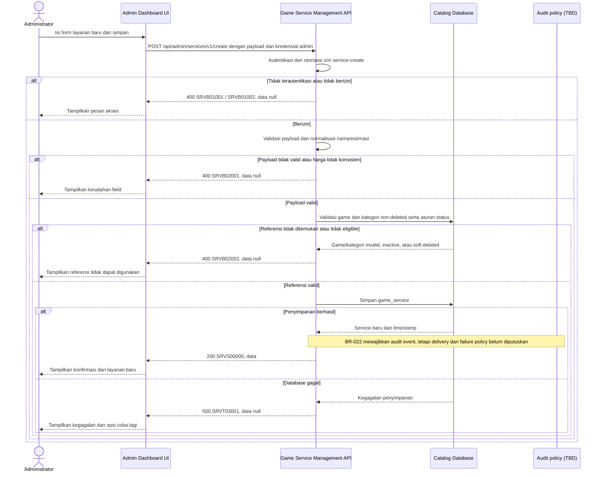

# Admin Dashboard - Create Service Interface Agreement

> **Document Type:** IFA / API Contract  
> **Status:** Draft  
> **Service / Domain:** Admin Dashboard — Game Service Management  
> **Consumer / Partner:** JokiHub Admin Dashboard (authorized administrator)

## Design


## Sequence Diagram



## Performance / SLA Targets

| Success Rate                                                  | VUser                              | CPU / Memory                                                                | Response Time              |
| ------------------------------------------------------------- | ---------------------------------- | --------------------------------------------------------------------------- | -------------------------- |
| 99.9% monthly availability; valid-request server error ≤ 0.1% | 50 VUser / 20 request/s NFT target | Initial 2 vCPU / 4 GiB per instance; CPU ≤ 70%, memory ≤ 75% at target load | Write p95 ≤ 1 s; p99 ≤ 2 s |

## General Information

| Component          | Value                                                                                                                                      |
| ------------------ | ------------------------------------------------------------------------------------------------------------------------------------------ |
| Description        | Membuat record layanan game baru beserta relasi game dan kategori.                                                                         |
| Resource URL       | `https://{host}/api/admin/services/v1/create`                                                                                              |
| Transport Protocol | HTTPS, REST                                                                                                                                |
| Request Verb       | POST                                                                                                                                       |
| Content Type       | `application/json`                                                                                                                         |
| Interaction Type   | Synchronous                                                                                                                                |
| Security Policy    | Admin authentication dan izin `service-create`. Identity provider dan permission final TBD. Terapkan rate limiting dan audit actor/action. |

### Path / Endpoint

| Section                  | Value                                |
| ------------------------ | ------------------------------------ |
| Host / Domain            | `{host}` (environment-specific)      |
| Service Name             | Game Service Management              |
| Version                  | `v1`                                 |
| Resource                 | `/admin/services/v1/create`          |
| Proposed target endpoint | `POST /api/admin/services/v1/create` |

### API Versioning

- **Inventory status:** Method/path yang sama tercatat pada route inventory repo ini; bagian ini bukan klaim bahwa route belum ada.
- **Target contract:** IFA mengusulkan perilaku pada `POST /api/admin/services/v1/create`; payload, permission, response, dan status target belum disetujui terhadap inventory.
- **Versioning:** Tetap `v1` pada usulan ini; perubahan kompatibilitas perlu keputusan API owner.
- **Proposed target endpoint:** `POST /api/admin/services/v1/create`
- **Backward Compatibility:** Consumer belum dinilai. Penambahan field hanya dapat dianggap kompatibel setelah perilaku consumer diverifikasi; perubahan field/semantik/status yang mematahkan consumer memerlukan keputusan versioning API owner.
- **Reason:** Admin Dashboard memerlukan operasi untuk menambahkan penawaran layanan pada game dan kategori yang tersedia.

## Business Rules

1. Hanya administrator terautentikasi dengan izin `service-create` yang dapat membuat layanan. Role mapping dan permission final TBD.
2. `serviceId`, `createdAt`, dan `updatedAt` dibuat oleh service; client tidak boleh menetapkan nilai tersebut.
3. `gameId` dan `categoryId` wajib merujuk record yang ada dan belum soft-deleted.
4. Layanan aktif hanya dapat dibuat untuk game aktif dan kategori aktif, mengikuti data rules ERD. Layanan nonaktif boleh ditautkan ke parent nonaktif bila product menyetujui; kebijakan tersebut TBD. Default usulan adalah menolak parent inactive untuk semua create sampai aturan final ditetapkan.
5. `name` wajib, di-trim, tidak kosong, maksimal 150 karakter. Uniqueness scope belum ditetapkan ERD; duplicate name tidak ditolak berdasarkan asumsi sampai product/API owner menetapkan apakah unik per game atau global.
6. Harga fixed menggunakan `isCustomPrice=false` dan `priceAmount` berupa decimal >= 0. Harga quote/custom menggunakan `isCustomPrice=true` dan `priceAmount=null`. Kombinasi lain ditolak.
7. Mata uang tidak dikirim dalam request dan tidak disimpan per service pada proposal ERD. Usulan response membaca currency dari `defaultCurrency` platform; pastikan kepemilikan, perubahan nilai, presisi uang, dan konsistensi currency pada order snapshot diputuskan melalui D-03/D-05 sebelum implementasi. UI yang menampilkan IDR bukan persetujuan nilai produksi.
8. `estimateText` wajib berupa teks tampilan, maksimal 100 karakter. Nilai bukan SLA dan tidak boleh dipakai sebagai jaminan sistem.
9. `isActive` menentukan ketersediaan layanan baru di storefront; default usulan `true` mengikuti ERD. Konfirmasi default sebelum implementasi.
10. Pembuatan tidak mengubah game, kategori, atau layanan lain; tidak membuat order atau perubahan fulfillment.
11. BR-022 menetapkan kebutuhan audit administratif minimum, tetapi event boundary (attempt/success/failure), payload, dan perilaku target create ini harus diselaraskan pada D-07. Store, delivery, atomicity, retry/deduplication, dan respons kegagalan masih menunggu D-08; jangan menyiratkan event pasti berhasil dicatat.
12. Service name uniqueness dan idempotency belum memiliki keputusan. Tetapkan scope uniqueness, mekanisme penegakan, dan retry semantics sebelum implementasi; keunikan nama tidak dengan sendirinya menjamin idempotensi request.
13. Penghapusan atau perubahan parent di masa depan tidak boleh menghapus order historis; order harus mengambil snapshot sesuai Order ERD.

## Request Headers

| Header         | E/N/T | Type   | M/O/C | Max Length | Description                                                                                                | Example                             |
| -------------- | ----- | ------ | ----- | ---------: | ---------------------------------------------------------------------------------------------------------- | ----------------------------------- |
| `Cookie`       | N     | String | M     |       4096 | Browser mengirim cookie access admin secara otomatis; token tidak dikirim melalui Authorization atau body. | `__Host-jokihub-admin-access={JWT}` |
| `Origin`       | N     | String | M     |        TBD | Origin dashboard harus cocok dengan allowlist.                                                             | `https://admin.example.test`        |
| `X-CSRF-Token` | N     | String | M     |        TBD | Token CSRF untuk request admin cookie-authenticated.                                                       | `{csrf-token}`                      |
| `Content-Type` | N     | String | M     |        100 | Format payload.                                                                                            | `application/json`                  |
| `Accept`       | N     | String | O     |        100 | Tipe media response yang diinginkan; default JSON.                                                         | `application/json`                  |
| `X-Request-Id` | N     | String | O     |        100 | ID korelasi untuk audit/support; jangan memuat PII.                                                        | `req-81d204`                        |

## Request Parameters

Tidak ada path/query parameter.

## Request Body

| Attribute       | E/N/T | Type         | M/O/C | Max Length | Description                                                   | Example              |
| --------------- | ----- | ------------ | ----- | ---------: | ------------------------------------------------------------- | -------------------- |
| `gameId`        | N     | String       | M     |         64 | ID game pada `game_catalog`.                                  | `gm_01JXYZ`          |
| `categoryId`    | N     | String       | M     |         64 | ID kategori pada `service_category`.                          | `cat_01JXYZ`         |
| `name`          | N     | String       | M     |        150 | Nama display layanan.                                         | `Top Up 86 Diamonds` |
| `priceAmount`   | N     | Decimal/null | C     |       18,2 | Harga fixed >= 0; wajib null untuk custom price.              | `25000.00`           |
| `isCustomPrice` | N     | Boolean      | M     |          — | `true` untuk layanan quote/custom; `false` untuk harga fixed. | `false`              |
| `estimateText`  | N     | String       | M     |        100 | Estimasi display penyelesaian.                                | `Instan`             |
| `isActive`      | N     | Boolean      | O     |          — | Status layanan; default usulan `true`.                        | `true`               |

### Example Request Body

```json
{
  "gameId": "gm_01JXYZ",
  "categoryId": "cat_01JXYZ",
  "name": "Top Up 86 Diamonds",
  "priceAmount": 25000.0,
  "isCustomPrice": false,
  "estimateText": "Instan",
  "isActive": true
}
```

### Request Validation

1. Session cookie harus valid; `Origin` harus exact-allowlisted; token CSRF dan permission `service-create` harus valid. HTTP/service-code mapping auth dan CSRF tetap mengikuti API standard yang disetujui.
2. Body harus JSON object valid. Tolak field yang tidak dikenal, termasuk `serviceId`, `id`, `createdAt`, `updatedAt`, dan `deletedAt`, dengan `SRVB02001`.
3. `gameId` dan `categoryId` wajib berupa string non-kosong maksimal 64 karakter dengan format ID yang ditetapkan implementasi.
4. `name` wajib string; trim sebelum simpan, tidak boleh kosong setelah trim, dan maksimal 150 karakter.
5. `priceAmount` dan `isCustomPrice` harus konsisten: jika `isCustomPrice=true`, `priceAmount` wajib hadir sebagai `null`; jika `isCustomPrice=false`, `priceAmount` wajib hadir sebagai angka decimal >= 0 dengan presisi maksimal `18,2`.
6. Jangan menerima string numerik untuk `priceAmount`. Tolak NaN, Infinity, nilai negatif, serta nilai yang memiliki presisi/scale di luar batas.
7. `estimateText` wajib string non-kosong setelah trim dan maksimal 100 karakter.
8. `isActive`, bila dikirim, harus boolean JSON; selain itu gunakan default usulan `true`.
9. `gameId` harus ada dan belum soft-deleted. Bila layanan akan aktif, game harus aktif. Referensi invalid atau tidak eligible mengembalikan `SRVB02002`.
10. `categoryId` harus ada, belum soft-deleted, dan aktif untuk layanan aktif. Referensi invalid atau tidak eligible mengembalikan `SRVB02002`.
11. Validasi referensi parent dan insert harus konsisten terhadap concurrent deactivation/deletion. MongoDB tidak menegakkan FK; koordinasi write, validasi ulang, atau strategi lain untuk menjaga aturan ini masih harus diputuskan.
12. Kegagalan database saat penyimpanan mengembalikan HTTP 500 `SRVT03001` tanpa detail internal.

## Response Body

| Attribute            | E/N/T | Type               | M/O/C | Max Length | Description                                                | Example                |
| -------------------- | ----- | ------------------ | ----- | ---------: | ---------------------------------------------------------- | ---------------------- |
| `code`               | N     | String             | M     |         20 | Service code.                                              | `SRVS00000`            |
| `message`            | N     | String             | O     |        200 | Pesan hasil untuk consumer.                                | `Service created`      |
| `data`               | N     | Object/null        | M     |          — | Payload hasil; `null` ketika error.                        | `{}`                   |
| `data.id`            | N     | String             | M     |         64 | ID immutable yang dibuat service.                          | `svc_01JXYZ`           |
| `data.gameId`        | N     | String             | M     |         64 | ID game terkait.                                           | `gm_01JXYZ`            |
| `data.gameName`      | N     | String             | M     |        100 | Nama game untuk admin UI, diproyeksikan dari katalog.      | `Mobile Legends`       |
| `data.categoryId`    | N     | String             | M     |         64 | ID kategori terkait.                                       | `cat_01JXYZ`           |
| `data.categoryName`  | N     | String             | M     |        100 | Nama kategori untuk admin UI, diproyeksikan dari kategori. | `Top Up`               |
| `data.name`          | N     | String             | M     |        150 | Nama layanan tersimpan.                                    | `Top Up 86 Diamonds`   |
| `data.priceAmount`   | N     | Decimal/null       | C     |       18,2 | Harga fixed atau null untuk custom price.                  | `25000.00`             |
| `data.isCustomPrice` | N     | Boolean            | M     |          — | Penanda harga custom.                                      | `false`                |
| `data.estimateText`  | N     | String             | M     |        100 | Estimasi display layanan.                                  | `Instan`               |
| `data.isActive`      | N     | Boolean            | M     |          — | Status layanan.                                            | `true`                 |
| `data.createdAt`     | N     | String (date-time) | M     |         35 | Waktu pembuatan UTC.                                       | `2026-10-11T10:00:00Z` |
| `data.updatedAt`     | N     | String (date-time) | M     |         35 | Waktu update; sama dengan `createdAt` saat create.         | `2026-10-11T10:00:00Z` |

### Success Example

```json
{
  "code": "SRVS00000",
  "message": "Service created",
  "data": null
}
```

### Business Error Example

```json
{
  "code": "SRVB02001",
  "message": "Invalid service payload",
  "data": null
}
```

### Technical Error Example

```json
{
  "code": "SRVT03001",
  "message": "Service catalog is temporarily unavailable",
  "data": null
}
```

## HTTP Status Codes

| HTTP Status | Usage                                                                                                                           |
| ----------- | ------------------------------------------------------------------------------------------------------------------------------- |
| `200`       | Layanan berhasil dibuat sesuai baseline IFA project; konfirmasi apakah API standard menetapkan `201`.                           |
| `400`       | Payload/reference tidak valid atau akses admin ditolak sesuai baseline response project. Konfirmasi auth-specific HTTP mapping. |
| `500`       | Kegagalan service atau database yang tidak terduga.                                                                             |

## Service Status Codes

Format: `[Service Prefix][Status Type][Category][Specific Error Code]`

| Code        | Type      | Category        | Meaning                                                                               |
| ----------- | --------- | --------------- | ------------------------------------------------------------------------------------- |
| `SRVS00000` | Success   | General         | Layanan berhasil dibuat.                                                              |
| `SRVB01001` | Business  | Authentication  | Administrator belum terautentikasi.                                                   |
| `SRVB01002` | Business  | Authentication  | Administrator tidak memiliki izin create layanan.                                     |
| `SRVB02001` | Business  | User validation | Payload, field, atau kombinasi harga tidak valid.                                     |
| `SRVB02002` | Business  | User validation | Game/kategori tidak ditemukan, soft-deleted, atau tidak eligible untuk layanan aktif. |
| `SRVT03001` | Technical | Database        | Layanan gagal disimpan atau database tidak tersedia.                                  |

## API Exposure Classification

| Classification            | Rationale                                                                                                                               |
| ------------------------- | --------------------------------------------------------------------------------------------------------------------------------------- |
| TBD (deployment exposure) | Operasi tulis katalog admin. Jika endpoint dapat diakses dari internet, klasifikasikan sebagai Public dan terapkan proteksi API publik. |

## Testing & Documentation Scope

| NFT / VA-Pentest handoff   | Value                                                                                                                                                                                  |
| -------------------------- | -------------------------------------------------------------------------------------------------------------------------------------------------------------------------------------- |
| Service / module           | Game Service Management                                                                                                                                                                |
| Endpoint                   | `POST /api/admin/services/v1/create`                                                                                                                                                   |
| Sample parameter / request | JSON body: `gameId=game_01ARZ3NDEKTSV4RRFFQ69G5FAV`, `categoryId=cat_01JXYZ`, `isCustomPrice=false`, `priceAmount=25000`                                                               |
| Sample response            | Success code `SRVS00000`; use the complete Success Example below. Probe code `SRVB01002`; use its corresponding error example below. HTTP mapping remains subject to D-11 where noted. |
| NFT CPU / memory target    | TBD; capacity evidence and approval required under D-12.                                                                                                                               |
| NFT TPS target             | TBD; traffic forecast and approval required under D-12.                                                                                                                                |

| Scope      | Required | Rationale / Handoff                                                                                                                                                                                                                                                          |
| ---------- | -------- | ---------------------------------------------------------------------------------------------------------------------------------------------------------------------------------------------------------------------------------------------------------------------------- |
| NFT        | Yes      | Validasi target contract untuk route create admin yang sudah tercatat di inventory. Uji fixed/custom price, batas nilai/presisi, referensi aktif/nonaktif/deleted, request bersamaan, persistence, dan peak admin load. VUser, CPU/memory, target TPS TBD menunggu forecast. |
| VA/Pentest | Yes      | Verifikasi authentication/authorization, mass assignment, IDOR pada referensi game/kategori, input validation, injection, audit attribution, dan tidak ada update silang ke entitas katalog.                                                                                 |

## Assumptions

- Response envelope, permission, service prefix `SRV`, dan perilaku target adalah proposal; method/path route tercatat pada inventory lokal.
- `isCustomPrice` ditambahkan eksplisit sebagai flag walau UI saat ini memakai `price === null`; ini mengikuti proposal ERD. Persisted schema/field migration perlu disetujui.
- Status aktif default `true`, eligibility parent inactive, serta currency platform tunggal memerlukan keputusan product/API owner.
- Uniqueness nama layanan belum ditetapkan ERD; kontrak tidak menambah aturan uniqueness tanpa persetujuan.
- BR-022 mewajibkan event, tetapi target audit store/service, delivery/atomicity, serta respons saat gagal belum diputuskan; diagram tidak mengasumsikan platform audit service tertentu.
- Idempotency, currency representation, database engine, identity provider, role mapping, HTTP auth mapping, dan SLA TBD.

## References

- [Sprint 2 BRD](../../../BRD.md) — BR-019, pengelolaan layanan; BR-005, pembedaan harga tetap dan quote pada katalog publik.
- `../../erd/service-erd.md` — atribut layanan, harga, relasi game/kategori, status, dan constraints.
- `../../erd/game-catalog-erd.md` — game catalog reference dan lifecycle.
- `../../erd/service-category-erd.md` — category reference dan lifecycle.
- `../service-categories/create-service-category.md` — pola create API kategori admin.
