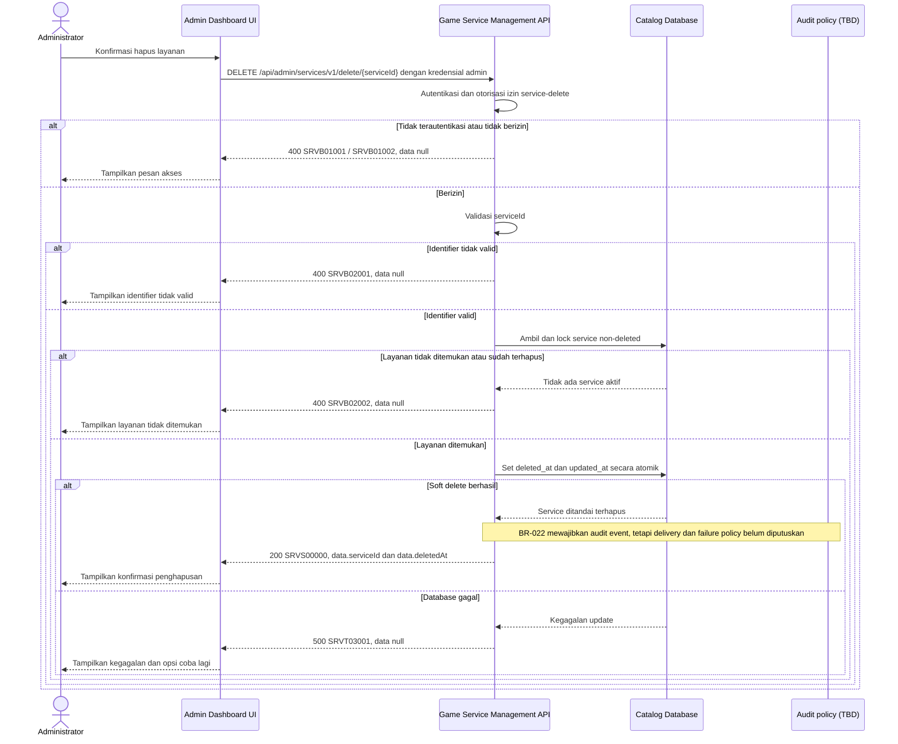

# Admin Dashboard - Delete Service Interface Agreement

> **Document Type:** IFA / API Contract  
> **Status:** Draft  
> **Service / Domain:** Admin Dashboard — Game Service Management  
> **Consumer / Partner:** JokiHub Admin Dashboard (authorized administrator)

## Design


## Sequence Diagram



## Performance / SLA Targets

| Success Rate                                                  | VUser                              | CPU / Memory                                                                | Response Time              |
| ------------------------------------------------------------- | ---------------------------------- | --------------------------------------------------------------------------- | -------------------------- |
| 99.9% monthly availability; valid-request server error ≤ 0.1% | 50 VUser / 20 request/s NFT target | Initial 2 vCPU / 4 GiB per instance; CPU ≤ 70%, memory ≤ 75% at target load | Write p95 ≤ 1 s; p99 ≤ 2 s |

## General Information

| Component          | Value                                                                                                                                      |
| ------------------ | ------------------------------------------------------------------------------------------------------------------------------------------ |
| Description        | Menandai satu layanan sebagai terhapus dari katalog tanpa menghapus histori order.                                                         |
| Resource URL       | `https://{host}/api/admin/services/v1/delete/{serviceId}`                                                                                  |
| Transport Protocol | HTTPS, REST                                                                                                                                |
| Request Verb       | DELETE                                                                                                                                     |
| Content Type       | `application/json` response; tidak ada request body.                                                                                       |
| Interaction Type   | Synchronous                                                                                                                                |
| Security Policy    | Admin authentication dan izin `service-delete`. Identity provider dan permission final TBD. Terapkan rate limiting dan audit actor/action. |

### Path / Endpoint

| Section                  | Value                                              |
| ------------------------ | -------------------------------------------------- |
| Host / Domain            | `{host}` (environment-specific)                    |
| Service Name             | Game Service Management                            |
| Version                  | `v1`                                               |
| Resource                 | `/admin/services/v1/delete/{serviceId}`            |
| Proposed target endpoint | `DELETE /api/admin/services/v1/delete/{serviceId}` |

### API Versioning

- **Inventory status:** Method/path yang sama tercatat pada route inventory repo ini; bagian ini bukan klaim bahwa route belum ada.
- **Target contract:** IFA mengusulkan perilaku pada `DELETE /api/admin/services/v1/delete/{serviceId}`; lifecycle, permission, response, dan status target belum disetujui terhadap inventory.
- **Versioning:** Tetap `v1` pada usulan ini; perubahan kompatibilitas perlu keputusan API owner.
- **Proposed target endpoint:** `DELETE /api/admin/services/v1/delete/{serviceId}`
- **Backward Compatibility:** Consumer belum dinilai. Perubahan response, semantik, atau status harus diverifikasi terhadap consumer; perubahan yang mematahkan consumer memerlukan keputusan versioning API owner.
- **Reason:** Admin UI menyediakan aksi hapus layanan; endpoint menerapkan penghapusan aman sambil mempertahankan referensi transaksi.

## Business Rules

1. Hanya administrator terautentikasi dengan izin `service-delete` yang dapat menghapus layanan. Role mapping final TBD.
2. `serviceId` mengidentifikasi record secara immutable. Nama layanan atau ID game/kategori tidak dapat digunakan sebagai target penghapusan.
3. Operasi adalah soft delete: set `deleted_at` dan `updated_at` ke waktu server UTC; record fisik dipertahankan.
4. Layanan aktif maupun nonaktif dapat dihapus. Layanan terhapus tidak lagi tersedia untuk pemesanan/storefront dan dikecualikan dari daftar admin standar.
5. Relasi ke game dan kategori tidak dihapus atau diubah. Tidak ada cascade ke game/kategori, order, order item, pembayaran, refund, komplain, maupun audit.
6. Order historis tetap utuh dan menggunakan snapshot nama, harga, mata uang, dan estimasi saat checkout. Delete katalog tidak membatalkan atau mengubah status order yang sudah dibuat.
7. Layanan yang tidak ditemukan atau sudah soft-deleted mengembalikan kode bisnis yang sama untuk menghindari enumerasi status record.
8. Target mengusulkan update bersyarat yang hanya berlaku bila service belum terhapus, agar retry setelah delete sukses tidak memberi efek samping tambahan. Jaminan concurrent write serta mapping field fisik masih harus dicocokkan dengan penyimpanan yang disetujui.
9. BR-022 mewajibkan audit event untuk aksi ini. Target event dan redaksi ditentukan oleh D-07; store, durability/delivery guarantee, urutan commit, serta respons bila audit gagal masih menunggu D-08.
10. Hard delete, restore, reassignment, dan pengubahan harga/status layanan bukan bagian endpoint ini.
11. ERD belum menentukan apakah service delete ditolak ketika sedang dipakai oleh proses fulfillment yang berjalan. Jika ada active fulfillment reference, perilaku blokir/allow harus ditentukan bersama modul order sebelum implementasi.

## Request Headers

| Header         | E/N/T | Type   | M/O/C | Max Length | Description                                                                                                | Example                             |
| -------------- | ----- | ------ | ----- | ---------: | ---------------------------------------------------------------------------------------------------------- | ----------------------------------- |
| `Cookie`       | N     | String | M     |       4096 | Browser mengirim cookie access admin secara otomatis; token tidak dikirim melalui Authorization atau body. | `__Host-jokihub-admin-access={JWT}` |
| `Origin`       | N     | String | M     |        TBD | Origin dashboard harus cocok dengan allowlist.                                                             | `https://admin.example.test`        |
| `X-CSRF-Token` | N     | String | M     |        TBD | Token CSRF untuk request admin cookie-authenticated.                                                       | `{csrf-token}`                      |
| `Accept`       | N     | String | O     |        100 | Tipe media response yang diinginkan; default JSON.                                                         | `application/json`                  |
| `X-Request-Id` | N     | String | O     |        100 | ID korelasi untuk audit/support; jangan memuat PII.                                                        | `req-2b84f1`                        |

## Request Parameters

| Parameter   | E/N/T | Type          | M/O/C | Max Length | Description                             | Example      |
| ----------- | ----- | ------------- | ----- | ---------: | --------------------------------------- | ------------ |
| `serviceId` | N     | String (path) | M     |         64 | ID immutable layanan yang akan dihapus. | `svc_01JXYZ` |

## Request Body

Tidak ada request body.

### Request Validation

1. Session cookie harus valid; `Origin` harus exact-allowlisted; token CSRF dan permission `service-delete` harus valid. HTTP/service-code mapping auth dan CSRF tetap mengikuti API standard yang disetujui.
2. `serviceId` wajib, tidak kosong, maksimal 64 karakter, dan mengikuti format ID implementasi. Format invalid menghasilkan `SRVB02001`.
3. Tolak request body dan query parameter yang tidak didefinisikan.
4. Lakukan soft delete hanya bila service ditemukan dan `deleted_at IS NULL`; bila tidak ditemukan atau sudah terhapus, kembalikan `SRVB02002`.
5. Jangan menghapus atau mengubah referensi order historis. Strategi agar concurrent update tidak mengaktifkan kembali service yang sedang dihapus masih perlu ditetapkan; jangan mengasumsikan row lock atau transaksi lintas dokumen.
6. Terapkan audit sesuai policy BR-022 setelah store, durability/delivery guarantee, urutan commit, retry/deduplication, dan respons gagal disetujui. Syarat durability belum dapat dianggap sebagai implementasi yang tersedia.
7. Kegagalan database menghasilkan HTTP 500 `SRVT03001` tanpa detail internal.

## Response Body

| Attribute        | E/N/T | Type               | M/O/C | Max Length | Description                           | Example                |
| ---------------- | ----- | ------------------ | ----- | ---------: | ------------------------------------- | ---------------------- |
| `code`           | N     | String             | M     |         20 | Service code.                         | `SRVS00000`            |
| `message`        | N     | String             | O     |        200 | Pesan hasil untuk consumer.           | `Service deleted`      |
| `data`           | N     | Object/null        | M     |          — | Payload hasil; `null` ketika error.   | `{}`                   |
| `data.serviceId` | N     | String             | M     |         64 | ID layanan yang ditandai terhapus.    | `svc_01JXYZ`           |
| `data.deletedAt` | N     | String (date-time) | M     |         35 | Waktu soft delete dalam ISO 8601 UTC. | `2026-10-11T10:30:00Z` |

### Success Example

```json
{
  "code": "SRVS00000",
  "message": "Service deleted",
  "data": null
}
```

### Business Error Example

```json
{
  "code": "SRVB02002",
  "message": "Service not found",
  "data": null
}
```

### Technical Error Example

```json
{
  "code": "SRVT03001",
  "message": "Service catalog is temporarily unavailable",
  "data": null
}
```

## HTTP Status Codes

| HTTP Status | Usage                                                                                                                                                    |
| ----------- | -------------------------------------------------------------------------------------------------------------------------------------------------------- |
| `200`       | Layanan berhasil ditandai terhapus sesuai baseline response project; konfirmasi apakah API standard memilih `204`.                                       |
| `400`       | Identifier invalid, akses admin ditolak sesuai baseline response project, atau layanan tidak ditemukan/sudah terhapus. Konfirmasi auth-specific mapping. |
| `500`       | Kegagalan service/database yang tidak terduga.                                                                                                           |

## Service Status Codes

Format: `[Service Prefix][Status Type][Category][Specific Error Code]`

| Code        | Type      | Category        | Meaning                                                                     |
| ----------- | --------- | --------------- | --------------------------------------------------------------------------- |
| `SRVS00000` | Success   | General         | Layanan berhasil ditandai terhapus.                                         |
| `SRVB01001` | Business  | Authentication  | Administrator belum terautentikasi.                                         |
| `SRVB01002` | Business  | Authentication  | Administrator tidak memiliki izin delete layanan.                           |
| `SRVB02001` | Business  | User validation | `serviceId` invalid atau request memuat parameter/body yang tidak didukung. |
| `SRVB02002` | Business  | User validation | Layanan tidak ditemukan atau sudah soft-deleted.                            |
| `SRVT03001` | Technical | Database        | Layanan gagal ditandai terhapus atau database tidak tersedia.               |

## API Exposure Classification

| Classification            | Rationale                                                                                                                                         |
| ------------------------- | ------------------------------------------------------------------------------------------------------------------------------------------------- |
| TBD (deployment exposure) | Operasi destruktif admin pada katalog. Jika endpoint dapat diakses dari internet, klasifikasikan sebagai Public dan terapkan proteksi API publik. |

## Testing & Documentation Scope

| NFT / VA-Pentest handoff   | Value                                                                                                                                                                                  |
| -------------------------- | -------------------------------------------------------------------------------------------------------------------------------------------------------------------------------------- |
| Service / module           | Game Service Management                                                                                                                                                                |
| Endpoint                   | `DELETE /api/admin/services/v1/delete/{serviceId}`                                                                                                                                     |
| Sample parameter / request | Path: `serviceId=svc_01JXYZ`                                                                                                                                                           |
| Sample response            | Success code `SRVS00000`; use the complete Success Example below. Probe code `SRVB01002`; use its corresponding error example below. HTTP mapping remains subject to D-11 where noted. |
| NFT CPU / memory target    | TBD; capacity evidence and approval required under D-12.                                                                                                                               |
| NFT TPS target             | TBD; traffic forecast and approval required under D-12.                                                                                                                                |

| Scope      | Required | Rationale / Handoff                                                                                                                                                                                                                                                                      |
| ---------- | -------- | ---------------------------------------------------------------------------------------------------------------------------------------------------------------------------------------------------------------------------------------------------------------------------------------- |
| NFT        | Yes      | Validasi target contract untuk route delete admin yang sudah tercatat di inventory. Uji layanan aktif/nonaktif, layanan tidak ditemukan, soft-deleted, retry, query katalog sesudah delete, serta operasi concurrent update/delete. VUser, CPU/memory, target TPS TBD menunggu forecast. |
| VA/Pentest | Yes      | Verifikasi authentication/authorization, IDOR, privilege boundaries, audit attribution, no hard-delete/cascade, dan order snapshot tetap tersedia.                                                                                                                                       |

## Assumptions

- Root envelope mengikuti Sprint 1; permission, payload, status code, dan prefix `SRV` mengikuti proposal [Create Service](create-service.md) dan masih menunggu persetujuan, walaupun method/path route tercatat pada inventory lokal.
- Soft delete mengikuti kolom `deleted_at` dan rekomendasi Service ERD; kebijakan restore/retensi perlu disetujui.
- Target mengizinkan soft delete meskipun ada order historis karena order memakai snapshot; referensi aplikasi tetap dipertahankan dan tidak ada FK yang ditegakkan MongoDB. Proses fulfillment aktif perlu aturan eksplisit.
- HTTP `200` dan response envelope mengikuti project baseline; `204` dapat dipilih oleh standar API final.
- Audit mechanism dan delivery/failure policy, identity provider, role mapping, database engine, active fulfillment guard, dan SLA TBD.

## References

- [Sprint 2 BRD](../../../BRD.md) — BR-019, pengelolaan dan lifecycle layanan.
- `../../erd/service-erd.md` — `deleted_at`, relasi parent, soft-delete proposal, dan audit rule.
- [order-erd.md](../../../../sprint-3/solutioning/erd/order-erd.md) — order item service reference, immutable snapshots, dan larangan menghapus histori.
- `./create-service.md` — service ID, field, permission, dan response naming baseline.
- `./update-service.md` — perilaku update dan referensi service.
