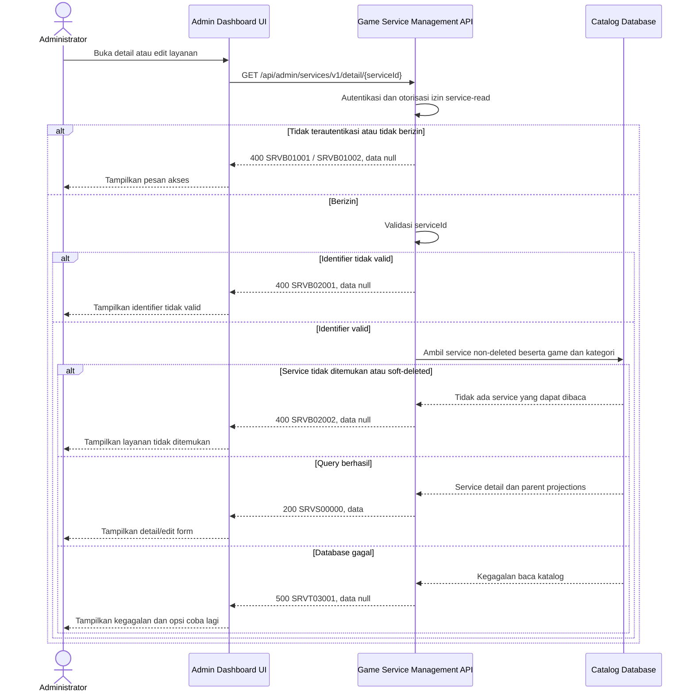

# Admin Dashboard - Get Service Detail Interface Agreement

> **Document Type:** IFA / API Contract  
> **Status:** Draft  
> **Service / Domain:** Admin Dashboard — Game Service Management  
> **Consumer / Partner:** JokiHub Admin Dashboard (authorized administrator)

## Design


## Sequence Diagram



## Performance / SLA Targets

| Success Rate                                                  | VUser                              | CPU / Memory                                                                | Response Time                |
| ------------------------------------------------------------- | ---------------------------------- | --------------------------------------------------------------------------- | ---------------------------- |
| 99.9% monthly availability; valid-request server error ≤ 0.1% | 50 VUser / 20 request/s NFT target | Initial 2 vCPU / 4 GiB per instance; CPU ≤ 70%, memory ≤ 75% at target load | Read p95 ≤ 500 ms; p99 ≤ 2 s |

## General Information

| Component          | Value                                                                                                                                              |
| ------------------ | -------------------------------------------------------------------------------------------------------------------------------------------------- |
| Description        | Mengambil satu layanan beserta relasi game/kategori untuk detail dan form edit Admin Dashboard.                                                    |
| Resource URL       | `https://{host}/api/admin/services/v1/detail/{serviceId}`                                                                                          |
| Transport Protocol | HTTPS, REST                                                                                                                                        |
| Request Verb       | GET                                                                                                                                                |
| Content Type       | `application/json` response; GET tidak memiliki request body.                                                                                      |
| Interaction Type   | Synchronous                                                                                                                                        |
| Security Policy    | Admin authentication dan izin `service-read`. Identity provider dan permission final TBD. Terapkan rate limiting dan audit akses sesuai kebijakan. |

### Path / Endpoint

| Section                  | Value                                           |
| ------------------------ | ----------------------------------------------- |
| Host / Domain            | `{host}` (environment-specific)                 |
| Service Name             | Game Service Management                         |
| Version                  | `v1`                                            |
| Resource                 | `/admin/services/v1/detail/{serviceId}`         |
| Proposed target endpoint | `GET /api/admin/services/v1/detail/{serviceId}` |

### API Versioning

- **Inventory status:** Method/path yang sama tercatat pada route inventory repo ini; bagian ini bukan klaim bahwa route belum ada.
- **Target contract:** IFA mengusulkan perilaku pada `GET /api/admin/services/v1/detail/{serviceId}`; projection, permission, response, dan status target belum disetujui terhadap inventory.
- **Versioning:** Tetap `v1` pada usulan ini; perubahan kompatibilitas perlu keputusan API owner.
- **Proposed target endpoint:** `GET /api/admin/services/v1/detail/{serviceId}`
- **Backward Compatibility:** Consumer belum dinilai. Penambahan field hanya dapat dianggap kompatibel setelah perilaku consumer diverifikasi; perubahan field/semantik/status yang mematahkan consumer memerlukan keputusan versioning API owner.
- **Reason:** Admin memerlukan detail persisted untuk meninjau dan mengisi form edit satu layanan.

## Business Rules

1. Hanya administrator terautentikasi dengan izin `service-read` yang dapat membaca detail. Role mapping final TBD.
2. `serviceId` adalah ID immutable `game_service.service_id`; slug atau nama layanan bukan identifier endpoint.
3. Layanan aktif maupun nonaktif dapat dibaca. Layanan soft-deleted (`deleted_at IS NOT NULL`) tidak dikembalikan pada endpoint detail standar.
4. Atribut layanan berasal dari record `game_service`; nama game dan kategori berasal dari parent catalog terkini. Order historis memakai snapshot tersendiri dan tidak berubah ketika katalog berubah.
5. Harga konsisten dengan storage: custom price mengembalikan `isCustomPrice=true` dan `priceAmount=null`; fixed price mengembalikan `false` dan nilai >= 0.
6. Detail mengembalikan ID dan nama game/kategori agar form edit dapat mempertahankan pilihan saat ini. Parent inactive tetap ditampilkan untuk layanan existing, tetapi opsi assignment baru mengikuti aturan update/create service.
7. Jika parent record tidak ditemukan karena inkonsistensi data, jangan menyamarkan service sebagai not-found. Kembalikan reference ID dengan display name null atau error integritas data sesuai policy platform; keputusan final TBD.
8. Endpoint bersifat read-only; tidak memperbarui timestamp, status, harga, atau audit trail bisnis.
9. Response tidak memuat data order/customer, credential game, atau atribut internal yang tidak tercantum dalam ERD.
10. Identifier yang tidak ada dan identifier soft-deleted menghasilkan kode bisnis yang sama untuk mengurangi enumeration.

## Request Headers

| Header         | E/N/T | Type   | M/O/C | Max Length | Description                                                                                                | Example                             |
| -------------- | ----- | ------ | ----- | ---------: | ---------------------------------------------------------------------------------------------------------- | ----------------------------------- |
| `Cookie`       | N     | String | M     |       4096 | Browser mengirim cookie access admin secara otomatis; token tidak dikirim melalui Authorization atau body. | `__Host-jokihub-admin-access={JWT}` |
| `Origin`       | N     | String | M     |        TBD | Origin dashboard harus cocok dengan allowlist.                                                             | `https://admin.example.test`        |
| `X-CSRF-Token` | N     | String | M     |        TBD | Token CSRF untuk request admin cookie-authenticated.                                                       | `{csrf-token}`                      |
| `Accept`       | N     | String | O     |        100 | Tipe media response yang diinginkan; default JSON.                                                         | `application/json`                  |
| `X-Request-Id` | N     | String | O     |        100 | ID korelasi untuk audit/support; jangan memuat PII.                                                        | `req-9d3f21`                        |

## Request Parameters

| Parameter   | E/N/T | Type          | M/O/C | Max Length | Description                | Example      |
| ----------- | ----- | ------------- | ----- | ---------: | -------------------------- | ------------ |
| `serviceId` | N     | String (path) | M     |         64 | ID immutable layanan game. | `svc_01JXYZ` |

## Request Body

Tidak ada request body.

### Request Validation

1. Session cookie harus valid; `Origin` harus exact-allowlisted; token CSRF dan permission `service-read` harus valid. HTTP/service-code mapping auth dan CSRF tetap mengikuti API standard yang disetujui.
2. `serviceId` wajib, tidak kosong, maksimal 64 karakter, dan mengikuti format ID implementasi. Format invalid menghasilkan `SRVB02001`.
3. Tolak query parameter yang tidak didefinisikan; endpoint tidak membutuhkan query parameter.
4. Jika service tidak ditemukan atau soft-deleted, kembalikan `SRVB02002` tanpa mengungkap status keberadaan historis.
5. Jika database gagal, kembalikan HTTP 500 `SRVT03001` tanpa detail query/schema internal.

## Response Body

| Attribute                | E/N/T | Type               | M/O/C | Max Length | Description                               | Example                    |
| ------------------------ | ----- | ------------------ | ----- | ---------: | ----------------------------------------- | -------------------------- |
| `code`                   | N     | String             | M     |         20 | Service code.                             | `SRVS00000`                |
| `message`                | N     | String             | O     |        200 | Pesan hasil untuk consumer.               | `Service detail retrieved` |
| `data`                   | N     | Object/null        | M     |          — | Payload hasil; `null` ketika error.       | `{}`                       |
| `data.id`                | N     | String             | M     |         64 | ID internal service.                      | `svc_01JXYZ`               |
| `data.name`              | N     | String             | M     |        150 | Nama layanan.                             | `Top Up Diamond 100`       |
| `data.game`              | N     | Object             | M     |          — | Ringkasan game terkait.                   | `{}`                       |
| `data.game.id`           | N     | String             | M     |         64 | ID game terkait.                          | `gm_01JXYZ`                |
| `data.game.name`         | N     | String/null        | O     |        100 | Nama game dari catalog.                   | `Mobile Legends`           |
| `data.game.isActive`     | N     | Boolean/null       | O     |          — | Status game parent bila tersedia.         | `true`                     |
| `data.category`          | N     | Object             | M     |          — | Ringkasan kategori terkait.               | `{}`                       |
| `data.category.id`       | N     | String             | M     |         64 | ID kategori terkait.                      | `cat_01JXYZ`               |
| `data.category.name`     | N     | String/null        | O     |        100 | Nama kategori dari catalog.               | `Top Up`                   |
| `data.category.isActive` | N     | Boolean/null       | O     |          — | Status kategori parent bila tersedia.     | `true`                     |
| `data.priceAmount`       | N     | Decimal/null       | C     |       18,2 | Nilai fixed price atau null untuk custom. | `25000.00`                 |
| `data.isCustomPrice`     | N     | Boolean            | M     |          — | Penanda harga custom.                     | `false`                    |
| `data.estimateText`      | N     | String             | M     |        100 | Estimasi display, bukan SLA.              | `Instan`                   |
| `data.isActive`          | N     | Boolean            | M     |          — | Status publikasi service.                 | `true`                     |
| `data.createdAt`         | N     | String (date-time) | M     |         35 | Waktu pembuatan UTC.                      | `2026-10-10T08:00:00Z`     |
| `data.updatedAt`         | N     | String (date-time) | M     |         35 | Waktu update terakhir UTC.                | `2026-10-11T08:30:00Z`     |

### Success Example

```json
{
  "code": "SRVS00000",
  "message": "Service detail retrieved",
  "data": {
    "id": "svc_01JXYZ",
    "name": "Top Up Diamond 100",
    "game": {
      "id": "gm_01JXYZ",
      "name": "Mobile Legends",
      "isActive": true
    },
    "category": {
      "id": "cat_01JXYZ",
      "name": "Top Up",
      "isActive": true
    },
    "priceAmount": 25000.0,
    "isCustomPrice": false,
    "estimateText": "Instan",
    "isActive": true,
    "createdAt": "2026-10-10T08:00:00Z",
    "updatedAt": "2026-10-11T08:30:00Z"
  }
}
```

### Business Error Example

```json
{
  "code": "SRVB02002",
  "message": "Service not found",
  "data": null
}
```

### Technical Error Example

```json
{
  "code": "SRVT03001",
  "message": "Service catalog is temporarily unavailable",
  "data": null
}
```

## HTTP Status Codes

| HTTP Status | Usage                                                                                                                                                                   |
| ----------- | ----------------------------------------------------------------------------------------------------------------------------------------------------------------------- |
| `200`       | Detail layanan berhasil diambil.                                                                                                                                        |
| `400`       | Identifier tidak valid, akses admin ditolak sesuai baseline response project, atau layanan tidak ditemukan. Konfirmasi apakah auth/not-found memakai `401`/`403`/`404`. |
| `500`       | Kegagalan service/database katalog yang tidak terduga.                                                                                                                  |

## Service Status Codes

Format: `[Service Prefix][Status Type][Category][Specific Error Code]`

| Code        | Type      | Category        | Meaning                                                   |
| ----------- | --------- | --------------- | --------------------------------------------------------- |
| `SRVS00000` | Success   | General         | Detail layanan berhasil dikembalikan.                     |
| `SRVB01001` | Business  | Authentication  | Administrator belum terautentikasi.                       |
| `SRVB01002` | Business  | Authentication  | Administrator tidak memiliki izin membaca detail layanan. |
| `SRVB02001` | Business  | User validation | `serviceId` invalid atau parameter tidak dikenal.         |
| `SRVB02002` | Business  | User validation | Layanan tidak ditemukan atau soft-deleted.                |
| `SRVT03001` | Technical | Database        | Detail layanan gagal dibaca atau database tidak tersedia. |

## API Exposure Classification

| Classification            | Rationale                                                                                                                                                     |
| ------------------------- | ------------------------------------------------------------------------------------------------------------------------------------------------------------- |
| TBD (deployment exposure) | Endpoint admin untuk metadata katalog dan harga. Jika dapat diakses dari internet, klasifikasikan sebagai Public dan terapkan kontrol API publik yang sesuai. |

## Testing & Documentation Scope

| NFT / VA-Pentest handoff   | Value                                                                                                                                                                                  |
| -------------------------- | -------------------------------------------------------------------------------------------------------------------------------------------------------------------------------------- |
| Service / module           | Game Service Management                                                                                                                                                                |
| Endpoint                   | `GET /api/admin/services/v1/detail/{serviceId}`                                                                                                                                        |
| Sample parameter / request | Path: `serviceId=svc_01JXYZ`                                                                                                                                                           |
| Sample response            | Success code `SRVS00000`; use the complete Success Example below. Probe code `SRVB01002`; use its corresponding error example below. HTTP mapping remains subject to D-11 where noted. |
| NFT CPU / memory target    | TBD; capacity evidence and approval required under D-12.                                                                                                                               |
| NFT TPS target             | TBD; traffic forecast and approval required under D-12.                                                                                                                                |

| Scope      | Required | Rationale / Handoff                                                                                                                                                                                                                                            |
| ---------- | -------- | -------------------------------------------------------------------------------------------------------------------------------------------------------------------------------------------------------------------------------------------------------------- |
| NFT        | Yes      | Validasi target contract untuk route detail admin yang sudah tercatat di inventory. Uji fixed/custom price, parent aktif/nonaktif, kategori/game relation, service soft-deleted, dan query detail puncak. VUser, CPU/memory, target TPS TBD menunggu forecast. |
| VA/Pentest | Yes      | Verifikasi authentication/authorization, IDOR terhadap `serviceId`, enumeration, excessive data exposure, dan tidak adanya order/customer data dalam response.                                                                                                 |

## Assumptions

- Root envelope mengikuti Sprint 1; permission, payload, status code, dan prefix `SRV` mengikuti proposal service list/create/update dan masih menunggu persetujuan, walaupun method/path route tercatat pada inventory lokal.
- Detail hanya mengembalikan service non-deleted. Restore/recycle-bin retrieval memerlukan kontrak lain.
- `isCustomPrice` merupakan field eksplisit dari proposed ERD; UI saat ini merepresentasikannya sebagai `price === null`.
- Parent `isActive` disertakan sebagai display/informasi assignment; final service ERD/game/category schemas harus memastikan nama dan availability field konsisten.
- IFA detail admin tidak menduplikasi currency per service. IFA publik mengusulkan menurunkan currency dari `defaultCurrency` platform; source, presisi, dan konsistensi snapshot masih menunggu D-03/D-05.
- Data integrity behavior untuk parent hilang, HTTP auth mapping, rate limit, identity provider, role mapping, database engine, dan SLA TBD.

## References

- [Sprint 2 BRD](../../../BRD.md) — BR-019, pengelolaan layanan; BR-005, pembedaan harga tetap dan quote pada katalog publik.
- `../../erd/service-erd.md` — field service, harga, relasi game/category, lifecycle, dan constraints.
- `../../erd/game-catalog-erd.md` — detail reference game.
- `../../erd/service-category-erd.md` — detail reference kategori.
- [order-erd.md](../../../../sprint-3/solutioning/erd/order-erd.md) — order snapshot yang tidak berubah saat katalog diperbarui.
- `./get-list-services.md` — list fields, permission, service codes, dan soft-delete behavior.
- `./create-service.md` — field dan price model create.
- `./update-service.md` — full update semantics dan status parent.
- `./delete-service.md` — soft-delete semantics.
