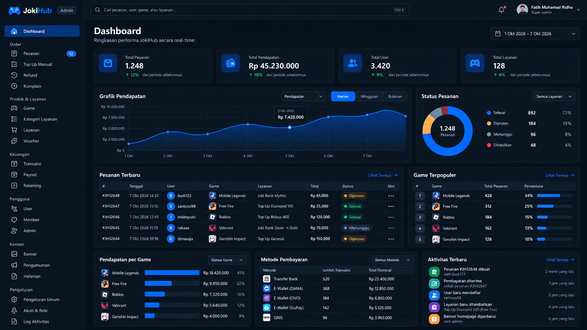
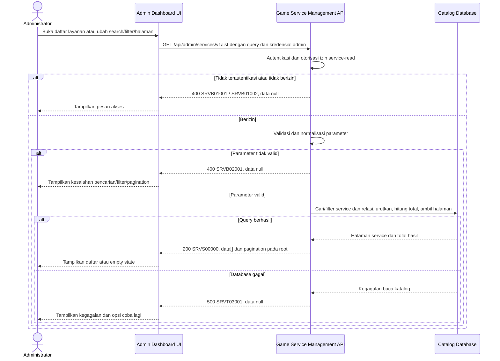

# Admin Dashboard - Get List Services Interface Agreement

> **Document Type:** IFA / API Contract  
> **Status:** Draft  
> **Service / Domain:** Admin Dashboard — Game Service Management  
> **Consumer / Partner:** JokiHub Admin Dashboard (authorized administrator)

## Design



## Sequence Diagram



## Performance / SLA Targets

| Success Rate                                                  | VUser                              | CPU / Memory                                                                | Response Time                |
| ------------------------------------------------------------- | ---------------------------------- | --------------------------------------------------------------------------- | ---------------------------- |
| 99.9% monthly availability; valid-request server error ≤ 0.1% | 50 VUser / 20 request/s NFT target | Initial 2 vCPU / 4 GiB per instance; CPU ≤ 70%, memory ≤ 75% at target load | Read p95 ≤ 500 ms; p99 ≤ 2 s |

## General Information

| Component          | Value                                                                                                                                              |
| ------------------ | -------------------------------------------------------------------------------------------------------------------------------------------------- |
| Description        | Mengambil daftar layanan game beserta relasi game dan kategori untuk Admin Dashboard.                                                              |
| Resource URL       | `https://{host}/api/admin/services/v1/list`                                                                                                        |
| Transport Protocol | HTTPS, REST                                                                                                                                        |
| Request Verb       | GET                                                                                                                                                |
| Content Type       | `application/json` response; GET tidak memiliki request body.                                                                                      |
| Interaction Type   | Synchronous                                                                                                                                        |
| Security Policy    | Admin authentication dan izin `service-read`. Identity provider dan permission final TBD. Terapkan rate limiting dan audit akses sesuai kebijakan. |

### Path / Endpoint

| Section                  | Value                             |
| ------------------------ | --------------------------------- |
| Host / Domain            | `{host}` (environment-specific)   |
| Service Name             | Game Service Management           |
| Version                  | `v1`                              |
| Resource                 | `/admin/services/v1/list`         |
| Proposed target endpoint | `GET /api/admin/services/v1/list` |

### API Versioning

- **Inventory status:** Method/path yang sama tercatat pada route inventory repo ini; bagian ini bukan klaim bahwa route belum ada.
- **Target contract:** IFA mengusulkan perilaku pada `GET /api/admin/services/v1/list`; query, permission, projection, pagination, response, dan status target belum disetujui terhadap inventory.
- **Versioning:** Tetap `v1` pada usulan ini; perubahan kompatibilitas perlu keputusan API owner.
- **Backward Compatibility:** Consumer belum dinilai. Penambahan field hanya dapat dianggap kompatibel setelah perilaku consumer diverifikasi; perubahan field/semantik/status yang mematahkan consumer memerlukan keputusan versioning API owner.
- **Reason:** Admin Dashboard memerlukan daftar layanan yang dapat dicari dan difilter untuk pengelolaan katalog.

## Business Rules

1. Hanya administrator terautentikasi dengan izin `service-read` yang dapat mengakses daftar. Role mapping dan permission final TBD.
2. Daftar mencakup layanan aktif dan nonaktif agar admin dapat mengelola status; layanan soft-deleted (`deleted_at IS NOT NULL`) tidak ditampilkan.
3. Parameter `q`, bila diberikan, mencocokkan nama layanan dan nama game secara case-insensitive setelah trim. Kategori tidak termasuk search karena UI menyediakan filter kategori terpisah.
4. `categoryId`, bila diberikan, memfilter exact match pada `game_service.category_id`. Kategori inactive tetap dapat digunakan untuk filter daftar historis/admin; kategori soft-deleted masih dapat menjadi relasi service dan tetap ditampilkan sebagai snapshot projection bila parent record tersedia.
5. `isActive`, bila diberikan, memfilter status layanan secara exact. Jika tidak diberikan, status aktif dan nonaktif ditampilkan.
6. Hasil diurutkan `updated_at DESC`, lalu `service_id DESC` untuk urutan deterministik. UI menampilkan latest-updated list; bila product menginginkan nama sort, definisikan terpisah.
7. `total` menghitung layanan setelah search dan filter, sebelum pagination. Hasil kosong adalah sukses dengan `data: []` dan `pagination.total: 0`.
8. Harga diambil dari `price_amount` dan `is_custom_price` yang tersimpan. Custom price memiliki `priceAmount=null` dan `isCustomPrice=true`; fixed price memiliki nilai non-negative dan flag false.
9. Nama game dan kategori adalah projection dari relasi katalog terkini untuk tampilan admin. Order historis memakai snapshot tersendiri dan tidak bergantung pada nilai projection list.
10. `updatedAt` dikembalikan ISO 8601 UTC dari `game_service.updated_at`.
11. Endpoint hanya read; tidak mengubah layanan, relasi, harga, status, atau audit records.
12. Pagination diterapkan pada database sebelum serialization; join ke game/category tidak boleh menduplikasi service atau mengubah `total`.
13. Bila parent game/category tidak ditemukan karena inkonsistensi data, jangan buang service tanpa observability; kembalikan ID referensi dan null display name atau raise data-integrity error sesuai kebijakan platform. Perilaku final perlu dikonfirmasi.

## Request Headers

| Header         | E/N/T | Type   | M/O/C | Max Length | Description                                                                                                | Example                             |
| -------------- | ----- | ------ | ----- | ---------: | ---------------------------------------------------------------------------------------------------------- | ----------------------------------- |
| `Cookie`       | N     | String | M     |       4096 | Browser mengirim cookie access admin secara otomatis; token tidak dikirim melalui Authorization atau body. | `__Host-jokihub-admin-access={JWT}` |
| `Origin`       | N     | String | M     |        TBD | Origin dashboard harus cocok dengan allowlist.                                                             | `https://admin.example.test`        |
| `X-CSRF-Token` | N     | String | M     |        TBD | Token CSRF untuk request admin cookie-authenticated.                                                       | `{csrf-token}`                      |
| `Accept`       | N     | String | O     |        100 | Tipe media response yang diinginkan; default JSON.                                                         | `application/json`                  |
| `X-Request-Id` | N     | String | O     |        100 | ID korelasi untuk audit/support; jangan memuat PII.                                                        | `req-f340b2`                        |

## Request Parameters

Tidak ada path parameter.

## Request Query Parameters

| Parameter    | E/N/T | Type    | M/O/C | Max Length | Description                                                      | Example      |
| ------------ | ----- | ------- | ----- | ---------: | ---------------------------------------------------------------- | ------------ |
| `q`          | N     | String  | O     |        100 | Cari nama layanan atau nama game.                                | `diamond`    |
| `categoryId` | N     | String  | O     |         64 | Filter berdasarkan ID kategori.                                  | `cat_01JXYZ` |
| `isActive`   | N     | Boolean | O     |          5 | Filter status layanan `true` atau `false`.                       | `true`       |
| `page`       | N     | Integer | O     |   9 digits | Nomor halaman, dimulai dari `1`; default `1`.                    | `1`          |
| `limit`      | N     | Integer | O     |   3 digits | Jumlah layanan per halaman; default `20`, maksimum usulan `100`. | `20`         |

## Request Body

Tidak ada request body.

### Request Validation

1. Session cookie harus valid; `Origin` harus exact-allowlisted; token CSRF dan permission `service-read` harus valid. HTTP/service-code mapping auth dan CSRF tetap mengikuti API standard yang disetujui.
2. `q`, bila dikirim, harus string maksimal 100 karakter setelah trim. Gunakan parameterized query dan kebijakan escape wildcard database.
3. `categoryId`, bila dikirim, harus string non-kosong maksimal 64 karakter dan sesuai format ID implementasi.
4. `isActive`, bila dikirim, hanya menerima `true` atau `false`.
5. `page` harus integer >= 1; default `1`. `limit` harus integer 1–100; default `20`.
6. Tolak query parameter yang tidak dikenal dengan `SRVB02001`.
7. Query mengecualikan service yang soft-deleted dan menghasilkan satu record per `serviceId`.
8. Jika tidak ada hasil, kembalikan HTTP 200 dengan array kosong dan total `0`.
9. Kegagalan database mengembalikan HTTP 500 tanpa detail internal.

## Response Body

| Attribute               | E/N/T | Type               | M/O/C |    Max Length | Description                                                                          | Example                |
| ----------------------- | ----- | ------------------ | ----- | ------------: | ------------------------------------------------------------------------------------ | ---------------------- |
| `code`                  | N     | String             | M     |            20 | Service code.                                                                        | `SRVS00000`            |
| `message`               | N     | String             | O     |           200 | Pesan hasil untuk consumer.                                                          | `Services retrieved`   |
| `data`                  | N     | Array of Object    | M     | `limit` items | Halaman layanan; array kosong bila hasil kosong.                                     | `[]`                   |
| `data[].id`             | N     | String             | M     |            64 | ID internal service.                                                                 | `svc_01JXYZ`           |
| `data[].name`           | N     | String             | M     |           150 | Nama layanan.                                                                        | `Top Up Diamond 100`   |
| `data[].gameId`         | N     | String             | M     |            64 | ID game terkait.                                                                     | `gm_01JXYZ`            |
| `data[].gameName`       | N     | String/null        | O     |           100 | Nama game hasil relasi katalog.                                                      | `Mobile Legends`       |
| `data[].categoryId`     | N     | String             | M     |            64 | ID kategori terkait.                                                                 | `cat_01JXYZ`           |
| `data[].categoryName`   | N     | String/null        | O     |           100 | Nama kategori hasil relasi katalog.                                                  | `Top Up`               |
| `data[].priceAmount`    | N     | Decimal/null       | C     |          18,2 | Harga fixed; null untuk custom price.                                                | `25000.00`             |
| `data[].isCustomPrice`  | N     | Boolean            | M     |             — | Penanda custom pricing.                                                              | `false`                |
| `data[].estimateText`   | N     | String             | M     |           100 | Estimasi display penyelesaian.                                                       | `Instan`               |
| `data[].isActive`       | N     | Boolean            | M     |             — | Status publikasi layanan.                                                            | `true`                 |
| `data[].updatedAt`      | N     | String (date-time) | M     |            35 | Waktu perubahan terakhir dalam ISO 8601 UTC.                                         | `2026-10-11T08:30:00Z` |
| `pagination`            | N     | Object             | C     |             — | Metadata pagination di root, sejajar dengan `data`; hadir pada response list sukses. | `{}`                   |
| `pagination.page`       | N     | Integer            | C     |      9 digits | Halaman efektif, dimulai dari 1; hadir pada response list sukses.                    | `1`                    |
| `pagination.limit`      | N     | Integer            | C     |      3 digits | Batas hasil efektif; hadir pada response list sukses.                                | `20`                   |
| `pagination.total`      | N     | Integer            | C     |     10 digits | Total service yang cocok sebelum pagination; hadir pada response list sukses.        | `1`                    |
| `pagination.totalPages` | N     | Integer            | C     |      9 digits | Jumlah halaman hasil; `0` bila tidak ada hasil; hadir pada response list sukses.     | `1`                    |

### Success Example

```json
{
  "code": "SRVS00000",
  "message": "Services retrieved",
  "data": [
    {
      "id": "svc_01JXYZ",
      "name": "Top Up Diamond 100",
      "gameId": "gm_01JXYZ",
      "gameName": "Mobile Legends",
      "categoryId": "cat_01JXYZ",
      "categoryName": "Top Up",
      "priceAmount": 25000.0,
      "isCustomPrice": false,
      "estimateText": "Instan",
      "isActive": true,
      "updatedAt": "2026-10-11T08:30:00Z"
    }
  ],
  "pagination": {
    "page": 1,
    "limit": 20,
    "total": 1,
    "totalPages": 1
  }
}
```

### Business Error Example

```json
{
  "code": "SRVB02001",
  "message": "Invalid service-list parameters",
  "data": null
}
```

### Technical Error Example

```json
{
  "code": "SRVT03001",
  "message": "Service catalog is temporarily unavailable",
  "data": null
}
```

## HTTP Status Codes

| HTTP Status | Usage                                                                                                                                             |
| ----------- | ------------------------------------------------------------------------------------------------------------------------------------------------- |
| `200`       | Query valid; mengembalikan layanan yang cocok atau array kosong.                                                                                  |
| `400`       | Parameter tidak valid atau akses admin ditolak sesuai baseline response project. Konfirmasi apakah autentikasi/otorisasi menggunakan `401`/`403`. |
| `500`       | Kegagalan service/database katalog yang tidak terduga.                                                                                            |

## Service Status Codes

Format: `[Service Prefix][Status Type][Category][Specific Error Code]`

| Code        | Type      | Category        | Meaning                                                      |
| ----------- | --------- | --------------- | ------------------------------------------------------------ |
| `SRVS00000` | Success   | General         | Daftar layanan berhasil dikembalikan, termasuk hasil kosong. |
| `SRVB01001` | Business  | Authentication  | Administrator belum terautentikasi.                          |
| `SRVB01002` | Business  | Authentication  | Administrator tidak memiliki izin membaca layanan.           |
| `SRVB02001` | Business  | User validation | Parameter pencarian/filter/pagination tidak valid.           |
| `SRVT03001` | Technical | Database        | Layanan gagal dibaca atau database tidak tersedia.           |

## API Exposure Classification

| Classification            | Rationale                                                                                                                                  |
| ------------------------- | ------------------------------------------------------------------------------------------------------------------------------------------ |
| TBD (deployment exposure) | Endpoint admin untuk katalog. Jika dapat diakses dari internet, klasifikasikan sebagai Public dan terapkan kontrol API publik yang sesuai. |

## Testing & Documentation Scope

| NFT / VA-Pentest handoff   | Value                                                                                                                                                                                  |
| -------------------------- | -------------------------------------------------------------------------------------------------------------------------------------------------------------------------------------- |
| Service / module           | Game Service Management                                                                                                                                                                |
| Endpoint                   | `GET /api/admin/services/v1/list`                                                                                                                                                      |
| Sample parameter / request | Query: `q=robux&categoryId=cat_01JXYZ&isActive=true&page=1&limit=20`                                                                                                                   |
| Sample response            | Success code `SRVS00000`; use the complete Success Example below. Probe code `SRVB01002`; use its corresponding error example below. HTTP mapping remains subject to D-11 where noted. |
| NFT CPU / memory target    | TBD; capacity evidence and approval required under D-12.                                                                                                                               |
| NFT TPS target             | TBD; traffic forecast and approval required under D-12.                                                                                                                                |

| Scope      | Required | Rationale / Handoff                                                                                                                                                                                                                                                   |
| ---------- | -------- | --------------------------------------------------------------------------------------------------------------------------------------------------------------------------------------------------------------------------------------------------------------------- |
| NFT        | Yes      | Validasi target contract untuk route list admin yang sudah tercatat di inventory. Uji search, filter kategori/status, pagination minimum/maksimum, hasil kosong, custom/fixed price, serta join tanpa duplikasi. VUser, CPU/memory, target TPS TBD menunggu forecast. |
| VA/Pentest | Yes      | Verifikasi authentication/authorization, privilege boundaries, injection, parameter validation, IDOR pada category filter, dan pengecualian service soft-deleted.                                                                                                     |

## Assumptions

- Parameter, pagination, response envelope, service prefix/codes, permission, dan perilaku target adalah proposal; method/path route tercatat pada inventory lokal.
- Pagination menggunakan `page`/`limit`, selaras dengan pola list game dalam solutioning. `limit=20`, maksimum `100` adalah proposal.
- Search terbatas pada nama layanan dan nama game sesuai UI placeholder/filter saat ini; status dan kategori menjadi filter terpisah.
- Daftar menyertakan aktif/nonaktif dan mengecualikan soft-deleted service. Kategori/game nonaktif tetap terbaca dalam admin list.
- Nama game/category di response berasal dari relasi katalog terkini; penanganan parent record yang hilang perlu diselaraskan dengan data-integrity policy.
- `isCustomPrice` mengikuti proposal ERD, sementara UI model menandai custom dengan `price === null`. Currency tidak disimpan per service pada proposal ERD; IFA publik mengusulkan turunannya dari `defaultCurrency` platform, yang masih menunggu keputusan D-03/D-05.
- Identity provider, role mapping, SLA, rate limit, database engine, sort policy, serta category soft-delete visibility TBD.

## References

- [Sprint 2 BRD](../../../BRD.md) — BR-019, pengelolaan layanan; BR-005, pembedaan harga tetap dan quote pada katalog publik.
- `../../erd/service-erd.md` — field `game_service`, parent relationships, status, price constraints, soft-delete proposal.
- `../../erd/game-catalog-erd.md` — game catalog source.
- `../../erd/service-category-erd.md` — category source.
- `./create-service.md` — contract create service dan price model proposal.
- `./update-service.md` — contract update service.
- `./delete-service.md` — soft-delete behavior.
- `../games/get-list-games.md` — pagination dan service code convention pembanding.
