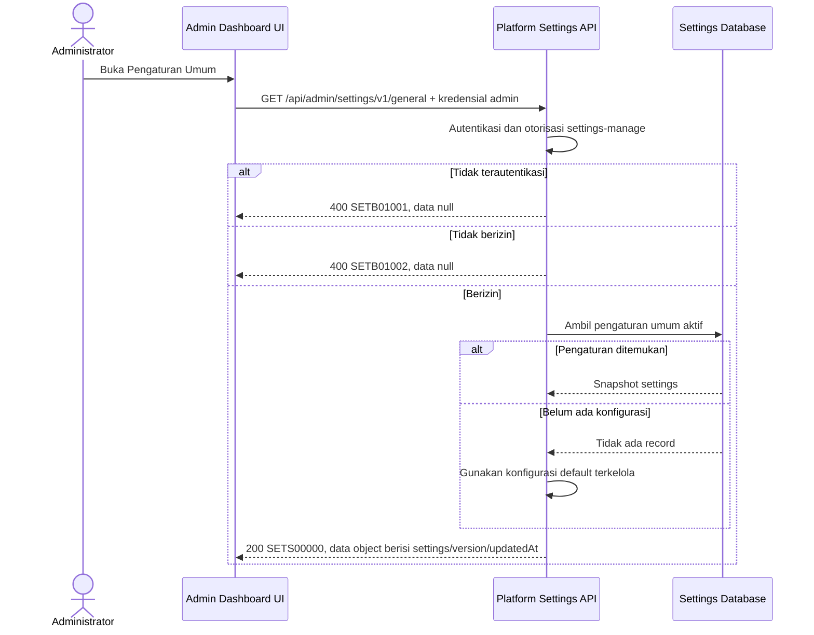

# Admin Dashboard - Get General Settings Interface Agreement

> **Document Type:** IFA / API Contract  
> **Status:** Draft  
> **Service / Domain:** Admin Dashboard — Platform Settings  
> **Consumer / Partner:** JokiHub Admin Dashboard (authorized administrator)

## Design


## Sequence Diagram



## Performance / SLA Targets

| Success Rate                                                  | VUser                              | CPU / Memory                                                                | Response Time                |
| ------------------------------------------------------------- | ---------------------------------- | --------------------------------------------------------------------------- | ---------------------------- |
| 99.9% monthly availability; valid-request server error ≤ 0.1% | 50 VUser / 20 request/s NFT target | Initial 2 vCPU / 4 GiB per instance; CPU ≤ 70%, memory ≤ 75% at target load | Read p95 ≤ 500 ms; p99 ≤ 2 s |

## General Information

| Component          | Value                                                           |
| ------------------ | --------------------------------------------------------------- |
| Description        | Membaca seluruh pengaturan umum platform untuk Admin Dashboard. |
| Resource URL       | `https://{host}/api/admin/settings/v1/general`                  |
| Transport Protocol | HTTPS, REST                                                     |
| Request Verb       | `GET`                                                           |
| Content Type       | Tidak ada request body; response `application/json`             |
| Interaction Type   | Synchronous                                                     |
| Security Policy    | Admin authentication dan permission `settings-manage`.          |

### Path / Endpoint

| Section        | Value                            |
| -------------- | -------------------------------- |
| Host / Domain  | `{host}` (environment-specific)  |
| Service Name   | Platform Settings                |
| Version        | `v1`                             |
| Resource       | `/admin/settings/v1/general`     |
| Final Endpoint | `/api/admin/settings/v1/general` |

### API Versioning

- **Decision:** Existing Endpoint / target enhancement.
- **Existing source route:** `GET /api/admin/settings/v1/general` tercatat pada source inventory Sprint 3.
- **Proposed target endpoint:** `GET /api/admin/settings/v1/general`; method/path dipertahankan.
- **Backward Compatibility:** Target mempertahankan field source; envelope `{code,message,data}` mengikuti pola Sprint 1. HTTP mapping masih memerlukan keputusan API owner.
- **Reason:** Admin Dashboard membutuhkan snapshot pengaturan umum untuk mengisi halaman settings.

## Business Rules

1. Hanya administrator terautentikasi dengan permission `settings-manage` dapat membaca pengaturan, mengikuti route source saat ini.
2. Resource merepresentasikan satu snapshot konfigurasi umum platform. `GET` mengembalikan seluruh field settings yang dapat dikelola UI.
3. Jika record belum ada, service mengembalikan konfigurasi default terkelola, `version` 0, dan `updatedAt` null sesuai source.
4. `maintenanceMode` dan `allowRegistration` menunjukkan nilai konfigurasi yang tersimpan; enforcement-nya berada di consumer terkait.
5. Public response hanya boleh berisi allowlist field publik dan tidak menggunakan endpoint admin ini.

## Request Headers

| Header         | E/N/T | Type   | M/O/C | Max Length | Description                                                                                                | Example                             |
| -------------- | ----- | ------ | ----- | ---------: | ---------------------------------------------------------------------------------------------------------- | ----------------------------------- |
| `Cookie`       | N     | String | M     |       4096 | Browser mengirim cookie access admin secara otomatis; token tidak dikirim melalui Authorization atau body. | `__Host-jokihub-admin-access={JWT}` |
| `Origin`       | N     | String | M     |        TBD | Origin dashboard harus cocok dengan allowlist.                                                             | `https://admin.example.test`        |
| `X-CSRF-Token` | N     | String | M     |        TBD | Token CSRF untuk request admin cookie-authenticated.                                                       | `{csrf-token}`                      |
| `Accept`       | N     | String | O     |        100 | Tipe media response yang diinginkan; default JSON.                                                         | `application/json`                  |
| `X-Request-Id` | N     | String | O     |        100 | ID korelasi untuk audit/support.                                                                           | `req-71c1ab`                        |

## Request Parameters

None.

## Request Query Parameters

None.

## Request Body

None.

### Request Validation

1. Request wajib berasal dari administrator yang terautentikasi dan memiliki permission `settings-manage`.
2. Request tidak menerima query parameter atau body.
3. Detail HTTP/service-code mapping untuk unauthorized dan forbidden masih mengikuti keputusan D-11.

## Response Body

| Attribute                  | E/N/T | Type        | M/O/C | Max Length | Description                                                                                             | Example                                                  |
| -------------------------- | ----- | ----------- | ----- | ---------: | ------------------------------------------------------------------------------------------------------- | -------------------------------------------------------- |
| `code`                     | N     | String      | M     |         20 | Service code.                                                                                           | `SETS00000`                                              |
| `message`                  | N     | String      | O     |        200 | Pesan hasil untuk consumer.                                                                             | `Settings retrieved`                                     |
| `data`                     | N     | Object/null | M     |          — | Object settings; `null` saat error.                                                                     | `{}`                                                     |
| `data.siteName`            | N     | String      | M     |        100 | Nama platform.                                                                                          | `JokiHub`                                                |
| `data.siteDescription`     | N     | String/null | M     |        500 | Deskripsi platform.                                                                                     | `Solusi top up game...`                                  |
| `data.contactEmail`        | N     | String      | M     |        TBD | Email bantuan.                                                                                          | `support@example.test`                                   |
| `data.contactWhatsapp`     | N     | String      | M     |        TBD | Nomor bantuan setelah normalisasi source.                                                               | `+19995550123`                                           |
| `data.socialLinks`         | N     | Array       | M     |          — | Link publik yang diizinkan, `{label,url}`.                                                              | `[ {"label":"Instagram","url":"https://example.test"} ]` |
| `data.socialLinks[].label` | N     | String      | M     |         40 | Label tautan.                                                                                           | `Instagram`                                              |
| `data.socialLinks[].url`   | N     | String      | M     |        255 | URL HTTPS.                                                                                              | `https://example.test`                                   |
| `data.businessHours`       | N     | String/null | M     |        160 | Jam operasional display atau null.                                                                      | `Setiap hari, 09.00–21.00 WIB`                           |
| `data.maintenanceMode`     | N     | Boolean     | M     |          — | Status mode pemeliharaan.                                                                               | `false`                                                  |
| `data.allowRegistration`   | N     | Boolean     | M     |          — | Status pendaftaran member.                                                                              | `true`                                                   |
| `data.defaultCurrency`     | N     | String      | M     |          3 | Mata uang default.                                                                                      | `IDR`                                                    |
| `data.timezone`            | N     | String      | M     |         64 | IANA timezone.                                                                                          | `Asia/Jakarta`                                           |
| `data.version`             | N     | Integer     | M     |          — | Metadata versi. Source mengirim sibling; penempatan di `data` adalah target.                            | `12`                                                     |
| `data.updatedAt`           | N     | String/null | M     |         35 | ISO 8601 UTC atau null jika belum ada row. Source mengirim sibling; penempatan di `data` adalah target. | `2026-10-12T09:45:00Z`                                   |

### Success Example

```json
{
  "code": "SETS00000",
  "message": "Settings retrieved",
  "data": {
    "siteName": "JokiHub",
    "siteDescription": "Solusi top up game, joki, dan kebutuhan digital.",
    "contactEmail": "support@example.test",
    "contactWhatsapp": "+19995550123",
    "socialLinks": [
      {
        "label": "Instagram",
        "url": "https://example.test"
      }
    ],
    "businessHours": "Setiap hari, 09.00–21.00 WIB",
    "maintenanceMode": false,
    "allowRegistration": true,
    "defaultCurrency": "IDR",
    "timezone": "Asia/Jakarta",
    "version": 12,
    "updatedAt": "2026-10-12T09:45:00Z"
  }
}
```

### Business Error Example

```json
{
  "code": "SETB01001",
  "message": "Administrator is not authenticated",
  "data": null
}
```

### Technical Error Example

```json
{
  "code": "SETT03001",
  "message": "Settings service is temporarily unavailable",
  "data": null
}
```

## HTTP Status Codes

| HTTP Status | Usage                                                                                            |
| ----------- | ------------------------------------------------------------------------------------------------ |
| `200`       | Settings berhasil dibaca.                                                                        |
| `400`       | Akses admin ditolak sesuai baseline response project; konfirmasi pemetaan `401` atau `403` D-11. |
| `500`       | Kegagalan database atau service yang tidak terduga.                                              |

## Service Status Codes

Format: `[Service Prefix][Status Type][Category][Specific Error Code]`

| Code        | Type      | Category       | Meaning                                             |
| ----------- | --------- | -------------- | --------------------------------------------------- |
| `SETS00000` | Success   | General        | Settings berhasil dibaca.                           |
| `SETB01001` | Business  | Authentication | Administrator belum terautentikasi.                 |
| `SETB01002` | Business  | Authentication | Administrator tidak memiliki izin membaca settings. |
| `SETT03001` | Technical | Database       | Settings gagal dibaca/database tidak tersedia.      |

## API Exposure Classification

| Classification            | Rationale                                                                                                                |
| ------------------------- | ------------------------------------------------------------------------------------------------------------------------ |
| TBD (deployment exposure) | Endpoint membaca konfigurasi platform untuk admin. Jika internet-accessible, klasifikasikan sebagai Public dan lindungi. |

## Testing & Documentation Scope

| Scope      | Required | Rationale / Handoff                                                                                                        |
| ---------- | -------- | -------------------------------------------------------------------------------------------------------------------------- |
| NFT        | Yes      | Uji pembacaan snapshot/default settings dan concurrency admin. VUser, CPU/memory, response-time, dan target TPS masih TBD. |
| VA/Pentest | Yes      | Uji authentication/authorization, CSRF sesuai auth, privilege bypass, dan kebocoran field privat ke consumer admin/public. |

## Assumptions

- Route GET `/api/admin/settings/v1/general` sudah tercatat pada source inventory Sprint 3.
- Target mempertahankan root envelope `{code,message,data}` sesuai pola Sprint 1; HTTP/error mapping memerlukan keputusan D-11.
- Authentication/permission implementation, settings storage, default bootstrap values, SLA, dan deployment exposure masih TBD.
- Endpoint public terpisah menyediakan allowlist field storefront dan tidak termasuk IFA ini.

## References

- [Sprint 2 BRD](../../../BRD.md) — BR-020 field/settings scope.
- [Platform settings ERD](../../../erd/platform-settings-erd.md) — logical settings data proposal and unresolved physical mapping.
- [Go admin dashboard source inventory](../../../../sprint-3/solutioning/backend-go/dashboard-source-ifa.md#route-to-handler-coverage) — current admin route/permission/field/response behavior.
- [Public settings IFA](../../public/settings/get-public-settings.md) — public settings projection and cache behavior.
- [Sprint 2 decision register](../../../../README.md#keputusan-yang-menghalangi-finalisasi) — open decision D-11.
