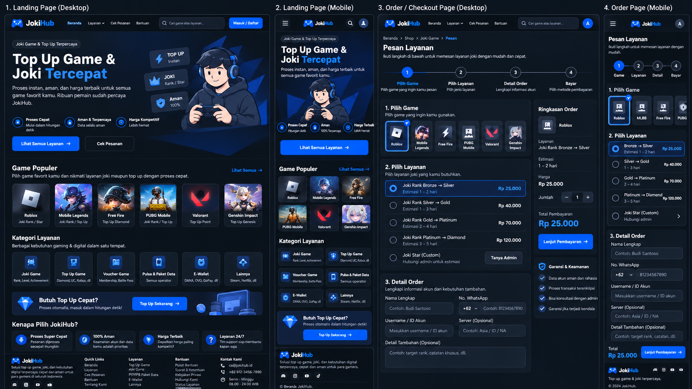
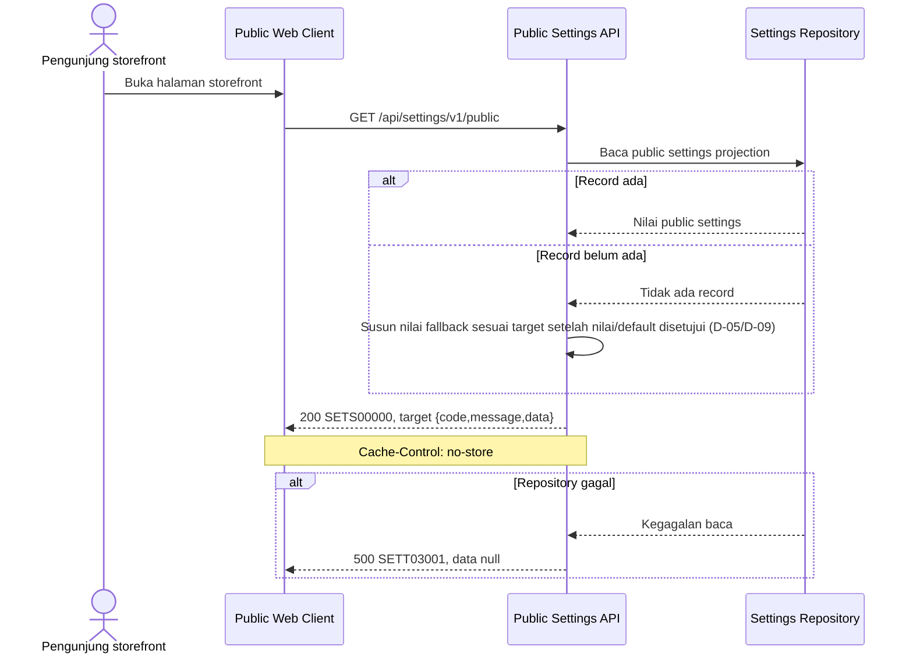

# Public Platform Settings - Interface Agreement

> **Document Type:** IFA / API Contract
> **Status:** Draft
> **Service / Domain:** Public Platform Settings
> **Consumer / Partner:** JokiHub public storefront

> Catatan bukti: Perilaku implementasi dalam dokumen ini merangkum catatan route lokal terdahulu dan belum diverifikasi ulang terhadap kode pada pekerjaan ini. Perlakukan sebagai konteks historis; kontrak Sprint 2 adalah target proposal.

## Design



## Sequence Diagram



## Performance / SLA Targets

> Status usulan: angka baseline turunan Sprint 1; belum menjadi komitmen Sprint 2. Forecast, kondisi ukur, dan persetujuan owner masih diperlukan (D-12).

| Success Rate                                                  | VUser                              | CPU / Memory                                                                | Response Time                |
| ------------------------------------------------------------- | ---------------------------------- | --------------------------------------------------------------------------- | ---------------------------- |
| 99.9% monthly availability; valid-request server error ≤ 0.1% | 50 VUser / 20 request/s NFT target | Initial 2 vCPU / 4 GiB per instance; CPU ≤ 70%, memory ≤ 75% at target load | Read p95 ≤ 500 ms; p99 ≤ 2 s |

## General Information

| Component          | Value                                                                                                                                                                  |
| ------------------ | ---------------------------------------------------------------------------------------------------------------------------------------------------------------------- |
| Description        | Membaca proyeksi allowlist pengaturan publik untuk storefront.                                                                                                         |
| Resource URL       | `https://{host}/api/settings/v1/public`                                                                                                                                |
| Transport Protocol | HTTPS, REST                                                                                                                                                            |
| Request Verb       | GET                                                                                                                                                                    |
| Content Type       | `application/json` response; GET tidak memiliki request body.                                                                                                          |
| Interaction Type   | Synchronous                                                                                                                                                            |
| Security Policy    | Target proposal: public read dengan field allowlist dan `Cache-Control: no-store`; exposure, authentication boundary, dan cache policy menunggu persetujuan D-09/D-11. |

### Path / Endpoint

| Section        | Value                           |
| -------------- | ------------------------------- |
| Host / Domain  | `{host}` (environment-specific) |
| Service Name   | Public Platform Settings        |
| Version        | `v1`                            |
| Resource       | `/settings/v1/public`           |
| Final Endpoint | `GET /api/settings/v1/public`   |

### API Versioning

- **Decision:** Existing v1 route; the target response changes the current public wire envelope and is not backward-compatible without consumer coordination.
- **Previous Endpoint:** `GET /api/settings/v1/public`.
- **Final Endpoint:** `GET /api/settings/v1/public`.
- **Backward Compatibility:** Historical local route notes describe a nested response envelope; this was not reverified in this work. Decide rollout, consumer migration, and compatibility before changing the deployed route (D-09/D-11).
- **Reason:** Storefront can display public identity/contact information from a server-owned allowlist.

## Business Rules

1. Historical local route notes describe success fields `siteName`, `siteDescription`, `contactEmail`, `contactWhatsapp`, `socialLinks` (`label`, `url`), and `businessHours`, and omission of admin-only settings such as maintenance/registration controls, currency, timezone, version, and updater identity. These notes are not reverified in this work; the target allowlist requires D-09 approval.
2. Historical local route notes describe defaults when no settings record exists: site name `JokiHub`, empty contact/description strings, empty `socialLinks`, and `businessHours: null`. Confirm these target defaults under D-05/D-09.
3. Historical local route notes describe `Cache-Control: no-store`; this IFA proposes no CDN or intermediary caching. Any change requires D-09 approval and freshness/security review.
4. Target success response uses root `{code,message,data}` and returns the settings object directly in `data`. Historical local notes describe a nested envelope, not reverified in this work; consumer migration is required before changing deployed behavior.
5. The public purpose, audience, field approval, localization, availability/error copy, and whether this route has a product-facing acceptance criterion are TBD (D-09/D-15).

## Request Headers

| Header   | Type   | M/O/C | Max Length | Description                                                                                    | Example            |
| -------- | ------ | ----- | ---------: | ---------------------------------------------------------------------------------------------- | ------------------ |
| `Accept` | String | O     |        100 | Consumer may request JSON; historical local notes do not establish explicit header validation. | `application/json` |

## Request Parameters

None. The route has no path or query parameters.

## Request Body

None. GET request has no body.

### Request Validation

1. Tidak ada path, query, atau body yang divalidasi oleh route source saat ini.
2. `Accept` tidak memiliki validasi source yang terdokumentasi; perilaku content negotiation selain JSON harus dikonfirmasi sebelum diwajibkan.
3. Jangan memperluas proyeksi di luar allowlist publik. Field admin, rahasia, data personal yang tidak diperlukan, serta metadata internal tidak boleh diserialisasi.
4. Kegagalan repository dipetakan ke HTTP `500` dan `SETT03001`; detail internal tidak dikembalikan.

## Response Body

| Attribute                  | Type                          | M/O/C |     Max Length | Description                                                                                                                                     | Example                     |
| -------------------------- | ----------------------------- | ----- | -------------: | ----------------------------------------------------------------------------------------------------------------------------------------------- | --------------------------- |
| `code`                     | String                        | M     |             20 | Service status code.                                                                                                                            | `SETS00000`                 |
| `message`                  | String                        | O     |            200 | Human-readable result.                                                                                                                          | `Public settings retrieved` |
| `data`                     | Object/null                   | M     |              — | Public settings object; null for errors.                                                                                                        | `{}`                        |
| `data.siteName`            | String                        | M     | Source-defined | Public site name; source fallback is `JokiHub`.                                                                                                 | `JokiHub`                   |
| `data.siteDescription`     | String                        | M     | Source-defined | Public description; source fallback is empty string.                                                                                            | `Solusi top up game.`       |
| `data.contactEmail`        | String                        | M     | Source-defined | Public contact email; source fallback is empty string.                                                                                          | `support@example.test`      |
| `data.contactWhatsapp`     | String                        | M     | Source-defined | Public WhatsApp contact; source fallback is empty string.                                                                                       | `+19995550123`              |
| `data.socialLinks`         | Array of Object               | M     |              — | Public social links; source fallback is empty array.                                                                                            | `[]`                        |
| `data.socialLinks[].label` | String                        | M     | Source-defined | Link label.                                                                                                                                     | `Instagram`                 |
| `data.socialLinks[].url`   | String                        | M     | Source-defined | Link URL.                                                                                                                                       | `https://example.test`      |
| `data.businessHours`       | String/null (target proposal) | M     |            TBD | Public business hours; fallback is null. Confirm exact non-null serialized type against the settings model and approved public contract (D-09). | `null`                      |

### Success Example

```json
{
  "code": "SETS00000",
  "message": "Public settings retrieved",
  "data": {
    "siteName": "JokiHub",
    "siteDescription": "",
    "contactEmail": "",
    "contactWhatsapp": "",
    "socialLinks": [],
    "businessHours": null
  }
}
```

### Business Error Example

No business error is defined for this parameter-free read route.

### Technical Error Example

```json
{
  "code": "SETT03001",
  "message": "Public settings are temporarily unavailable",
  "data": null
}
```

## HTTP Status Codes

| HTTP Status | Usage                                                                                  |
| ----------- | -------------------------------------------------------------------------------------- |
| `200`       | Public settings retrieved, including documented fallback values when no record exists. |
| `500`       | Settings repository read failure; proposed service code is `SETT03001`.                |

## Service Status Codes

Format: `[Service Prefix][Status Type][Category][Specific Error Code]`.

| Code        | Type      | Category | Meaning                                 |
| ----------- | --------- | -------- | --------------------------------------- |
| `SETS00000` | Success   | General  | Public settings projection retrieved.   |
| `SETT03001` | Technical | Database | Public settings repository read failed. |

## API Exposure Classification

| Classification                        | Rationale                                                                                                |
| ------------------------------------- | -------------------------------------------------------------------------------------------------------- |
| Public target proposal (approval TBD) | Public read exposure, authentication boundary, purpose, and field allowlist require D-09/D-11 decisions. |

## Testing & Documentation Scope

| NFT / VA-Pentest handoff   | Value                                                                                                                                                                                  |
| -------------------------- | -------------------------------------------------------------------------------------------------------------------------------------------------------------------------------------- |
| Service / module           | Public Platform Settings                                                                                                                                                               |
| Endpoint                   | `GET /api/settings/v1/public`                                                                                                                                                          |
| Sample parameter / request | No parameters or request body                                                                                                                                                          |
| Sample response            | Success code `SETS00000`; use the complete Success Example below. Probe code `SETT03001`; use its corresponding error example below. HTTP mapping remains subject to D-11 where noted. |
| NFT CPU / memory target    | Usulan: 2 vCPU / 4 GiB per instance; CPU ≤ 70%, memory ≤ 75%. Konfirmasi D-12 pending.                                                                                                 |
| NFT TPS target             | Usulan: 20 request/s pada 50 VUser. Forecast dan approval D-12 pending.                                                                                                                |

| Scope      | Required | Rationale / Handoff                                                                                                                                                                                     |
| ---------- | -------- | ------------------------------------------------------------------------------------------------------------------------------------------------------------------------------------------------------- |
| NFT        | Yes      | Public storefront read; test present/missing settings, defaults, social link projection, response size, and no-store header. Traffic, CPU/memory, response time, and TPS targets remain TBD under D-12. |
| VA/Pentest | Yes      | Public endpoint; verify strict allowlist, absence of admin-only fields, safe error handling, and no accidental caching.                                                                                 |

## Assumptions

- Earlier local route notes describe an allowlist and defaults, but these have not been reverified against code in this work; the root envelope is a Sprint 2 target proposal.
- Earlier local route notes say `businessHours` may be null but do not establish the non-null serialized type. The admin settings target uses string/null; this public target provisionally follows that type, pending confirmation against the settings model and public-field decision D-09.
- No acceptance-criteria index exists in the repository, so route presence does not prove the route has a Sprint 2 delivery story (D-15).

## References

- [Sprint 2 BRD](../../../BRD.md) — scope and open gates.
- [Sprint 2 decision register](../../open-decisions.md) — D-05/D-09/D-11/D-12/D-15.
