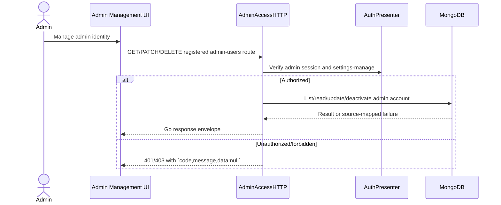

# Go Admin Account Management APIs - Interface Agreement

> **Document Type:** IFA / API Contract  
> **Status:** Source-mapped draft; invitation provider behavior unresolved  
> **Service / Domain:** Admin Access and Accounts  
> **Consumer / Partner:** JokiHub Admin Dashboard

## Design

This internal Go service IFA covers `GET /api/admin/admin-users/v1/list`, `GET /detail/{adminId}`, `PATCH /update/{adminId}`, and `DELETE /delete/{adminId}`. These operate on admin identities, not customer member accounts. The create route is documented separately in `dashboard/users/create-admin-user.md`; its method/path match Go but invitation provisioning differs. Only list/detail/update/delete behavior below is source-derived.

## Sequence Diagram



## Performance / SLA Targets

| Success Rate                                    | VUser                               | CPU / Memory                       | Response Time                    |
| ----------------------------------------------- | ----------------------------------- | ---------------------------------- | -------------------------------- |
| TBD; admin criticality target requires approval | TBD; concurrent admin usage unknown | TBD; capacity measurement required | TBD; no measured target supplied |

## General Information

| Component          | Value                                                                                   |
| ------------------ | --------------------------------------------------------------------------------------- |
| Description        | Read and mutate admin account identity, status and role assignment                      |
| Resource URL       | `https://{host}/api/admin/admin-users/v1/...`                                           |
| Transport Protocol | HTTPS REST                                                                              |
| Request Verb       | GET, PATCH, DELETE                                                                      |
| Content Type       | JSON for PATCH; no body for GET/DELETE                                                  |
| Interaction Type   | Synchronous                                                                             |
| Security Policy    | Admin token/cookie and `settings-manage`; role assignment additionally Super Admin only |

### Path / Endpoint

| Section        | Value                                                                  |
| -------------- | ---------------------------------------------------------------------- |
| Host / Domain  | `{host}`                                                               |
| Service Name   | Admin Access                                                           |
| Version        | `v1`                                                                   |
| Resource       | `/list`, `/detail/{adminId}`, `/update/{adminId}`, `/delete/{adminId}` |
| Final Endpoint | Exact methods and paths above                                          |

### API Versioning

- Decision: Existing v1 routes; source-mapped.
- Backward Compatibility: Preserve action-style paths and PATCH update method for Go consumers.

## Business Rules

1. These routes address `AdminAccount`; customer member endpoints `/api/admin/users/v1/*` address a different entity.
2. All routes require valid admin session and `settings-manage`. Role assignment changes additionally require Super Admin.
3. List supports page/pageSize/search/status/roleId. Status filter values are `ACTIVE` and `INACTIVE`; default pagination and exact bounds are source-defined in handler.
4. Update accepts only name, username, email, roleIds, and status. Body must contain at least one field. Unknown keys fail validation.
5. Delete deactivates the account and records actor. Last active Super Admin cannot be disabled/demoted/removed.
6. Current Go wire envelope is `{code,message,data?}`; IFA nested `status` examples are target-only. Source projections are enumerated under Response Body.

## Request Headers

| Header        | Type   | M/O/C | Max Length | Description                                               | Example                       |
| ------------- | ------ | ----- | ---------: | --------------------------------------------------------- | ----------------------------- |
| Authorization | String | C     |        TBD | Admin Bearer token; admin cookie also accepted by handler | `Bearer {admin-access-token}` |
| Content-Type  | String | C     |          - | Required for PATCH JSON                                   | `application/json`            |

## Request Parameters

| Parameter  | Type    | M/O/C |     Max Length | Description                                        | Example      |
| ---------- | ------- | ----- | -------------: | -------------------------------------------------- | ------------ |
| `adminId`  | String  | M     | Source-defined | Admin identity identifier for detail/update/delete | `{admin-id}` |
| `page`     | Integer | O     |              - | Positive list page; default 1                      | `1`          |
| `pageSize` | Integer | O     |            100 | Positive list page size; default 20, maximum 100   | `20`         |
| `search`   | String  | O     |            100 | Admin identity search                              | `operator`   |
| `status`   | String  | O     |              - | `ACTIVE` or `INACTIVE` filter                      | `ACTIVE`     |
| `roleId`   | String  | O     | Source-defined | Filter by role                                     | `{role-id}`  |

## Request Body

| Attribute  | Type     | M/O/C | Max Length | Description                                                                                           | Example                        |
| ---------- | -------- | ----- | ---------: | ----------------------------------------------------------------------------------------------------- | ------------------------------ |
| `name`     | String   | C     |        150 | Nonempty after trim                                                                                   | `Support Admin`                |
| `username` | String   | C     |         30 | Lowercase-normalized match `[a-z0-9._-]{3,30}`                                                        | `support.ops`                  |
| `email`    | String   | C     |        254 | Email syntax; unique after lowercase normalization                                                    | `support@example.test`         |
| `roleIds`  | String[] | C     |          - | Unique active ObjectID strings; required nonempty on create; assignment on update is Super Admin-only | `["507f1f77bcf86cd799439011"]` |
| `status`   | String   | C     |          - | Admin account status; update-only                                                                     | `ACTIVE`                       |

### Example Request Body

```json
{ "name": "Support Admin", "status": "ACTIVE" }
```

### Request Validation

1. PATCH body only accepts `name`, `username`, `email`, `roleIds`, `status`; at least one field required.
2. Name must be nonempty after trim and <=150; username lowercases and matches `[a-z0-9._-]{3,30}`; email must be valid and <=254. Username/email conflict returns 409 `USRB02002`.
3. `roleIds` must be an array of unique ObjectID strings referring to active roles; unavailable role returns 400 `USRB02003`. Assignment requires Super Admin, else 403 `USRB01002`.
4. `page` and `pageSize` must be positive integers; `pageSize` maximum 100. `search` max length 100. Only `page`, `pageSize`, `search`, `status`, `roleId` query keys accepted.
5. `status` filter is empty, `ACTIVE`, or `INACTIVE`.
6. `adminId` must be valid 24-character Mongo ObjectID hex; missing/soft-deleted account returns 404 `USRB02004`.

## Response Body

Current Go wire envelope: `{code,message,data?}`. List, detail/update, and deactivate results use the distinct fields below; do not copy customer-member response. Target nested envelope is not current Go behavior.

| Attribute                    | Type     | M/O/C | Max Length | Description                                    | Example                                   |
| ---------------------------- | -------- | ----- | ---------: | ---------------------------------------------- | ----------------------------------------- |
| `code`                       | String   | M     |         10 | Go service code                                | `USRS00000`                               |
| `message`                    | String   | M     |        200 | Operation result                               | `Akun administrator berhasil diperbarui.` |
| `data.admins[]`              | Object[] | C     |          - | List rows, excludes soft-deleted admin records | `[]`                                      |
| `data.admins[].id`           | String   | C     |         24 | Mongo ObjectID hex                             | `507f1f77bcf86cd799439011`                |
| `data.admins[].username`     | String   | C     |         30 | Admin username                                 | `support.ops`                             |
| `data.admins[].name`         | String   | C     |        150 | Display name                                   | `Support Admin`                           |
| `data.admins[].email`        | String   | C     |        254 | Admin email                                    | `support@example.test`                    |
| `data.admins[].status`       | String   | C     |          - | `ACTIVE` / `INACTIVE`                          | `ACTIVE`                                  |
| `data.admins[].roleId`       | String   | C     |         24 | Primary role projection                        | `507f1f77bcf86cd799439012`                |
| `data.admins[].role`         | String   | C     |          - | `Tanpa Role`, `Admin`, or `Super Admin`        | `Admin`                                   |
| `data.admins[].roleIds`      | String[] | C     |          - | Active assigned role IDs                       | `[]`                                      |
| `data.admins[].roleNames`    | String[] | C     |          - | Active assigned role names                     | `[]`                                      |
| `data.admins[].lastActive`   | String   | C     |          - | Fixed source placeholder `Belum tersedia`      | `Belum tersedia`                          |
| `data.admins[].updatedAt`    | DateTime | C     |          - | Update time                                    | `2026-10-23T10:00:00Z`                    |
| `data.total`                 | Integer  | C     |          - | Filtered count before slicing                  | `1`                                       |
| `data.pagination`            | Object   | C     |          - | Page metadata                                  | `{}`                                      |
| `data.pagination.page`       | Integer  | C     |          - | Current page                                   | `1`                                       |
| `data.pagination.pageSize`   | Integer  | C     |          - | Effective size                                 | `20`                                      |
| `data.pagination.total`      | Integer  | C     |          - | Filtered total                                 | `1`                                       |
| `data.pagination.totalPages` | Integer  | C     |          - | Page count                                     | `1`                                       |
| `data.admin`                 | Object   | C     |          - | Detail/update projection                       | `{}`                                      |
| `data.admin.id`              | String   | C     |         24 | Mongo ObjectID hex                             | `507f1f77bcf86cd799439011`                |
| `data.admin.roles[]`         | Object[] | C     |          - | Active assignments `{id,name,code,system}`     | `[]`                                      |
| `data.id`                    | String   | C     |         24 | Deactivated account ID                         | `507f1f77bcf86cd799439011`                |
| `data.deletedAt`             | DateTime | C     |          - | Soft-delete timestamp                          | `2026-10-23T10:00:00Z`                    |

### Success Example

```json
{
  "code": "USRS00000",
  "message": "Admin berhasil diperbarui.",
  "data": {
    "admin": {
      "id": "507f1f77bcf86cd799439011",
      "username": "support.ops",
      "name": "Support Admin",
      "email": "support@example.test",
      "status": "ACTIVE",
      "roleIds": [],
      "roles": [],
      "createdAt": "2026-10-22T10:00:00Z",
      "updatedAt": "2026-10-23T10:00:00Z"
    }
  }
}
```

### Business Error Example

```json
{ "code": "USRB02001", "message": "Data admin tidak valid.", "data": null }
```

### Technical Error Example

```json
{ "code": "USRT03001", "message": "Layanan admin tidak tersedia.", "data": null }
```

## HTTP Status Codes

| HTTP Status | Usage                                                                      |
| ----------- | -------------------------------------------------------------------------- |
| 200         | Successful list/detail/update/deactivate                                   |
| 400         | Invalid filters or input                                                   |
| 401         | Admin session unavailable                                                  |
| 403         | Missing settings permission or Super Admin-only action                     |
| 404         | Admin account not found                                                    |
| 409         | Username/email conflict; protected active Super Admin or self-deactivation |
| 500         | Persistence/service failure where source translator maps technical failure |

## Service Status Codes

| Code        | Type      | Category | Meaning                                         |
| ----------- | --------- | -------- | ----------------------------------------------- |
| `USRS00000` | Success   | 00       | Admin account operation successful              |
| `USRB01001` | Business  | 01       | Admin session missing/invalid                   |
| `USRB01002` | Business  | 01       | Permission denied / Super Admin restriction     |
| `USRB02001` | Business  | 02       | Invalid request or filter                       |
| `USRB02002` | Business  | 02       | Username/email conflict                         |
| `USRB02003` | Business  | 02       | One or more role IDs unavailable                |
| `USRB02004` | Business  | 02       | Admin account not found                         |
| `USRB02005` | Business  | 02       | Protected current/last active Super Admin state |
| `USRT03001` | Technical | 03       | Admin account persistence failure               |

## API Exposure Classification

| Classification | Rationale                                                                                            |
| -------------- | ---------------------------------------------------------------------------------------------------- |
| Public         | Web-admin reachable; strict authentication, authorization, audit and rate/perimeter policy required. |

## Testing & Documentation Scope

| Scope      | Required | Rationale / Handoff                                                                                                         |
| ---------- | -------- | --------------------------------------------------------------------------------------------------------------------------- |
| NFT        | Yes      | Admin account management; concurrency/traffic targets TBD.                                                                  |
| VA/Pentest | Yes      | Privilege escalation, role assignment, last Super Admin lockout, IDOR, mass assignment, PII exposure and audit attribution. |

## References

- [Dashboard QUESTION.md](../../dashboard-management/QUESTION.md)
- [Admin authentication and sessions](../../public/auth/session-recovery.md)
- `../../../../../go-game-service-platform/internal/controller/http/admin_access_http.go`
