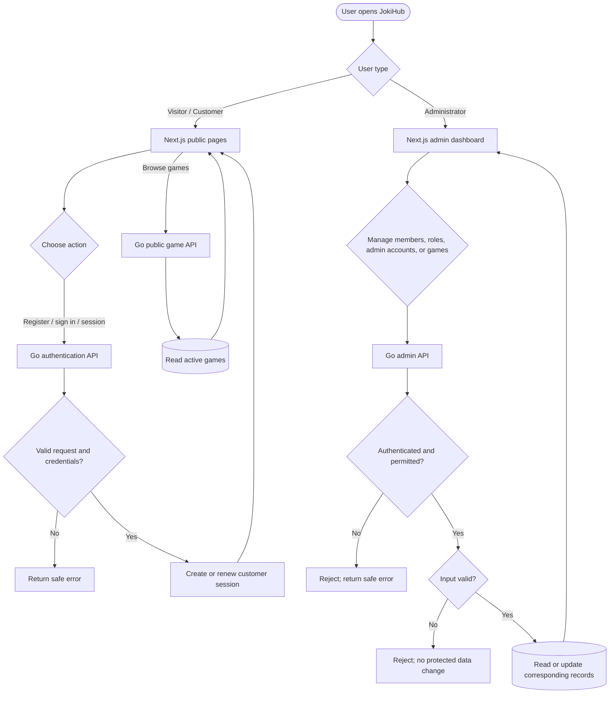

# Sprint 1 — High-Level Design

> **Scope:** Admin member/user management, roles, admin accounts, customer account access, and game management/discovery. Admin authentication is a prerequisite check; it does not add a new login feature.

## Flowchart

## Penjelasan flow

- **Akses customer:** Halaman Next.js mengirim registrasi, login, atau pembaruan sesi ke Go. Go memvalidasi kredensial dan mengelola sesi customer. Jika gagal, Go mengembalikan error yang aman.
- **Game publik:** Pengunjung meminta daftar game melalui Next.js. Go mengambil game aktif dan mengembalikan hasil untuk ditampilkan.
- **Aksi admin:** Dashboard mengirim permintaan ke Go. Go memeriksa sesi, permission, dan input sebelum membaca atau mengubah data member, role, akun admin, atau game. Permintaan tanpa akses atau input tidak valid ditolak tanpa mengubah data terlindungi.

Detail kebijakan identitas, session, role, dan publikasi game masih mengikuti keputusan terbuka di IFAs dan acceptance criteria terkait.
