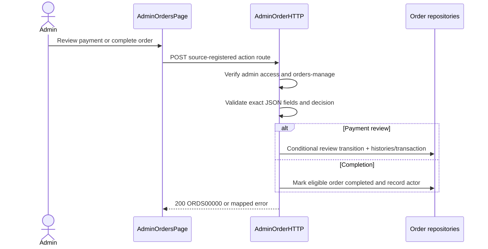

# Go Admin Order Mutations - Interface Agreement

> **Document Type:** IFA / API Contract  
> **Status:** Source-mapped draft; business inclusion/review policy pending  
> **Service / Domain:** Admin Order Management  
> **Consumer / Partner:** JokiHub Admin Dashboard

## Design

This IFA covers `POST /api/admin/orders/v1/payment-review` and `POST /api/admin/orders/v1/complete/{orderId}`. Admin detail read is separately specified at `dashboard/orders/get-detail-order.md`. Current Go route registrations and handlers are implementation evidence; business approval policy and Sprint inclusion still need owner approval.

## Sequence Diagram



## Performance / SLA Targets

| Success Rate                                        | VUser                          | CPU / Memory                | Response Time                    |
| --------------------------------------------------- | ------------------------------ | --------------------------- | -------------------------------- |
| TBD; approval operations criticality requires owner | TBD; admin concurrency unknown | TBD; capacity test required | TBD; measured target unavailable |

## General Information

| Component          | Value                                                    |
| ------------------ | -------------------------------------------------------- |
| Description        | Manual payment decision and order completion mutations   |
| Resource URL       | `https://{host}/api/admin/orders/v1/...`                 |
| Transport Protocol | HTTPS REST                                               |
| Request Verb       | POST                                                     |
| Content Type       | `application/json`                                       |
| Interaction Type   | Synchronous                                              |
| Security Policy    | Admin access token/cookie and `orders-manage` permission |

### Path / Endpoint

| Section        | Value                                    |
| -------------- | ---------------------------------------- |
| Host / Domain  | `{host}`                                 |
| Service Name   | Admin Order Management                   |
| Version        | `v1`                                     |
| Resource       | `/payment-review`; `/complete/{orderId}` |
| Final Endpoint | Exact POST routes above                  |

### API Versioning

- Decision: Existing v1 routes; source-mapped.
- Backward Compatibility: Preserve POST methods and action paths used by Go and `AdminOrdersPage`.

## Business Rules

1. Both mutations require valid admin session and `orders-manage`; handler returns 401 or 403 otherwise.
2. Payment review requires exact `orderId`, `paymentId`, `decision`; optional `note`. Only `APPROVE` and `REJECT` accepted. Note is trimmed; empty becomes absent; maximum trimmed length 500.
3. Review records reviewer from authenticated token. Approval transitions payment/order and records history/financial transaction; rejection outcome depends on expiry. Exact persistence transaction boundary follows repository implementation.
4. Completion records actor and completion transition; current allowed-state details are service-defined and must not be inferred from route registration.
5. Frontend calls both exact POST paths; method/path match Go. Current response envelope `{code,message,data?}`. IFA template nested envelope remains proposed target until API owner confirms wire format.

## Request Headers

| Header        | Type   | M/O/C | Max Length | Description                                  | Example                |
| ------------- | ------ | ----- | ---------: | -------------------------------------------- | ---------------------- |
| Authorization | String | C     |        TBD | Admin bearer token; admin cookie accepted    | `Bearer {admin-token}` |
| Content-Type  | String | M     |          - | JSON body for review; completion has no body | `application/json`     |

## Request Parameters

| Parameter | Type   | M/O/C |     Max Length | Description                         | Example      |
| --------- | ------ | ----- | -------------: | ----------------------------------- | ------------ |
| `orderId` | String | M     | Source-defined | Order identifier in completion path | `{order-id}` |

## Request Body

| Attribute   | Type        | M/O/C |     Max Length | Description                  | Example                    |
| ----------- | ----------- | ----- | -------------: | ---------------------------- | -------------------------- |
| `orderId`   | String      | M     | Source-defined | Order under review           | `{order-id}`               |
| `paymentId` | String      | M     | Source-defined | Payment attempt under review | `{payment-id}`             |
| `decision`  | String      | M     |              7 | `APPROVE` or `REJECT`        | `APPROVE`                  |
| `note`      | String/null | O     |            500 | Optional review note         | `Transfer amount verified` |

### Example Request Body

```json
{ "orderId": "{order-id}", "paymentId": "{payment-id}", "decision": "REJECT", "note": "Amount does not match" }
```

### Request Validation

1. Payment-review body accepts only `orderId`, `paymentId`, `decision`, `note`; first three must be JSON strings.
2. `decision` must equal `APPROVE` or `REJECT`; non-null note must be a string with trimmed length <=500.
3. Shared JSON decoder enforces 1 MiB body cap, rejects unknown fields and trailing values.
4. Completion has path `orderId` and no declared JSON body; service validates order state.

## Response Body

Current Go JSON envelope: `{code,message,data?}`; error `data` is null. Exact successful data fields are source-defined by `AdminOrderController`.

| Attribute            | Type   | M/O/C | Max Length | Description                                    | Example                                     |
| -------------------- | ------ | ----- | ---------: | ---------------------------------------------- | ------------------------------------------- |
| `code`               | String | M     |         10 | Service code                                   | `ORDS00000`                                 |
| `message`            | String | M     |        200 | Current response text                          | `Pemeriksaan pembayaran berhasil disimpan.` |
| `data.paymentStatus` | String | C     |          - | Resulting payment status after review          | `PAID`                                      |
| `data.orderStatus`   | String | C     |          - | Resulting order status after review/completion | `PROCESSING`                                |

### Success Example

```json
{
  "code": "ORDS00000",
  "message": "Pemeriksaan pembayaran berhasil disimpan.",
  "data": { "paymentStatus": "PAID", "orderStatus": "PROCESSING" }
}
```

### Business Error Example

```json
{ "code": "ORDB02001", "message": "Data pemeriksaan tidak valid.", "data": null }
```

### Technical Error Example

```json
{ "code": "ORDT03001", "message": "Layanan order sementara tidak tersedia.", "data": null }
```

## HTTP Status Codes

| HTTP Status | Usage                                                                     |
| ----------- | ------------------------------------------------------------------------- |
| 200         | Mutation completed                                                        |
| 400         | Invalid review payload                                                    |
| 401         | Admin session unavailable                                                 |
| 403         | `orders-manage` permission absent                                         |
| 404         | Order/payment not found                                                   |
| 409         | Payment already reviewed/not reviewable or order not completable/conflict |

## Service Status Codes

| Code        | Type      | Category | Meaning                                                               |
| ----------- | --------- | -------- | --------------------------------------------------------------------- |
| `ORDS00000` | Success   | 00       | Review/completion successful                                          |
| `ORDB01001` | Business  | 01       | Admin session unavailable                                             |
| `ORDB01002` | Business  | 01       | Permission denied                                                     |
| `ORDB02001` | Business  | 02       | Invalid request                                                       |
| `ORDB02002` | Business  | 02       | Order/payment not found                                               |
| `ORDB02004` | Business  | 02       | Current state prevents review/completion or concurrent state conflict |
| `ORDT03001` | Technical | 03       | Order persistence failure                                             |

## API Exposure Classification

| Classification | Rationale                                                                                                  |
| -------------- | ---------------------------------------------------------------------------------------------------------- |
| Public         | Admin web API reachable through configured frontend boundary; strict RBAC and perimeter controls required. |

## Testing & Documentation Scope

| Scope      | Required | Rationale / Handoff                                                                                  |
| ---------- | -------- | ---------------------------------------------------------------------------------------------------- |
| NFT        | Yes      | Financial/order state mutations; workload targets TBD. Verify concurrent review and replay behavior. |
| VA/Pentest | Yes      | Test admin authorization, IDOR, decision tampering, CSRF, and audit attribution.                     |

## References

- [Backend Go QUESTION.md](../../../sprint_1/solutioning/source-inventory/backend-go/QUESTION.md)
- [Public orders QUESTION.md](../public/orders/QUESTION.md)
- `./implementation-alignment.md`
- `../dashboard/orders/get-detail-order.md`
- `../../../../go-game-service-platform/internal/controller/http/admin_order_http.go`
- `../../../../go-game-service-platform/internal/controller/admin_order.go`
