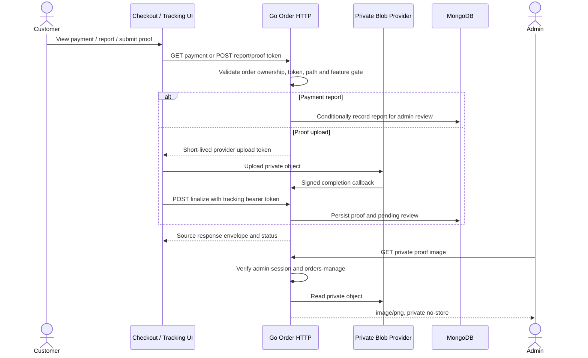

# Go Order Payment and Proof APIs - Interface Agreement

> **Document Type:** IFA / API Contract  
> **Status:** Source-mapped draft; no gateway settlement contract  
> **Service / Domain:** Go Order and Manual Payment  
> **Consumer / Partner:** JokiHub customer client, admin client, and configured blob provider

## Design

This IFA maps ten source-registered routes across checkout, payment reporting/status, tracking, proof upload/finalization, and admin proof image. Source behavior is authoritative for current Go. Adjacent checkout/proof IFAs are target proposals; route match does not establish body, storage, or settlement parity. `FEATURE_SPRINT_2` gates proof routes and changes payment reporting behavior. QRIS/BCA configuration provides instructions only; no payment gateway verifies funds.

## Sequence Diagram



## Performance / SLA Targets

| Success Rate                                      | VUser                                  | CPU / Memory                     | Response Time                                         |
| ------------------------------------------------- | -------------------------------------- | -------------------------------- | ----------------------------------------------------- |
| TBD; payment criticality target requires approval | TBD; checkout peak concurrency unknown | TBD; load/capacity test required | TBD; provider upload and DB commit targets unmeasured |

## General Information

| Component          | Value                                                                                                              |
| ------------------ | ------------------------------------------------------------------------------------------------------------------ |
| Description        | Manual payment details, report-paid actions, proof upload/finalization and private image retrieval                 |
| Resource URL       | `https://{host}/api/orders/v1/...` or `/api/admin/orders/v1/...`                                                   |
| Transport Protocol | HTTPS REST; provider callback protocol for blob events                                                             |
| Request Verb       | GET or POST per endpoint table                                                                                     |
| Content Type       | JSON except image response; upload route accepts provider JSON events                                              |
| Interaction Type   | Synchronous; object upload occurs directly between client and blob provider                                        |
| Security Policy    | Order-scoped bearer token, signed callback, admin permission `orders-manage`, rate limit, private/no-store storage |

### Path / Endpoint

| Section        | Value                                      |
| -------------- | ------------------------------------------ |
| Host / Domain  | `{host}`                                   |
| Service Name   | Order and Payment                          |
| Version        | `v1`                                       |
| Resource       | Exact routes in endpoint matrix            |
| Final Endpoint | Exact methods and paths in endpoint matrix |

### API Versioning

- Decision: Existing v1 implementation; source-aligned route mapping.
- Backward Compatibility: Keep exact registered method/path and token flow. Existing proposed `/proof-upload` route differs from Go `/proofs/upload`; do not alias silently.

## Business Rules

1. `report-paid` and tracking payment POST submit a claim for manual validation; they do not mark payment settled.
2. Payment read/report requires order ownership proof: payment ID plus order number/WhatsApp, or order-scoped tracking bearer token.
3. Upload endpoint is a provider token/callback endpoint, not multipart file upload. Callback requires valid `x-vercel-signature`.
4. Proof finalize accepts only `orderNumber` and `pathname`, validates object path against payment ID, tracking token, storage configuration, and feature gate.
5. New proof returns HTTP 201; idempotent finalize replay returns HTTP 200. Proof image requires admin `orders-manage`, returns private PNG bytes, and discloses no object key.
6. Only authorized admin payment approval marks payment paid. Report, token issuance, provider callback, and proof finalize are not payment evidence.
7. Current Go response envelope is `{code,message,data?}`; errors set `data:null`. The nested `status` envelope is a target proposal only, not current wire behavior.

## Request Headers

| Header               | Type   | M/O/C |       Max Length | Description                                                                             | Example                |
| -------------------- | ------ | ----- | ---------------: | --------------------------------------------------------------------------------------- | ---------------------- |
| Authorization        | String | C     | No handler limit | Tracking token format `trk_` plus 43 URL-safe chars; admin token/cookie for proof image | `Bearer trk_{opaque}`  |
| Content-Type         | String | C     |                - | `application/json` for JSON bodies/provider events                                      | `application/json`     |
| `x-vercel-signature` | String | C     | No handler limit | Required and HMAC-verified for `blob.upload-completed`; configured blob token required  | `{provider-signature}` |

## Request Parameters

| Parameter     | Type   | M/O/C |     Max Length | Description                                               | Example                    |
| ------------- | ------ | ----- | -------------: | --------------------------------------------------------- | -------------------------- |
| `paymentId`   | String | M     |   24 hex chars | Mongo ObjectID path parameter                             | `507f1f77bcf86cd799439011` |
| `orderNumber` | String | M     |             18 | `JH-YYYYMMDD-XXXXXX` path/query/body value                | `JH-20261023-ABC123`       |
| `view`        | String | O     |              6 | Status view supports only `result`                        | `result`                   |
| `proofId`     | String | M     | Source-defined | Proof lookup path; exact ID validation is service-defined | `proof-identifier`         |

## Request Body

| Attribute               | Type    | M/O/C |       Max Length | Description                                                                              | Example                                                           |
| ----------------------- | ------- | ----- | ---------------: | ---------------------------------------------------------------------------------------- | ----------------------------------------------------------------- |
| `orderNumber`           | String  | M     |               18 | Payment report order number                                                              | `JH-20261023-ABC123`                                              |
| `whatsapp`              | String  | M     |               32 | Payment verification contact; accepted formats normalized by handler                     | `081234567890`                                                    |
| `orderNumber`           | String  | M     |               18 | Proof finalize order number                                                              | `JH-20261023-ABC123`                                              |
| `pathname`              | String  | M     |               81 | Pattern `(?i)^payment-proofs/{paymentId}/[a-f0-9-]{36}\.(jpg                             | jpeg                                                              | png)$`; longest permitted extension `.jpeg` | `payment-proofs/{paymentId}/01234567-89ab-cdef-0123-456789abcdef.png` |
| `type`                  | String  | M     |                - | Provider event type `blob.generate-client-token` or `blob.upload-completed`              | `blob.generate-client-token`                                      |
| `payload.pathname`      | String  | C     |               81 | Required on token-generation event; must match payment ID path pattern                   | `payment-proofs/{paymentId}/{uuid}.png`                           |
| `payload.clientPayload` | String  | C     | No handler limit | Token-generation event parses JSON containing `orderNumber` and nonempty `trackingToken` | `{"orderNumber":"JH-20261023-ABC123","trackingToken":"{opaque}"}` |
| `payload.multipart`     | Boolean | O     |                - | Decoded by handler but not used to authorize/configure upload                            | `false`                                                           |

### Example Request Body

```json
{ "orderNumber": "JH-20261023-ABC123", "pathname": "proofs/507f1f77bcf86cd799439011/image.png" }
```

### Request Validation

1. Payment path ID must parse as Mongo ObjectID; order number must match `^JH-\d{8}-[A-F0-9]{6}$`.
2. Report-paid body requires `orderNumber` and `whatsapp`; phone length 8–32 and normalized contact must match order. Unknown JSON keys are rejected by shared decoder.
3. Tracking payment GET/POST requires valid tracking bearer token scoped to path order number. POST has no request body.
4. Payment status permits only `orderNumber` and `whatsapp` query keys; both required and validated. Unknown query keys return 400.
5. Provider upload event must be recognized. Callback signature is HMAC-verified over raw body; decoded callback payload is not otherwise used. Token-generation event requires valid JSON `clientPayload` with order number/tracking token and payment-owned `pathname`. `multipart` is parsed but has no effect.
6. Proof finalize body must contain exactly `orderNumber` and `pathname`; proof storage must be configured, and `FEATURE_SPRINT_2=true`. Provider token allows JPEG/PNG, max 5 MiB, and expires within five minutes.

## Response Body

Current Go envelope is `{code,message,data?}` for JSON. Payment details/status and report data structures are service-defined; see Go handler/service. Upload-token response is provider-specific raw JSON. Proof image response is binary `image/png`.

| Attribute                                 | Type         | M/O/C |       Max Length | Description                                                                                | Example                               |
| ----------------------------------------- | ------------ | ----- | ---------------: | ------------------------------------------------------------------------------------------ | ------------------------------------- |
| `code`                                    | String       | M     |               10 | Current Go service code                                                                    | `ORDS00000`                           |
| `message`                                 | String       | M     |              200 | Current Go message                                                                         | `Detail pembayaran berhasil diambil.` |
| `data`                                    | Object/null  | M     |                - | Per-route payload below; errors set null                                                   | `{}`                                  |
| `data.order.orderNumber`                  | String       | C     |               18 | Public order number in tracking payment response                                           | `JH-20261023-ABC123`                  |
| `data.order.orderStatus`                  | String       | C     |   Source-defined | Current order state in tracking payment response                                           | `PENDING_PAYMENT`                     |
| `data.order.paymentStatus`                | String       | C     |   Source-defined | Current payment state in tracking payment response/status response                         | `UNPAID`                              |
| `data.order.totalAmount`                  | Number       | C     |   Source-defined | Decimal total in tracking payment response                                                 | `25000`                               |
| `data.order.expiresAt`                    | String       | C     |          RFC3339 | Order expiry timestamp                                                                     | `2026-10-23T10:00:00Z`                |
| `data.order.game`                         | String       | C     |   Source-defined | Game name snapshot                                                                         | `Roblox`                              |
| `data.order.service`                      | String       | C     |   Source-defined | Service name snapshot                                                                      | `Robux 400`                           |
| `data.order.quantity`                     | Integer      | C     |   Source-defined | Ordered quantity                                                                           | `1`                                   |
| `data.payment.id`                         | String       | C     |     24 hex chars | Payment ObjectID                                                                           | `507f1f77bcf86cd799439011`            |
| `data.payment.method`                     | String       | C     |   Source-defined | `QRIS` or `BCA_TRANSFER`                                                                   | `QRIS`                                |
| `data.payment.amount`                     | Number       | C     |   Source-defined | Decimal payment amount                                                                     | `25000`                               |
| `data.payment.instructions.qrImageUrl`    | String/null  | C     |   Source-defined | Configured QR image URL, may be null                                                       | `https://pay.example/qris.png`        |
| `data.payment.instructions.bankName`      | String/null  | C     |   Source-defined | Configured bank label, may be null                                                         | `BCA`                                 |
| `data.payment.instructions.accountNumber` | String/null  | C     |   Source-defined | Configured transfer account, may be null                                                   | `1234567890`                          |
| `data.payment.instructions.accountHolder` | String/null  | C     |   Source-defined | Configured account holder, may be null                                                     | `JokiHub`                             |
| `data.payment.instructions.reference`     | String/null  | C     |   Source-defined | Payment reference note                                                                     | `JH-20261023-ABC123`                  |
| `data.paymentStatus`                      | String       | C     |   Source-defined | Current payment status in payment-status response                                          | `UNPAID`                              |
| `data.reviewNote`                         | String/null  | C     |   Source-defined | Current review note in payment-status response                                             | `null`                                |
| `data.expiresAt`                          | String       | C     |          RFC3339 | Payment/order expiry in payment-status response                                            | `2026-10-23T10:00:00Z`                |
| `data.retryAllowed`                       | Boolean      | C     |   Source-defined | Retry indicator in payment-status response                                                 | `true`                                |
| `data.paymentStatus`                      | String       | C     |   Source-defined | Payment report response; `PENDING_REVIEW` for new report; existing pending can be replayed | `PENDING_REVIEW`                      |
| `data.type`                               | String       | C     |                - | Upload token response type                                                                 | `blob.generate-client-token`          |
| `data.clientToken`                        | String       | C     | Provider-defined | Provider signed client upload token                                                        | `{opaque-provider-token}`             |
| `data.id`                                 | String       | C     |     24 hex chars | New proof finalize ID; omitted on idempotent replay                                        | `507f1f77bcf86cd799439011`            |
| `data.status`                             | String       | C     |                - | Proof finalize state                                                                       | `PENDING_REVIEW`                      |
| `data.idempotentReplay`                   | Not returned | -     |                - | Finalize controller removes internal replay marker before HTTP serialization               | -                                     |

### Current per-operation error mapping

| Operation                    | Current handler/service codes and statuses                                                                                                                                                                                                                                      |
| ---------------------------- | ------------------------------------------------------------------------------------------------------------------------------------------------------------------------------------------------------------------------------------------------------------------------------- |
| Report paid                  | `ORDB02001` 400 invalid payment ID/body; `ORDB02002` 404 order/payment not verified; `ORDB02004` 409 expired/nonreportable/concurrent state; `ORDT03001` 500 persistence failure; rate-limit response 429                                                                       |
| Tracking payment read/report | `ORDB02001` 400 malformed order number; `ORDB02002` 401/404 authorization or ownership failure; `ORDB02004` 409 state restriction; `ORDB02004` 503 payment instructions missing; `ORDT03001` 500 service failure; rate limit 429                                                |
| Payment status               | `ORDB02001` 400 invalid ID/query; `ORDB02002` 404 ownership/order/payment not verified; `ORDT03001` 500 service failure; rate limit 429                                                                                                                                         |
| Upload token/callback        | `ORDT04004` 404 feature disabled; `ORDB02001` 400 invalid ID/event/body; `ORDB02002` 400/401 invalid payload/tracking/order scope; `ORDB02003` 400 invalid path; `ORDT03001` 400 invalid callback signature; `ORDT04001` 503 storage unavailable; rate limit 429                |
| Finalize                     | `ORDT04004` 404 disabled; `ORDB02001` 400 invalid ID/body; `ORDB02002` 401 missing token or 404 order mismatch/expiry; `ORDB02003` 400 invalid proof selection; `ORDB02004` 409 payment state/concurrency; `ORDT03001` 500 persistence; `ORDT04001` 503 storage; rate limit 429 |
| Private proof image          | `ORDT04004` 404 disabled; `ORDB01001` 401; `ORDB01002` 403; `ORDB02001` 400 invalid proof ID; `ORDB02002` 404 proof/object absent; `ORDT03001` 500; `ORDT04001` 503 storage                                                                                                     |

### Success Example

```json
{
  "code": "ORDS00000",
  "message": "Detail pembayaran berhasil diambil.",
  "data": {
    "order": { "orderNumber": "JH-20261023-ABC123", "paymentStatus": "UNPAID" },
    "payment": { "method": "QRIS", "instructions": { "qrImageUrl": "https://{configured-host}/qris.png" } }
  }
}
```

### Business Error Example

```json
{ "code": "ORDB02002", "message": "Pesanan tidak dapat diverifikasi.", "data": null }
```

### Technical Error Example

```json
{ "code": "ORDT04001", "message": "Penyimpanan bukti pembayaran belum dikonfigurasi.", "data": null }
```

Target template envelope (not current Go wire): `{"status":{"code":"ORDS00000","message":"..."},"data":{}}`.

## HTTP Status Codes

| HTTP Status | Usage                                                                            |
| ----------- | -------------------------------------------------------------------------------- |
| 200         | Successful reads/report; proof finalize replay; provider callback/token exchange |
| 201         | New proof finalize                                                               |
| 400         | Invalid IDs, query/body, order scope or provider callback                        |
| 401         | Missing/invalid tracking or admin credentials where handler returns 401          |
| 403         | Admin proof-image permission denied                                              |
| 404         | `FEATURE_SPRINT_2` disabled                                                      |
| 429         | Rate limit                                                                       |
| 500         | Internal processing failure                                                      |
| 503         | Proof storage or payment-instruction dependency unavailable                      |

## Service Status Codes

| Code        | Type      | Category | Meaning                                      |
| ----------- | --------- | -------- | -------------------------------------------- |
| `ORDS00000` | Success   | 00       | Operation accepted/successful                |
| `ORDB02001` | Business  | 02       | Malformed ID/body/order number               |
| `ORDB02002` | Business  | 02       | Tracking ownership/token verification failed |
| `ORDB02003` | Business  | 02       | Invalid proof file/path selection            |
| `ORDB01001` | Business  | 01       | Admin session unavailable                    |
| `ORDB01002` | Business  | 01       | Admin permission denied                      |
| `ORDT03001` | Technical | 03       | Order/database failure                       |
| `ORDT04001` | Technical | 04       | Object storage unavailable                   |
| `ORDT04004` | Technical | 04       | Feature disabled                             |

## API Exposure Classification

| Classification | Rationale                                                                                       |
| -------------- | ----------------------------------------------------------------------------------------------- |
| Public         | Customer payment/tracking APIs are internet-facing; admin proof-image route is admin-protected. |

## Testing & Documentation Scope

| Scope      | Required | Rationale / Handoff                                                                                                                                |
| ---------- | -------- | -------------------------------------------------------------------------------------------------------------------------------------------------- |
| NFT        | Yes      | Customer transactional flow and object storage; targets VUser, CPU/memory, TPS TBD from checkout forecast and provider capacity.                   |
| VA/Pentest | Yes      | Public IDOR/token/callback surface and admin private proof access; verify signatures, ownership, expiry, replay, authorization, and cache headers. |

## References

- `QUESTION.md`
- `../public/checkout/QUESTION.md`
- `../public/orders/QUESTION.md`
- `./implementation-alignment.md`
- `../checkout-payment-implementation.md`
- `../../../../go-game-service-platform/internal/controller/http/order_http.go`
- `../../../../go-game-service-platform/internal/controller/http/payment_proof_http.go`

## Route-by-route current Go contract (source parity)

Evidence: `go-game-service-platform/internal/controller/http/order_http.go`, `payment_proof_http.go`, `internal/controller/order.go`, `internal/view`, and associated controller HTTP tests. Go JSON responses are `{code,message,data}` (not nested `status`); errors generally set `data:null`. No route below accepts a general idempotency key except checkout. Rate limits are shared middleware: checkout 40/IP + 10/IP/WhatsApp per 15 min; payment-status/report-paid 240/IP + 120/IP/payment/order/contact per hour; order-tracking 50/IP + 10/IP/token-or-order-contact per hour; proof 12/IP + 4/IP/payment per hour. Exact values come from `rateLimitConfig` in `auth_http.go`.

| Method/path                                              | Inputs and validation                                                                                                                                                                                                                                                                                                                                                                                                                                                                                | Current effects / success                                                                                                                                                                                                                                                                                                                                                                                                                                                                            | Current errors and caveats                                                                                                                                                                                                                                                      |
| -------------------------------------------------------- | ---------------------------------------------------------------------------------------------------------------------------------------------------------------------------------------------------------------------------------------------------------------------------------------------------------------------------------------------------------------------------------------------------------------------------------------------------------------------------------------------------- | ---------------------------------------------------------------------------------------------------------------------------------------------------------------------------------------------------------------------------------------------------------------------------------------------------------------------------------------------------------------------------------------------------------------------------------------------------------------------------------------------------- | ------------------------------------------------------------------------------------------------------------------------------------------------------------------------------------------------------------------------------------------------------------------------------- |
| `POST /api/orders/v1/checkout`                           | Requires `Idempotency-Key` regex `^[A-Za-z0-9._:-]{8,200}$`; JSON allowlist `gameSlug,serviceId,quantity,paymentMethod,customer,item`; nested customer `{name,whatsapp}`, item `{gameAccount,gameServer?,customerNotes?}`. Slug lowercase slug format; service ID 1–64 and Mongo ObjectID; quantity 1–100; method QRIS/BCA_TRANSFER; name nonempty <=150; phone normalized to E.164; gameAccount nonempty <=100 and rejects password/pass/OTP/token/credential; optional server <=100, notes <=1000. | Creates order/payment from server catalog/config, idempotency record, tracking token (hash stored; 15m TTL). New success HTTP 201, replay HTTP 200; `ORDS00000`; result fields: `order:{id,orderNumber,orderStatus,paymentStatus,totalAmount,currency,expiresAt,game:{name},service:{id,name},quantity}`, `payment:{id,method,status,amount,instructions:{qrImageUrl,bankName,accountNumber,accountHolder,reference}}`, `trackingToken`, `trackingTokenExpiresAt`, `nextAction`, `idempotentReplay`. | 400 `ORDB02001`; 400 `ORDB02002` game unavailable; 400 `ORDB02003` service/custom price unavailable; 409 `ORDB02005` key mismatch/in-progress; 503 `ORDT03001` settings/method unavailable; 500 `ORDT03001` price/persistence failure; 429 limiter. No authentication required. |
| `POST /api/orders/v1/payments/{paymentId}/report-paid`   | Path ObjectID; JSON `{orderNumber,whatsapp}`; order number `JH-YYYYMMDD-XXXXXX`; phone length 8–32, normalized before matching.                                                                                                                                                                                                                                                                                                                                                                      | Public claim that payment was made; changes payment to PENDING_REVIEW and order to PENDING_VALIDATION, records histories; HTTP 200 `ORDS00000`, `data.paymentStatus`. `FEATURE_SPRINT_2=true` changes behavior to require a proof already uploaded.                                                                                                                                                                                                                                                  | 400 `ORDB02001`; ownership/verification `ORDB02002`; invalid state/feature requirement `ORDB02004` (409); `ORDT03001`; 429. Report is not settlement.                                                                                                                           |
| `POST /api/orders/v1/tracking/lookup`                    | Body `{orderNumber,whatsapp}`; body max 4096; exact JSON fields; uppercase/trim order number; phone syntax/normalization validated.                                                                                                                                                                                                                                                                                                                                                                  | Verifies contact, issues hashed order-scoped token (`trk_` + 32 random bytes; 15m), returns same DTO as status plus token fields; HTTP 200 `ORDS00000`; no-store/no-cache. Not idempotent: successful lookup mints fresh token.                                                                                                                                                                                                                                                                      | 400 `ORDB02001` malformed, 400 `ORDB02002` mismatch, 500 `ORDT03001`, 429.                                                                                                                                                                                                      |
| `GET /api/orders/v1/tracking/{orderNumber}/status`       | Path order number uppercased. `Authorization: Bearer trk_...` required; only optional query is `view=result`. Any other/additional query -> 400.                                                                                                                                                                                                                                                                                                                                                     | Verifies token hash/scope/expiry, reads order/payment history, returns public order, max 50 combined timeline entries, `dataAsOf`; HTTP 200 `ORDS00000`. `view=result` returns same DTO and only allowed at payment PENDING_REVIEW or PAID.                                                                                                                                                                                                                                                          | Missing/invalid/mismatch token is HTTP 400 `ORDB02002`; pre-report result is 409 `ORDB02004`; repo failure 500 `ORDT03001`; 429. no-store/no-cache.                                                                                                                             |
| `GET /api/orders/v1/tracking/{orderNumber}/payment`      | Path order number format; tracking bearer token required; no query/body validation.                                                                                                                                                                                                                                                                                                                                                                                                                  | Returns `data.order:{orderNumber,orderStatus,paymentStatus,totalAmount,expiresAt,game,service,quantity}` and `data.payment:{id,method,amount,instructions:{qrImageUrl,bankName,accountNumber,accountHolder,reference}}`; 200 `ORDS00000`.                                                                                                                                                                                                                                                            | Bad order number 400 `ORDB02001`; token/order scope 401/404 using `ORDB02002`; missing payment config 503 `ORDB02004`; repo 500 `ORDT03001`; 429.                                                                                                                               |
| `POST /api/orders/v1/tracking/{orderNumber}/payment`     | Path number format and tracking bearer token; no body used.                                                                                                                                                                                                                                                                                                                                                                                                                                          | Uses stored order WhatsApp and invokes same report flow; 200 `ORDS00000`, `data.paymentStatus`.                                                                                                                                                                                                                                                                                                                                                                                                      | Same report state errors plus token scope; 429.                                                                                                                                                                                                                                 |
| `GET /api/orders/v1/payments/{paymentId}/status`         | ObjectID path; only query keys `orderNumber`,`whatsapp`, both required; order number format; phone length 8–32.                                                                                                                                                                                                                                                                                                                                                                                      | Verifies order/payment/contact and returns `{paymentStatus,reviewNote,expiresAt,retryAllowed}`; note is non-null only while UNPAID; retry true only UNPAID and unexpired; HTTP 200 `ORDS00000`.                                                                                                                                                                                                                                                                                                      | 400 `ORDB02001` invalid input; 404 `ORDB02002` not verified; 500 `ORDT03001`; 429.                                                                                                                                                                                              |
| `POST /api/orders/v1/payments/{paymentId}/proofs/upload` | Feature gate `FEATURE_SPRINT_2`; valid payment ObjectID; provider JSON event. Generate event requires `type=blob.generate-client-token`, payload pathname and clientPayload JSON `{orderNumber,trackingToken}`; path binds payment ID; callback event requires `x-vercel-signature`.                                                                                                                                                                                                                 | Generate event issues provider JSON `{type,clientToken}` with max 5m expiry; callback returns raw `{type:"blob.upload-completed",response:"ok"}`. No proof record until finalize.                                                                                                                                                                                                                                                                                                                    | Feature off 404 `ORDT04004`; invalid event/body/path/signature 400 codes `ORDB02001/2/3`, callback signature `ORDT03001`; storage 503 `ORDT04001`; 429.                                                                                                                         |
| `POST /api/orders/v1/payments/{paymentId}/proofs`        | Feature gate; valid ObjectID; tracking bearer required; exact JSON `{orderNumber,pathname}`; pathname `payment-proofs/{paymentId}/{36-char UUID}.{jpg                                                                                                                                                                                                                                                                                                                                                | jpeg                                                                                                                                                                                                                                                                                                                                                                                                                                                                                                 | png}`; max bytes 5 MiB; image dimensions <=20M pixels; actual decode required.                                                                                                                                                                                                  | Reads private uploaded object, normalizes image to PNG, creates private object/proof record, deletes temporary object. 201 new or 200 replay, `ORDS00000`; data `{id,status:"PENDING_REVIEW"}` for new; replay only `{status:"PENDING_REVIEW"}` (no ID). | 404 `ORDT04004`; 400 `ORDB02001/3`; missing token 401 `ORDB02002`; mismatch/expiry 404 `ORDB02002`; wrong payment state/concurrency 409 `ORDB02002/4`; storage 503 `ORDT04001`; persistence 500 `ORDT03001`; 429. Duplicate finalize with pending proof is replay and deletes newly uploaded pathname. |
| `GET /api/admin/orders/v1/proofs/{proofId}/image`        | Feature gate; admin access token from Bearer or admin cookie; `orders-manage` permission; proof ID parsed as Mongo ObjectID.                                                                                                                                                                                                                                                                                                                                                                         | Reads private object and writes raw PNG bytes, `Content-Type:image/png`, inline filename, private/no-store, nosniff and CSP headers; HTTP 200.                                                                                                                                                                                                                                                                                                                                                       | Feature off 404 `ORDT04004`; unauthenticated 401 `ORDB01001`; unauthorized 403 `ORDB01002`; invalid ID 400 `ORDB02001`; missing proof/object 404 `ORDB02002`; storage 503 `ORDT04001`; repo/object error can be 500 `ORDT03001`.                                                |

### Evidence-scoped unknowns

- Upload provider token response fields beyond `{type,clientToken}` are provider-defined; no stable provider schema is sourced in Go. Multipart flag is parsed but unused. Callback response is raw provider JSON and is intentionally outside Go envelope.
- Payment instruction config values come from environment and are intentionally represented with safe placeholders; QRIS URL and BCA account values must not be copied from runtime configuration into docs.
- Rate limiter cannot enforce without configured store and valid `JWT_SECRET`; these cases return service unavailable. Rate limiter behavior is evidenced by `enforceRateLimit` / `rateLimitConfig`, not per-route unit tests for every registration.
- Test evidence is limited: `internal/controller/order_test.go` covers decimal conversion, phone normalization/labels, and proof-read error classification. `internal/controller/http` contains no `order_http_test.go` or `payment_proof_http_test.go`; therefore handler-level method/status/body and route registration claims above are source-derived, not test-verified.
- Existing route-specific IFAs contain proposed contract content; this section records current behavior. Any move to nested `status` envelope, alternate paths, or different HTTP semantics is a target-breaking decision requiring consumer alignment.
